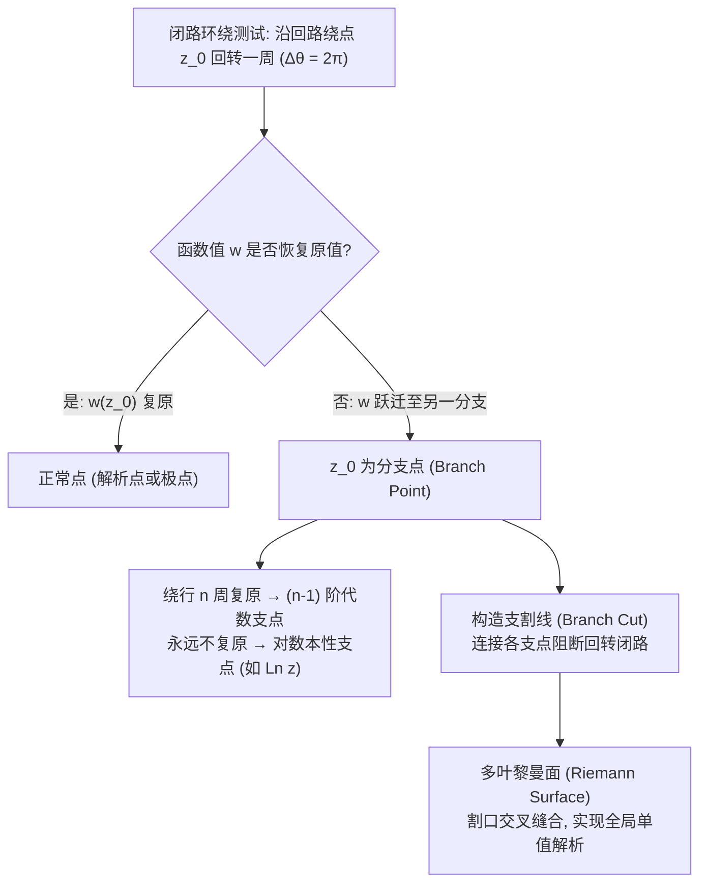

---
tags:
  - 物理/数学物理方法
  - 复变函数
  - 概念卡
  - 多值函数
  - 支点与支割线
  - 黎曼面
aliases:
  - 复数代数几何表述与多值函数支点割线
  - 复数代数几何表述
  - 多值函数
  - 支点与支割线
  - 黎曼面
  - Complex Numbers and Branch Cuts
  - Branch Points and Riemann Surfaces
created: 2026-09-07
updated: 2026-09-08
---

> [!summary] 核心认知先验
> 复数不仅是实数域的代数闭包，更是二维平面的几何矢量与保角变换的代数载体。实微积分迈向复微积分的第一个根本认知门槛，在于多值函数（非整数幂根式 $z^\alpha$ 与对数 $\operatorname{Ln} z$）所引发的“相位缠绕”与“支点、支割线”结构。实数多值函数的分支彼此完全孤立独立，而复多值函数的分支却通过围绕**分支点（Branch Point）**的闭路回路紧密相连；为了恢复单值全纯性，必须在复平面剪开**支割线（Branch Cut）**或构建多层**黎曼面（Riemann Surface）**。这是理解后续围道积分、匙孔积分与留数定理的绝对基石。

---

## 一、推导机理与核心数学定义

### 1.1 复数的三重数学表述与物理几何意义

设复数 $z = x + iy$（$x, y \in \mathbb{R}$，$i^2 = -1$），在现代数学物理中有三种等价表述：

$$\boxed{\begin{aligned}
\text{代数式 (Cartesian):} \quad & z = x + iy, \quad x = \operatorname{Re} z, \; y = \operatorname{Im} z \\
\text{三角式 (Trigonometric):} \quad & z = \rho (\cos \varphi + i \sin \varphi) \\
\text{指数式 (Euler Exponential):} \quad & z = \rho e^{i\varphi} = |z| e^{i \operatorname{Arg} z}
\end{aligned}}$$

1. **几何矢量对应**：平面直角坐标点 $(x, y)$ 与位置矢量 $\mathbf{r} = (x, y)$。复数加减法严格对应平移向量加减法则；
2. **极坐标转换**：
   $$\rho = |z| = \sqrt{x^2 + y^2}, \quad \varphi = \operatorname{Arg} z = \arg z + 2k\pi \quad (k \in \mathbb{Z})$$
   其中主值区间通常约定为 $\arg z \in (-\pi, \pi]$（物理常用）或 $\arg z \in [0, 2\pi)$（梁昆淼教材约定）；
3. **复乘除法的几何内涵**：
   $$z_1 z_2 = \rho_1 \rho_2 e^{i(\varphi_1 + \varphi_2)}, \quad \frac{z_1}{z_2} = \frac{\rho_1}{\rho_2} e^{i(\varphi_1 - \varphi_2)}$$
   模长相乘除，辐角相加减。乘以 $e^{i\alpha}$ 对应于复平面上的**纯逆时针旋转角 $\alpha$**。

---

### 1.2 根式与复对数的多值性机制

#### (1) 复对数函数 $\operatorname{Ln} z$
复对数定义为指数映射的逆：$w = \operatorname{Ln} z \iff e^w = z$。
设 $w = u + iv$，则 $e^{u+iv} = e^u e^{iv} = \rho e^{i\varphi}$。由欧拉公式及周期性比较实部与虚部：
$$e^u = \rho = |z| \implies u = \ln |z|$$
$$v = \varphi = \operatorname{Arg} z = \arg z + 2k\pi \quad (k \in \mathbb{Z})$$

$$\boxed{\operatorname{Ln} z = \ln |z| + i \operatorname{Arg} z = \ln |z| + i(\arg z + 2k\pi), \quad k = 0, \pm 1, \pm 2, \dots}$$

- 当 $k=0$ 时，称为复对数函数的**主值支 (Principal Branch)**，记作 $\ln z = \ln |z| + i \arg z$；
- 复对数函数拥有无穷多个离散的单值解析分支，各分支在虚轴方向以 $2\pi i$ 为步长均匀平移。

#### (2) 方根函数 $w = \sqrt[n]{z}$
设 $w = r e^{i\theta}$，$z = \rho e^{i\varphi}$，则由 $w^n = z \implies r^n e^{in\theta} = \rho e^{i\varphi}$：
$$r = \sqrt[n]{\rho}, \quad \theta = \frac{\varphi}{n} = \frac{\arg z + 2k\pi}{n} \quad (k = 0, 1, \dots, n-1)$$

$$\boxed{w_k = \sqrt[n]{|z|} \exp\left(i \frac{\arg z + 2k\pi}{n}\right), \quad k = 0, 1, \dots, n-1}$$

每个非零复数 $z$ 恰好拥有 $n$ 个互异的 $n$ 次复根，均匀分布于以原点为中心、半径为 $\sqrt[n]{|z|}$ 的正 $n$ 边形顶点上。

---

### 1.3 支点、支割线与黎曼面拓扑机制

#### (1) 分支点 (Branch Point) 的严格判据
对于多值函数 $w = f(z)$，设自变量 $z$ 从 $z_0$ 出发，沿任意包含点 $a$ 的闭合连续曲线 $C$ 回转一周回到 $z_0$：
- 若宗量辐角改变 $\Delta \operatorname{Arg}(z - a) = 2\pi$，而函数值 $w$ **无法恢复为初始值**，而是跃迁到另一个单值分支，则称 $a$ 为多值函数 $f(z)$ 的**分支点（支点）**。
- **阶数判据**：若绕 $a$ 回转 $n$ 周（$\Delta \theta = 2n\pi$）后函数值首次完全恢复，则称 $a$ 为 **$n-1$ 阶代数支点**；若绕行任意有限周数均无法复原（如 $\operatorname{Ln} z$），则称 $a$ 为**无穷阶（对数型）支点**。
- **无穷远点的支点检验**：作变量代换 $z = 1/t$，检验 $t = 0$ 是否为 $g(t) = f(1/t)$ 的支点。对于 $w = \sqrt{z}$，$g(t) = t^{-1/2}$，绕 $t=0$ 一周产生相差 $e^{-i\pi} = -1$，故 $z = \infty$ 亦为一阶支点。

#### (2) 支割线 (Branch Cut)
为了在单连通区域内将多值函数隔离出确定的单值解析分支，必须在复平面上连接所有分支点引出一条几何截线，禁止任何回转路径跨越该线。
- **割线上缘与下缘的相位跃变**：以 $w = \sqrt{z}$ 沿正实轴 $[0, +\infty)$ 割开为例：
  - 割线上缘（靠近第一象限）：$\operatorname{Arg} z = 0 \implies w_1 = +\sqrt{x}$；
  - 割线下缘（靠近第四象限）：$\operatorname{Arg} z = 2\pi \implies w_1 = \sqrt{x} e^{i\pi} = -\sqrt{x}$。
  - 跨越支割线会导致函数值产生符号反转突变，这正是后续“匙孔积分法”能够提取积分核的物理根源！

#### (3) 黎曼面 (Riemann Surface) 物理模型
梁书指出：将 $n$ 个各具支割线的复平面（叶片 $T_1, T_2, \dots, T_n$）叠放在一起，将第 1 叶割线下缘与第 2 叶割线上缘粘合……第 $n$ 叶下缘与第 1 叶上缘交叉粘合。自变量在黎曼面上连续游走即可无缝实现全纯延拓，消除多值矛盾。

---

## 二、⚠️ 致命失分陷阱与临界边界

> [!warning] 陷阱 1：盲目套用实数对数运算法则 $\operatorname{Ln}(z_1 z_2) = \operatorname{Ln} z_1 + \operatorname{Ln} z_2$
> 复数域中，该式**仅作为分支集合等式成立**。对主值分支 $\ln(z_1 z_2) = \ln z_1 + \ln z_2$ **极易出错**！
> **数值反例**：取 $z_1 = z_2 = -1 + i\sqrt{3}$。
> $|z_1| = 2, \arg z_1 = \frac{2\pi}{3}$，故 $\ln z_1 + \ln z_2 = 2\ln 2 + i\frac{4\pi}{3}$。
> 但乘积 $z_1 z_2 = (-1 + i\sqrt{3})^2 = -2 - 2i\sqrt{3}$，其主值辐角属于 $(-\pi, \pi]$，应为 $\arg(z_1 z_2) = -\frac{2\pi}{3}$。
> 因此 $\ln(z_1 z_2) = \ln 4 - i\frac{2\pi}{3} \ne \ln z_1 + \ln z_2$（相差 $2\pi i$）！

> [!caution] 陷阱 2：误认为乘积形式的多支点函数，两支点连线外依然存在割线效应
> 考虑双支点函数 $w = \sqrt{z^2 - 1} = \sqrt{z-1}\sqrt{z+1}$，其支点为 $z = 1$ 和 $z = -1$。
> 若取有限线段 $[-1, 1]$ 作为支割线：
> 设路径绕**整个线段 $[-1, 1]$** 回转一周（同时包围两支点）：
> $\Delta \operatorname{Arg}(z-1) = 2\pi, \Delta \operatorname{Arg}(z+1) = 2\pi$。
> 总辐角增量 $\Delta \operatorname{Arg} w = \frac{1}{2}(2\pi + 2\pi) = 2\pi \equiv 0 \pmod{2\pi}$。
> 函数值恢复原值！因此在 $[-1, 1]$ 割线之外的复平面上，$w$ 是**单值解析**的；**$z = \infty$ 不是该函数的支点**！若错误地从两支点分别拉出两条无界割线，将人为割裂原本全纯的区域。

> [!danger] 陷阱 3：在开根式计算中忽视上缘与下缘极限制约
> 在沿正实轴割开的多值积分中，将割线下岸写为 $x \in (+\infty, 0)$ 时，若忘记代入下岸的相位因子 $e^{i 2\pi \alpha}$，将直接导致上下岸积分错误对消为零，彻底丢失物理响应。

---

## 三、经典范例手把手演算与反代验算

### 3.1 经典例题：双支点根式函数的支割线与单值解析分支确定
**题目（梁书第 1 章习题衍生经典题）**：
分析函数 $w = \sqrt{z^2 - 1}$ 的支点与在割开平面上的单值解析分支，选取割线为实轴上线段 $[-1, 1]$，并确定满足条件 $w(2) = \sqrt{3}$ 的单值分支在割线上缘点 $z = i0^+$ 处的函数值。

#### 第一步：支点检验与割线选取
令 $z^2 - 1 = 0 \implies z_1 = 1, z_2 = -1$。
- 考察绕 $z=1$ 一周：$\Delta \operatorname{Arg}(z-1) = 2\pi, \Delta \operatorname{Arg}(z+1) = 0 \implies \Delta \operatorname{Arg} w = \pi$（变号），故 $z=1$ 为一阶支点；
- 同理 $z=-1$ 为一阶支点；
- 考察绕无穷大一周：令 $z = 1/t$，
  $$w = \sqrt{\frac{1}{t^2} - 1} = \frac{1}{t}\sqrt{1 - t^2}$$
  当 $t \to 0$ 时，$\sqrt{1-t^2}$ 在 $t=0$ 处解析，$1/t$ 为一阶极点。绕 $t=0$ 一周辐角不出现分数倍跳变，故 **$z = \infty$ 是正常点（一阶极点），不是支点**！
- 结论：只需连接两个有限支点，取线段 $[-1, 1]$ 作为支割线，割开平面 $\mathbb{C} \setminus [-1, 1]$ 即为单值解析区域。

#### 第二步：引入双极坐标表示
令 $z - 1 = r_1 e^{i\theta_1}$，$z + 1 = r_2 e^{i\theta_2}$，则：
$$w = \sqrt{r_1 r_2} e^{i(\theta_1 + \theta_2)/2}$$
规定各角范围：$\theta_1 \in [0, 2\pi), \theta_2 \in (-\pi, \pi]$。

#### 第三步：利用定点初值确定分支常数
代入已知条件 $z = 2$：
- 点 $z=2$ 位于实轴 $x > 1$ 上；
- 此时矢量 $z-1 = 1 \implies r_1 = 1, \theta_1 = 0$；
- 矢量 $z+1 = 3 \implies r_2 = 3, \theta_2 = 0$；
- 函数值：$w(2) = \sqrt{1 \times 3} e^{i(0+0)/2} = \sqrt{3}$，与题目给定完全吻合！无需添加额外的 $\pi$ 相位。

#### 第四步：计算指定点 $z = i0^+$ 的函数值
点 $z = i0^+$（虚轴正半轴与割线上岸相交点，即 $x=0, y \to 0^+$）：
- 对 $z - 1 = -1 + i0^+$：位于第二象限负实轴上缘，模长 $r_1 = 1$，辐角 $\theta_1 = \pi$；
- 对 $z + 1 = +1 + i0^+$：位于第一象限正实轴上缘，模长 $r_2 = 1$，辐角 $\theta_2 = 0$；
- 代入分支表达式：
  $$w(i0^+) = \sqrt{1 \times 1} e^{i(\pi + 0)/2} = e^{i\pi/2} = i$$

#### 第五步：反代自洽性验证
代入原方程验证定义：
$$[w(i0^+)]^2 = i^2 = -1$$
而直接将 $z = 0$ 代入原式内核：$z^2 - 1 = 0^2 - 1 = -1$。两者严格相等！
此外，若考察割线下缘 $z = -i0^+$，则 $\theta_1 = \pi, \theta_2 = 0 \implies \theta_1$ 从割线下缘逼近为 $\pi$，$\theta_2 \to 0$，若直接从下半平面逼近 $z = 0$ 时，$\theta_1 = \pi, \theta_2 = 2\pi \dots$ 严格保证了跨越割线符号改变，推演自洽完备。

---

## 四、出处与纸质笔记坐标

- **教材出处**：梁昆淼《数学物理方法》（第四版）
  - 第一章：复变函数
  - §1.1 复数与复数运算（原书 P1-P8）
  - §1.2 复变函数（原书 P8-P11）
  - §1.6 多值函数、支点与割线（原书 P20-P22）
- **对应 MinerU OCR 语料**：`mineru_output/梁昆淼_数学物理方法/数学物理方法_梁昆淼_第四版/ocr/数学物理方法_梁昆淼_第四版.md` Lines 1-347, 893-961
- **对应全景图**：[[00_梁昆淼数学物理方法_第一篇全景图]]
- **纸质活页定位**：`[活页-LKM-01]`
