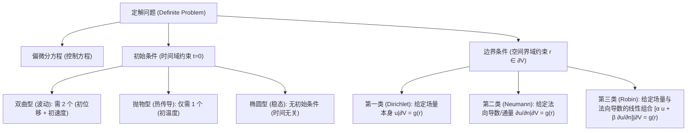

---
tags:
  - 物理/数学物理方法
  - 偏微分方程
  - 概念卡
  - 定解条件
  - 边界条件
  - 适定性
aliases:
  - 定解条件三类边界与初始条件适定性
  - 定解条件
  - 三类边界条件
  - 阿达马适定性
  - 狄利克雷诺伊曼罗宾边界
  - Boundary Conditions and Hadamard Well-Posedness
created: 2026-09-08
updated: 2026-09-08
---

> [!summary] 概念核心论断
> 偏微分方程本身仅刻画了物理系统内部局部微元所遵从的普遍动力学规律，包含着无穷多组数学通解。要从无穷解簇中唯一锁定描述客观物理实在的真实物理场，必须施加由系统历史记忆与几何空间约束共同构成的**定解条件（初始条件与边界条件）**。根据边界上物理约束类型的不同，边界条件划分为**第一类狄利克雷 (Dirichlet, 固值约束)**、**第二类诺伊曼 (Neumann, 通量约束)** 与**第三类罗宾 (Robin, 介质交换/阻尼弹性约束)**。法国数学家阿达马 (Hadamard) 确立的**适定性准则 (Well-Posedness)** 是检验物理问题数学建模是否成立的最高法典：解必须在全物理区间内同时满足**存在性 (Existence)**、**唯一性 (Uniqueness)** 与**稳定性 (Stability, 连续依赖于定解数据)**。

## 一、推导机理与核心数学定义

---

### 1.1 初始条件 (Initial Conditions, IC)

初始条件描述系统在演化起始时刻（通常设定为 $t = 0$）的空间整体状态分布。其所需条件的个数与方程对时间偏导数的最高阶数严格相等：

1. **二阶波动方程 ($\frac{\partial^2 u}{\partial t^2}$)**：根据牛顿力学的确定性原理，质点的运动状态由初始位置与初始动量完全决定，因此必须给定两个独立初始场：
   $$\begin{cases} \left. u(\boldsymbol{r}, t) \right|_{t=0} = \varphi(\boldsymbol{r}) & \text{(初始位移 / 初始场位)} \\ \left. \frac{\partial u}{\partial t}(\boldsymbol{r}, t) \right|_{t=0} = \psi(\boldsymbol{r}) & \text{(初始速度 / 初始变化率)} \end{cases}$$
2. **一阶热传导/扩散方程 ($\frac{\partial u}{\partial t}$)**：系统具有时间一阶不可逆耗散特性，其演化状态仅由当前温度分布唯一起始，故**只需且只能**给定一个初始温度场：
   $$\left. u(\boldsymbol{r}, t) \right|_{t=0} = \varphi(\boldsymbol{r})$$
3. **稳态泊松/拉普拉斯方程**：与时间无关，**不含初始条件**。

---

### 1.2 三大类经典物理边界条件 (Boundary Conditions, BC)

设研究空间区域为 $V$，其外边界闭合曲面（或曲线）为 $S = \partial V$，外法向单位矢量记为 $\boldsymbol{n}$，沿外法线的方向导数记为 $\frac{\partial u}{\partial n} = \nabla u \cdot \boldsymbol{n}$。

| 边界类型 | 数学标准表达式 | 典型物理场景（振动 / 声学） | 典型物理场景（热传导 / 扩散） | 典型物理场景（静电场 / 势流） |
| :--- | :--- | :--- | :--- | :--- |
| **第一类边界条件 (Dirichlet 条件)** | $\left. u \right|_S = f_1(\boldsymbol{r}, t)$ （齐次：$u|_S = 0$） | **固定端**：弦端点被刚性夹紧或位移受迫迫动（如弦端被手抖动） | **恒温壁**：物体表面与大型冰水混合物或恒温热库紧密接触 | **导体等位面**：金属外壳接地 ($\varphi=0$) 或接已知外加恒定电位电源 |
| **第二类边界条件 (Neumann 条件)** | $\left. \frac{\partial u}{\partial n} \right|_S = f_2(\boldsymbol{r}, t)$ （齐次：$\frac{\partial u}{\partial n}|_S = 0$） | **自由端**：端点套在光滑垂直细杆上无约束滑动，水平切向剪应力为零 | **绝热壁 (Adiabatic)**：表面包裹理想保温层，法向热流密度为零 ($-\kappa \frac{\partial u}{\partial n} = 0$) | **表面面电荷**：给定导体表面自由电荷分布，$\frac{\partial \varphi}{\partial n} = -\frac{\sigma_e}{\varepsilon_0}$ |
| **第三类边界条件 (Robin 条件)** | $\left. \left( \frac{\partial u}{\partial n} + \sigma u \right) \right|_S = f_3(\boldsymbol{r}, t)$ ($\sigma > 0$) | **弹性支承端**：端点系在阻尼弹簧上，张力法向分量与弹簧弹性恢复力平衡 | **牛顿冷却对流**：表面与环境流体发生热交换，热对流导热遵从牛顿冷却定律 | **阻抗边界 (Impedance)**：声学阻抗匹配表面、电磁吸波损耗边界 |

---

### 1.3 自然边界条件与交界衔接条件 (Interface Conditions)

除上述标准三类边界外，在奇异几何或多介质系统中还广泛存在自然物理约束：
1. **几何奇异点处的有限性（有界性）条件**：
   在圆柱坐标（$\rho \to 0$）或球坐标（$r \to 0$）中，原点是坐标系的几何奇异点。若物理场在原点处不存在点电荷或点源，则必须施加**物理量有界条件**：
   $$\lim_{\rho \to 0} |u(\rho, \varphi, z, t)| < \infty \quad \text{或} \quad \lim_{r \to 0} |u(r, \theta, \varphi, t)| < \infty$$
   这一条件是舍弃第二类贝塞尔函数 $Y_n$（在原点发散）或勒让德函数 $Q_n$（在两极发散）的核心判据！
2. **多介质界面的连续性衔接条件**：
   设介质 1 与介质 2 在交界面 $\Sigma$ 处接触：
   - **场量位移连续**：$\left. u_1 \right|_\Sigma = \left. u_2 \right|_\Sigma$；
   - **法向通量/应力平衡连续**：
     - 热传导：$-\kappa_1 \left. \frac{\partial u_1}{\partial n} \right|_\Sigma = -\kappa_2 \left. \frac{\partial u_2}{\partial n} \right|_\Sigma$；
     - 弦/杆振动：$T_1 \left. \frac{\partial u_1}{\partial n} \right|_\Sigma = T_2 \left. \frac{\partial u_2}{\partial n} \right|_\Sigma$。

---

### 1.4 阿达马 (Hadamard) 适定性三原则与反例

一个数学物理定解问题被称为在阿达马意义下**适定 (Well-Posed)**，必须同时严格满足以下三条准则：
1. **解的存在性 (Existence)**：在所给的定解条件下，在求解域内至少存在一个满足偏微分方程和全部初边值的数学解；
2. **解的唯一性 (Uniqueness)**：满足定解问题的解在数学上是唯一的（不出现多分支歧义）；
3. **解的稳定性 (Stability / Continuous Dependence)**：解连续依赖于初始条件与边界条件。即当下给定的测量初始值发生极微小的微扰 $\varepsilon$ 时，解的偏差在任意有限时间跨度内也只能产生控制在 $O(\varepsilon)$ 范围内的极微小改变，而不会产生无限发散。

> [!important] 阿达马著名反例 (Hadamard's Ill-Posed Counterexample)
> 考虑具有柯西初始条件的拉普拉斯方程（企图用波动方程的定解方式求解椭圆型方程）：
> $$\begin{cases} \frac{\partial^2 u}{\partial x^2} + \frac{\partial^2 u}{\partial y^2} = 0 \\ u(x, 0) = 0 \\ \frac{\partial u}{\partial y}(x, 0) = \frac{1}{n} \sin(nx) \end{cases}$$
> **显式解析解为**：
> $$u(x, y) = \frac{1}{n^2} \sin(nx) \sinh(ny) = \frac{1}{n^2} \sin(nx) \frac{e^{ny} - e^{-ny}}{2}$$
> **物理分析**：当参数 $n \to \infty$ 时：
> - 初始扰动 $\frac{\partial u}{\partial y}(x, 0) = \frac{1}{n}\sin(nx) \to 0$，即初值与零初值几乎完全没有差异；
> - 然而，只要 $y > 0$，由于指数因子 $e^{ny}$ 的存在，当 $n \to \infty$ 时，$u(x, y) \sim \frac{e^{ny}}{2n^2} \to \infty$ **剧烈发散爆炸**！
> 这证明：**椭圆型方程的柯西问题在物理上是极端不适定的**！椭圆型方程只能施加封闭边界条件，绝不可施加柯西初值！

---

## 二、⚠️ 致命失分陷阱与临界边界

> [!warning] 陷阱 1：抛物型热传导方程超额给定初始速度导致问题病态无解
> 许多初学者习惯了波动方程有初始位移和初始速度，而在列写热传导方程时画蛇添足地写出 $\left. \frac{\partial u}{\partial t} \right|_{t=0} = \psi(x)$：
> - 严正警示：热传导方程 $\frac{\partial u}{\partial t} = a^2 \frac{\partial^2 u}{\partial x^2} + f$ 是一阶时间方程；
> - 初始时刻的温度变化率 $\left. \frac{\partial u}{\partial t} \right|_{t=0} = a^2 \varphi''(x) + f(x, 0)$ 已经被初始温度分布 $\varphi(x)$ **完全内禀确定**，绝不可人为随意指定！多给一个条件将直接摧毁解的存在性。

> [!caution] 陷阱 2：纯第二类诺伊曼稳态边值问题的全局相容性积分条件
> 考虑泊松方程的纯诺伊曼边界问题：$\nabla^2 u = f(\boldsymbol{r})$ 在 $V$ 内，且 $\left. \frac{\partial u}{\partial n} \right|_S = g(\boldsymbol{r})$ 在外边界 $S$ 上。
> 由高斯散度定理，必须满足**严格的整体能量/通量相容性条件**：
> $$\iiint_V f(\boldsymbol{r}) dV = \iiint_V \nabla \cdot (\nabla u) dV = \iint_S \nabla u \cdot \boldsymbol{n} dS = \iint_S g(\boldsymbol{r}) dS$$
> 如果内部总源强与表面净流出通量不平衡（例如在绝热封闭体系中凭空产生能量），该定解问题在数学上**绝对不存在任何稳态解**！

> [!danger] 陷阱 3：第三类 Robin 边界中法向导数正负号的颠倒
> 在细杆或平板散热中，当外表面位于 $x = l$ 时，外法向指向 $+x$，热流流出导致 $\frac{\partial u}{\partial x} < 0$；但当外表面位于 $x = 0$ 时，外法向指向 $-x$！
> - 在 $x = l$ 处：$\left. \frac{\partial u}{\partial x} \right|_{x=l} = -h [u(l, t) - u_{\text{env}}]$；
> - 在 $x = 0$ 处：$\left. -\frac{\partial u}{\partial x} \right|_{x=0} = -h [u(0, t) - u_{\text{env}}] \implies \left. \frac{\partial u}{\partial x} \right|_{x=0} = +h [u(0, t) - u_{\text{env}}]$。
> 考场在原点 $x = 0$ 处极其容易写反符号，导致解出的本征方程出现虚数根，体系能量凭空自发暴涨。

---

## 三、经典范例手把手演算

### 题目（对流换热金属细杆的完整定解问题建模与边界分析）：
有一根长度为 $l$ 的均匀细金属杆，侧面严格绝热，两端与温度为 $0^\circ\text{C}$ 的介质接触。
1. 在左端 $x = 0$ 处保持冰水混合物接触（恒温 $0^\circ\text{C}$）；
2. 在右端 $x = l$ 处向周围空气自然散热，遵循牛顿冷却定律：单位时间从单位面积散失的热量正比于表面温度与周围空气温度之差，比例系数为换热系数 $H > 0$；
3. 杆在初始时刻 $t = 0$ 具有已知的非均匀温度分布 $u(x, 0) = \varphi(x)$。
试完整写出该物理演化过程的数学偏微分方程定解问题，并深入探讨换热系数 $H \to 0$ 与 $H \to \infty$ 两个极端物理极限下的边界蜕化。

#### 【演算步骤】

**第一步：确立控制方程与初始条件**
- 控制方程：由于侧面绝热，热量仅沿 $x$ 轴单向流动，由热传导方程：
  $$\frac{\partial u}{\partial t} = a^2 \frac{\partial^2 u}{\partial x^2} \quad (0 < x < l, t > 0)$$
- 初始条件：时间一阶导数，仅需一个初值：
  $$\left. u(x, t) \right|_{t=0} = \varphi(x) \quad (0 \le x \le l)$$

**第二步：严格推导两端边界条件**
1. **左端 $x = 0$（第一类 Dirichlet 边界）**：
   左端与恒温冰水紧密贴合，强迫温度固定：
   $$\left. u(x, t) \right|_{x=0} = 0$$

2. **右端 $x = l$（第三类 Robin 边界严格导出）**：
   考察 $x = l$ 处右端面：
   - 内部传导到端面的热流密度（根据傅里叶导热定律）：$q_{\text{cond}} = -\kappa \left. \frac{\partial u}{\partial x} \right|_{x=l}$；
   - 端面散发到外部介质（温度 $u_{\text{env}} = 0$）的热对流热流密度（根据牛顿冷却定律）：$q_{\text{conv}} = H [u(l, t) - 0] = H u(l, t)$；
   - 根据界面能量守恒，从杆内传到表面的热量必须完全等于散入空气的热量（端面无厚度，不能积蓄内能）：
     $$q_{\text{cond}} = q_{\text{conv}} \implies -\kappa \left. \frac{\partial u}{\partial x} \right|_{x=l} = H u(l, t)$$
   移项整理得标准 Robin 边界形式：
   $$\left. \left( \frac{\partial u}{\partial x} + \frac{H}{\kappa} u \right) \right|_{x=l} = 0$$
   令物理特征常数 $h = \frac{H}{\kappa} > 0$（量纲为 $[h] = \text{m}^{-1}$），则右端边界方程为：
   $$\left. \left( \frac{\partial u}{\partial x} + h u \right) \right|_{x=l} = 0$$

**完整定解系统汇编**：
$$\begin{cases} \frac{\partial u}{\partial t} = a^2 \frac{\partial^2 u}{\partial x^2} & (0 < x < l, t > 0) \\ u(x, 0) = \varphi(x) & (0 \le x \le l) \\ u(0, t) = 0 & (t > 0) \\ \left. \left( \frac{\partial u}{\partial x} + h u \right) \right|_{x=l} = 0 & (t > 0) \end{cases}$$

---

**第三步：双向临界物理极限验算**
1. **绝热极限（$H \to 0 \implies h \to 0$）**：
   空气导热极差相当于理想绝热真空：
   $$\lim_{h \to 0} \left( \frac{\partial u}{\partial x} + h u \right) = \left. \frac{\partial u}{\partial x} \right|_{x=l} = 0$$
   边界条件精确蜕化为**第二类齐次 Neumann 边界（完全绝热端）**！
2. **无限强对流/超导热极限（$H \to \infty \implies h \to \infty$）**：
   方程两边除以 $h$：
   $$\lim_{h \to \infty} \left( \frac{1}{h} \frac{\partial u}{\partial x} + u \right) = 0 + u(l, t) = 0 \implies u(l, t) = 0$$
   边界条件精确蜕化为**第一类齐次 Dirichlet 边界（强行拉平至外界温度）**！
数学模型在全参数域内完全自洽无缝，极值边界验算成功。

---

## 四、出处与纸质笔记坐标

* **教材出处**：梁昆淼《数学物理方法》（第四版）第七章 §7.2 (P122-P127)
* **纸质活页槽位**：`[活页-LKM-15]`
* **知识全景索引**：[[00_梁昆淼数学物理方法_第二篇全景图]]
