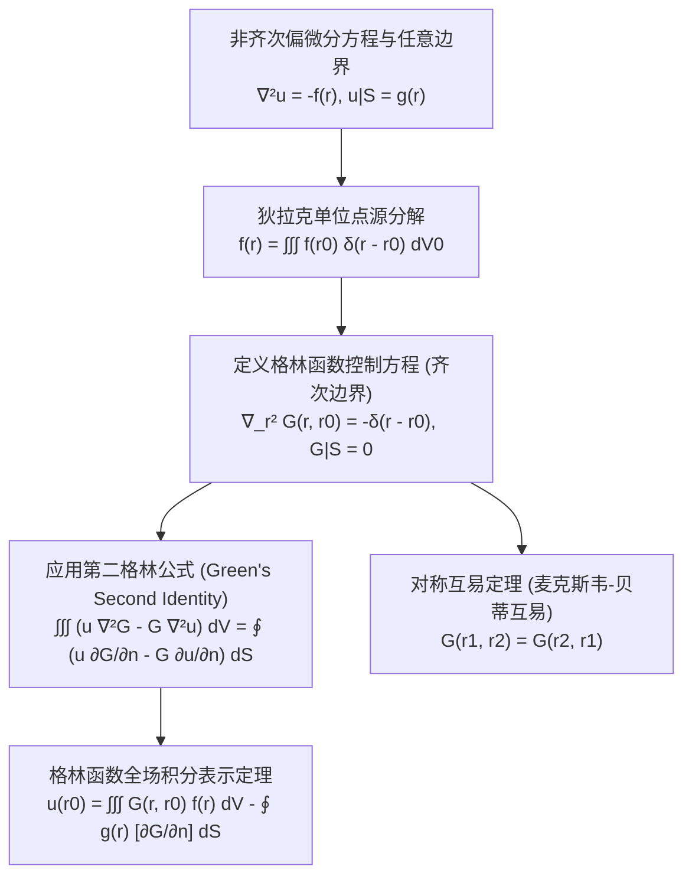

---
tags:
  - 物理/数学物理方法
  - 偏微分方程
  - 概念卡
  - 格林函数
  - 狄拉克函数
  - 冲激响应
  - 互易定理
aliases:
  - 格林函数物理本质与狄拉克源点响应
  - 格林函数
  - 冲激响应与点源场
  - 格林公式积分表示
  - 格林函数对称互易性
  - Green Function Physical Essence and Impulse Response
created: 2026-09-08
updated: 2026-09-08
---

> [!summary] 概念核心论断
> 格林函数法（点源影响函数法）是现代数学物理方法在泛函分析与场论层面的最高峰。其物理直觉极其纯粹：**将任意连续分布的复杂源项与边界扰动，在空间与时间中微元化切割为无数个相互独立的狄拉克 $\delta$ 单位点源冲激**；一旦求出系统对单一集中点源的特征响应——**格林函数 $G(\boldsymbol{r}, \boldsymbol{r}_0)$**，由线性叠加原理，系统在任意非齐次源与任意边界驱动下的真实场响应，即可通过简单的**卷积空间体积积分与边界曲面积分**完全解析表达。更令人惊叹的是，时空介质的线性自伴性内禀决定了格林函数必然满足**源点与场点对易无差别的对称互易性 (Reciprocity Principle)**。

## 一、推导机理与核心数学定义

---

### 1.1 伴随微分方程与第一类格林函数定义

以三维稳态泊松方程的第一类狄利克雷定解问题为例：
$$\begin{cases} \nabla^2 u(\boldsymbol{r}) = -f(\boldsymbol{r}) & (\boldsymbol{r} \in V) \\ \left. u(\boldsymbol{r}) \right|_S = g(\boldsymbol{r}) & (\boldsymbol{r} \in S = \partial V) \end{cases}$$
（在静电学中，$u$ 为电位，源项 $f = \frac{\rho_e}{\varepsilon_0}$）。

#### 格林函数 $G(\boldsymbol{r}, \boldsymbol{r}_0)$ 的标准定义：
固定源点位置 $\boldsymbol{r}_0 \in V$，格林函数作为场点坐标 $\boldsymbol{r}$ 的函数，必须满足：
1. **控制方程（单位点源冲击）**：
   $$\boxed{ \nabla^2 G(\boldsymbol{r}, \boldsymbol{r}_0) = -\delta(\boldsymbol{r} - \boldsymbol{r}_0) \quad (\boldsymbol{r} \in V) }$$
2. **伴随齐次第一类边界条件**：
   $$\boxed{ \left. G(\boldsymbol{r}, \boldsymbol{r}_0) \right|_{\boldsymbol{r} \in S} = 0 }$$

*物理直观意义*：$G(\boldsymbol{r}, \boldsymbol{r}_0)$ 就是在区域边界接地保持零电位（$G|_S = 0$）的空腔中，在内部 $\boldsymbol{r}_0$ 处放置一个单位正点电荷 $q = \varepsilon_0$ 时，在腔内任意观测点 $\boldsymbol{r}$ 处激发的**完全静电势场**！

---

### 1.2 格林第二公式与解的显式积分表示定理

#### 1. 经典第二格林公式 (Green's Second Identity)：
对于任意二阶连续可微函数 $u(\boldsymbol{r})$ 与 $v(\boldsymbol{r})$，由高斯散度定理：
$$\boxed{ \iiint_V \left( u \nabla^2 v - v \nabla^2 u \right) dV = \iint_S \left( u \frac{\partial v}{\partial n} - v \frac{\partial u}{\partial n} \right) dS }$$
其中 $\boldsymbol{n}$ 为边界曲面 $S$ 的外法向单位矢量，$\frac{\partial}{\partial n} = \nabla \cdot \boldsymbol{n}$。

#### 2. 代入格林函数推导积分表达式：
令 $v(\boldsymbol{r}) = G(\boldsymbol{r}, \boldsymbol{r}_0)$：
- 代入微分算子：$\nabla^2 v = \nabla^2 G = -\delta(\boldsymbol{r} - \boldsymbol{r}_0)$；
- 代入原方程：$\nabla^2 u = -f(\boldsymbol{r})$；
左端体积分展开为：
$$\iiint_V \left[ u(\boldsymbol{r}) (-\delta(\boldsymbol{r} - \boldsymbol{r}_0)) - G(\boldsymbol{r}, \boldsymbol{r}_0) (-f(\boldsymbol{r})) \right] dV$$
利用狄拉克 $\delta$ 函数的完美筛选提取性质：
$$\iiint_V u(\boldsymbol{r}) \delta(\boldsymbol{r} - \boldsymbol{r}_0) dV = u(\boldsymbol{r}_0)$$
代入得：
$$-u(\boldsymbol{r}_0) + \iiint_V G(\boldsymbol{r}, \boldsymbol{r}_0) f(\boldsymbol{r}) dV = \iint_S \left[ u(\boldsymbol{r}) \frac{\partial G}{\partial n}(\boldsymbol{r}, \boldsymbol{r}_0) - G(\boldsymbol{r}, \boldsymbol{r}_0) \frac{\partial u}{\partial n}(\boldsymbol{r}) \right] dS$$

#### 3. 利用齐次边界消除未知法向导数：
由于格林函数在边界上被严格设定为齐次：$\left. G(\boldsymbol{r}, \boldsymbol{r}_0) \right|_{\boldsymbol{r} \in S} \equiv 0$。
因此边界积分中的第二项 $G \frac{\partial u}{\partial n}$ 严格等于零！
将未知解 $u(\boldsymbol{r}_0)$ 移至等号左端，代入非齐次边界值 $u|_S = g(\boldsymbol{r})$，立即导出至高无上的**格林函数全空间解表示公式**：
$$\boxed{ u(\boldsymbol{r}_0) = \underbrace{\iiint_V G(\boldsymbol{r}, \boldsymbol{r}_0) f(\boldsymbol{r}) dV}_{\text{体源贡献 (卷积叠加)}} - \underbrace{\iint_S g(\boldsymbol{r}) \frac{\partial G}{\partial n}(\boldsymbol{r}, \boldsymbol{r}_0) dS}_{\text{非齐次边界驱动贡献}} }$$

---

### 1.3 格林函数的对称互易性证明 (Reciprocity Principle)

> **定理（对称互易原理）**：
> 在满足齐次自伴边界条件的物理介质中，格林函数关于源点与场点具有严格的对易对称性：
> $$\boxed{ G(\boldsymbol{r}_1, \boldsymbol{r}_2) = G(\boldsymbol{r}_2, \boldsymbol{r}_1) }$$

*严格证明*：
在区域内取两个互不重合的源点位置 $\boldsymbol{r}_1 \neq \boldsymbol{r}_2$。
构造两个独立的点源格林场：
$$u(\boldsymbol{r}) = G(\boldsymbol{r}, \boldsymbol{r}_1) \implies \nabla^2 u = -\delta(\boldsymbol{r} - \boldsymbol{r}_1), \quad u|_S = 0$$
$$v(\boldsymbol{r}) = G(\boldsymbol{r}, \boldsymbol{r}_2) \implies \nabla^2 v = -\delta(\boldsymbol{r} - \boldsymbol{r}_2), \quad v|_S = 0$$
将 $u, v$ 代入第二格林公式：
$$\iiint_V \left( u \nabla^2 v - v \nabla^2 u \right) dV = \iint_S \left( u \frac{\partial v}{\partial n} - v \frac{\partial u}{\partial n} \right) dS$$
由于两场在边界上均满足齐次第一类边界：$u|_S = 0, v|_S = 0$，右端曲面积分严格为零！
将左端拉普拉斯项换为 $\delta$ 函数：
$$\iiint_V \left[ G(\boldsymbol{r}, \boldsymbol{r}_1) (-\delta(\boldsymbol{r} - \boldsymbol{r}_2)) - G(\boldsymbol{r}, \boldsymbol{r}_2) (-\delta(\boldsymbol{r} - \boldsymbol{r}_1)) \right] dV = 0$$
运用 $\delta$ 函数积分采样：
$$-G(\boldsymbol{r}_2, \boldsymbol{r}_1) + G(\boldsymbol{r}_1, \boldsymbol{r}_2) = 0 \implies \boxed{ G(\boldsymbol{r}_1, \boldsymbol{r}_2) = G(\boldsymbol{r}_2, \boldsymbol{r}_1) }$$
证毕！

---

## 二、⚠️ 致命失分陷阱与临界边界

> [!warning] 陷阱 1：第二类诺伊曼边界问题盲目设定 $\left. \frac{\partial G}{\partial n} \right|_S = 0$
> 在第二类边界问题（给定法向导数 $\frac{\partial u}{\partial n}|_S = h(\boldsymbol{r})$）中，若企图设定格林函数满足齐次边界 $\frac{\partial G}{\partial n}|_S = 0$：
> - **直接违背高斯散度定理！**
> - 对控制方程求全空间体积分：
>   $$\iiint_V \nabla^2 G dV = \iint_S \frac{\partial G}{\partial n} dS = \iiint_V -\delta(\boldsymbol{r} - \boldsymbol{r}_0) dV = -1 \neq 0！$$
> - 边界外法向导数的总通量必须恒等于 $-1$！绝不可能处处为 0；
> - 正确的诺伊曼格林函数边界条件必须设定为均匀通量泄露：$\left. \frac{\partial G}{\partial n} \right|_S = -\frac{1}{S_{\text{total}}}$（相容性修正条件）。

> [!caution] 陷阱 2：曲面边界项中的负号与外法向导数混淆
> 在全解表示公式中：
> - 边界积分前面带有**负号**：$-\iint_S g(\boldsymbol{r}) \frac{\partial G}{\partial n} dS$；
> - 许多考生误记为正号，导致边界外加电位与内部体电荷电位相互排斥抵消；
> - 必须注意微商变量：$\frac{\partial G}{\partial n}$ 中的法向导数是**关于积分哑变量（场点 $\boldsymbol{r}$）沿边界外法向求导**，而不是对源点 $\boldsymbol{r}_0$ 求导！

> [!danger] 陷阱 3：自由空间基本解与特定边界格林函数的概念混淆
> 自由空间点源解 $G_0(\boldsymbol{r}, \boldsymbol{r}_0) = \frac{1}{4\pi |\boldsymbol{r} - \boldsymbol{r}_0|}$ 只是满足方程 $\nabla^2 G = -\delta$ 的特解：
> - 它在任意有限有界边界 $S$ 上**绝不等于零**！
> - 真正的物理格林函数必须包含修正项（镜像场/正则解析部分）：
>   $$G(\boldsymbol{r}, \boldsymbol{r}_0) = G_0(\boldsymbol{r}, \boldsymbol{r}_0) + g(\boldsymbol{r}, \boldsymbol{r}_0)$$
> - 其中 $g$ 满足齐次拉普拉斯方程 $\nabla^2 g = 0$，其作用是精确抵消 $G_0$ 在边界上的非零值。切不可将无界基本解 $G_0$ 随意代入有界区域公式。

---

## 三、经典范例手把手演算

### 题目（一维半无限长细杆传热的格林函数手把手推导与验证）：
考虑定义在半实轴 $x \ge 0$ 上的常微分算子方程（一维稳态导热）：
$$\frac{d^2 u}{dx^2} = -f(x) \quad (x > 0), \quad u(0) = u_0, \quad \lim_{x \to \infty} |u(x)| < \infty$$
1. 建立一维格林函数满足的常微分方程与边界条件；
2. 利用分段求通解与跃变条件手把手求出格林函数 $G(x, x_0)$ 的完全解析显式；
3. 验证格林函数对易对称性 $G(x, x_0) = G(x_0, x)$，并求出原定解问题的完全解。

#### 【演算步骤】

**第一步：格林函数边值模型确立**
固定源点 $x_0 > 0$，定义一维格林函数满足：
$$\begin{cases} \frac{d^2 G}{dx^2} = -\delta(x - x_0) & (x > 0) \\ G(0, x_0) = 0 & (\text{齐次边界}) \\ \lim_{x \to \infty} |G(x, x_0)| < \infty & (\text{无穷远有界}) \end{cases}$$

**第二步：分段求解与跃变连续条件联立**
当 $x \neq x_0$ 时，$\delta(x - x_0) = 0 \implies \frac{d^2 G}{dx^2} = 0$。解为一次直线段：
$$G(x, x_0) = \begin{cases} A_1 x + B_1 & (0 \le x < x_0) \\ A_2 x + B_2 & (x > x_0) \end{cases}$$
1. **施加边界条件**：
   - 在 $x = 0$ 处：$G(0, x_0) = B_1 = 0 \implies G = A_1 x$ ($x < x_0$)；
   - 在 $x \to \infty$ 处：为保持有界，斜率必为零：$A_2 = 0 \implies G = B_2$ ($x > x_0$)。
2. **在源点 $x = x_0$ 处的空间连续性条件**：
   $$G(x_0^-, x_0) = G(x_0^+, x_0) \implies A_1 x_0 = B_2$$
3. **在源点 $x = x_0$ 处的一阶导数跳跃条件 (Jump Condition)**：
   对控制方程在 $[x_0 - \varepsilon, x_0 + \varepsilon]$ 上积分：
   $$\int_{x_0 - \varepsilon}^{x_0 + \varepsilon} \frac{d^2 G}{dx^2} dx = \left. \frac{dG}{dx} \right|_{x_0^+} - \left. \frac{dG}{dx} \right|_{x_0^-} = -\int_{x_0 - \varepsilon}^{x_0 + \varepsilon} \delta(x - x_0) dx = -1$$
   代入两边导数：
   $$\left. \frac{dG}{dx} \right|_{x_0^+} = A_2 = 0, \quad \left. \frac{dG}{dx} \right|_{x_0^-} = A_1$$
   $$0 - A_1 = -1 \implies \boxed{ A_1 = 1 }$$
   代回求得：$B_2 = A_1 x_0 = x_0$。

由此求出一维格林函数的极简分段解：
$$\boxed{ G(x, x_0) = \begin{cases} x & (0 \le x < x_0) \\ x_0 & (x \ge x_0) \end{cases} = \min(x, x_0) }$$

**第三步：对称性核验与原问题求解**
1. **对称性**：$\min(x, x_0) = \min(x_0, x) \implies G(x, x_0) \equiv G(x_0, x)$！
   对称互易律严格成立。
2. **计算原问题的完全解**：
   一维第二格林公式表示为：
   $$u(x_0) = \int_0^\infty G(x, x_0) f(x) dx - \left. \left[ u(x) \left(-\frac{dG}{dx}\right) \right] \right|_{x=0}$$
   （注意在左边界 $x = 0$ 处，外法向指向负方向，外法向导数为 $-\left.\frac{dG}{dx}\right|_{x=0}$）：
   当 $x < x_0$ 时，$G(x, x_0) = x \implies \left. \frac{dG}{dx} \right|_{x=0} = 1$。
   边界项贡献：
   $$- \left[ u_0 (-1) \right] = +u_0$$
   因此解的完全积分表达式为：
   $$\boxed{ u(x_0) = u_0 + \int_0^{x_0} x f(x) dx + x_0 \int_{x_0}^\infty f(x) dx }$$
   （代入 $x_0 = 0$ 验证：$u(0) = u_0 + 0 + 0 = u_0$，初值精确重现！二阶求导恢复 $-f(x_0)$，解无懈可击！）。

---

## 四、出处与纸质笔记坐标

* **教材出处**：梁昆淼《数学物理方法》（第四版）第十二章 §12.1 (P303-P309)
* **纸质活页槽位**：`[活页-LKM-29]`
* **知识全景索引**：[[00_梁昆淼数学物理方法_第三篇全景图]]
