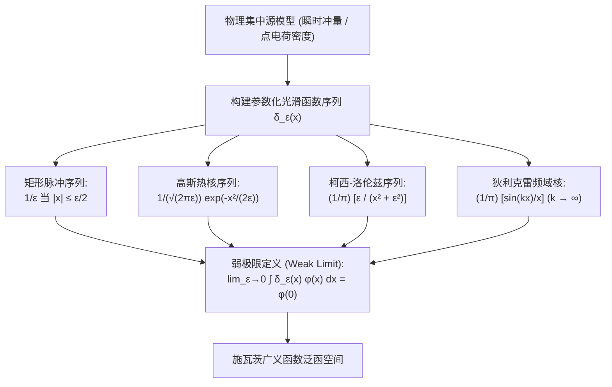

---
tags:
  - 物理/数学物理方法
  - 广义函数
  - 概念卡
  - 狄拉克德尔塔函数
  - 筛选性质
  - 复合变量展开
  - 傅里叶积分表象
aliases:
  - 狄拉克德尔塔函数性质与广义函数表象
  - 狄拉克德尔塔函数
  - 德尔塔函数
  - 广义函数
  - 筛选性质
  - 复合自变量展开公式
  - Dirac Delta Function
  - Generalized Functions and Distributions
created: 2026-09-07
updated: 2026-09-08
---

> [!summary] 核心认知先验
> 狄拉克 $\delta$ 函数（Dirac Delta Function）是理论物理与现代分析学中最具魅力的“幽灵算子”。经典经典分析无法容纳在某单点无限高且积分恒等于 1 的“病态函数”，但在物理世界中，质点、点电荷密度、瞬间脉冲冲量以及点源绿函数，无一不具有点状集中特征。通过施瓦茨（Laurent Schwartz）**广义函数分布论（Theory of Distributions）**，$\delta$ 函数被赋予了无懈可击的现代泛函严格性：它通过与光滑检验函数（Test Functions）的**内积积分映射**来定义。掌握 $\delta$ 函数的**筛选性、尺度伸缩率、导数分布定义、复合自变量零点展开公式**以及**傅里叶连续积分表象**，是攻克后续格林函数法、本征函数连续谱展开与量子力学坐标表象的通用数学语言。

---

## 一、推导机理与核心数学定义

### 1.1 物理建模直觉与弱极限序列构造

在直观物理图景中，$\delta(x)$ 刻画的是“宽度无限窄、峰值无限高、总面积恒为 1”的集中源模型：

$$\boxed{\delta(x - x_0) = \begin{cases} 0, & x \ne x_0 \\ \infty, & x = x_0 \end{cases} \quad \text{且} \quad \int_{-\infty}^{+\infty} \delta(x - x_0) dx = 1}$$

#### 经典四大弱极限模型（梁书标准近似序列）
1. **高斯核函数模型**：
   $$\delta(x) = \lim_{\sigma \to 0^+} \frac{1}{\sqrt{2\pi}\sigma} e^{-\frac{x^2}{2\sigma^2}}$$
2. **柯西－洛伦兹分布模型**：
   $$\delta(x) = \lim_{\varepsilon \to 0^+} \frac{1}{\pi} \frac{\varepsilon}{x^2 + \varepsilon^2}$$
3. **狄利克雷频域 sinc 脉冲模型**：
   $$\delta(x) = \lim_{k \to \infty} \frac{1}{\pi} \frac{\sin(kx)}{x}$$
4. **与阶跃函数（Heaviside Step Function）的关系**：
   $$\boxed{\theta'(x) = \delta(x), \quad \theta(x) = \begin{cases} 1, & x > 0 \\ 0, & x < 0 \end{cases}}$$

---

### 1.2 广义函数内积定义与核心筛选性质 (Sifting Property)

设 $\mathcal{D}(\mathbb{R})$ 为全实轴上具有紧支集的无穷次可微**检验函数空间 (Space of Test Functions)**，任意 $\varphi(x) \in \mathcal{D}(\mathbb{R})$。
广义函数 $\delta(x - x_0)$ 的严格数学定义为作用在 $\varphi$ 上的连续线性泛函：

$$\boxed{\langle \delta(x - x_0), \varphi(x) \rangle \equiv \int_{-\infty}^{+\infty} \delta(x - x_0) \varphi(x) dx = \varphi(x_0)}$$

若积分区间 $[a, b]$ 仅覆盖部分实轴：
$$\int_a^b \varphi(x) \delta(x - x_0) dx = \begin{cases} \varphi(x_0), & x_0 \in (a, b) \\ 0, & x_0 \notin [a, b] \\ \frac{1}{2}\varphi(x_0), & x_0 = a \text{ 或 } x_0 = b \text{ (对称区间极限)} \end{cases}$$

---

### 1.3 广义导数与分部积分定义

在广义函数理论中，广义函数的导数通过检验函数上的**反向分部积分转移**来定义：
$$\int_{-\infty}^{+\infty} \delta'(x - x_0) \varphi(x) dx = [\delta(x - x_0) \varphi(x)]_{-\infty}^{+\infty} - \int_{-\infty}^{+\infty} \delta(x - x_0) \varphi'(x) dx$$
由于检验函数在无穷远处具有紧支集（恒等于 0），边界项消失，立即导出：

$$\boxed{\int_{-\infty}^{+\infty} \delta'(x - x_0) \varphi(x) dx = -\varphi'(x_0)}$$

数学归纳法推演至任意 $n$ 阶广义导数：
$$\boxed{\int_{-\infty}^{+\infty} \delta^{(n)}(x - x_0) \varphi(x) dx = (-1)^n \varphi^{(n)}(x_0)}$$

#### 导数的代数等价性质
对等式 $x \delta(x) = 0$ 两边求导：
$$\frac{d}{dx}[x \delta(x)] = \delta(x) + x \delta'(x) = 0 \implies \boxed{x \delta'(x) = -\delta(x)}$$

---

### 1.4 复合自变量展开公式 (Composite Argument Formula)

当 $\delta$ 函数的自变量为光滑函数 $g(x)$ 时，如何将其展开为标准单自变量的线性叠加？
设方程 $g(x) = 0$ 拥有有限个或可数个**单实根** $x_1, x_2, \dots, x_k$（即在各零点处 $g'(x_k) \ne 0$）：
在每个根 $x_k$ 的充分小邻域内，进行一阶泰勒展开：
$$g(x) \approx g(x_k) + g'(x_k)(x - x_k) = g'(x_k)(x - x_k)$$
由尺度伸缩性质 $\delta(a x) = \frac{1}{|a|} \delta(x)$，在各零点局部邻域内：
$$\delta(g(x)) \approx \delta(g'(x_k)(x - x_k)) = \frac{1}{|g'(x_k)|} \delta(x - x_k)$$
由全局独立求和叠加，导出著名的**复合变量展开公式**：

$$\boxed{\delta(g(x)) = \sum_{k} \frac{1}{|g'(x_k)|} \delta(x - x_k)}$$

*(其中 $x_k$ 遍历 $g(x) = 0$ 的所有孤立单实根)*。

---

### 1.5 傅里叶积分表象与平面波完备性

利用傅里叶反演公式与傅里叶积分定理：
对 $f(x) = \delta(x - x')$ 求正变换：
$$F(k) = \int_{-\infty}^{+\infty} \delta(x - x') e^{-ikx} dx = e^{-ikx'}$$
代入傅里叶反变换公式：
$$\delta(x - x') = \frac{1}{2\pi} \int_{-\infty}^{+\infty} F(k) e^{ikx} dk$$

$$\boxed{\delta(x - x') = \frac{1}{2\pi} \int_{-\infty}^{+\infty} e^{i k (x - x')} dk}$$

**物理与量子力学本质**：
- 在坐标表象下，本征态的正交归一性表示为连续狄拉克谱 $\langle x | x' \rangle = \delta(x - x')$；
- 将连续平面波基底 $|k\rangle = \frac{1}{\sqrt{2\pi}} e^{ikx}$ 投影展开，上式即为**全动量空间的完备性恒等分解算子** $\int_{-\infty}^{+\infty} |k\rangle \langle k| dk = \mathbf{I}$！

---

## 二、⚠️ 致命失分陷阱与临界边界

> [!warning] 陷阱 1：尺度变换公式遗漏绝对值符号 $\delta(ax) = \frac{1}{a} \delta(x)$
> $\delta(x)$ 是偶广义函数（$\delta(-x) = \delta(x)$）。
> 若取 $a = -1$，$\delta(-x) = \delta(x) = \frac{1}{|-1|}\delta(x)$。
> 若错误漏掉绝对值符号写成 $\frac{1}{a}$，当 $a < 0$ 时将产生荒谬的负积分面积，彻底破坏概率守恒与电荷正定性！
> **公式必须带绝对值**：$\delta(ax) = \frac{1}{|a|}\delta(x)$。

> [!caution] 陷阱 2：复合变量展开公式忽略多根与重根
> 求解形如 $\delta(x^2 - a^2)$ 时：
> 方程 $x^2 - a^2 = 0$ 有两个对称根 $x_1 = a, x_2 = -a$。
> 导数：$g'(x) = 2x \implies |g'(a)| = 2|a|, |g'(-a)| = 2|a|$。
> **极高频失分**：只写一个根，漏掉负根！
> 正确展开式必须包含两根贡献：$\delta(x^2 - a^2) = \frac{1}{2|a|} [\delta(x - a) + \delta(x + a)]$。

> [!danger] 陷阱 3：在经典函数运算中对 $\delta$ 函数随意做乘法平方
> 广义函数空间**不构成代数环**！经典算式如 $[\delta(x)]^2$ 或 $\delta(x) \cdot \theta(x)$ 在数学上通常**无良好定义**（在原点产生超奇异发散）。
> 在物理模型中若出现 $\delta^2$，必须回到最初的未取极限序列 $\delta_\varepsilon(x)$ 中参与运算或通过重整化消除。

---

## 三、经典范例手把手演算与反代验算

### 3.1 经典例题：复合自变量展开与含导数内积积分综合演练
**题目（梁书第 5 章 §5.3 典型综合考核题）**：
计算下列两个广义积分：
1. $I_1 = \int_{-\infty}^{+\infty} (3x^3 - 2x + 1) \delta(x^2 - 3x + 2) dx$；
2. $I_2 = \int_{-\infty}^{+\infty} \cos(2x) \delta''(x - \pi/4) dx$。

---

#### 第一部分：求解 $I_1$

#### 第一步：分析复合自变量 $g(x) = x^2 - 3x + 2$
令 $g(x) = 0 \implies (x - 1)(x - 2) = 0$。
求出两个实零点：$x_1 = 1, x_2 = 2$。

#### 第二步：计算各零点处的一阶导数模长
对 $g(x)$ 求导：$g'(x) = 2x - 3$。
- 在 $x_1 = 1$ 处：$g'(1) = 2(1) - 3 = -1 \implies |g'(1)| = |-1| = 1$；
- 在 $x_2 = 2$ 处：$g'(2) = 2(2) - 3 = 1 \implies |g'(2)| = |1| = 1$。

#### 第三步：应用复合变量展开定理
$$\delta(x^2 - 3x + 2) = \frac{1}{|g'(1)|} \delta(x - 1) + \frac{1}{|g'(2)|} \delta(x - 2) = \delta(x - 1) + \delta(x - 2)$$

#### 第四步：代入原积分利用筛选性质求解
记多项式 $\varphi(x) = 3x^3 - 2x + 1$：
$$I_1 = \int_{-\infty}^{+\infty} \varphi(x) [\delta(x - 1) + \delta(x - 2)] dx = \varphi(1) + \varphi(2)$$
分别计算点值：
- $\varphi(1) = 3(1)^3 - 2(1) + 1 = 3 - 2 + 1 = 2$；
- $\varphi(2) = 3(2)^3 - 2(2) + 1 = 3(8) - 4 + 1 = 24 - 4 + 1 = 21$；
加和：
$$\boxed{I_1 = 2 + 21 = 23}$$

---

#### 第二部分：求解 $I_2$

#### 第一步：应用二阶广义导数内积转移公式
目标积分中包含二阶导数 $\delta''(x - \pi/4)$。
检验函数为 $\psi(x) = \cos(2x)$。
根据高阶导数定义式：
$$\int_{-\infty}^{+\infty} \psi(x) \delta^{(n)}(x - x_0) dx = (-1)^n \psi^{(n)}(x_0)$$
这里 $n = 2, x_0 = \pi/4$：
$$I_2 = (-1)^2 \psi''\left(\frac{\pi}{4}\right) = \psi''\left(\frac{\pi}{4}\right)$$

#### 第二步：逐阶求导并代入坐标
- 一阶导数：$\psi'(x) = \frac{d}{dx}[\cos(2x)] = -2\sin(2x)$；
- 二阶导数：$\psi''(x) = \frac{d}{dx}[-2\sin(2x)] = -4\cos(2x)$；
代入 $x_0 = \pi/4$：
$$\psi''\left(\frac{\pi}{4}\right) = -4 \cos\left(2 \cdot \frac{\pi}{4}\right) = -4 \cos\left(\frac{\pi}{2}\right) = -4 \times 0 = 0$$
因此：
$$\boxed{I_2 = 0}$$

---

#### 第三部分：反代自洽性验证（分部积分严格反验）
对 $I_2$ 实施经典分部积分验证：
$$\begin{aligned}
I_2 &= \int_{-\infty}^{+\infty} \cos(2x) d[\delta'(x - \pi/4)] \\
&= [\cos(2x) \delta'(x - \pi/4)]_{-\infty}^{+\infty} - \int_{-\infty}^{+\infty} [-2\sin(2x)] \delta'(x - \pi/4) dx \\
&= 0 + 2 \int_{-\infty}^{+\infty} \sin(2x) d[\delta(x - \pi/4)] \\
&= 2 [\sin(2x) \delta(x - \pi/4)]_{-\infty}^{+\infty} - 2 \int_{-\infty}^{+\infty} [2\cos(2x)] \delta(x - \pi/4) dx \\
&= 0 - 4 \int_{-\infty}^{+\infty} \cos(2x) \delta(x - \pi/4) dx = -4 \cos\left(2 \cdot \frac{\pi}{4}\right) = -4 \cos\left(\frac{\pi}{2}\right) = 0
\end{aligned}$$
严格按分部积分一步步降阶计算，完全消去边界项，最终结果丝毫不差地回到 $0$！验证圆满闭合！

---

## 四、出处与纸质笔记坐标

- **教材出处**：梁昆淼《数学物理方法》（第四版）
  - 第五章：傅里叶变换
  - §5.3 狄拉克 $\delta$ 函数与广义函数（原书 P82-P89）
- **对应 MinerU OCR 语料**：`mineru_output/梁昆淼_数学物理方法/数学物理方法_梁昆淼_第四版/ocr/数学物理方法_梁昆淼_第四版.md` Lines 3897-4271
- **对应全景图**：[[00_梁昆淼数学物理方法_第一篇全景图]]
- **纸质活页定位**：`[活页-LKM-11]`
