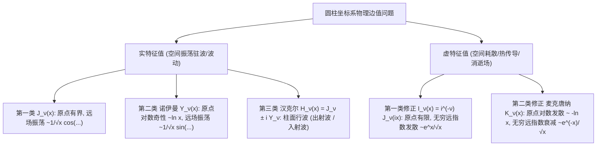

---
tags:
  - 物理/数学物理方法
  - 特殊函数
  - 概念卡
  - 柱函数
  - 诺伊曼函数
  - 汉克尔函数
  - 修正贝塞尔函数
aliases:
  - 第二三类柱函数与虚宗量修正贝塞尔函数
  - 第二类贝塞尔函数
  - 诺伊曼函数
  - 汉克尔函数与柱面行波
  - 虚宗量修正贝塞尔函数
  - Neumann Hankel and Modified Bessel Functions
created: 2026-09-08
updated: 2026-09-08
---

> [!summary] 概念核心论断
> 柱函数族由第一类贝塞尔函数 $J_\nu(x)$、第二类诺伊曼函数 $Y_\nu(x)$、第三类汉克尔函数 $H_\nu^{(1,2)}(x)$ 以及虚宗量修正贝塞尔函数 $I_\nu(x), K_\nu(x)$ 共同构成了完整的圆柱场函数谱系。第二类**诺伊曼函数**通过罗必达极限填补了整数阶时第一类函数线性退化的通解漏洞，其在原点的**对数奇性 $\ln x$** 是判断内域/外域物理场的核心准绳；第三类**汉克尔函数**将实驻波重组为沿径向单向扩散的**柱面出射行波与入射行波**，统御着波动辐射与声波散射；而**虚宗量修正贝塞尔函数**则对应柱对称下的耗散、热扩散与电磁消逝场（Evanescent Field），实现了三角振荡向双曲单调衰减的宏伟跨越。

## 一、推导机理与核心数学定义

---

### 1.1 第二类柱函数（诺伊曼函数 / 韦伯函数 $Y_\nu(x)$）

当 $\nu = n \in \mathbb{Z}$ 为整数时，$J_{-n}(x) = (-1)^n J_n(x)$ 线性相关。为构造通解的第二个独立解，定义**第二类贝塞尔函数（诺伊曼函数，Neumann Function）**：
$$\boxed{ Y_\nu(x) \equiv \frac{J_\nu(x) \cos(\nu\pi) - J_{-\nu}(x)}{\sin(\nu\pi)} }$$
（许多前苏联及我国教材亦记作 $N_\nu(x)$）。

#### 1. 整数阶极限与罗必达法则：
当 $\nu \to n$ 时，分子分母均趋于 0（$0/0$ 型不定式）。应用罗必达法则对阶数 $\nu$ 求微商极限：
$$Y_n(x) = \lim_{\nu \to n} Y_\nu(x) = \frac{1}{\pi} \left[ \left. \frac{\partial J_\nu(x)}{\partial \nu} \right|_{\nu=n} + (-1)^n \left. \frac{\partial J_{-\nu}(x)}{\partial \nu} \right|_{\nu=n} \right]$$
求导产生因子 $\frac{\partial}{\partial \nu}(x^\nu) = x^\nu \ln x$，从而在整数阶严格引出了**对数奇性**！

#### 2. 原点附近的奇异渐近行为 ($x \to 0$)：
- **零阶诺伊曼函数（对数发散）**：
  $$\boxed{ Y_0(x) \approx \frac{2}{\pi} \left[ \ln\left(\frac{x}{2}\right) + \gamma \right] \to -\infty \quad (x \to 0) }$$
  （$\gamma \approx 0.5772$ 为欧拉常数）；
- **高阶诺伊曼函数（幂次极点发散）**：
  $$\boxed{ Y_n(x) \approx -\frac{(n - 1)!}{\pi} \left( \frac{2}{x} \right)^n \to -\infty \quad (n \ge 1, x \to 0) }$$

> [!important] 核心物理甄别判据
> 任何包含几何对称中心轴 $r = 0$ 的物理系统（如实心导线、实心弹性膜、实心柱体）：
> 由于物理能量密度或位移在轴线上不可能无穷大，**必须将通解中的第二类诺伊曼函数项全部严格剔除（其系数必为零！）**。
> $Y_\nu(x)$ 仅在**不包含轴线的环形区域（如两同心圆柱管之间）或外场有奇异线源（如无限长线电荷、线电流、细丝声源）**时才具备物理意义。

---

### 1.2 第三类柱函数（汉克尔函数 $H_\nu^{(1)}(x), H_\nu^{(2)}(x)$ 与柱面行波）

为了在数学上对偶复指数行波 $e^{\pm ikx} = \cos(kx) \pm i \sin(kx)$，定义第一类与第二类**汉克尔函数 (Hankel Functions)**：
$$\boxed{ \begin{cases} H_\nu^{(1)}(x) = J_\nu(x) + i Y_\nu(x) & \text{(第一类汉克尔函数)} \\ H_\nu^{(2)}(x) = J_\nu(x) - i Y_\nu(x) & \text{(第二类汉克尔函数)} \end{cases} }$$

#### 大宗量渐近行为与柱面波传播：
将 $J_\nu(x) \sim \sqrt{\frac{2}{\pi x}} \cos\theta_\nu$ 与 $Y_\nu(x) \sim \sqrt{\frac{2}{\pi x}} \sin\theta_\nu$ 代入（其中 $\theta_\nu = x - \frac{\nu\pi}{2} - \frac{\pi}{4}$）：
$$\boxed{ H_\nu^{(1)}(x) \approx \sqrt{\frac{2}{\pi x}} e^{i\left( x - \frac{\nu\pi}{2} - \frac{\pi}{4} \right)} \quad (x \to \infty) }$$
$$\boxed{ H_\nu^{(2)}(x) \approx \sqrt{\frac{2}{\pi x}} e^{-i\left( x - \frac{\nu\pi}{2} - \frac{\pi}{4} \right)} \quad (x \to \infty) }$$

**物理波动意义（设时间因子为 $e^{-i\omega t}$）**：
- $H_\nu^{(1)}(kr) e^{-i\omega t} \propto \frac{1}{\sqrt{r}} e^{i(kr - \omega t)}$：相位随时间向外扩散，表示从中心向外无限空间辐射的**柱面出射行波 (Outgoing Traveling Wave)**；
- $H_\nu^{(2)}(kr) e^{-i\omega t} \propto \frac{1}{\sqrt{r}} e^{-i(kr + \omega t)}$：表示由无穷远汇聚向轴线的**柱面入射行波 (Incoming Traveling Wave)**。
这是在柱对称开放空间中应用**索莫菲辐射条件 (Sommerfeld Radiation Condition)** 唯一选定的波函数！

---

### 1.3 虚宗量贝塞尔方程与修正贝塞尔函数

在柱坐标分离变量中，若径向分离常数符号相反（例如稳态拉普拉斯方程 $u_{rr} + \frac{1}{r}u_r - k^2 u = 0$，或虚波矢 $x = ikr$），方程演变为**修正贝塞尔方程 (Modified Bessel Equation)**：
$$\boxed{ x^2 \frac{d^2 y}{dx^2} + x \frac{dy}{dx} - (x^2 + \nu^2) y = 0 }$$
（关键差异：原本的 $+x^2$ 项变号为 $-x^2$）。

#### 1. 第一类修正贝塞尔函数 $I_\nu(x)$：
定义为纯虚宗量贝塞尔函数的实数化规范：
$$\boxed{ I_\nu(x) \equiv i^{-\nu} J_\nu(ix) = \sum_{k=0}^\infty \frac{1}{k! \Gamma(\nu + k + 1)} \left( \frac{x}{2} \right)^{\nu + 2k} }$$
- 级数中去掉了交错负号 $(-1)^k$，各项全为正实数；
- 单调无振荡，在原点有限：$I_0(0) = 1$；
- **无穷远渐近指数发散**：
  $$\boxed{ I_\nu(x) \approx \frac{e^x}{\sqrt{2\pi x}} \to +\infty \quad (x \to \infty) }$$

#### 2. 第二类修正贝塞尔函数（虚宗量汉克尔函数 / 麦克唐纳函数 $K_\nu(x)$）：
由独立解组合消除无穷远发散项：
$$\boxed{ K_\nu(x) \equiv \frac{\pi}{2} \frac{I_{-\nu}(x) - I_\nu(x)}{\sin(\nu\pi)} = \frac{\pi}{2} i^{\nu + 1} H_\nu^{(1)}(ix) }$$
- **原点对数发散**：$K_0(x) \approx -\ln x \to +\infty$ ($x \to 0$)；
- **无穷远单调指数衰减**：
  $$\boxed{ K_\nu(x) \approx \sqrt{\frac{\pi}{2x}} e^{-x} \to 0 \quad (x \to \infty) }$$

---

### 1.4 全域柱函数选型物理速查矩阵

| 物理求解区域与几何特征 | 控制微分方程类型 | 原点 $x = 0$ 约束 | 无穷远 $x \to \infty$ 约束 | 唯一合法物理基函数 | 典型物理实例 |
| :--- | :--- | :--- | :--- | :--- | :--- |
| **实心圆柱 / 膜内部 (实宗量)** | 标准贝塞尔方程 | 必须有限有界 | 边界在有限半径 $R$ | **$J_\nu(kr)$**（剔除 $Y_\nu$） | 圆形鼓膜振动、圆波导 TE/TM 模 |
| **同心圆柱双壁环形域 (实宗量)** | 标准贝塞尔方程 | 原点不在区域内 | 区域有界 | **$A J_\nu(kr) + B Y_\nu(kr)$** | 同心电缆腔体、圆环水波 |
| **无限无界外域辐射波 (实宗量)** | 标准波动方程 | 原点不在物理域 | 索莫菲出射辐射条件 | **$H_\nu^{(1)}(kr)$** | 细导线电磁波天线全向发射 |
| **实心圆柱介质内部 (虚宗量)** | 修正贝塞尔方程 | 必须有限有界 | 边界在有限半径 $R$ | **$I_\nu(kr)$**（剔除 $K_\nu$） | 圆柱金属棒涡流集肤效应、圆柱稳态电位 |
| **无限无界外域消逝场 (虚宗量)** | 修正贝塞尔方程 | 原点不在物理域 | 无穷远处场衰减至零 | **$K_\nu(kr)$**（剔除 $I_\nu$） | 光纤包层消逝波衰减、圆柱周围屏蔽静电场 |

---

## 二、⚠️ 致命失分陷阱与临界边界

> [!warning] 陷阱 1：修正贝塞尔方程与标准方程的符号颠倒
> 考场最高频失误：
> - 混淆 $x^2 y'' + x y' + (x^2 - \nu^2)y = 0$（振荡型，解为 $J_\nu, Y_\nu$）；
> - 与 $x^2 y'' + x y' - (x^2 + \nu^2)y = 0$（修正型，解为 $I_\nu, K_\nu$）；
> 只要在分离变量中负号看错，将把衰减指数场误算为三角驻波振荡，导致整个物理过程由耗散逆转为持续能量循环！

> [!caution] 陷阱 2：在无界外域衰减问题中保留了 $I_\nu(x)$
> 当求解光纤包层外的电磁波或接地圆柱孔外部的电位时：
> - 区域延伸至 $r \to \infty$，物理场在无限远处必须趋于 0；
> - 许多考生误选 $I_\nu(kr)$，但其在大宗量处以 $\frac{e^{kr}}{\sqrt{kr}}$ 指数剧烈发散爆炸！
> - **在外域衰减场中，必须且只能选用麦克唐纳函数 $K_\nu(kr)$**！

> [!danger] 陷阱 3：汉克尔出射波与入射波定义记反
> 在采用时间约定 $e^{-i\omega t}$ 时：
> - $H_\nu^{(1)}$ 是出射波（辐射向外传播）；$H_\nu^{(2)}$ 是入射波；
> - 若误将时间约定设为 $e^{+i\omega t}$（如某些工程电磁学文献），出射波将变为 $H_\nu^{(2)}$；
> - 必须在解题开头明确声明时间约定，否则符号混乱直接判错。

---

## 三、经典范例手把手演算

### 题目（实心圆柱导体棒内部稳态直流集肤效应电位场手把手全解）：
有一根半径为 $R$ 的无限长均匀导电圆柱棒，轴向放置于直角坐标 $z$ 轴上。棒内静电势满足柱坐标方程：
$$\frac{d^2 \Phi}{dr^2} + \frac{1}{r} \frac{d\Phi}{dr} - k^2 \Phi = 0 \quad (0 \le r < R, k > 0)$$
外表面 $r = R$ 处电位固定维持为常数 $V_0$。
1. 识别方程数学类型，写出一般通解；
2. 施加物理原点有界性条件与边界条件，求出棒内电位精确封闭解；
3. 严格手把手利用小宗量与大宗量渐近展开，分析强弱集肤极限下的电位分布。

#### 【演算步骤】

**第一步：方程标准化与通解设定**
两边同乘 $r^2$：
$$r^2 \frac{d^2 \Phi}{dr^2} + r \frac{d\Phi}{dr} - (k^2 r^2 + 0^2) \Phi = 0$$
令无量纲宗量 $x = kr$（则 $r \frac{d}{dr} = x \frac{d}{dx}$）：
$$x^2 \frac{d^2 \Phi}{dx^2} + x \frac{d\Phi}{dx} - (x^2 + 0^2) \Phi = 0$$
这正是**零阶虚宗量修正贝塞尔方程 ($\nu = 0$)**！
因此在实轴上的完全数学通解为两类修正贝塞尔函数的线性组合：
$$\Phi(r) = C_1 I_0(kr) + C_2 K_0(kr)$$

**第二步：施加物理约束定解**
1. **中心轴原点有界性条件（$r = 0$）**：
   导电棒轴心物理电位必然是有限确定的实数：
   $$\lim_{r \to 0} |\Phi(r)| < \infty$$
   根据第二类修正贝塞尔函数的渐近性态，当 $r \to 0$ 时，$K_0(kr) \sim -\ln(kr) \to +\infty$ 呈现对数奇性发散！
   为杜绝非物理轴心发散，必须令其系数恒为零：
   $$\boxed{ C_2 = 0 }$$
   电位解简化为单基底形式：
   $$\Phi(r) = C_1 I_0(kr)$$

2. **圆柱外表面边界条件（$r = R$）**：
   $$\Phi(R) = C_1 I_0(kR) = V_0 \implies \boxed{ C_1 = \frac{V_0}{I_0(kR)} }$$

由此直接解得棒内电位的完全解析显式解：
$$\boxed{ \Phi(r) = V_0 \frac{I_0(kr)}{I_0(kR)} \quad (0 \le r \le R) }$$

---

**第三步：双向极端物理极限手把手核验**

1. **弱场/低频极限（$kR \ll 1$）**：
   利用小宗量展开 $I_0(x) \approx 1 + \frac{x^2}{4}$：
   $$\Phi(r) \approx V_0 \frac{1 + \frac{k^2 r^2}{4}}{1 + \frac{k^2 R^2}{4}} \approx V_0 \left[ 1 - \frac{k^2 (R^2 - r^2)}{4} \right]$$
   当 $k \to 0$ 时，$\Phi(r) \to V_0$（电位在全截面完全均匀穿透拉平）。

2. **高频强集肤极限（$kR \gg 1$）**：
   利用大宗量渐近展开 $I_0(x) \approx \frac{e^x}{\sqrt{2\pi x}}$：
   $$\Phi(r) \approx V_0 \frac{\frac{e^{kr}}{\sqrt{2\pi kr}}}{\frac{e^{kR}}{\sqrt{2\pi kR}}} = V_0 \sqrt{\frac{R}{r}} e^{-k(R - r)}$$
   令深入柱体内部的径向深度为 $\delta = R - r$：
   $$\Phi(r) \approx V_0 \sqrt{\frac{R}{r}} e^{-k \delta}$$
   **物理深刻展现**：场强与电流电位以指数阻尼 $e^{-k\delta}$ 极其迅速地衰减，全部电磁场被强行挤压在圆柱外表面的极薄表层（厚度 $\sim 1/k$）内，棒中心近乎完全屏蔽！严格重现了经典的**高频集肤效应 (Skin Effect)**！

---

## 四、出处与纸质笔记坐标

* **教材出处**：梁昆淼《数学物理方法》（第四版）第十一章 §11.3-§11.4 (P278-P288)
* **纸质活页槽位**：`[活页-LKM-27]`
* **知识全景索引**：[[00_梁昆淼数学物理方法_第三篇全景图]]
