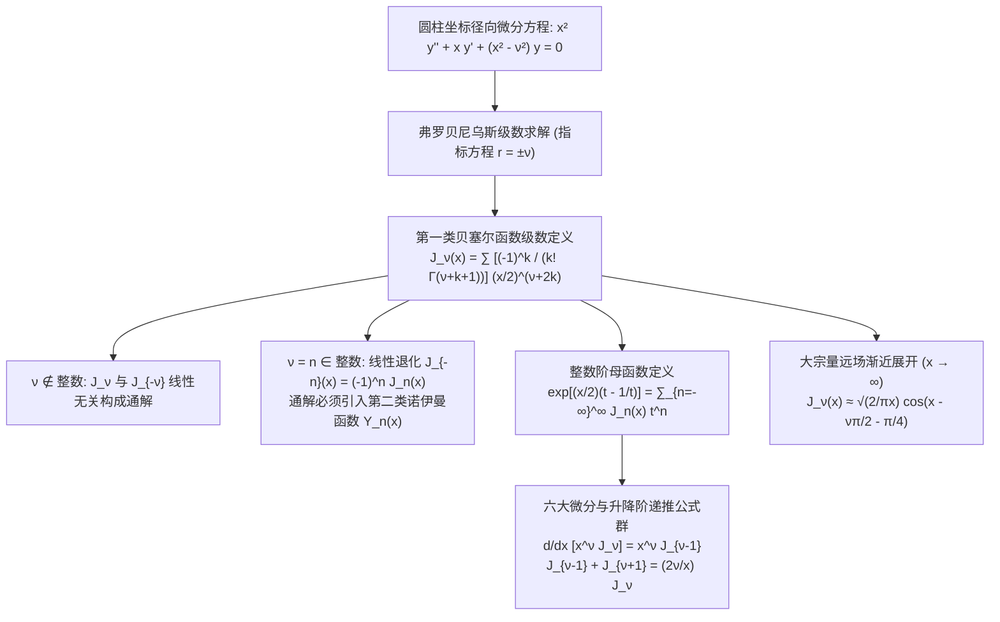

---
tags:
  - 物理/数学物理方法
  - 特殊函数
  - 概念卡
  - 贝塞尔函数
  - 柱函数
  - 母函数
  - 渐近展开
aliases:
  - 贝塞尔函数递推关系母函数与渐近展开
  - 第一类贝塞尔函数
  - 贝塞尔母函数
  - 贝塞尔函数递推公式
  - 半奇数阶贝塞尔函数
  - Bessel Functions Recurrence Relations Generating Function and Asymptotics
created: 2026-09-08
updated: 2026-09-08
---

> [!summary] 概念核心论断
> 贝塞尔函数（柱函数，$J_\nu(x)$）是圆柱对称系统（圆形薄膜振动、同轴电缆电磁波、光纤波导、圆孔弗劳恩霍夫衍射艾里斑）不可或缺的**柱面径向本征波函数**。作为二阶变系数贝塞尔微分方程在原点有界性筛选出的核心解析解，贝塞尔函数完美展现了从**微观幂级数**到**巨观母函数波调制**的数学美感。对于非整数阶，正负阶函数线性无关；而在关键的整数阶，两解退化线性相关，必须经由母函数建立谐波投影。随着宗量 $x \to \infty$，圆柱波几何扩散能量守恒要求振幅按 $1/\sqrt{x}$ 衰减，在远场平滑渐近过渡为带有内禀相位滞后的**调幅余弦平面波**。

## 一、推导机理与核心数学定义

---

### 1.1 贝塞尔方程与第一类贝塞尔函数级数定义

标准二阶线性变系数**贝塞尔方程 (Bessel's Equation)** 表述为：
$$\boxed{ x^2 \frac{d^2 y}{dx^2} + x \frac{dy}{dx} + (x^2 - \nu^2) y = 0 \quad (\nu \ge 0) }$$
原点 $x = 0$ 是方程的正则奇点。由弗罗贝尼乌斯方法（Card 21），设 $y(x) = x^r \sum a_k x^k$，最低阶项导出指标方程：
$$r(r - 1) + r - \nu^2 = r^2 - \nu^2 = 0 \implies r_1 = \nu, \quad r_2 = -\nu$$

代入较大根 $r = \nu$，经过偶次幂递推化简与伽马函数 $\Gamma(z)$ 标准化归一，定义**第一类 $\nu$ 阶贝塞尔函数 (Bessel Function of the First Kind)**：
$$\boxed{ J_\nu(x) = \sum_{k=0}^\infty \frac{(-1)^k}{k! \Gamma(\nu + k + 1)} \left( \frac{x}{2} \right)^{\nu + 2k} }$$

#### 1. 当 $\nu = n \in \mathbb{Z}$ 为非负整数时：
由于 $\Gamma(n + k + 1) = (n + k)!$，级数简化为：
$$J_n(x) = \sum_{k=0}^\infty \frac{(-1)^k}{k! (n + k)!} \left( \frac{x}{2} \right)^{n + 2k}$$

#### 2. 正负指标线性相关性判据：
- **当 $\nu \notin \mathbb{Z}$（非整数）时**：
  指标差 $r_1 - r_2 = 2\nu \notin \mathbb{Z}$，根据福克斯定理，两个解 $J_\nu(x)$ 与 $J_{-\nu}(x)$ **严格线性无关**，构成方程的完全基础解系，通解为 $y(x) = C_1 J_\nu(x) + C_2 J_{-\nu}(x)$。
- **当 $\nu = n \in \mathbb{Z}$（整数阶）时**：
  代入负指标定义式，利用伽马函数在负整数处的奇点极点性质 $\frac{1}{\Gamma(-m)} = 0$ ($m=0, 1, 2, \dots$)，前 $n$ 项系数严格全部为零！展开后导出**神圣退化恒等式**：
  $$\boxed{ J_{-n}(x) = (-1)^n J_n(x) \quad (n \in \mathbb{Z}) }$$
  两解线性相关！方程通解必须由第二类贝塞尔函数 $Y_n(x)$（诺伊曼函数）来补全。

---

### 1.2 整数阶贝塞尔函数的母函数与积分表示

#### 1. 母函数 (Generating Function) 定义：
对于复数变量 $t \neq 0$，构造指数型母函数：
$$\boxed{ G(x, t) \equiv \exp\left[ \frac{x}{2} \left( t - \frac{1}{t} \right) \right] = \sum_{n=-\infty}^{+\infty} J_n(x) t^n }$$
*推导验证*：展开两个单指数泰勒级数的柯西乘积：
$$e^{\frac{xt}{2}} e^{-\frac{x}{2t}} = \left( \sum_{r=0}^\infty \frac{(x/2)^r t^r}{r!} \right) \left( \sum_{s=0}^\infty \frac{(-1)^s (x/2)^s t^{-s}}{s!} \right)$$
提取净幂次 $t^{r-s} = t^n$（即 $r = n + s$）的系数，恰好重现 $J_n(x)$ 的级数定义式！

#### 2. 雅可比－昂格尔展开与贝塞尔积分表示：
令复变量 $t = e^{i\theta}$：
$$t - \frac{1}{t} = e^{i\theta} - e^{-i\theta} = 2i \sin\theta \implies \frac{x}{2}\left( t - \frac{1}{t} \right) = ix \sin\theta$$
代入母函数即得著名的**雅可比－昂格尔展开式 (Jacobi-Anger Expansion)**：
$$e^{ix \sin\theta} = \sum_{n=-\infty}^{+\infty} J_n(x) e^{in\theta} = J_0(x) + 2 \sum_{k=1}^\infty J_{2k}(x) \cos(2k\theta) + 2i \sum_{k=0}^\infty J_{2k+1}(x) \sin[(2k+1)\theta]$$
将右端视作关于 $\theta$ 的标准复指数傅里叶级数，直接反演计算其傅里叶谱系数，即得**贝塞尔积分表示公式**：
$$\boxed{ J_n(x) = \frac{1}{2\pi} \int_{-\pi}^\pi e^{i(x \sin\theta - n\theta)} d\theta = \frac{1}{\pi} \int_0^\pi \cos(n\theta - x \sin\theta) d\theta }$$

---

### 1.3 六大核心微分与升降阶递推公式群

通过对级数逐项求导或对母函数求偏导，可推导出一套极具威力、全通用的递推算子：

| 递推公式编号 | 数学解析表达式 | 运算功能与物理内涵 |
| :--- | :--- | :--- |
| **公式一 (升指数微分降阶)** | **$\frac{d}{dx} \left[ x^\nu J_\nu(x) \right] = x^\nu J_{\nu-1}(x)$** | 核心积分公式：$\int x^\nu J_{\nu-1}(x) dx = x^\nu J_\nu(x)$ |
| **公式二 (降指数微分升阶)** | **$\frac{d}{dx} \left[ x^{-\nu} J_\nu(x) \right] = -x^{-\nu} J_{\nu+1}(x)$** | 核心积分公式：$\int x^{-\nu} J_{\nu+1}(x) dx = -x^{-\nu} J_\nu(x)$ |
| **公式三 (三项代数升降阶)** | **$J_{\nu-1}(x) + J_{\nu+1}(x) = \frac{2\nu}{x} J_\nu(x)$** | **纯代数算法**：由 $J_0, J_1$ 可递推算出任意高阶贝塞尔函数！ |
| **公式四 (微分降升差值)** | **$J_{\nu-1}(x) - J_{\nu+1}(x) = 2 J_\nu'(x)$** | 导数与相邻两阶纯代数线性组合的互相映射 |
| **公式五 (一阶导数降阶表象)** | **$J_\nu'(x) = J_{\nu-1}(x) - \frac{\nu}{x} J_\nu(x)$** | 将导数消除，转换为同阶与低阶函数计算 |
| **公式六 (一阶导数升阶表象)** | **$J_\nu'(x) = -J_{\nu+1}(x) + \frac{\nu}{x} J_\nu(x)$** | 导数向高阶函数的单向转换（特例：$J_0'(x) = -J_1(x)$） |

---

### 1.4 小宗量极限与大宗量渐近余弦展开

#### 1. 小宗量近场行为 ($x \to 0$)：
由级数首项主导：
$$J_0(x) = 1 - \frac{x^2}{4} + O(x^4) \implies J_0(0) = 1$$
$$J_\nu(x) \approx \frac{1}{\Gamma(\nu + 1)} \left( \frac{x}{2} \right)^\nu \quad (\nu > 0)$$
所有正阶贝塞尔函数在原点均恒等于 0，且阶数越高在原点附近的“平台期”越平坦。

#### 2. 大宗量远场渐近展开 ($x \to \infty$)：
利用驻相法或鞍点法对积分表达式展开，当 $x \gg 1$ 时：
$$\boxed{ J_\nu(x) = \sqrt{\frac{2}{\pi x}} \cos\left( x - \frac{\nu\pi}{2} - \frac{\pi}{4} \right) + O\left( x^{-3/2} \right) }$$

**物理深刻内涵**：
1. **几何振幅衰减 $1/\sqrt{x}$**：圆柱波能量通量流经同心圆柱面 $S \propto 2\pi r$，能流密度守恒要求场强振幅必按 $1/\sqrt{r}$ 衰减；
2. **渐近正弦振荡与零点间隔**：在远场，连续两个相邻零点的间距严格渐近趋于常数 $\Delta x \approx \pi$，展现出与一维简谐正余弦驻波完全对偶的准周期行为；
3. **内禀相位滞后 $-\frac{\nu\pi}{2} - \frac{\pi}{4}$**：圆柱波在原点几何奇点反射积累的特征拓扑几何相移。

---

## 二、⚠️ 致命失分陷阱与临界边界

> [!warning] 陷阱 1：整数阶贝塞尔方程通解中出现虚假独立解 $J_{-n}$
> 考场最高频致命错误：
> - 求解整数阶方程（如 $x^2 y'' + x y' + (x^2 - 1) y = 0$）：
> - 许多考生误写通解为 $y = C_1 J_1(x) + C_2 J_{-1}(x)$；
> - 必须严正牢记：$J_{-1}(x) = -J_1(x)$！这两个解本质上是同一个解，该写法实质上只包含一个任意常数 $(C_1 - C_2) J_1(x)$，解丢失了一个自由度！必须使用诺伊曼函数 $Y_1(x)$。

> [!caution] 陷阱 2：微分递推公式漏乘幂因子导致求导错误
> 考场推导时最容易漏掉幂函数因子：
> - 正确：$\frac{d}{dx}[x J_1(x)] = x J_0(x) \implies J_1(x) + x J_1'(x) = x J_0(x)$；
> - 常见低级错误：想当然写成 $J_1'(x) = J_0(x)$（这是完全错误的伪公式，只有 $J_0'(x) = -J_1(x)$ 成立）；
> - 必须严格运用公式一与公式二：必须连带 $x^{\pm \nu}$ 整体求导！

> [!danger] 陷阱 3：零阶贝塞尔函数在原点的数值与导数
> 考场在带入边界条件时，经常把零阶与高阶混淆：
> - $J_0(0) = 1$（不是 0！）；
> - $J_0'(0) = -J_1(0) = 0$；
> - $J_n(0) = 0$ ($n \ge 1$)；
> 混淆原点值会导致初始条件投影系数全盘算错。

---

## 三、经典范例手把手演算

### 题目（半奇数阶贝塞尔函数的初等函数封闭解析推导）：
1. 取 $\nu = \frac{1}{2}$，代入第一类贝塞尔函数级数定义式，严格手把手证明 $J_{1/2}(x)$ 可精确退化为初等正弦波函数：
   $$J_{1/2}(x) = \sqrt{\frac{2}{\pi x}} \sin x$$
2. 利用递推公式手把手求出 $J_{-1/2}(x)$ 与 $J_{3/2}(x)$ 的封闭初等表达式。

#### 【演算步骤】

**第一步：由级数定义展开 $J_{1/2}(x)$**
将 $\nu = 1/2$ 代入级数通式：
$$J_{1/2}(x) = \sum_{k=0}^\infty \frac{(-1)^k}{k! \Gamma\left(k + \frac{3}{2}\right)} \left( \frac{x}{2} \right)^{\frac{1}{2} + 2k}$$
提取公因式 $\sqrt{\frac{x}{2}}$：
$$J_{1/2}(x) = \sqrt{\frac{x}{2}} \sum_{k=0}^\infty \frac{(-1)^k}{k! \Gamma\left(k + \frac{3}{2}\right)} \left( \frac{x}{2} \right)^{2k}$$
利用伽马函数的半整数阶乘性质：
$$\Gamma\left(k + \frac{3}{2}\right) = \left(k + \frac{1}{2}\right) \left(k - \frac{1}{2}\right) \dots \frac{1}{2} \Gamma\left(\frac{1}{2}\right) = \frac{(2k + 1)!!}{2^{k+1}} \sqrt{\pi}$$
又因为：
$$k! \cdot (2k + 1)!! = \frac{(2k)!!}{2^k} (2k + 1)!! = \frac{(2k + 1)!}{2^k}$$
两式相乘化简分母：
$$k! \Gamma\left(k + \frac{3}{2}\right) = \frac{(2k + 1)!}{2^k} \cdot \frac{\sqrt{\pi}}{2^{k+1}} \cdot 2^k \dots = \frac{(2k + 1)! \sqrt{\pi}}{2^{2k + 1}}$$
将此分母代回级数式：
$$J_{1/2}(x) = \sqrt{\frac{x}{2}} \sum_{k=0}^\infty \frac{(-1)^k 2^{2k + 1}}{(2k + 1)! \sqrt{\pi}} \frac{x^{2k}}{2^{2k}} = \sqrt{\frac{x}{2}} \frac{2}{\sqrt{\pi}} \sum_{k=0}^\infty \frac{(-1)^k x^{2k}}{(2k + 1)!}$$
分子分母同乘 $x$：
$$J_{1/2}(x) = \sqrt{\frac{2}{\pi x}} \sum_{k=0}^\infty \frac{(-1)^k x^{2k + 1}}{(2k + 1)!}$$
注意右端的无穷级数正是**初等正弦函数 $\sin x$ 的麦克劳林展开式**！
由此精确证得：
$$\boxed{ J_{1/2}(x) = \sqrt{\frac{2}{\pi x}} \sin x }$$

---

**第二步：计算 $J_{-1/2}(x)$**
同理，将 $\nu = -1/2$ 代入（利用 $\Gamma(1/2) = \sqrt{\pi}$）：
$$J_{-1/2}(x) = \sum_{k=0}^\infty \frac{(-1)^k}{k! \Gamma\left(k + \frac{1}{2}\right)} \left( \frac{x}{2} \right)^{-\frac{1}{2} + 2k}$$
分母展开：$k! \Gamma(k + 1/2) = \frac{(2k)! \sqrt{\pi}}{2^{2k}}$。
代入得：
$$J_{-1/2}(x) = \sqrt{\frac{2}{x}} \frac{1}{\sqrt{\pi}} \sum_{k=0}^\infty \frac{(-1)^k x^{2k}}{(2k)!} = \boxed{ \sqrt{\frac{2}{\pi x}} \cos x }$$

---

**第三步：利用三项递推公式求解 $J_{3/2}(x)$**
应用公式三：$J_{\nu-1}(x) + J_{\nu+1}(x) = \frac{2\nu}{x} J_\nu(x)$。
令 $\nu = 1/2$：
$$J_{-1/2}(x) + J_{3/2}(x) = \frac{2(1/2)}{x} J_{1/2}(x) = \frac{1}{x} J_{1/2}(x)$$
移项求解 $J_{3/2}(x)$：
$$J_{3/2}(x) = \frac{1}{x} J_{1/2}(x) - J_{-1/2}(x) = \frac{1}{x} \sqrt{\frac{2}{\pi x}} \sin x - \sqrt{\frac{2}{\pi x}} \cos x$$
提取公因式 $\sqrt{\frac{2}{\pi x}}$：
$$\boxed{ J_{3/2}(x) = \sqrt{\frac{2}{\pi x}} \left( \frac{\sin x}{x} - \cos x \right) }$$

**物理深刻结论**：所有半奇数阶贝塞尔函数（球贝塞尔函数 $j_l(x) = \sqrt{\frac{\pi}{2x}} J_{l+1/2}(x)$）全部可严格由初等多项式与正余弦函数的复合显式表述！它们正是三维球坐标波动方程径向解的物理本质。

---

## 四、出处与纸质笔记坐标

* **教材出处**：梁昆淼《数学物理方法》（第四版）第十一章 §11.1-§11.2 (P263-P277)
* **纸质活页槽位**：`[活页-LKM-26]`
* **知识全景索引**：[[00_梁昆淼数学物理方法_第三篇全景图]]
