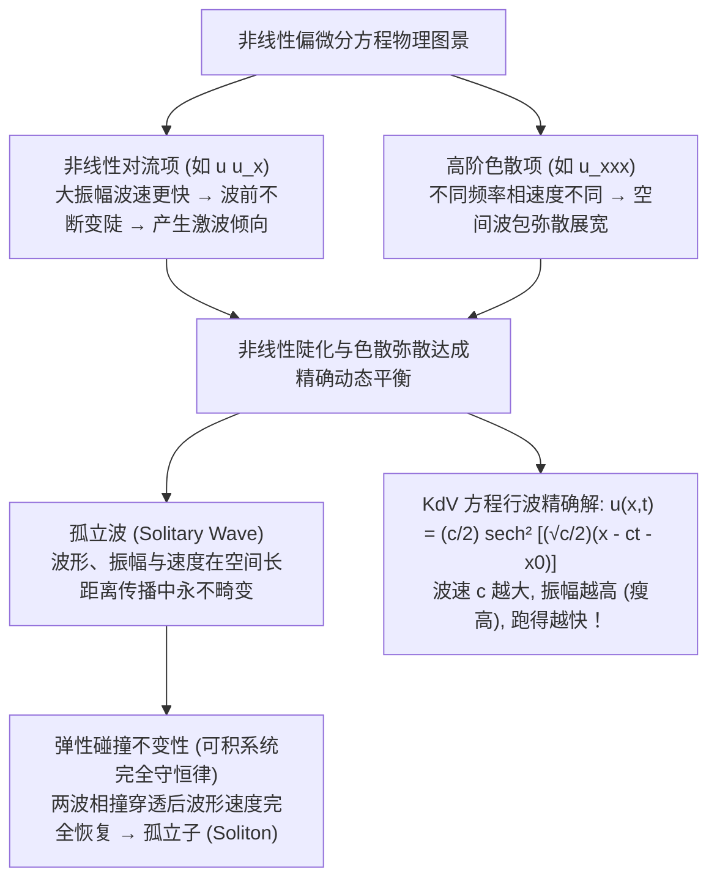

---
tags:
  - 物理/数学物理方法
  - 非线性物理
  - 概念卡
  - 孤立波
  - 孤子
  - KdV方程
  - 孤立波精确解
aliases:
  - 非线性数理方程孤立波与KdV方程
  - 孤立子与孤立波
  - KdV方程单孤子解
  - 非线性对流与色散平衡
  - 伯格斯方程与正弦戈登方程
  - Nonlinear PDEs Solitary Waves and KdV Equation
created: 2026-09-08
updated: 2026-09-08
---

> [!summary] 概念核心论断
> 经典线性数学物理方法建立在“小振幅近似”与“线性叠加原理”的基石之上；而当物理扰动超越微幅范畴时，大自然展示出更加瑰丽奇绝的非线性物理图景。在非线性介质中，波的演化受制于两大相互竞争的物理力量：**非线性对流项（引起波峰加速的波前变陡与激波倾向）**与**高阶色散项（导致不同波长谐波相速度分离的波包弥散展宽）**。当这两大相反倾向在动力学中达成精巧绝伦的**动态平衡**时，便诞生了千百年来波形、波速与能量恒定不变的**孤立波 (Solitary Wave)**。以浅水长波 **KdV 方程**为代表的完全可积非线性系统更展现了碰撞后波形完好如初的**孤立子 (Soliton)** 奇迹，标志着数学物理方法向现代非线性科学与孤子通信技术的伟大跃迁。

## 一、推导机理与核心数学定义

---

### 1.1 KdV 方程与孤立波形成的动力学机制

1895 年，荷兰数学家科特韦赫 (Korteweg) 与德弗里斯 (de Vries) 为了解释罗素 (John Scott Russell) 1834 年在运河中观测到的奇特孤立水波，推导出了著名的浅水无耗散非线性波方程——**KdV 方程 (Korteweg-de Vries Equation)**：
$$\boxed{ \frac{\partial u}{\partial t} + 6 u \frac{\partial u}{\partial x} + \frac{\partial^3 u}{\partial x^3} = 0 }$$

#### 动力学竞争机制深度剖析：
1. **纯非线性方程（去掉色散项）：$u_t + 6 u u_x = 0$**
   特征线方程为 $\frac{dx}{dt} = 6u$。
   波上任意一点的传播速度正比于该点的波幅 $u$！
   波峰处的幅值高于波谷，因此**波峰跑得比波谷快**，波峰逐渐追赶波谷，使波的前沿越来越陡峭，最终切线斜率变为无穷大形成**激波破坏 (Shock Break)**。
2. **纯线性色散方程（去掉非线性项）：$u_t + u_{xxx} = 0$**
   代入平面简谐波 $u \sim e^{i(kx - \omega t)}$，导出色散关系：
   $$-i\omega + (ik)^3 = 0 \implies \omega(k) = -k^3$$
   相速度为 $v_p = \frac{\omega}{k} = -k^2$，群速度为 $v_g = \frac{d\omega}{dk} = -3k^2$。
   不同波长的波传播速度各不相同，任意局域的孤立波包会随时间不断**扩散拉宽变扁，能量弥散**。
3. **KdV 动态平衡**：
   非线性项 $6 u u_x$ 使波前不断变陡变窄，而三阶导数色散项 $u_{xxx}$ 不断使波前平滑展宽。两者的动态制衡使波包维持永恒不变的固定形态！

---

### 1.2 KdV 方程单孤子解的严格解析推导

设 KdV 方程具有固定波速为 $c > 0$、沿 $+x$ 方向恒定平移的**行波特解 (Traveling Wave)**：
$$u(x, t) = U(\xi), \quad \xi = x - ct$$
由链式法则：
$$\frac{\partial u}{\partial t} = -c U'(\xi), \quad \frac{\partial u}{\partial x} = U'(\xi), \quad \frac{\partial^3 u}{\partial x^3} = U'''(\xi)$$
代入 KdV 方程，偏微分方程退化为关于 $\xi$ 的**三阶非线性常微分方程**：
$$-c U' + 6 U U' + U''' = 0$$

#### 第一次积分（施加孤立波无穷远局域边界）：
由于寻找的是孤立波，波在远离中心处必须衰减为零，且各阶导数平滑趋于零：
$$\lim_{|\xi| \to \infty} U(\xi) = 0, \quad \lim_{|\xi| \to \infty} U'(\xi) = 0, \quad \lim_{|\xi| \to \infty} U''(\xi) = 0$$
将方程每一项直接关于 $\xi$ 积分：
$$-c U + 3 U^2 + U'' = C_1$$
代入无穷远边界条件，积分常数严格为零：$C_1 = 0$。
方程简化为二阶常微分方程：
$$U'' - c U + 3 U^2 = 0$$

#### 第二次积分（引入能量势函数积分因子）：
两边同乘一阶导数 $U'(\xi)$：
$$U'' U' - c U U' + 3 U^2 U' = 0 \iff \frac{d}{d\xi} \left[ \frac{1}{2}(U')^2 - \frac{c}{2} U^2 + U^3 \right] = 0$$
两边再次关于 $\xi$ 积分：
$$\frac{1}{2}(U')^2 - \frac{c}{2} U^2 + U^3 = C_2$$
代入无穷远边界条件 $U \to 0, U' \to 0$，积分常数亦为零：$C_2 = 0$。
方程分离为一阶自洽动力学系统：
$$(U')^2 = c U^2 - 2 U^3 = c U^2 \left( 1 - \frac{2}{c} U \right)$$
开方得可分离变量的一阶微分方程：
$$\frac{dU}{d\xi} = \pm \sqrt{c} U \sqrt{1 - \frac{2}{c} U}$$

#### 变量代换完成最终积分：
作变量代换：令 $U = \frac{c}{2} \operatorname{sech}^2\theta$（利用恒等式 $1 - \tanh^2\theta = \operatorname{sech}^2\theta$）：
$$dU = \frac{c}{2} \cdot 2 \operatorname{sech}\theta (-\operatorname{sech}\theta \tanh\theta) d\theta = -c \operatorname{sech}^2\theta \tanh\theta d\theta$$
$$\sqrt{1 - \frac{2}{c} U} = \sqrt{1 - \operatorname{sech}^2\theta} = \tanh\theta$$
代入方程：
$$\frac{-c \operatorname{sech}^2\theta \tanh\theta d\theta}{\left(\frac{c}{2} \operatorname{sech}^2\theta\right) \tanh\theta} = \pm \sqrt{c} d\xi \implies -2 d\theta = \pm \sqrt{c} d\xi \implies d\theta = \mp \frac{\sqrt{c}}{2} d\xi$$
积分之：
$$\theta = \mp \frac{\sqrt{c}}{2} (\xi - \xi_0)$$
代回 $U(\xi)$，利用双曲正割函数的偶对称性 $\operatorname{sech}(-\theta) = \operatorname{sech}(\theta)$：
$$U(\xi) = \frac{c}{2} \operatorname{sech}^2\left( \frac{\sqrt{c}}{2} (\xi - \xi_0) \right)$$
将行波坐标 $\xi = x - ct$ 还原，即导出名垂物理史册的**KdV 单孤子精确显式解析解**：
$$\boxed{ u(x, t) = \frac{c}{2} \operatorname{sech}^2\left[ \frac{\sqrt{c}}{2} (x - ct - x_0) \right] }$$

---

### 1.3 KdV 孤立子的三大物理奇特性质

1. **振幅与波速成绝对正比**：
   孤波的最大峰值高度为：
   $$\boxed{ A = \frac{c}{2} }$$
   **波幅越高，波速 $c$ 越快**！大波永远跑在小波前面；如果后方出现一个高振幅大波，它将以更快速度追赶前方的小波；
2. **波宽与波速成反比（高瘦与矮胖）**：
   孤波的特征空间宽度（半峰全宽）为：
   $$\boxed{ \Delta \propto \frac{1}{\sqrt{c}} }$$
   波速越快，波形越“瘦高”；波速越慢，波形越“平缓矮胖”；
3. **碰撞的完全弹性复原（“粒子性”与孤子命名）**：
   当一个大孤波从后方追赶并与前方小孤波发生非线性相互作用（剧烈非线性重组碰撞）后：
   碰撞结束后，大波重新从前方脱颖而出，小波留在后方。**两个波的形状、高度、速度与碰撞前完全一模一样，没有任何能量损失和畸变，仅仅在空间坐标上产生了一个极微小的相对相位移动 (Phase Shift)**！这一具有类似微观粒子弹性碰撞的奇特性质，促使扎布斯基 (Zabusky) 和克鲁斯卡尔 (Kruskal) 于 1965 年将其正式命名为**孤立子 (Soliton)**。

---

### 1.4 经典非线性数学物理方程家族谱系

| 方程名称 | 标准偏微分方程形式 | 核心非线性与物理机制 | 典型物理系统与孤子类型 |
| :--- | :--- | :--- | :--- |
| **KdV 方程** | $u_t + 6 u u_x + u_{xxx} = 0$ | 对流陡化 vs 线性高阶色散 | 浅水长波、等离子体离子声波、内重力波（单峰正割孤子） |
| **Burgers 方程** | $u_t + u u_x = \nu u_{xx}$ | 对流陡化 vs 粘性耗散扩散 | 气体激波结构、交通流流体力学模型（可通过 Cole-Hopf 变换线性化） |
| **Sine-Gordon 方程** | $u_{tt} - u_{xx} + \sin u = 0$ | 波动惯性 vs 周期非线性晶格势 | 晶体中位错运动、超导约瑟夫森结磁通子（**扭折孤子 Kink**，拓扑荷守恒） |
| **非线性薛定谔方程 (NLS 方程)** | $i \psi_t + \psi_{xx} + 2 |\psi|^2 \psi = 0$ | 空间衍射/色散 vs 自聚焦非线性（克尔介质） | 非线性光纤光孤子通信、玻色－爱因斯坦凝聚 (BEC)（**包络亮/暗孤子**） |

---

## 二、⚠️ 致命失分陷阱与临界边界

> [!warning] 陷阱 1：孤立波 (Solitary Wave) 与孤立子 (Soliton) 的概念混同
> 考场论述题中极其容易混淆这两个概念：
> - **孤立波 (Solitary Wave)**：泛指任何波形在传播过程中保持不变的局域孤立单波包（只要非线性与色散平衡即可存在）；
> - **孤立子 (Soliton)**：要求更高更苛刻！不仅波形不变，更必须在与其他孤波**经历碰撞后依然完全保持波形、速度和振幅不变（只产生相移）**！
> 只有具有无穷多个守恒律的**完全可积系统 (Completely Integrable Systems)**（如 KdV, NLS, Sine-Gordon）中的孤立波才有资格称为“孤子”。

> [!caution] 陷阱 2：KdV 单孤子解中波速、振幅与自变量系数匹配失误
> 单孤子表达式中包含三个关键位置的 $c$：
> - 振幅系数是 $\frac{c}{2}$；
> - 双曲正割括号内的系数是 $\frac{\sqrt{c}}{2}$；
> - 极易漏写系数中的分母 2，误记为 $c \operatorname{sech}^2[\sqrt{c}(x - ct)]$，代入方程将多出 4 倍常数而无法满足 KdV 方程。

> [!danger] 陷阱 3：非线性方程盲目套用线性叠加原理
> 非线性偏微分方程的最根本数学特征：
> - **线性叠加原理彻底失效！**
> - 若 $u_1(x, t)$ 和 $u_2(x, t)$ 是 KdV 方程的孤子解，两者的线性相加 $u_1 + u_2$ **绝对不是 KdV 方程的解**！
> - 多孤子相互作用必须借助逆散射变换 (Inverse Scattering Transform, IST) 或广田双线性方法 (Hirota's Method) 等高阶非线性算子工具求解。

---

## 三、经典范例手把手演算

### 题目（KdV 单孤子解手把手反代偏微分方程全面验算）：
已知行波解：
$$u(x, t) = 2 \kappa^2 \operatorname{sech}^2\left[ \kappa (x - 4\kappa^2 t) \right]$$
（此为令 $\kappa = \frac{\sqrt{c}}{2} \implies c = 4\kappa^2, A = \frac{c}{2} = 2\kappa^2$ 的标准紧凑写法）。
1. 手把手计算偏导数 $\frac{\partial u}{\partial t}$、$\frac{\partial u}{\partial x}$、非线性项 $6 u \frac{\partial u}{\partial x}$ 以及三阶色散导数 $\frac{\partial^3 u}{\partial x^3}$；
2. 严格手把手合并所有求导项，证明其严格满足 KdV 方程：
   $$\frac{\partial u}{\partial t} + 6 u \frac{\partial u}{\partial x} + \frac{\partial^3 u}{\partial x^3} \equiv 0$$

#### 【演算步骤】

**第一步：定义中间变量并计算一阶微商**
令行波自变量：$\theta = \kappa (x - 4\kappa^2 t)$。
则：
$$u(\theta) = 2\kappa^2 \operatorname{sech}^2\theta$$
根据链式法则：$\frac{\partial\theta}{\partial x} = \kappa, \quad \frac{\partial\theta}{\partial t} = -4\kappa^3$。
已知双曲函数求导公式：$\frac{d}{d\theta}\operatorname{sech}\theta = -\operatorname{sech}\theta \tanh\theta$。
- 对 $\theta$ 求一阶导数：
  $$\frac{du}{d\theta} = 2\kappa^2 \cdot 2\operatorname{sech}\theta (-\operatorname{sech}\theta \tanh\theta) = -4\kappa^2 \operatorname{sech}^2\theta \tanh\theta$$
- **计算时间导数项 $\frac{\partial u}{\partial t}$**：
  $$\frac{\partial u}{\partial t} = \frac{du}{d\theta} \frac{\partial\theta}{\partial t} = (-4\kappa^2 \operatorname{sech}^2\theta \tanh\theta)(-4\kappa^3) = \boxed{ +16 \kappa^5 \operatorname{sech}^2\theta \tanh\theta }$$
- **计算空间一阶导数 $\frac{\partial u}{\partial x}$**：
  $$\frac{\partial u}{\partial x} = \frac{du}{d\theta} \frac{\partial\theta}{\partial x} = \boxed{ -4\kappa^3 \operatorname{sech}^2\theta \tanh\theta }$$

**第二步：计算非线性对流项 $6 u \frac{\partial u}{\partial x}$**
$$6 u \frac{\partial u}{\partial x} = 6 \left( 2\kappa^2 \operatorname{sech}^2\theta \right) \left( -4\kappa^3 \operatorname{sech}^2\theta \tanh\theta \right) = \boxed{ -48 \kappa^5 \operatorname{sech}^4\theta \tanh\theta }$$

**第三步：连续微商计算三阶色散项 $\frac{\partial^3 u}{\partial x^3}$**
1. **求对 $\theta$ 的二阶导数 $\frac{d^2 u}{d\theta^2}$**：
   $$\frac{d^2 u}{d\theta^2} = \frac{d}{d\theta} \left[ -4\kappa^2 \operatorname{sech}^2\theta \tanh\theta \right]$$
   利用乘积法则（注意 $\frac{d}{d\theta}\tanh\theta = \operatorname{sech}^2\theta$）：
   $$\frac{d^2 u}{d\theta^2} = -4\kappa^2 \left[ \left( -2\operatorname{sech}^2\theta \tanh\theta \right) \tanh\theta + \operatorname{sech}^2\theta (\operatorname{sech}^2\theta) \right]$$
   $$= -4\kappa^2 \left[ -2\operatorname{sech}^2\theta \tanh^2\theta + \operatorname{sech}^4\theta \right]$$
   代入恒等式 $\tanh^2\theta = 1 - \operatorname{sech}^2\theta$：
   $$-2\operatorname{sech}^2\theta (1 - \operatorname{sech}^2\theta) + \operatorname{sech}^4\theta = -2\operatorname{sech}^2\theta + 2\operatorname{sech}^4\theta + \operatorname{sech}^4\theta = -2\operatorname{sech}^2\theta + 3\operatorname{sech}^4\theta$$
   因此：
   $$\frac{d^2 u}{d\theta^2} = -4\kappa^2 \left[ -2\operatorname{sech}^2\theta + 3\operatorname{sech}^4\theta \right] = 8\kappa^2 \operatorname{sech}^2\theta - 12\kappa^2 \operatorname{sech}^4\theta$$

2. **求对 $\theta$ 的三阶导数 $\frac{d^3 u}{d\theta^3}$**：
   $$\frac{d^3 u}{d\theta^3} = 8\kappa^2 (-2\operatorname{sech}^2\theta \tanh\theta) - 12\kappa^2 \left[ 4\operatorname{sech}^3\theta (-\operatorname{sech}\theta \tanh\theta) \right]$$
   $$= -16\kappa^2 \operatorname{sech}^2\theta \tanh\theta + 48\kappa^2 \operatorname{sech}^4\theta \tanh\theta$$

3. **化为对空间变量 $x$ 的三阶导数**：
   $$\frac{\partial^3 u}{\partial x^3} = \frac{d^3 u}{d\theta^3} \left( \frac{\partial\theta}{\partial x} \right)^3 = \kappa^3 \frac{d^3 u}{d\theta^3}$$
   $$\boxed{ \frac{\partial^3 u}{\partial x^3} = -16\kappa^5 \operatorname{sech}^2\theta \tanh\theta + 48\kappa^5 \operatorname{sech}^4\theta \tanh\theta }$$

**第四步：代入 KdV 方程合并总检验**
将三项全部相加：
$$\frac{\partial u}{\partial t} + 6 u \frac{\partial u}{\partial x} + \frac{\partial^3 u}{\partial x^3}$$
$$= \left( 16\kappa^5 \operatorname{sech}^2\theta \tanh\theta \right) + \left( -48\kappa^5 \operatorname{sech}^4\theta \tanh\theta \right) + \left( -16\kappa^5 \operatorname{sech}^2\theta \tanh\theta + 48\kappa^5 \operatorname{sech}^4\theta \tanh\theta \right)$$
按波函数项进行合并：
- $\operatorname{sech}^2\theta \tanh\theta$ 项系数：$16\kappa^5 - 16\kappa^5 = 0$；
- $\operatorname{sech}^4\theta \tanh\theta$ 项系数：$-48\kappa^5 + 48\kappa^5 = 0$。
总和严格恒等于零：
$$\frac{\partial u}{\partial t} + 6 u \frac{\partial u}{\partial x} + \frac{\partial^3 u}{\partial x^3} \equiv 0！$$
非线性对流项与高阶色散项精确、完美抵消，孤立子解的数学正确性无懈可击！

---

## 四、出处与纸质笔记坐标

* **教材出处**：梁昆淼《数学物理方法》（第四版）第十五章 §15.1-§15.2 (P374-P390)
* **纸质活页槽位**：`[活页-LKM-35]`
* **知识全景索引**：[[00_梁昆淼数学物理方法_第四篇全景图]]
