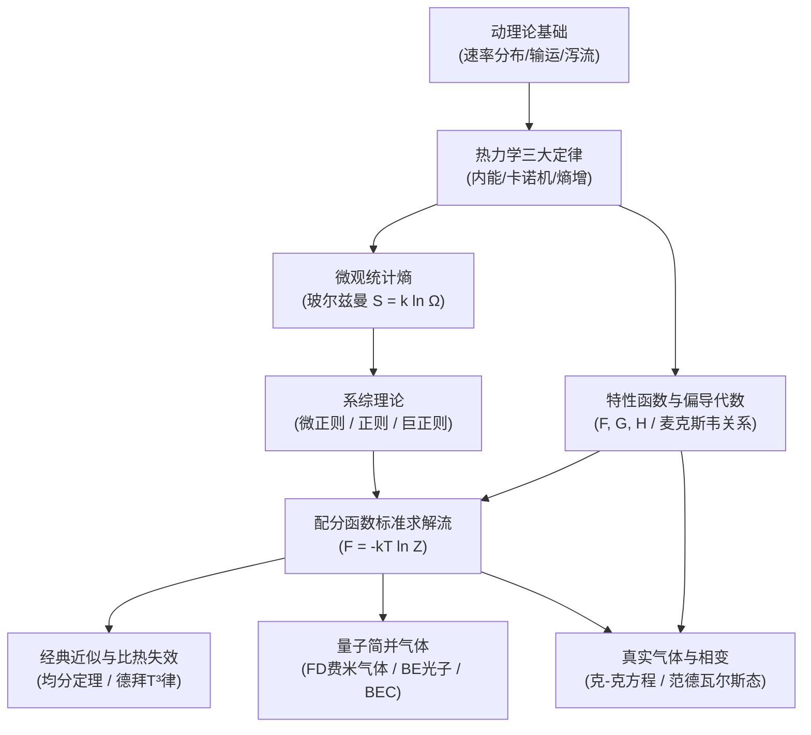

---
aliases:
  - 热学与统计物理全景图
  - Thermal and Statistical Physics MOC
tags:
  - 物理/热学与统计物理
  - 知识全景图
---

# 热学与统计物理 (Thermal and Statistical Physics) 体系全景图

> 本知识库严格遵循 **教材解构黄金标准 (v1 Standard)** 构建，解构自经典权威教材 **Stephen J. Blundell & Katherine M. Blundell《Concepts in Thermal Physics》**。
> 全库涵盖从分子动理论到经典热力学定律，再递进至统计物理微正则、正则、巨正则系综，直至量子气体简并与相变理论的 26 张高阶出版级卡片，形成闭环自洽的物理与数学架构。

---

## 模块一：气体动理论与非平衡微观输运

微观分子撞击与速率统计是连接经典力学与宏观热力学的第一道桥梁。

- [[概念_热力学极限与温度的统计本质]] `[活页-THERM-01]`：热力学系统大数极限 ($N \to \infty$)、统计温度微观定义 $\frac{\partial \ln \Omega}{\partial E} = \frac{1}{k_B T}$。
- [[定理_麦克斯韦玻尔兹曼速率分布]] `[活页-THERM-02]`：高斯各向同性假设、球壳相空间微元 $v^2$ 因子、三种特征速率严格推导。
- [[技术_气体压强与分子泻流计算]] `[活页-THERM-03]`：碰撞动量传递推导 $P = \frac{1}{3}nm\langle v^2\rangle$、克努森流泻流通量 $\Phi = \frac{1}{4}n\langle v\rangle$ 与泻流冷却。
- [[概念_分子平均自由程与微观输运]] `[活页-THERM-04]`：硬球碰撞截面 $\sigma = \pi d^2$、动量与热能梯度输运、气体黏度与压强无关性的物理本质。

---

## 模块二：热力学三大定律与经典热机极限

以不可逆性与熵为灵魂的唯象热力学宏观大厦。

- [[定理_热力学第一定律与功热转化]] `[活页-THERM-05]`：内能状态函数存在性、做功与传热的微观能级机制差异、自由膨胀的非准静态本质。
- [[技术_理想气体等温与绝热多方过程]] `[活页-THERM-06]`：微分演变关系、绝热方程 $PV^\gamma = \text{const}$、多方过程热容与 $P-V$ 图几何斜率对比。
- [[定理_卡诺定理与热机最大效率]] `[活页-THERM-07]`：开尔文与克劳修斯表述等价性、卡诺循环可逆性定理、第二类永动机的不可能性。
- [[定理_克劳修斯不等式与宏观熵]] `[活页-THERM-08]`：无穷微元循环逼近、$\oint \frac{đQ}{T} \le 0$、态函数熵定义及孤立系统熵增原理。
- [[定理_热力学第三定律与能斯特热定理]] `[活页-THERM-13]`：绝对零度熵趋零极限 ($S_0 = 0$)、热容与膨胀系数低温冻结、绝对零度有限步不可达性。

---

## 模块三：热力学特性函数与麦克斯韦关系式代数

以勒让德变换与全微分条件为基础的高阶热力学校准分析。

- [[概念_四大热力学特性函数与勒让德变换]] `[活页-THERM-10]`：内能 $U$、焓 $H$、自由能 $F$、吉布斯自由能 $G$ 的自然变量与自发判据极值性。
- [[定理_麦克斯韦关系式与雅可比行列式]] `[活页-THERM-11]`：二阶偏导对称性导出四个基本关系、雅可比行列式热力学偏导化简范式。
- [[技术_热容差严格推导与绝热压缩率]] `[活页-THERM-12]`：内能展开推导 $C_P - C_V = \frac{VT\beta^2}{\kappa_T}$、一切热力学稳定体系定压比热必大于定容比热的证明。

---

## 模块四：系综理论与微观统计桥梁

从微观状态空间积分建立通向宏观自由能的终极统计通道。

- [[概念_玻尔兹曼统计熵与微观状态数]] `[活页-THERM-09]`：$S = k_B \ln \Omega$、不可逆性的微观状态概率驱动、吉布斯全同性佯谬与 $1/N!$ 因子。
- [[概念_微正则系综与等几率假定]] `[活页-THERM-14]`：孤立系 $(N,V,E)$、能壳层相空间等几率假设、量子微观态体积微元 $h^{3N}$。
- [[定理_正则系综与玻尔兹曼配分函数]] `[活页-THERM-15]`：大热库接触 $(N,V,T)$、玻尔兹曼概率因子、配分函数桥梁 $F = -k_B T \ln Z$ 统一求解内能与熵。
- [[技术_配分函数求热力学量标准代数流]] `[活页-THERM-17]`：单粒子态向全同体系转化 $Z = z^N/N!$、热波长 $\lambda_{th}$、理想气体物态方程与萨克尔-特特罗德绝对熵公式。
- [[概念_化学势与巨正则系综]] `[活页-THERM-18]`：粒子数开放系统 $(V,T,\mu)$、化学势的微观增量定义、巨配分函数 $\Xi$ 与巨热力学势 $\Phi = -PV$。
- [[技术_巨配分函数与粒子数涨落计算]] `[活页-THERM-19]`：巨配分函数求平均粒子数与方差、相对涨落 $\propto 1/\sqrt{N}$ 展现的热力学极限系综等价性。

---

## 模块五：经典均分定理与固态比热模型

量子能级冻结如何突破经典电动力学与经典统计的致命困境。

- [[定理_经典能量均分定理与杜隆珀蒂律]] `[活页-THERM-16]`：二次型哈密顿量每自由度贡献 $\frac{1}{2}k_B T$、经典固体比热杜隆-珀蒂常数 $3R$。
- [[技术_固态比热德拜模型与T3低温律]] `[活页-THERM-21]`：声子态密度二次方谱 $g(\omega) \propto \omega^2$、德拜温度 $\Theta_D$、极低温晶格热容 $(T/\Theta_D)^3$ 渐近行为。

---

## 模块六：量子气体统计与简并物理

全同粒子波函数交换对称性主导的宏观量子物理。

- [[定理_光子气体与普朗克黑体辐射]] `[活页-THERM-20]`：化学势 $\mu=0$、普朗克黑体辐射能量谱密度、紫外灾难的终结与光辐射压 $P = u/3$。
- [[定理_量子气体两大统计分布律]] `[活页-THERM-22]`：费米-狄拉克分布与玻色-爱因斯坦分布微观推导、经典玻尔兹曼极限判据 $n\lambda_{th}^3 \ll 1$。
- [[定理_玻色爱因斯坦凝聚与临界温度]] `[活页-THERM-23]`：动量空间基态能级宏观占据、临界温度 $T_c$ 严格积分与超流相干态机制。
- [[技术_完全简并费米气体与泡利顺磁性]] `[活页-THERM-24]`：费米球动量与费米能 $E_F$、绝对零度非零简并压（白矮星简并压基础）与温度无关的泡利弱顺磁化率。

---

## 模块七：相平衡与非理想气体理论

从理想模型向真实分子相互作用与跨相变演化的扩展。

- [[定理_克劳修斯克拉佩龙方程与相平衡]] `[活页-THERM-25]`：沿相界面化学势相等微分 $\frac{dP}{dT} = \frac{L}{T \Delta V}$、水结冰体积反常膨胀与蒸气压指数方程。
- [[技术_范德瓦尔斯方程与临界参数求解]] `[活页-THERM-26]`：分子自积修正 $V-nb$ 与分子引力内聚压 $P+an^2/V^2$、二阶鞍点导数求临界常数与麦克斯韦等面积法则。

---

## 建议精读路线图

