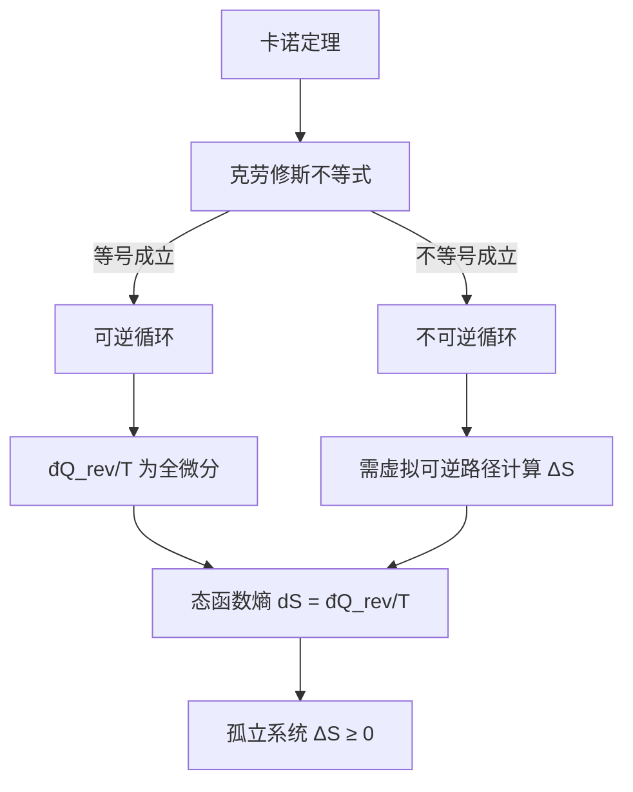

---
tags:
  - 热力学
  - 熵
  - 克劳修斯不等式
  - 不可逆过程
  - 态函数
aliases:
  - Clausius Inequality
  - 宏观熵定义
  - 熵增原理
created: 2024-01-15
updated: 2024-01-15
---

> [!summary] 定理核心论断
> 对于任意循环过程（可逆或不可逆），热温比沿闭合路径的环积分满足 $\oint \frac{đQ}{T} \leq 0$，其中等号严格对应可逆循环，不等号对应不可逆循环。该不等式直接导致态函数——宏观熵 $S$ 的引入，其微分定义为 $dS = \frac{đQ_{\text{rev}}}{T}$，并由此推出孤立系统的熵增原理 $\Delta S_{\text{iso}} \geq 0$。

---

## 一、推导机理与核心数学定义

### 1.1 任意不可逆循环的微元卡诺逼近

任意工作物质在 $p$-$V$ 图上经历的不可逆循环 $C$，其路径无法在状态图上精确描绘（因中间态非平衡）。但可将其分割为 $N$ 个微元段，每一段用一个小型卡诺循环（由两条等温线和两条绝热线构成）去逼近。关键在于：**每个微元卡诺循环的热温比满足精确等式**。

对于第 $i$ 个微元卡诺循环，其从高温热源 $T_{H,i}$ 吸热 $Q_{H,i}$，向低温热源 $T_{L,i}$ 放热 $Q_{L,i}$（取绝对值），卡诺定理给出：

$$
\frac{Q_{H,i}}{T_{H,i}} = \frac{Q_{L,i}}{T_{L,i}}
$$

若采用代数量约定（吸热为正，放热为负），则 $Q_{L,i}$ 本身为负值，上式改写为：

$$
\frac{Q_{H,i}}{T_{H,i}} + \frac{Q_{L,i}}{T_{L,i}} = 0
$$

### 1.2 不可逆性的介入与不等式建立

当原循环 $C$ 为**不可逆**时，微元卡诺逼近中的每一个小循环若按原循环的不可逆热交换方式运行，则卡诺定理的等号退化为不等号。具体而言，若第 $i$ 个微元段从热源 $T_i$ 吸收热量 $đQ_i$（代数量），则该微元过程的实际热温比满足：

$$
\frac{đQ_i}{T_i} \leq \frac{đQ_{i,\text{rev}}}{T_i}
$$

对所有微元求和并取极限 $N \to \infty$，即得克劳修斯不等式：

$$
\oint_C \frac{đQ}{T} \leq 0
$$

其中 $T$ 为**热源温度**（而非系统温度，因不可逆过程中系统温度可能无定义）。等号当且仅当循环 $C$ 完全可逆时成立。

### 1.3 态函数熵的引入

考虑两个平衡态 $A$ 与 $B$，连接它们的任意两条可逆路径 $R_1$ 与 $R_2$。沿 $R_1$ 从 $A$ 到 $B$，再沿 $R_2$ 的逆方向从 $B$ 回到 $A$，构成一个可逆循环，由克劳修斯不等式取等号：

$$
\oint \frac{đQ_{\text{rev}}}{T} = 0 \quad \Longrightarrow \quad \int_{A}^{B} \frac{đQ_{\text{rev}}}{T} \Big|_{R_1} + \int_{B}^{A} \frac{đQ_{\text{rev}}}{T} \Big|_{R_2^{-1}} = 0
$$

即：

$$
\int_{A}^{B} \frac{đQ_{\text{rev}}}{T} \Big|_{R_1} = \int_{A}^{B} \frac{đQ_{\text{rev}}}{T} \Big|_{R_2}
$$

积分值与路径无关，仅取决于始末状态，故 $\frac{đQ_{\text{rev}}}{T}$ 是全微分，定义态函数熵：

$$
dS \equiv \frac{đQ_{\text{rev}}}{T}
$$

对有限过程：

$$
\Delta S = S(B) - S(A) = \int_{A}^{B} \frac{đQ_{\text{rev}}}{T}
$$

### 1.4 孤立系统熵增原理

对于孤立系统（与外界无能量交换，$đQ = 0$），设其经历某一不可逆过程从状态 $A$ 到 $B$。为计算熵变，构造一个辅助可逆过程连接 $A$ 与 $B$，使系统与一个温度为 $T$ 的热源交换热量 $Q_{\text{rev}}$。由克劳修斯不等式应用于该不可逆过程本身：

$$
\int_{A}^{B} \frac{đQ_{\text{不可逆}}}{T} < 0 \quad (\text{孤立系统中 } đQ_{\text{不可逆}} = 0)
$$

但熵变必须通过可逆路径计算：

$$
\Delta S = \int_{A}^{B} \frac{đQ_{\text{rev}}}{T}
$$

将不可逆过程与辅助可逆过程首尾相接构成循环，克劳修斯不等式给出：

$$
\oint \frac{đQ}{T} = \underbrace{\int_{A}^{B} \frac{đQ_{\text{不可逆}}}{T}}_{=0} + \int_{B}^{A} \frac{đQ_{\text{rev}}}{T} \leq 0
$$

即：

$$
-\Delta S \leq 0 \quad \Longrightarrow \quad \Delta S_{\text{iso}} \geq 0
$$

---

## 二、⚠️ 致命失分陷阱与临界边界

### 陷阱 1：不可逆路径上直接积分（最高频错误）

**错误做法**：系统经历自由膨胀（绝热不可逆，$Q = 0$），学生直接写 $\Delta S = \int \frac{đQ}{T} = 0$，得出熵不变的错误结论。

**正确逻辑**：$dS = \frac{đQ_{\text{rev}}}{T}$ 中的下标 rev 不可省略。**熵是态函数，其变化量只取决于始末平衡态**。计算 $\Delta S$ 的唯一合法途径是：在 $p$-$V$ 图上设计一条连接相同始末态的**虚拟可逆路径**（如等温可逆膨胀），沿该路径积分。

### 陷阱 2：混淆系统温度与热源温度

克劳修斯不等式 $\oint \frac{đQ}{T} \leq 0$ 中的 $T$ 是**热源温度**。当系统与热源存在有限温差时（不可逆传热），系统温度 $T_{\text{sys}} \neq T_{\text{res}}$，代入系统温度将导致错误。

### 陷阱 3：等号条件的误用

克劳修斯不等式的等号**仅**对可逆循环成立。若循环中包含任何不可逆环节（如摩擦、非准静态过程、有限温差传热），则严格不等号成立。不可将不可逆循环误用等号。

### 陷阱 4：孤立系统熵增的适用范围

熵增原理 $\Delta S_{\text{iso}} \geq 0$ 仅适用于**孤立系统**。对于开放系统或封闭系统（可与外界交换能量），熵可以减少（如冰箱内熵减，但外界熵增更多，总熵仍不减）。

### 陷阱 5：绝热不可逆过程的熵变

绝热不可逆过程（$Q = 0$）中 $\Delta S > 0$，而非零。这是不可逆性的体现：虽然无热交换，但过程不可逆导致熵产生（entropy generation）。

---

## 三、经典范例手把手演算

### 范例：理想气体自由膨胀的熵变计算

**题目**：$n$ 摩尔理想气体在绝热真空容器中从体积 $V_1$ 自由膨胀至 $V_2 = 2V_1$，求熵变。

**第一步：确定始末状态**

自由膨胀中 $Q = 0$，$W = 0$（真空无外压），由热力学第一定律 $\Delta U = Q - W = 0$。理想气体内能仅依赖温度，故 $T$ 不变，始末温度均为 $T$。

**第二步：设计虚拟可逆路径**

由于始末温度相同，选择**等温可逆膨胀**作为辅助路径，从 $(T, V_1)$ 到 $(T, V_2)$。

**第三步：沿可逆路径积分**

等温可逆过程中，$dU = 0$，故 $đQ_{\text{rev}} = đW_{\text{rev}} = pdV$。由理想气体状态方程 $p = \frac{nRT}{V}$：

$$
\Delta S = \int_{V_1}^{V_2} \frac{đQ_{\text{rev}}}{T} = \int_{V_1}^{V_2} \frac{p\,dV}{T} = \int_{V_1}^{V_2} \frac{nRT}{V} \cdot \frac{dV}{T}
$$

温度 $T$ 为常量，提出积分号：

$$
\Delta S = nR \int_{V_1}^{V_2} \frac{dV}{V} = nR \left[ \ln V \right]_{V_1}^{V_2} = nR \ln \frac{V_2}{V_1}
$$

代入 $V_2 = 2V_1$：

$$
\Delta S = nR \ln 2 > 0
$$

**第四步：终解反代验算**

- 量纲检查：$nR$ 单位为 $\text{J/K}$，与熵的单位一致。
- 物理一致性：自由膨胀为不可逆绝热过程，孤立系统熵增原理要求 $\Delta S > 0$。$nR \ln 2 > 0$ 恒成立，符合预期。
- 极限检验：若 $V_2 \to V_1$（无膨胀），则 $\Delta S \to 0$，退化为可逆极限，合理。

---

## 四、出处与纸质笔记坐标

### 教材出处

- **Blundell, Concepts in Thermal Physics**, 2nd ed., Oxford University Press.
- 核心章节：**Ch.14 (P134–P146)**
  - P134–P137：克劳修斯不等式的推导与不可逆循环逼近
  - P138–P141：熵作为态函数的引入与全微分条件
  - P142–P146：熵增原理与孤立系统应用

### 纸质活页留痕槽位

- **[活页-THERM-08]**：本卡片对应活页第 08 页。
  - 正面：抄录克劳修斯不等式推导全流程，标注每一步对应的教材页码。
  - 反面：完成自由膨胀熵变例题的完整手写推导，并自行补充一道有限温差热传导的熵变计算题。

### 知识全景图

### 关联卡片索引

- 前置：卡诺循环与热机效率（THERM-05）、热力学第二定律开尔文表述（THERM-06）
- 后置：熵的统计诠释与玻尔兹曼公式（THERM-09）、热力学基本方程与麦克斯韦关系（THERM-10）

---
**知识图谱导航**：[[00_热学与统计物理_学习全景图]]
