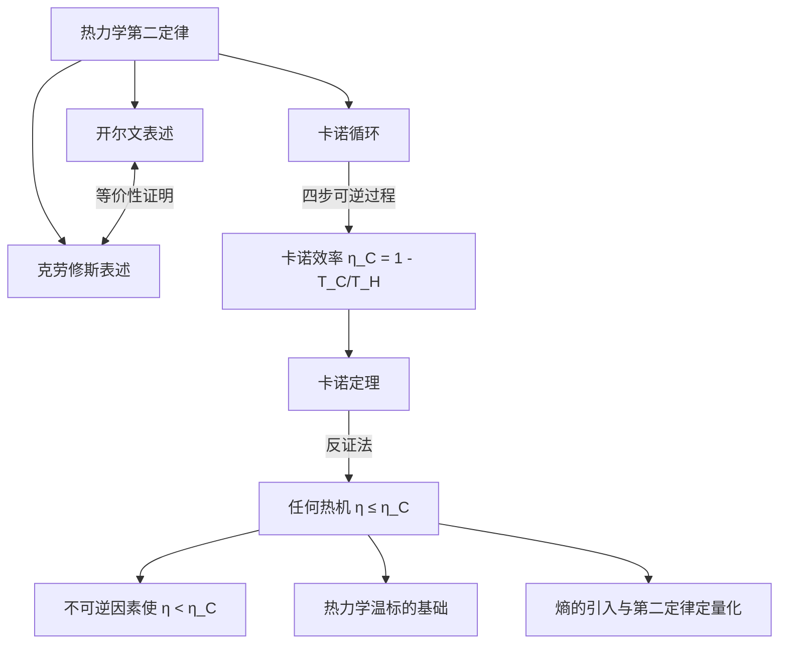

---
tags:
  - 热力学
  - 卡诺定理
  - 热力学第二定律
  - 热机效率
  - 可逆过程
aliases:
  - 卡诺定理
  - Carnot Theorem
  - 卡诺循环效率极限
created: 2024-01-18
updated: 2024-01-18
---

> [!summary] 定理核心论断
> 工作于两个固定温度热源（高温 $T_H$、低温 $T_C$）之间的**任何**热机，其效率 $\eta$ 不可能超过工作于相同两热源之间的**可逆卡诺热机**的效率 $\eta_C$，即
> $$\eta \leq \eta_C = 1 - \frac{T_C}{T_H}$$
> 等号当且仅当热机为可逆卡诺机时成立。此定理是热力学第二定律的宏观定量基石。

---

## 一、推导机理与核心数学定义

### 1.1 热力学第二定律的两种经典表述

**开尔文表述（Kelvin statement）**：不可能从单一热源吸取热量，使之完全转化为功而不产生其他影响。

**克劳修斯表述（Clausius statement）**：热量不可能自发地从低温物体传到高温物体而不引起其他变化。

**等价性证明（反证法纲要）**：
- 若开尔文表述被违反，则可构造一个从高温热源吸热 $Q_H$ 全部做功 $W = Q_H$ 的完美热机，用它驱动一个逆向卡诺制冷机，将热量 $Q_C$ 从低温热源泵回高温热源。净效果为热量 $Q_C$ 自发从低温流向高温而无其他变化，违反克劳修斯表述。
- 反之，若克劳修斯表述被违反，则可构造一个使热量自发从低温流向高温的装置，将其与一个正向卡诺热机耦合，净效果为从单一热源吸热完全变成功，违反开尔文表述。

### 1.2 卡诺循环的构成

卡诺循环由四个可逆过程组成：

1. **可逆等温膨胀**（温度 $T_H$）：工质从高温热源吸热 $Q_H$。
2. **可逆绝热膨胀**：温度从 $T_H$ 降至 $T_C$，无热交换。
3. **可逆等温压缩**（温度 $T_C$）：工质向低温热源放热 $Q_C$。
4. **可逆绝热压缩**：温度从 $T_C$ 回升至 $T_H$，回到初始状态。

### 1.3 卡诺效率的推导

对于理想气体工质，在可逆等温过程中内能不变（$dU = 0$），由热力学第一定律：

$$Q_H = W_{\text{等温膨胀}} = nRT_H \ln\frac{V_2}{V_1}$$

$$Q_C = W_{\text{等温压缩}} = nRT_C \ln\frac{V_3}{V_4}$$

对于可逆绝热过程，利用 $TV^{\gamma-1} = \text{常数}$：

$$T_H V_2^{\gamma-1} = T_C V_3^{\gamma-1}, \qquad T_H V_1^{\gamma-1} = T_C V_4^{\gamma-1}$$

两式相除得：

$$\frac{V_2}{V_1} = \frac{V_3}{V_4}$$

代入热量表达式：

$$\frac{Q_C}{Q_H} = \frac{T_C}{T_H}$$

热机效率定义为 $\eta = \frac{W_{\text{net}}}{Q_H} = \frac{Q_H - Q_C}{Q_H}$，故：

$$\eta_C = 1 - \frac{Q_C}{Q_H} = 1 - \frac{T_C}{T_H}$$

### 1.4 卡诺定理的反证法证明

**假设**：存在某热机 $X$ 工作在 $T_H$ 与 $T_C$ 之间，其效率 $\eta_X > \eta_C$。

**构造**：用热机 $X$ 驱动一个逆向运行的卡诺热机（即卡诺制冷机）。

- 热机 $X$ 从高温热源吸热 $Q_H$，做功 $W = \eta_X Q_H$，向低温热源放热 $Q_H - W$。
- 逆向卡诺机消耗功 $W$，从低温热源吸热 $Q_C'$，向高温热源放热 $Q_C' + W$。

**净效果分析**：
- 高温热源净得热：$(Q_C' + W) - Q_H$
- 低温热源净失热：$Q_C' - (Q_H - W)$

由于 $\eta_X > \eta_C$，即 $W/Q_H > 1 - T_C/T_H$，可推出 $W > Q_H(1 - T_C/T_H)$，从而 $Q_H - W < Q_H \cdot T_C/T_H$。

逆向卡诺机满足 $\frac{Q_C'}{W} = \frac{T_C}{T_H - T_C}$，即 $Q_C' = W \cdot \frac{T_C}{T_H - T_C}$。

代入 $W > Q_H(1 - T_C/T_H) = Q_H \cdot \frac{T_H - T_C}{T_H}$，得：

$$Q_C' > Q_H \cdot \frac{T_H - T_C}{T_H} \cdot \frac{T_C}{T_H - T_C} = Q_H \cdot \frac{T_C}{T_H}$$

因此 $Q_C' > Q_H \cdot \frac{T_C}{T_H} > Q_H - W$（因 $Q_H - W < Q_H \cdot T_C/T_H$）。

**结论**：低温热源净失热 $Q_C' - (Q_H - W) > 0$，即热量从低温热源净流出；高温热源净得热 $(Q_C' + W) - Q_H > 0$。净效果为热量自发从低温流向高温而不产生其他影响，**违反克劳修斯表述**。

由矛盾可知假设不成立，故 $\eta_X \leq \eta_C$，卡诺定理得证。

---

## 二、⚠️ 致命失分陷阱与临界边界

### 陷阱 1：不可逆因素导致效率严格小于 $\eta_C$

真实热机不可避免地存在：
- **摩擦损耗**：机械能部分转化为内能，减少可输出功。
- **有限温差传热**：工质与热源之间存在温差 $\Delta T$，使传热过程不可逆。
- **非准静态过程**：工质内部存在压强、温度梯度。

这些因素使实际效率 $\eta_{\text{real}}$ 严格满足：

$$\eta_{\text{real}} < \eta_C = 1 - \frac{T_C}{T_H}$$

**易错点**：将 $\eta_C$ 直接代入实际热机计算，忽略不可逆修正。

### 陷阱 2：温度必须使用绝对温标

卡诺效率公式中的 $T_H$ 与 $T_C$ 必须为**热力学温标（开尔文温标）**下的绝对温度。若误用摄氏温度，将导致严重错误。

**反例警示**：$T_H = 100^\circ\text{C}$，$T_C = 20^\circ\text{C}$ 时，若误用摄氏温标计算得 $\eta = 1 - 20/100 = 0.8$，而正确值为 $\eta_C = 1 - 293/373 \approx 0.214$，相差近四倍。

### 陷阱 3：$T_C = 0$ 的极限情形

当 $T_C \to 0$ 时，$\eta_C \to 1$，但**热力学第三定律**禁止通过有限步骤达到绝对零度。因此 $\eta_C = 1$ 是理论极限，不可实际达到。

### 陷阱 4：等号成立条件的严格性

$\eta = \eta_C$ 当且仅当热机**完全可逆**，即：
- 所有传热过程在等温且无温差的条件下进行。
- 所有过程为准静态（无限缓慢）。
- 无任何耗散效应。

实际中这些条件无法完全满足，故等号仅为理论极限。

### 陷阱 5：卡诺定理的适用范围

卡诺定理适用于**任意工质**（不限于理想气体），只要热源温度固定。推导中使用的理想气体状态方程仅为计算工具，定理本身具有普适性。

---

## 三、经典范例手把手演算

### 例题：蒸汽发电厂的效率分析

**题目**：某蒸汽发电厂锅炉温度为 $T_H = 600\,\text{K}$，冷凝器温度为 $T_C = 300\,\text{K}$。实际测得该电厂热效率为 $\eta_{\text{real}} = 0.35$。

**(a)** 计算卡诺极限效率 $\eta_C$。

**(b)** 若电厂输出功率为 $P = 500\,\text{MW}$，求实际吸热速率 $\dot{Q}_H$ 与放热速率 $\dot{Q}_C$。

**(c)** 若通过技术改造将锅炉温度提升至 $T_H' = 650\,\text{K}$，求新的卡诺极限效率，并计算在相同吸热速率下可额外输出的功率。

### 演算步骤

**(a) 卡诺极限效率**

$$\eta_C = 1 - \frac{T_C}{T_H} = 1 - \frac{300}{600} = 1 - 0.5 = 0.5$$

$$\boxed{\eta_C = 0.5 = 50\%}$$

**验证**：实际效率 $\eta_{\text{real}} = 0.35 < 0.5 = \eta_C$，符合卡诺定理。

**(b) 实际吸热与放热速率**

由效率定义 $\eta = \frac{P}{\dot{Q}_H}$：

$$\dot{Q}_H = \frac{P}{\eta_{\text{real}}} = \frac{500 \times 10^6}{0.35} = 1.429 \times 10^9\,\text{W}$$

由能量守恒 $\dot{Q}_H = P + \dot{Q}_C$：

$$\dot{Q}_C = \dot{Q}_H - P = 1.429 \times 10^9 - 500 \times 10^6 = 9.29 \times 10^8\,\text{W}$$

$$\boxed{\dot{Q}_H \approx 1.43\,\text{GW}, \quad \dot{Q}_C \approx 0.93\,\text{GW}}$$

**(c) 提升锅炉温度后的分析**

新卡诺效率：

$$\eta_C' = 1 - \frac{T_C}{T_H'} = 1 - \frac{300}{650} = 1 - 0.4615 = 0.5385$$

$$\boxed{\eta_C' \approx 0.538 = 53.8\%}$$

在相同吸热速率 $\dot{Q}_H = 1.429 \times 10^9\,\text{W}$ 下，若热机达到新卡诺极限，输出功率为：

$$P' = \eta_C' \cdot \dot{Q}_H = 0.5385 \times 1.429 \times 10^9 = 7.70 \times 10^8\,\text{W}$$

额外功率：

$$\Delta P = P' - P = 7.70 \times 10^8 - 5.00 \times 10^8 = 2.70 \times 10^8\,\text{W}$$

$$\boxed{\Delta P = 270\,\text{MW}}$$

**终解反代验算**：实际效率 $0.35$ 与卡诺极限 $0.5$ 之比为 $0.7$，即实际效率达到卡诺极限的 $70\%$，这在工程上是合理的（现代蒸汽电厂通常能达到卡诺效率的 $60\%-80\%$）。提升锅炉温度 $50\,\text{K}$ 后，卡诺效率提升 $3.8$ 个百分点，在相同吸热下可多输出 $270\,\text{MW}$，验证了提高热源温度是提升热机效率的有效途径。

---

## 四、出处与纸质笔记坐标

### 教材出处

- **Blundell, Concepts in Thermal Physics**, Chapter 13, pp. 126–133
  - §13.1 热力学第二定律的表述与等价性 (pp. 126–128)
  - §13.2 卡诺循环与卡诺定理 (pp. 129–131)
  - §13.3 卡诺定理的推论与热力学温标 (pp. 132–133)

### 纸质活页留痕槽位

- **[活页-THERM-07]**：卡诺定理反证法完整推导 + 等价性证明逻辑链
- 建议在活页左侧记录定理证明的每一步逻辑依据，右侧标注对应的教材页码与公式编号

### 知识全景图

### 关联卡片索引

- 熵与克劳修斯不等式（THERM-08）
- 热力学温标与理想气体温标的等价性（THERM-09）
- 制冷机与热泵的性能系数（THERM-10）
- 自由能与热力学势（THERM-11）

---
**知识图谱导航**：[[00_热学与统计物理_学习全景图]]
