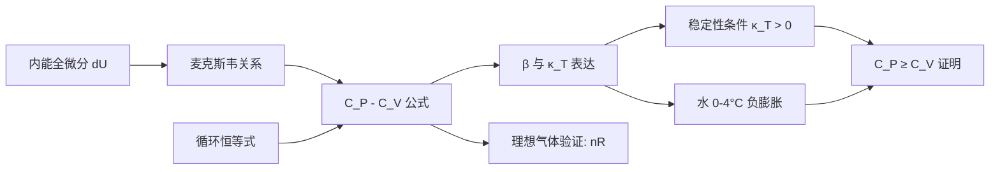

---
tags:
  - 热力学
  - 热容差
  - 麦克斯韦关系
  - 压缩系数
  - 解法卡
aliases:
  - Cp-Cv严格公式
  - 热容差与压缩系数
  - 体胀系数与等温压缩率
created: 2025-04-14
updated: 2025-04-14
---

> [!summary] 算法执行总览
> 本卡解决的核心问题是：**如何从内能的全微分出发，严格推导定压热容与定容热容之差 $C_P - C_V$ 的普适表达式**。执行路径为：写出 $dU$ 的 $(T,V)$ 展开 → 引入热容定义与焓的全微分 → 利用麦克斯韦关系消去不可测偏导 → 引入体胀系数 $\beta$ 与等温压缩率 $\kappa_T$ 化简 → 基于稳定性条件论证 $C_P \ge C_V$ 恒成立。

---

## 一、推导机理与核心数学定义

### 1.1 内能的全微分展开

以温度 $T$ 与体积 $V$ 为独立变量，内能 $U(T,V)$ 的全微分为：

$$
dU = \left(\frac{\partial U}{\partial T}\right)_V dT + \left(\frac{\partial U}{\partial V}\right)_T dV
$$

第一项直接联系定容热容：

$$
C_V \equiv \left(\frac{\partial U}{\partial T}\right)_V
$$

第二项 $\left(\frac{\partial U}{\partial V}\right)_T$ 不可直接测量。利用热力学基本关系 $dU = T\,dS - P\,dV$，在固定 $T$ 下对 $V$ 求偏导：

$$
\left(\frac{\partial U}{\partial V}\right)_T = T\left(\frac{\partial S}{\partial V}\right)_T - P
$$

由麦克斯韦关系（从亥姆霍兹自由能 $F$ 的全微分 $dF = -S\,dT - P\,dV$ 的交叉偏导相等导出）：

$$
\left(\frac{\partial S}{\partial V}\right)_T = \left(\frac{\partial P}{\partial T}\right)_V
$$

代入得：

$$
\left(\frac{\partial U}{\partial V}\right)_T = T\left(\frac{\partial P}{\partial T}\right)_V - P
$$

因此内能全微分可改写为：

$$
dU = C_V\,dT + \left[ T\left(\frac{\partial P}{\partial T}\right)_V - P \right] dV
$$

### 1.2 焓的全微分与 $C_P$ 的引入

定义焓 $H = U + PV$，以 $(T,P)$ 为独立变量：

$$
dH = \left(\frac{\partial H}{\partial T}\right)_P dT + \left(\frac{\partial H}{\partial P}\right)_T dP
$$

其中 $C_P \equiv \left(\frac{\partial H}{\partial T}\right)_P$。由 $dH = T\,dS + V\,dP$，固定 $T$ 对 $P$ 求偏导并利用麦克斯韦关系（从吉布斯自由能 $G$ 导出）：

$$
\left(\frac{\partial H}{\partial P}\right)_T = V - T\left(\frac{\partial V}{\partial T}\right)_P
$$

### 1.3 热容差的推导

考虑沿等压线（$dP = 0$）的路径。此时 $dH = C_P\,dT$，同时 $dH = dU + P\,dV + V\,dP = dU + P\,dV$（因 $dP=0$）。将 $dU$ 的展开式代入：

$$
C_P\,dT = C_V\,dT + \left[ T\left(\frac{\partial P}{\partial T}\right)_V - P \right] dV + P\,dV
$$

$P\,dV$ 项抵消，得：

$$
C_P\,dT = C_V\,dT + T\left(\frac{\partial P}{\partial T}\right)_V dV
$$

沿等压线，$V$ 随 $T$ 的变化率为 $\left(\frac{\partial V}{\partial T}\right)_P$，即 $dV = \left(\frac{\partial V}{\partial T}\right)_P dT$。代入并消去 $dT$：

$$
C_P - C_V = T\left(\frac{\partial P}{\partial T}\right)_V \left(\frac{\partial V}{\partial T}\right)_P
$$

### 1.4 引入体胀系数与等温压缩率

定义体胀系数（等压热膨胀系数）：

$$
\beta \equiv \frac{1}{V}\left(\frac{\partial V}{\partial T}\right)_P
$$

定义等温压缩率：

$$
\kappa_T \equiv -\frac{1}{V}\left(\frac{\partial V}{\partial P}\right)_T
$$

由循环恒等式（三重积关系）：

$$
\left(\frac{\partial P}{\partial T}\right)_V \left(\frac{\partial T}{\partial V}\right)_P \left(\frac{\partial V}{\partial P}\right)_T = -1
$$

即：

$$
\left(\frac{\partial P}{\partial T}\right)_V = -\frac{\left(\frac{\partial V}{\partial T}\right)_P}{\left(\frac{\partial V}{\partial P}\right)_T}
$$

代入 $\beta$ 与 $\kappa_T$：

$$
\left(\frac{\partial P}{\partial T}\right)_V = \frac{\beta}{\kappa_T}
$$

最终得到热容差的严格公式：

$$
\boxed{C_P - C_V = T\left(\frac{\partial P}{\partial T}\right)_V \left(\frac{\partial V}{\partial T}\right)_P = \frac{V T \beta^2}{\kappa_T}}
$$

### 1.5 稳定性条件与 $C_P \ge C_V$ 的证明

热力学稳定性要求等温压缩率为正：

$$
\kappa_T > 0
$$

同时 $V > 0$（体积为正）、$T \ge 0$（绝对温度非负）、$\beta^2 \ge 0$（平方非负）。因此：

$$
C_P - C_V = \frac{V T \beta^2}{\kappa_T} \ge 0
$$

即对一切稳定宏观物质：

$$
\boxed{C_P \ge C_V}
$$

等号成立当且仅当 $\beta = 0$ 或 $T = 0$。

---

## 二、⚠️ 致命失分陷阱与临界边界

### 陷阱 1：水在 $0\sim 4^\circ\mathrm{C}$ 的负膨胀区

水在 $0\sim 4^\circ\mathrm{C}$ 之间加热时体积收缩，即 $\beta < 0$。此时若误以为 $C_P - C_V$ 可能为负，则犯概念错误。由于公式中 $\beta$ 以平方 $\beta^2$ 出现，$\beta < 0$ 不影响 $C_P - C_V > 0$ 的结论。**$\beta$ 的符号只影响 $\left(\frac{\partial P}{\partial T}\right)_V$ 的符号，不影响热容差的正定性。**

### 陷阱 2：绝对零度极限的误判

在 $T \to 0$ 极限下，由热力学第三定律，体胀系数趋于零：

$$
\lim_{T \to 0} \beta = 0
$$

因此：

$$
\lim_{T \to 0} (C_P - C_V) = \lim_{T \to 0} \frac{V T \beta^2}{\kappa_T} = 0
$$

注意此处存在**双重零因子**：$T \to 0$ 与 $\beta^2 \to 0$ 同时贡献。若仅考虑 $T \to 0$ 而忽略 $\beta \to 0$，会错误地认为 $C_P - C_V$ 以 $T$ 的一次方趋于零；实际上 $\beta$ 的温度依赖（通常 $\beta \propto T$ 或更高阶）使差值趋于零的速度更快。**不能将 $\beta$ 视为与温度无关的常数后取极限。**

### 陷阱 3：循环恒等式的符号错误

在推导 $\left(\frac{\partial P}{\partial T}\right)_V = \frac{\beta}{\kappa_T}$ 时，三重积关系包含负号：

$$
\left(\frac{\partial P}{\partial T}\right)_V \left(\frac{\partial T}{\partial V}\right)_P \left(\frac{\partial V}{\partial P}\right)_T = -1
$$

由于 $\left(\frac{\partial T}{\partial V}\right)_P = \frac{1}{\left(\frac{\partial V}{\partial T}\right)_P}$，代入后负号恰好被 $\kappa_T$ 定义中的负号吸收。若在 $\kappa_T$ 定义中遗漏负号，将导致 $\beta^2/\kappa_T$ 前出现错误负号。

### 陷阱 4：$\kappa_T = 0$ 的不可压缩极限

对完全不可压缩物质（$\kappa_T = 0$），公式发散。但真实物质 $\kappa_T$ 恒为正且有限。在相变点附近 $\kappa_T \to \infty$，此时 $C_P - C_V \to 0$（如临界点附近），但 $C_P$ 与 $C_V$ 各自发散，差值趋于有限或零——需区分处理。

---

## 三、经典范例手把手演算

### 范例：理想气体的热容差验证

**已知**：理想气体状态方程 $PV = nRT$。

**第一步**：计算 $\left(\frac{\partial P}{\partial T}\right)_V$。固定 $V$，对 $T$ 求偏导：

$$
P = \frac{nRT}{V} \quad \Rightarrow \quad \left(\frac{\partial P}{\partial T}\right)_V = \frac{nR}{V}
$$

**第二步**：计算 $\left(\frac{\partial V}{\partial T}\right)_P$。固定 $P$，对 $T$ 求偏导：

$$
V = \frac{nRT}{P} \quad \Rightarrow \quad \left(\frac{\partial V}{\partial T}\right)_P = \frac{nR}{P}
$$

**第三步**：代入热容差公式：

$$
C_P - C_V = T \cdot \frac{nR}{V} \cdot \frac{nR}{P} = \frac{n^2 R^2 T}{PV}
$$

利用 $PV = nRT$ 化简：

$$
C_P - C_V = \frac{n^2 R^2 T}{nRT} = nR
$$

**第四步**：用 $\beta$ 与 $\kappa_T$ 路径验证。对理想气体：

$$
\beta = \frac{1}{V}\left(\frac{\partial V}{\partial T}\right)_P = \frac{1}{V} \cdot \frac{nR}{P} = \frac{1}{T}
$$

$$
\kappa_T = -\frac{1}{V}\left(\frac{\partial V}{\partial P}\right)_T = -\frac{1}{V} \cdot \left(-\frac{nRT}{P^2}\right) = \frac{nRT}{P^2 V} = \frac{1}{P}
$$

代入：

$$
C_P - C_V = \frac{V T \beta^2}{\kappa_T} = \frac{V T \cdot \frac{1}{T^2}}{\frac{1}{P}} = \frac{VP}{T} = \frac{nRT}{T} = nR
$$

**第五步：终解反代验算**。对单原子理想气体，$C_V = \frac{3}{2}nR$，$C_P = \frac{5}{2}nR$，差值恰为 $nR$，与推导一致。对双原子理想气体，$C_V = \frac{5}{2}nR$，$C_P = \frac{7}{2}nR$，差值仍为 $nR$。**结论：理想气体热容差与温度、压强无关，恒等于 $nR$。**

---

## 四、出处与纸质笔记坐标

### 教材出处

- **Blundell, Concepts in Thermal Physics**, 2nd Edition
- Chapter 16: *The First Law of Thermodynamics*
- 热容差推导与压缩系数定义：**P183–P187**
- 关键公式 (16.28)–(16.35) 区域
- 麦克斯韦关系综述见同章前部 P178–P182

### 纸质活页留痕槽位

> [!note] 活页记录区
> **[活页-THERM-12]**
> - 左侧页：内能展开 → 麦克斯韦关系代入 → 热容差公式完整推导（手写）
> - 右侧页：$\beta$ 与 $\kappa_T$ 定义及循环恒等式证明；水的负膨胀区 $\beta\text{-}T$ 曲线草图
> - 底部留白：理想气体 $nR$ 验证的完整代数过程

### 知识关联图谱

### 易混概念对照

| 物理量 | 符号 | 定义式 | 单位 | 典型值（水, 20°C） |
|--------|------|--------|------|---------------------|
| 体胀系数 | $\beta$ | $\frac{1}{V}\left(\frac{\partial V}{\partial T}\right)_P$ | $\mathrm{K}^{-1}$ | $2.07 \times 10^{-4}$ |
| 等温压缩率 | $\kappa_T$ | $-\frac{1}{V}\left(\frac{\partial V}{\partial P}\right)_T$ | $\mathrm{Pa}^{-1}$ | $4.6 \times 10^{-10}$ |
| 绝热压缩率 | $\kappa_S$ | $-\frac{1}{V}\left(\frac{\partial V}{\partial P}\right)_S$ | $\mathrm{Pa}^{-1}$ | — |

> [!warning] 后续复习提示
> 将本卡与 [活页-THERM-10]（麦克斯韦关系四式推导）及 [活页-THERM-11]（亥姆霍兹与吉布斯自由能全微分）对照复习。考试中若要求证明 $C_P \ge C_V$，必须写出 $\kappa_T > 0$ 的稳定性论证，不可仅凭"实验事实"一笔带过。

---
**知识图谱导航**：[[00_热学与统计物理_学习全景图]]
