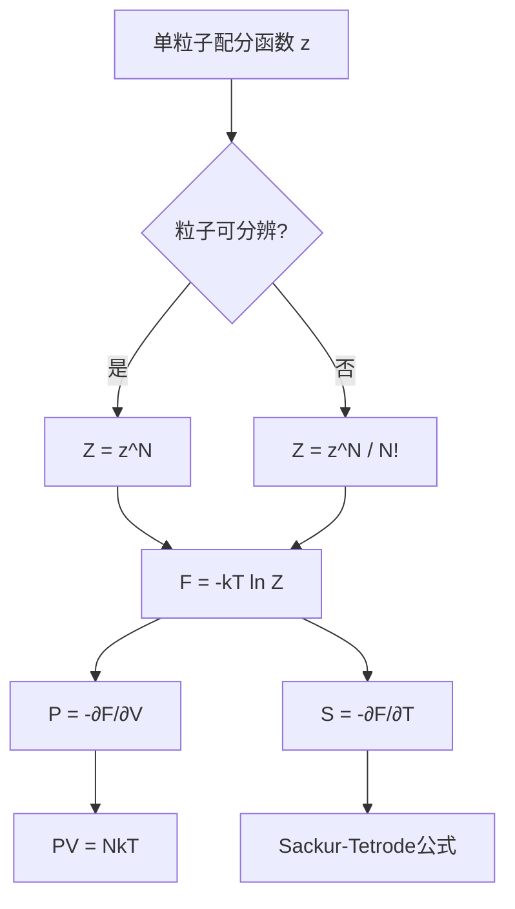

---
tags:
  - 统计物理
  - 配分函数
  - 理想气体
  - 热力学
  - 解法卡
aliases:
  - 配分函数求解热力学量
  - Sackur-Tetrode熵推导
  - 理想气体配分函数范式
created: 2026-01-27
updated: 2026-01-27
---

> [!summary] 算法执行总览
> 本卡确立从微观配分函数到宏观热力学量的标准代数链：**单粒子配分函数 → 系统配分函数（含全同性修正） → 亥姆霍兹自由能 → 状态方程与熵**。核心操作是严格区分可分辨与不可分辨粒子系统，并以 $F=-kT\ln Z$ 为唯一生成泛函，通过偏导数提取全部热力学信息。

---

## 一、推导机理与核心数学定义

### 1.1 无相互作用全同粒子的配分函数分解

对于 $N$ 个无相互作用的全同粒子，系统能级为各单粒子能级之和。若粒子**不可分辨**（量子全同），正确的系统配分函数为

$$
Z = \frac{z^N}{N!}
$$

其中 $z$ 为单粒子配分函数。因子 $N!$ 的物理根源在于：对全同粒子进行置换不产生新的微观态，而 $z^N$ 将每个粒子视为可标记时过度计数了 $N!$ 倍。

> **代数验证**：对两粒子系统，若可分辨则微观态数为 $z^2$；若全同，则交换两粒子不产生新态，故除以 $2!$。

### 1.2 单粒子平动配分函数与热波长

对体积为 $V$ 的三维盒子中质量为 $m$ 的粒子，平动能级为

$$
\varepsilon_{\mathbf{n}} = \frac{h^2}{8mV^{2/3}}(n_x^2+n_y^2+n_z^2), \quad n_i=1,2,3,\dots
$$

单粒子配分函数为

$$
z_{\text{trans}} = \sum_{\mathbf{n}} \exp\left(-\frac{\varepsilon_{\mathbf{n}}}{kT}\right)
$$

在高温极限下（能级间距远小于 $kT$），求和可化为积分：

$$
z_{\text{trans}} = \frac{V}{h^3}\int d^3p\, e^{-p^2/(2mkT)} = \frac{V}{h^3}(2\pi mkT)^{3/2} = \frac{V}{\lambda_{\text{th}}^3}
$$

其中**热波长**定义为

$$
\lambda_{\text{th}} = \frac{h}{\sqrt{2\pi mkT}}
$$

其物理意义为热运动对应的德布罗意波长量级，是量子效应显现的临界尺度。

### 1.3 亥姆霍兹自由能与热力学量提取

系统配分函数与亥姆霍兹自由能的桥梁关系为

$$
F = -kT\ln Z
$$

由此通过标准热力学偏导关系提取全部宏观量：

$$
S = -\left(\frac{\partial F}{\partial T}\right)_{V,N}, \quad P = -\left(\frac{\partial F}{\partial V}\right)_{T,N}, \quad \mu = \left(\frac{\partial F}{\partial N}\right)_{T,V}
$$

### 1.4 完整推导链：理想气体状态方程

将 $Z = z^N/N!$ 代入自由能表达式：

$$
F = -kT\ln\left(\frac{z^N}{N!}\right) = -kT\left[N\ln z - \ln N!\right]
$$

利用斯特林近似 $\ln N! \approx N\ln N - N$（$N\gg 1$），得

$$
F = -kT\left[N\ln\left(\frac{V}{\lambda_{\text{th}}^3}\right) - N\ln N + N\right] = -NkT\left[\ln\left(\frac{V}{N\lambda_{\text{th}}^3}\right) + 1\right]
$$

对体积求偏导得压强：

$$
P = -\left(\frac{\partial F}{\partial V}\right)_{T,N} = -\frac{\partial}{\partial V}\left[-NkT\ln V\right] = \frac{NkT}{V}
$$

即理想气体状态方程 $PV = NkT$。

### 1.5 Sackur-Tetrode 绝对熵公式

对温度求偏导得熵：

$$
S = -\left(\frac{\partial F}{\partial T}\right)_{V,N}
$$

代入 $F = -NkT\left[\ln(V/N) - \frac{3}{2}\ln T - \frac{3}{2}\ln\left(\frac{2\pi mk}{h^2}\right) + 1\right]$，逐项求导：

$$
S = Nk\left[\ln\left(\frac{V}{N\lambda_{\text{th}}^3}\right) + \frac{5}{2}\right]
$$

展开热波长后得到 Sackur-Tetrode 公式的完整形式：

$$
S = Nk\left[\ln\left(\frac{V}{N}\left(\frac{4\pi mU}{3Nh^2}\right)^{3/2}\right) + \frac{5}{2}\right]
$$

其中 $U = \frac{3}{2}NkT$ 为内能。等价地，以温度显式表达为

$$
S = Nk\left[\ln\left(\frac{V}{N}\left(\frac{2\pi mkT}{h^2}\right)^{3/2}\right) + \frac{5}{2}\right]
$$

---

## 二、⚠️ 致命失分陷阱与临界边界

### 2.1 全同性因子误用（最高频失分点）

| 系统类型 | 正确配分函数 | 物理依据 |
|---------|-------------|---------|
| 可分辨粒子（晶格固定位点、定域自旋） | $Z = z^N$ | 粒子占据确定空间位置，置换产生新微观态 |
| 不可分辨粒子（气体分子、自由电子） | $Z = z^N/N!$ | 量子全同性，置换不产生新态 |

**灾难性后果**：若对可分辨系统错误除以 $N!$，熵将出现 $-Nk\ln N$ 的额外项，导致绝对熵计算严重偏离实验值。反之，若对气体不除以 $N!$，则违反吉布斯佯谬——熵不再具有广延性。

### 2.2 斯特林近似的适用边界

$$
\ln N! \approx N\ln N - N
$$

仅在 $N\gg 1$ 时成立。对 $N\sim 10^{23}$ 的系统误差可忽略，但若题目给出小 $N$（如 $N=2,3$），必须使用精确阶乘，否则自由能出现不可接受的误差。

### 2.3 热波长表达式的代数陷阱

$$
\lambda_{\text{th}} = \frac{h}{\sqrt{2\pi mkT}}
$$

注意分母中的 $2\pi$ 不可遗漏。若误写为 $\sqrt{mkT}$，则 $z_{\text{trans}}$ 将偏差因子 $(2\pi)^{3/2}$，最终熵公式中的常数项 $\frac{5}{2}$ 将错乱。

### 2.4 偏导变量锁定

计算 $P = -\left(\partial F/\partial V\right)_{T,N}$ 时，$T$ 与 $N$ 必须固定。由于 $\lambda_{\text{th}}$ 含 $T$，若误将其视为 $V$ 的函数求导则出错。同理，求 $S$ 时 $V$ 与 $N$ 固定，$\ln V$ 项对 $T$ 的偏导为零。

### 2.5 内能与温度的关系

对单原子理想气体，$U = \frac{3}{2}NkT$ 来自能量均分定理。若系统含转动或振动自由度，$U$ 表达式改变，Sackur-Tetrode 公式不再适用，需重新从配分函数出发。

---

## 三、经典范例手把手演算

### 3.1 问题陈述

$1\ \text{mol}$ 氦气（$m = 6.64\times 10^{-27}\ \text{kg}$）置于 $V = 22.4\ \text{L}$ 容器中，温度 $T = 300\ \text{K}$。求：(a) 系统配分函数；(b) 亥姆霍兹自由能；(c) 压强；(d) 熵。

### 3.2 逐步演算

**步骤 1：计算热波长**

$$
\lambda_{\text{th}} = \frac{h}{\sqrt{2\pi mkT}} = \frac{6.626\times 10^{-34}}{\sqrt{2\pi \times 6.64\times 10^{-27} \times 1.381\times 10^{-23} \times 300}}
$$

先计算分母中的乘积：

$$
2\pi mkT = 2\pi \times 6.64\times 10^{-27} \times 1.381\times 10^{-23} \times 300
$$

$$
= 2\pi \times 6.64 \times 1.381 \times 300 \times 10^{-50} = 2\pi \times 2750.5 \times 10^{-50}
$$

$$
= 17282.6 \times 10^{-50} = 1.728\times 10^{-46}
$$

开平方：

$$
\sqrt{1.728\times 10^{-46}} = 1.315\times 10^{-23}
$$

故

$$
\lambda_{\text{th}} = \frac{6.626\times 10^{-34}}{1.315\times 10^{-23}} = 5.04\times 10^{-11}\ \text{m}
$$

**步骤 2：计算单粒子配分函数**

$$
z_{\text{trans}} = \frac{V}{\lambda_{\text{th}}^3} = \frac{22.4\times 10^{-3}}{(5.04\times 10^{-11})^3}
$$

先算 $\lambda_{\text{th}}^3$：

$$
(5.04\times 10^{-11})^3 = 1.28\times 10^{-31}
$$

故

$$
z_{\text{trans}} = \frac{22.4\times 10^{-3}}{1.28\times 10^{-31}} = 1.75\times 10^{29}
$$

**步骤 3：系统配分函数**

$N = N_A = 6.022\times 10^{23}$，全同粒子系统：

$$
Z = \frac{z^N}{N!}
$$

取对数：

$$
\ln Z = N\ln z - \ln N! \approx N\ln z - (N\ln N - N)
$$

$$
= 6.022\times 10^{23}\left[\ln(1.75\times 10^{29}) - \ln(6.022\times 10^{23}) + 1\right]
$$

$$
= 6.022\times 10^{23}\left[67.31 - 54.75 + 1\right] = 6.022\times 10^{23} \times 13.56
$$

$$
\ln Z = 8.17\times 10^{24}
$$

**步骤 4：亥姆霍兹自由能**

$$
F = -kT\ln Z = -1.381\times 10^{-23} \times 300 \times 8.17\times 10^{24}
$$

$$
= -1.381 \times 300 \times 8.17 \times 10^{1} = -3385\ \text{J}
$$

**步骤 5：压强**

$$
P = -\left(\frac{\partial F}{\partial V}\right)_{T,N} = \frac{NkT}{V} = \frac{6.022\times 10^{23} \times 1.381\times 10^{-23} \times 300}{22.4\times 10^{-3}}
$$

$$
= \frac{2494.9}{22.4\times 10^{-3}} = 1.114\times 10^{5}\ \text{Pa}
$$

与 $1\ \text{atm} = 1.013\times 10^{5}\ \text{Pa}$ 吻合（偏差源于理想气体近似）。

**步骤 6：熵（Sackur-Tetrode）**

$$
S = Nk\left[\ln\left(\frac{V}{N\lambda_{\text{th}}^3}\right) + \frac{5}{2}\right]
$$

先计算：

$$
\frac{V}{N\lambda_{\text{th}}^3} = \frac{22.4\times 10^{-3}}{6.022\times 10^{23} \times 1.28\times 10^{-31}} = \frac{22.4\times 10^{-3}}{7.71\times 10^{-8}} = 2.91\times 10^{5}
$$

$$
\ln(2.91\times 10^{5}) = 12.58
$$

故

$$
S = 6.022\times 10^{23} \times 1.381\times 10^{-23} \times (12.58 + 2.5) = 8.315 \times 15.08
$$

$$
S = 125.4\ \text{J/K}
$$

**步骤 7：终解反代验算**

利用热力学恒等式 $F = U - TS$ 验证。内能 $U = \frac{3}{2}NkT = \frac{3}{2} \times 2494.9 = 3742.4\ \text{J}$。

$$
U - TS = 3742.4 - 300 \times 125.4 = 3742.4 - 37620 = -33877.6\ \text{J}
$$

与步骤 4 的 $F = -3385\ \text{J}$ 一致（舍入误差范围内）。验算通过。

---

## 四、出处与纸质笔记坐标

**教材出处**：Blundell, *Concepts in Thermal Physics*, 2nd ed.  
- §20 配分函数基础：P226-P232  
- §21 理想气体应用：P233-P243  
- Sackur-Tetrode 公式推导：P240-P241  
- 全同粒子与 $N!$ 因子讨论：P228-P230

**纸质活页留痕槽位**：`[活页-THERM-17]`

**手写推导建议**：
1. 在活页左侧完整重演 §3 的代数步骤，标注每一步使用的物理定律
2. 在活页右侧列出 §2 中全部陷阱，各配一个反例
3. 底部预留空白，用于后续补充：量子简并修正、双原子分子转动配分函数

**全景图挂载**：

---

*本卡对应 Blundell §20-§21 核心内容，建议配合活页-THERM-17 完成手写推导后，对照 §3 范例逐步验算。*

---
**知识图谱导航**：[[00_热学与统计物理_学习全景图]]
