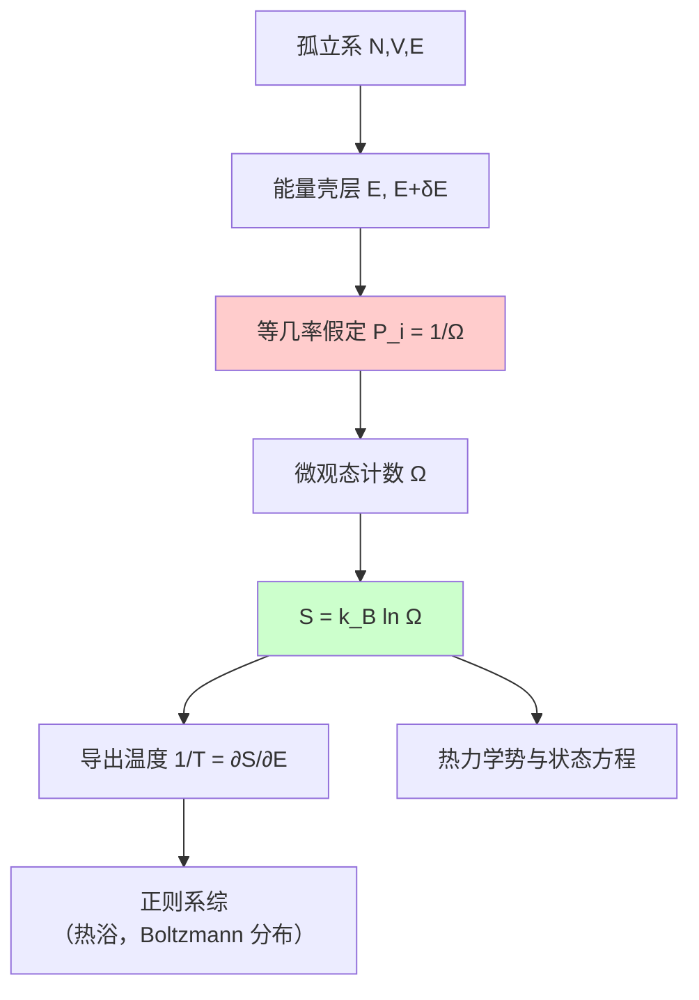

---
tags:
  - 统计物理
  - 微正则系综
  - 等几率假定
  - 孤立系
  - 熵
aliases:
  - 微正则系综
  - 等几率基本假定
  - 热力学几率
created: 2025-04-14
updated: 2025-04-14
---

> [!summary] 核心认知先验
> 微正则系综是统计力学中最基本的系综，描述完全孤立、具有确定粒子数 $N$、体积 $V$ 与能量 $E$（严格处于壳层 $[E, E+\delta E]$）的平衡系统。其唯一的动力学输入是**等几率基本假定**：在能量壳层内，每一个可及微观态出现的概率严格相等，即 $P_i = 1/\Omega$。该假定是连接微观动力学与宏观热力学（经由 $S = k_B \ln \Omega$）的唯一桥梁，其适用范围严格限定于孤立平衡系统。

---

## 一、推导机理与核心数学定义

### 1.1 微正则系综的定义与约束条件

微正则系综（Microcanonical Ensemble）对应宏观上完全孤立的系统，其宏观约束为：

$$
N = \text{const}, \quad V = \text{const}, \quad E \in [E, E+\delta E]
$$

其中 $\delta E$ 是能量壳层的宽度。在经典极限下，$\delta E$ 的选取需满足：

$$
\delta E \ll E, \quad \text{但} \quad \Omega(E) \text{ 对 } \delta E \text{ 不敏感}
$$

即壳层宽度远小于系统总能量，但远大于能级间距的典型尺度，以保证壳层内包含足够多的微观态。

### 1.2 等几率基本假定（Postulate of Equal a Priori Probabilities）

**核心论断**：对于处于平衡态的孤立系统，能量壳层 $[E, E+\delta E]$ 内的每一个可及微观态 $i$，其出现概率严格相等：

$$
P_i = 
\begin{cases}
\dfrac{1}{\Omega(N, V, E)}, & E \leq E_i \leq E + \delta E \\[6pt]
0, & \text{otherwise}
\end{cases}
$$

其中 $\Omega(N, V, E)$ 为能量壳层内的微观态总数（热力学几率）。归一化条件自动满足：

$$
\sum_{i=1}^{\Omega} P_i = \Omega \cdot \frac{1}{\Omega} = 1
$$

### 1.3 相空间体积与量子微观态数的对应

在经典力学框架下，$N$ 个全同粒子的微观态由 $6N$ 维相空间中的一个点表示。能量壳层对应的相空间体积为：

$$
\Gamma(E) = \int_{E \leq H(\mathbf{q}, \mathbf{p}) \leq E + \delta E} \mathrm{d}^{3N}q \, \mathrm{d}^{3N}p
$$

由于量子力学的不确定性原理，每个量子微观态在相空间中占据的体积元为 $h^{3N}$（$h$ 为 Planck 常数），因此量子微观态数为：

$$
\Omega(N, V, E) = \frac{\Gamma(E)}{h^{3N} \, N!}
$$

> 注：$N!$ 因子来源于全同粒子的不可分辨性（Gibbs 修正），仅在经典计数时引入；在量子统计中，该因子自动由产生/湮灭算符的对易关系给出。

### 1.4 热力学几率与熵的桥梁——Boltzmann 熵公式

等几率假定将微观态计数与宏观熵直接关联：

$$
\boxed{S(N, V, E) = k_B \ln \Omega(N, V, E)}
$$

其中 $k_B$ 为 Boltzmann 常数。该式是统计力学的基石，其逆命题——熵最大的宏观态对应微观态数最多的分布——构成了平衡态判据的基础。

---

## 二、⚠️ 致命失分陷阱与临界边界

### 陷阱 1：等几率假定的适用范围（最高频失分点）

等几率假定**仅适用于完全孤立的平衡系统**。若系统与外界存在能量交换（如处于热浴中），则系统应改用**正则系综**描述，微观态概率服从 Boltzmann 分布 $P_i \propto e^{-\beta E_i}$，而非等几率分布。同理，若存在粒子交换，则需使用巨正则系综。

**典型错误**：将 $P_i = 1/\Omega$ 直接套用于与热浴接触的系统。

### 陷阱 2：能量壳层 $\delta E$ 的处理

- **错误做法**：令 $\delta E \to 0$ 取极限，导致 $\Omega \to 0$ 且 $S \to -\infty$。
- **正确理解**：$\delta E$ 是宏观小、微观大的能量窗口。在热力学极限（$N \to \infty$）下，$S = k_B \ln \Omega$ 对 $\delta E$ 的具体取值不敏感（对数函数的弱依赖性），因此可任选壳层宽度。

### 陷阱 3：经典计数中的 $N!$ 因子遗漏

若对全同粒子系统不使用 $N!$ 修正，将导致熵的非广延性（Gibbs 悖论）：混合熵不为零。考试中若涉及经典理想气体，必须写出：

$$
\Omega = \frac{1}{N! h^{3N}} \int_{E \leq H \leq E+\delta E} \mathrm{d}^{3N}q \, \mathrm{d}^{3N}p
$$

### 陷阱 4：$\Omega$ 与相空间体积 $\Gamma$ 的混淆

$\Omega$ 是**无量纲的微观态计数**，而 $\Gamma$ 具有作用量纲 $[\text{能量} \times \text{时间}]^{3N}$。熵公式中必须使用 $\Omega$（或 $\Gamma / h^{3N}$），直接对 $\Gamma$ 取对数会得到量纲错误的表达式。

### 陷阱 5：简并态与等几率的关系

等几率假定指的是**微观态**等概率，而非**能级**等概率。若某一能级 $E_i$ 具有简并度 $g_i$，则该能级被占据的总概率为 $g_i / \Omega$，而非 $1/\Omega$。

---

## 三、经典范例手把手演算

### 范例：单原子理想气体的微正则熵

**问题**：$N$ 个无相互作用的单原子理想气体分子，处于体积 $V$ 的容器中，总能量处于 $[E, E+\delta E]$ 壳层内。计算微观态数 $\Omega$ 与熵 $S$。

**第一步：写出 Hamiltonian**

$$
H = \sum_{i=1}^{N} \frac{\mathbf{p}_i^2}{2m}
$$

（无势能项，粒子间无相互作用）

**第二步：计算能量壳层内的相空间体积**

$$
\Gamma(E) = V^N \cdot \int_{E \leq \sum p_i^2/2m \leq E+\delta E} \mathrm{d}^{3N}p
$$

位置积分给出 $V^N$。动量积分对应 $3N$ 维球壳体积。半径为 $R = \sqrt{2mE}$ 的 $3N$ 维球体积为：

$$
V_{3N}(R) = \frac{\pi^{3N/2}}{\Gamma(3N/2 + 1)} R^{3N}
$$

其中 $\Gamma(\cdot)$ 为 Gamma 函数（注意勿与相空间体积混淆）。壳层体积为球体积对能量的微分：

$$
\int_{E \leq H \leq E+\delta E} \mathrm{d}^{3N}p = \frac{\mathrm{d}V_{3N}}{\mathrm{d}E} \cdot \delta E = \frac{\pi^{3N/2}}{\Gamma(3N/2)} (2m)^{3N/2} E^{3N/2 - 1} \, \delta E
$$

**第三步：引入量子修正与全同粒子修正**

$$
\Omega(N, V, E) = \frac{V^N}{N! h^{3N}} \cdot \frac{\pi^{3N/2}}{\Gamma(3N/2)} (2m)^{3N/2} E^{3N/2 - 1} \, \delta E
$$

**第四步：取热力学极限求熵**

$$
S = k_B \ln \Omega = k_B \left[ N \ln V - \ln N! - 3N \ln h + \frac{3N}{2} \ln(2m) + \frac{3N}{2} \ln E + \ln\left(\frac{\pi^{3N/2} \delta E}{\Gamma(3N/2) E}\right) \right]
$$

使用 Stirling 近似 $\ln N! \approx N \ln N - N$，并忽略最后一项中对 $N$ 为次线性的贡献（热力学极限下可忽略）：

$$
S = N k_B \left[ \ln\left(\frac{V}{N}\right) + \frac{3}{2} \ln\left(\frac{2\pi m E}{h^2}\right) + \frac{3}{2} \right] + \mathcal{O}(\ln N)
$$

**第五步：终解反代验算**

由 $S$ 求能量 $E$：

$$
\frac{1}{T} = \left(\frac{\partial S}{\partial E}\right)_{N,V} = \frac{3N k_B}{2E} \quad \Rightarrow \quad E = \frac{3}{2} N k_B T
$$

该结果与能量均分定理一致（每个单原子分子有 3 个平动自由度，每个自由度贡献 $\frac{1}{2}k_B T$），验证了推导的正确性。

---

## 四、出处与纸质笔记坐标

### 指定教材出处

- **Blundell, *Concepts in Thermal Physics*, 2nd ed.**
  - 微正则系综定义与等几率假定：**§19.1–19.2 (P213–P216)**
  - 相空间体积与量子计数：**§19.3 (P216–P218)**
  - Boltzmann 熵公式与热力学联系：**§19.4–19.5 (P218–P220)**

### 纸质活页留痕槽位

| 槽位编号 | 内容留痕 | 完成状态 |
|:---:|:---|:---:|
| [活页-THERM-14] | 等几率假定表述 + 适用条件框图 | ☐ |
| [活页-THERM-14] | 相空间体积 $\Gamma$ 与 $\Omega$ 的推导 | ☐ |
| [活页-THERM-14] | 理想气体微正则熵完整推导 | ☐ |
| [活页-THERM-14] | 错题订正：正则系综误用等几率 | ☐ |

### 知识全景图

> **关联卡片索引**：正则系综（THERM-15）、巨正则系综（THERM-16）、熵的统计诠释（THERM-12）、Gibbs 悖论（THERM-13）

---
**知识图谱导航**：[[00_热学与统计物理_学习全景图]]
