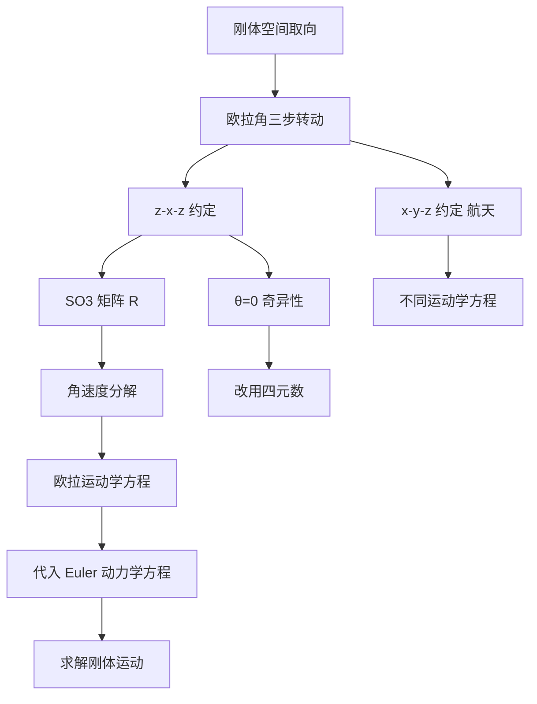

---
tags:
  - 理论力学
  - 刚体动力学
  - 欧拉角
  - SO3旋转
  - 运动学方程
aliases:
  - 欧拉角变换
  - 刚体空间取向
  - 欧拉运动学方程
created: 2024-01-15
updated: 2024-01-15
---

> [!summary] 算法执行总览
> 欧拉角变换的核心操作是**三步有序转动**：进动（绕固定 $z$ 轴）→ 章动（绕节线 $N$）→ 自转（绕体 $z'$ 轴）。整体变换矩阵 $R$ 按**右乘序**合成：$R = R_{z'}(\psi) R_N(\theta) R_z(\phi)$。角速度 $\boldsymbol{\Omega}$ 在体固连主轴上的投影由欧拉运动学方程给出，其形式**完全依赖于转动约定**，z-x-z 与 x-y-z 约定不可混用。

---

## 一、推导机理与核心数学定义

### 1.1 欧拉角的三步几何定义

设固定坐标系 $Oxyz$（惯性系），体固连坐标系 $Ox'y'z'$（随刚体运动）。刚体的任意空间取向可由三个独立角度唯一确定：

| 步骤 | 角度 | 转动轴 | 几何含义 |
|:---:|:---:|:---:|:---|
| 1 | 进动角 $\phi$ | 固定 $z$ 轴 | 将 $x$ 轴在 $Oxy$ 平面内转过 $\phi$，得到节线 $N$（即 $Ox'$ 在 $Oxy$ 平面上的投影） |
| 2 | 章动角 $\theta$ | 节线 $N$ | 将 $z$ 轴绕节线 $N$ 转过 $\theta$，得到 $z'$ 轴（$0 \leq \theta \leq \pi$） |
| 3 | 自转角 $\psi$ | 体 $z'$ 轴 | 将节线 $N$ 绕 $z'$ 轴转过 $\psi$，得到 $x'$ 轴 |

**关键几何事实**：节线 $N$ 同时垂直于 $z$ 轴与 $z'$ 轴，即 $N = z \times z'$（归一化后）。

### 1.2 SO(3) 旋转变换矩阵的合成

设 $R_z(\phi)$、$R_N(\theta)$、$R_{z'}(\psi)$ 分别表示绕对应轴转动的主动旋转矩阵。从固定系到体坐标系的整体变换为：

$$
R = R_{z'}(\psi) \, R_N(\theta) \, R_z(\phi)
$$

其中各基本旋转矩阵（主动旋转，右手定则）为：

$$
R_z(\phi) = \begin{pmatrix} \cos\phi & -\sin\phi & 0 \\ \sin\phi & \cos\phi & 0 \\ 0 & 0 & 1 \end{pmatrix}, \quad
R_N(\theta) = \begin{pmatrix} 1 & 0 & 0 \\ 0 & \cos\theta & -\sin\theta \\ 0 & \sin\theta & \cos\theta \end{pmatrix}, \quad
R_{z'}(\psi) = \begin{pmatrix} \cos\psi & -\sin\psi & 0 \\ \sin\psi & \cos\psi & 0 \\ 0 & 0 & 1 \end{pmatrix}
$$

> **注意**：$R_N(\theta)$ 的矩阵形式与 $R_x(\theta)$ 相同，因为节线 $N$ 在第一步转动后与固定 $x$ 轴重合（当 $\phi$ 转动完成后，$N$ 即位于 $Oxy$ 平面内与 $x$ 轴夹角为 $\phi$ 的方向；在第二步转动前，将坐标系绕 $z$ 轴旋转 $-\phi$ 即可使 $N$ 与 $x$ 轴对齐，故在节线坐标系中 $R_N(\theta) = R_x(\theta)$）。

将三个矩阵按右乘序展开，得到完整变换矩阵：

$$
R = \begin{pmatrix}
\cos\psi\cos\phi - \cos\theta\sin\phi\sin\psi & -\sin\psi\cos\phi - \cos\theta\sin\phi\cos\psi & \sin\theta\sin\phi \\
\cos\psi\sin\phi + \cos\theta\cos\phi\sin\psi & -\sin\psi\sin\phi + \cos\theta\cos\phi\cos\psi & -\sin\theta\cos\phi \\
\sin\theta\sin\psi & \sin\theta\cos\psi & \cos\theta
\end{pmatrix}
$$

**验证**：当 $\theta = 0$ 时（章动消失），$R$ 退化为 $R_z(\phi + \psi)$，即进动与自转合并为绕 $z$ 轴的单次转动，符合物理直觉。

### 1.3 角速度在体固连主轴上的投影（欧拉运动学方程）

角速度矢量 $\boldsymbol{\Omega}$ 可分解为三个瞬时转动之和：

$$
\boldsymbol{\Omega} = \dot{\phi} \hat{z} + \dot{\theta} \hat{N} + \dot{\psi} \hat{z}'
$$

其中 $\hat{z}$ 为固定 $z$ 轴单位矢量，$\hat{N}$ 为节线方向单位矢量，$\hat{z}'$ 为体 $z'$ 轴单位矢量。

将 $\hat{z}$ 与 $\hat{N}$ 投影到体固连坐标系 $Ox'y'z'$ 上：

- $\hat{z}$ 在体系中的分量为 $(\sin\theta\sin\psi, \sin\theta\cos\psi, \cos\theta)$
- $\hat{N}$ 在体系中的分量为 $(\cos\psi, -\sin\psi, 0)$
- $\hat{z}'$ 在体系中的分量为 $(0, 0, 1)$

代入分解式，得到角速度在体固连主轴上的投影：

$$
\boxed{
\begin{aligned}
\Omega_{x'} &= \dot{\phi}\sin\theta\sin\psi + \dot{\theta}\cos\psi \\
\Omega_{y'} &= \dot{\phi}\sin\theta\cos\psi - \dot{\theta}\sin\psi \\
\Omega_{z'} &= \dot{\phi}\cos\theta + \dot{\psi}
\end{aligned}}
$$

此即 **z-x-z 约定下的欧拉运动学方程**。

---

## 二、⚠️ 致命失分陷阱与临界边界

### 2.1 转动次序混淆（最高频错误）

| 约定 | 转动次序 | 运动学方程形式 |
|:---:|:---:|:---|
| **z-x-z**（Landau 采用，经典力学标准） | 先绕 $z$ 转 $\phi$，再绕节线 $N$（即新 $x$ 轴）转 $\theta$，最后绕新 $z'$ 转 $\psi$ | $\Omega_{x'} = \dot{\phi}\sin\theta\sin\psi + \dot{\theta}\cos\psi$ 等（如上） |
| **x-y-z**（航天/航空惯用，即 Tait-Bryan 角） | 先绕 $x$ 转 $\phi$（滚转），再绕新 $y$ 转 $\theta$（俯仰），最后绕新 $z$ 转 $\psi$（偏航） | $\Omega_{x'} = \dot{\phi} - \dot{\psi}\sin\theta$，$\Omega_{y'} = \dot{\theta}\cos\phi + \dot{\psi}\sin\phi\cos\theta$，$\Omega_{z'} = -\dot{\theta}\sin\phi + \dot{\psi}\cos\phi\cos\theta$ |

**后果**：若将航天约定的运动学方程误用于 z-x-z 约定的问题，或反之，则 $\Omega_{x'}, \Omega_{y'}, \Omega_{z'}$ 全部错位，后续 Euler 动力学方程（$I\dot{\boldsymbol{\Omega}} + \boldsymbol{\Omega} \times I\boldsymbol{\Omega} = \boldsymbol{M}$）将完全失效。

**判别方法**：检查题目中节线 $N$ 的定义位置——若节线是 $x$ 轴在 $Oxy$ 平面上的投影（即 $z$ 轴与 $z'$ 轴的公垂线），则为 z-x-z 约定；若三个角分别对应滚转-俯仰-偏航，则为 x-y-z 约定。

### 2.2 章动角 $\theta = 0$ 或 $\theta = \pi$ 的奇异性

当 $\theta = 0$（$z$ 轴与 $z'$ 轴重合）或 $\theta = \pi$（两轴反向）时：

- 节线 $N$ **不再唯一定义**（$z \times z' = 0$）
- 进动角 $\phi$ 与自转角 $\psi$ 的区分丧失，仅 $\phi + \psi$（或 $\phi - \psi$）有物理意义
- 运动学方程中 $\sin\theta$ 因子消失，$\Omega_{x'}$ 与 $\Omega_{y'}$ 的表达式退化为 $\dot{\theta}$ 的线性组合，但 $\phi$ 与 $\psi$ 的单独贡献不可分辨

**临界处理**：若问题中 $\theta$ 恒为 $0$ 或 $\pi$，应改用其他坐标参数化（如直接使用 $\phi + \psi$ 作为单一角度），或采用四元数避免奇异性。

### 2.3 矩阵乘法顺序的左右手陷阱

- **主动旋转 vs 被动旋转**：上述矩阵均为主动旋转（旋转矢量本身）。若采用被动旋转（旋转坐标系），所有矩阵需取转置。
- **列向量 vs 行向量约定**：若使用行向量左乘矩阵（$v^T R$），则合成顺序需反转。务必确认教材约定与自身推导一致。

### 2.4 角速度分解中基矢量的时序性

$\boldsymbol{\Omega} = \dot{\phi}\hat{z} + \dot{\theta}\hat{N} + \dot{\psi}\hat{z}'$ 中，$\hat{z}$ 是**固定**基矢量，$\hat{N}$ 是**中间**基矢量（随 $\phi$ 变化），$\hat{z}'$ 是**体固连**基矢量。投影到体系时，$\hat{z}$ 与 $\hat{N}$ 都必须通过完整变换矩阵 $R$ 转到体系，不可遗漏任何一步转动。

---

## 三、经典范例手把手演算

### 3.1 问题陈述

一对称陀螺（惯量主轴 $I_{x'} = I_{y'} = I_0$，$I_{z'} = I_3$）绕固定点 $O$ 运动。已知其欧拉角随时间变化规律为：

$$
\phi(t) = \omega_1 t, \quad \theta(t) = \theta_0 \text{（常数）}, \quad \psi(t) = \omega_2 t
$$

求：(a) 角速度 $\boldsymbol{\Omega}$ 在体固连主轴上的分量；(b) 当 $\theta_0 = \pi/2$ 时，$\boldsymbol{\Omega}$ 的方向。

### 3.2 演算步骤

**步骤 1**：代入欧拉运动学方程（z-x-z 约定）。

$$
\Omega_{x'} = \dot{\phi}\sin\theta\sin\psi + \dot{\theta}\cos\psi = \omega_1 \sin\theta_0 \sin(\omega_2 t) + 0
$$

$$
\Omega_{y'} = \dot{\phi}\sin\theta\cos\psi - \dot{\theta}\sin\psi = \omega_1 \sin\theta_0 \cos(\omega_2 t) - 0
$$

$$
\Omega_{z'} = \dot{\phi}\cos\theta + \dot{\psi} = \omega_1 \cos\theta_0 + \omega_2
$$

**步骤 2**：整理结果。

$$
\boxed{
\Omega_{x'} = \omega_1 \sin\theta_0 \sin(\omega_2 t), \quad
\Omega_{y'} = \omega_1 \sin\theta_0 \cos(\omega_2 t), \quad
\Omega_{z'} = \omega_1 \cos\theta_0 + \omega_2
}
$$

**步骤 3**：当 $\theta_0 = \pi/2$ 时，$\sin\theta_0 = 1$，$\cos\theta_0 = 0$，故：

$$
\Omega_{x'} = \omega_1 \sin(\omega_2 t), \quad
\Omega_{y'} = \omega_1 \cos(\omega_2 t), \quad
\Omega_{z'} = \omega_2
$$

$\boldsymbol{\Omega}$ 在体系 $x'y'$ 平面内的投影大小为 $\sqrt{\Omega_{x'}^2 + \Omega_{y'}^2} = \omega_1$（恒定），方向以角速度 $\omega_2$ 绕 $z'$ 轴旋转。$\boldsymbol{\Omega}$ 与 $z'$ 轴的夹角 $\alpha$ 满足：

$$
\tan\alpha = \frac{\sqrt{\Omega_{x'}^2 + \Omega_{y'}^2}}{\Omega_{z'}} = \frac{\omega_1}{\omega_2}
$$

**步骤 4**：终解反代验算。

将 $\boldsymbol{\Omega}$ 的分量代回 $\boldsymbol{\Omega} = \dot{\phi}\hat{z} + \dot{\theta}\hat{N} + \dot{\psi}\hat{z}'$ 的原始分解。当 $\theta_0 = \pi/2$ 时，$\hat{z}$ 在体系中的分量为 $(\sin\psi, \cos\psi, 0) = (\sin(\omega_2 t), \cos(\omega_2 t), 0)$，$\hat{N}$ 在体系中的分量为 $(\cos\psi, -\sin\psi, 0)$。于是：

$$
\dot{\phi}\hat{z} + \dot{\psi}\hat{z}' = \omega_1(\sin(\omega_2 t), \cos(\omega_2 t), 0) + \omega_2(0, 0, 1)
$$

与步骤 3 结果一致，验算通过。

---

## 四、出处与纸质笔记坐标

### 4.1 教材出处

- **Landau & Lifshitz**, *Mechanics*, 3rd Edition:
  - §33 (P105-P108)：欧拉角的几何定义与转动矩阵推导
  - §35 (P110-P115)：角速度在体固连轴上的投影，欧拉运动学方程的导出
- 补充参考：Goldstein, *Classical Mechanics*, §4.4 (P150-P160) 对 z-x-z 约定的矩阵展开有更详细的代数步骤。

### 4.2 纸质活页留痕槽位

> **[活页-MECH-20]**
> - 左侧页：手绘三步转动几何示意图（标注 $\phi, \theta, \psi$ 与节线 $N$）
> - 右侧页：完整矩阵乘法展开推导（从 $R_{z'}R_NR_z$ 逐项乘开）
> - 底部留白：记录航天 x-y-z 约定与 z-x-z 约定的对照表

### 4.3 知识全景图

---

*卡片生成时间：2024-01-15 | 复核状态：待纸质推导后回填批注*

---
**知识图谱导航**：[[00_理论力学_学习全景图]]
