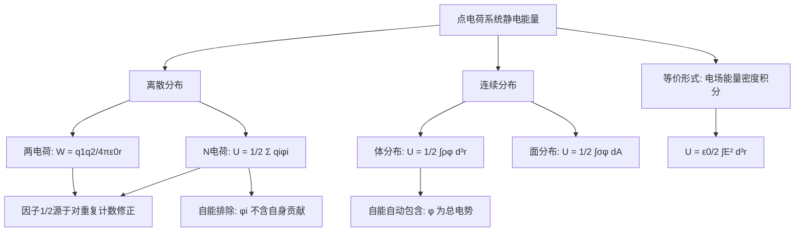

---
tags:
  - 电磁学
  - 静电能量
  - 点电荷系统
  - 定理卡
aliases:
  - 点电荷系统静电能量
  - 静电能量公式
created: 2025-04-15
updated: 2025-04-15
---

> [!summary] 定理核心论断
> 由 $N$ 个静止点电荷构成的孤立系统，其总静电能量（即构建该系统所需的外界功）等于每个电荷的电量与其所在位置处**由其他所有电荷产生的电势**之乘积总和的一半：
> $$U = \frac{1}{2} \sum_{i=1}^{N} q_i \varphi_i$$
> 其中 $\varphi_i$ 为除 $q_i$ 自身外其余 $N-1$ 个电荷在 $q_i$ 处产生的电势（**严格排除自能**）。

---

## 一、推导机理与核心数学定义

### 1.1 物理直觉：功的积累过程

静电能量并非电荷“自带”的属性，而是**构建电荷构型过程中外界反抗静电力所做的功**。设想将 $N$ 个点电荷从彼此相距无穷远的状态，逐一、准静态地搬运至最终位置 $\mathbf{r}_1, \mathbf{r}_2, \ldots, \mathbf{r}_N$。每搬入一个电荷，外界需反抗已有电荷对其的库仑斥力（或引力）做功，这部分功以电势能的形式储存在系统中。

### 1.2 两电荷系统的严格推导

考虑两个点电荷 $q_1$ 与 $q_2$，最终相距 $r_{12}$。

**第一步**：搬运 $q_1$ 至 $\mathbf{r}_1$（此时无其他电荷，外界做功为零）。

**第二步**：搬运 $q_2$ 从无穷远至距 $q_1$ 为 $r_{12}$ 处。在搬运路径上，$q_2$ 受到的静电力为：

$$F(r) = \frac{1}{4\pi\varepsilon_0} \frac{q_1 q_2}{r^2}$$

方向沿两者连线。外界需施加等大反向的力，沿径向从 $r = \infty$ 至 $r = r_{12}$ 做功：

$$W = \int_{\infty}^{r_{12}} \frac{1}{4\pi\varepsilon_0} \frac{q_1 q_2}{r^2} \, dr = \frac{q_1 q_2}{4\pi\varepsilon_0} \left[ -\frac{1}{r} \right]_{\infty}^{r_{12}} = \frac{1}{4\pi\varepsilon_0} \frac{q_1 q_2}{r_{12}}$$

**第三步**：对称性改写。$q_2$ 在 $q_1$ 处产生的电势为 $\varphi_1 = \dfrac{1}{4\pi\varepsilon_0}\dfrac{q_2}{r_{12}}$；$q_1$ 在 $q_2$ 处产生的电势为 $\varphi_2 = \dfrac{1}{4\pi\varepsilon_0}\dfrac{q_1}{r_{12}}$。于是：

$$W = \frac{1}{2} \left( q_1 \varphi_1 + q_2 \varphi_2 \right)$$

### 1.3 N 电荷系统的归纳推广

对 $N$ 个电荷，总能量为所有电荷对相互作用能之和（每对只计一次）：

$$U = \sum_{i<j} \frac{1}{4\pi\varepsilon_0} \frac{q_i q_j}{r_{ij}}$$

现定义 $\varphi_i$ 为除 $q_i$ 外所有其他电荷在 $\mathbf{r}_i$ 处产生的总电势：

$$\varphi_i = \sum_{j \neq i} \frac{1}{4\pi\varepsilon_0} \frac{q_j}{r_{ij}}$$

考察双重求和 $\sum_{i=1}^{N} q_i \varphi_i$：

$$\sum_{i=1}^{N} q_i \varphi_i = \sum_{i=1}^{N} \sum_{j \neq i} \frac{1}{4\pi\varepsilon_0} \frac{q_i q_j}{r_{ij}} = 2 \sum_{i<j} \frac{1}{4\pi\varepsilon_0} \frac{q_i q_j}{r_{ij}} = 2U$$

因为每对 $(i,j)$ 在双重求和中出现两次（一次为 $i$ 项中的 $j$，一次为 $j$ 项中的 $i$）。由此得到核心公式：

$$U = \frac{1}{2} \sum_{i=1}^{N} q_i \varphi_i$$

### 1.4 连续电荷分布的积分推广

当电荷连续分布时，将求和过渡为积分。引入电荷密度 $\rho(\mathbf{r})$，则：

$$U = \frac{1}{2} \int \rho(\mathbf{r}) \, \varphi(\mathbf{r}) \, d^3r$$

其中 $\varphi(\mathbf{r})$ 为**全空间所有电荷**（包括 $\mathbf{r}$ 处微元自身）在该点产生的总电势。此处与离散情形的关键差异在于：连续分布中“自能”与“互能”不可分割——将电荷元无限细分时，每个微元与其自身邻近微元的相互作用在极限下收敛为有限的“自能”贡献，该积分形式已自动包含此部分。

---

## 二、⚠️ 致命失分陷阱与临界边界

### 2.1 自能排除的绝对必要性

在离散点电荷公式 $U = \dfrac{1}{2}\sum q_i \varphi_i$ 中，$\varphi_i$ **必须**是除 $q_i$ 自身外其他电荷产生的电势。若误将 $q_i$ 自身的电势 $\varphi_i^{\text{self}} = \dfrac{1}{4\pi\varepsilon_0}\dfrac{q_i}{r} \bigg|_{r \to 0}$ 计入，则因点电荷在自身位置处电势发散，将得到无穷大的错误结果。**物理根源**：点电荷的“自能”在经典电磁学中本身发散，不属于可观测的相互作用能。

### 2.2 因子 $\frac{1}{2}$ 的物理来源与常见误用

因子 $\frac{1}{2}$ 源于对电荷对的重复计数修正。初学者常犯错误包括：

- 直接写 $U = \sum_i q_i \varphi_i$（漏掉 $\frac{1}{2}$，每对相互作用被计两次）；
- 对两电荷系统写 $U = q_1 \varphi_1$（只计一个电荷的贡献，物理上不对称）。

**验证方法**：对两电荷系统，$U = \dfrac{1}{4\pi\varepsilon_0}\dfrac{q_1 q_2}{r_{12}}$ 必须为正（同号）或负（异号），且与搬运顺序无关。

### 2.3 连续分布积分中的符号陷阱

在 $U = \dfrac{1}{2}\int \rho \varphi \, d^3r$ 中，$\varphi$ 为**全空间总电势**（含自身贡献）。若误用“排除自身”的离散逻辑，将导致积分不收敛或结果错误。连续分布的自能是有限的（只要 $\rho$ 无奇点），且物理上不可分离。

### 2.4 边界条件与参考点

电势 $\varphi_i$ 的零点必须取在无穷远处（孤立系统默认约定）。若系统周围存在外部导体或边界，则需重新定义参考点，否则能量值失去绝对意义（仅能量差有物理意义）。

### 2.5 符号约定

$q_i \varphi_i$ 的符号取决于电荷正负与电势正负。异号电荷对的相互作用能为负（吸引构型能量低于无穷远分离态），同号电荷对为正。总能量可为正、负或零，取决于系统具体构型。

---

## 三、经典范例手把手演算

### 3.1 范例：三个电荷的等边三角形构型

**题目**：三个等量正电荷 $q$ 分别位于边长为 $a$ 的等边三角形三个顶点，求系统总静电能量。

**第一步**：确定各电荷处的电势（排除自身）。由于对称性，每个电荷处由另外两个电荷产生的电势相同：

$$\varphi_1 = \varphi_2 = \varphi_3 = \frac{1}{4\pi\varepsilon_0} \frac{q}{a} + \frac{1}{4\pi\varepsilon_0} \frac{q}{a} = \frac{2q}{4\pi\varepsilon_0 a}$$

**第二步**：代入核心公式：

$$U = \frac{1}{2} \sum_{i=1}^{3} q_i \varphi_i = \frac{1}{2} \cdot 3 \cdot q \cdot \frac{2q}{4\pi\varepsilon_0 a} = \frac{3q^2}{4\pi\varepsilon_0 a}$$

**第三步**：交叉验证（逐对求和法）。系统有三对电荷，每对相距 $a$：

$$U = \sum_{i<j} \frac{1}{4\pi\varepsilon_0}\frac{q_i q_j}{r_{ij}} = 3 \cdot \frac{1}{4\pi\varepsilon_0}\frac{q^2}{a} = \frac{3q^2}{4\pi\varepsilon_0 a}$$

两种方法结果一致，验证正确。

**第四步**：终解反代验算。若 $q = 1\,\mu\text{C}$，$a = 1\,\text{cm}$，则：

$$U = \frac{3 \times (10^{-6})^2}{4\pi \times 8.85 \times 10^{-12} \times 0.01} \approx \frac{3 \times 10^{-12}}{1.112 \times 10^{-12}} \approx 2.7\,\text{J}$$

量级合理（微库仑级电荷在厘米尺度下的能量为焦耳量级）。

### 3.2 范例：连续分布——均匀带电球壳

**题目**：半径为 $R$、总电荷为 $Q$ 的均匀带电球壳，求其静电能量。

**第一步**：写出电荷密度。球壳面密度 $\sigma = \dfrac{Q}{4\pi R^2}$。

**第二步**：确定电势分布。由高斯定理，球壳内（$r < R$）电势为常数：

$$\varphi_{\text{in}} = \frac{1}{4\pi\varepsilon_0}\frac{Q}{R}$$

球壳上（$r = R$）电势连续，即 $\varphi(R) = \dfrac{1}{4\pi\varepsilon_0}\dfrac{Q}{R}$。

**第三步**：代入连续分布积分公式。电荷仅分布于球壳表面，体积分化为面积分：

$$U = \frac{1}{2} \int_{\text{shell}} \sigma \, \varphi(R) \, dA = \frac{1}{2} \cdot \frac{Q}{4\pi R^2} \cdot \frac{1}{4\pi\varepsilon_0}\frac{Q}{R} \cdot 4\pi R^2$$

**第四步**：化简：

$$U = \frac{1}{2} \cdot \frac{Q^2}{4\pi\varepsilon_0 R} = \frac{Q^2}{8\pi\varepsilon_0 R}$$

**第五步**：验算。球壳内电场为零，电场能量密度 $u = \dfrac{\varepsilon_0 E^2}{2}$ 仅在 $r > R$ 区域非零。对全空间积分：

$$U = \int_{R}^{\infty} \frac{\varepsilon_0}{2} \left( \frac{Q}{4\pi\varepsilon_0 r^2} \right)^2 4\pi r^2 \, dr = \frac{Q^2}{8\pi\varepsilon_0} \int_{R}^{\infty} \frac{dr}{r^2} = \frac{Q^2}{8\pi\varepsilon_0 R}$$

与积分公式结果一致，验证正确。

---

## 四、出处与纸质笔记坐标

- **纸质活页留痕**：`[活页-EM-03]`
- **教材原典坐标**：Purcell Ch.1 §1.5 (P18-P22)

### 4.1 教材出处

- **主教材**：Purcell, *Electricity and Magnetism*, 3rd Ed., Chapter 1, §1.5, pp. 18–22
- **核心内容定位**：p.18 两电荷系统能量推导起点；p.19 因子 $\frac{1}{2}$ 的引入与 $N$ 电荷推广；p.20 连续分布积分形式；p.21–22 自能与互能的讨论及电场能量密度过渡

### 4.2 纸质活页留痕槽位

> [!note] 活页-EM-03 手写推导留痕区
> - [ ] Purcell p.18 两电荷搬运功的积分推导（抄写并独立重推）
> - [ ] $N$ 电荷双重求和的因子 $\frac{1}{2}$ 展开（展开至 $N=4$ 验证系数）
> - [ ] 均匀带电球体（体分布）能量推导（对比球壳结果）
> - [ ] 自能发散问题的物理讨论笔记（附 Purcell p.21 旁注）
> - [ ] 错题订正区：误用 $\varphi_i$ 含自能的典型错误

### 4.3 知识全景图

> [!warning] 关联知识点索引
> - 电势定义与叠加原理 → Purcell §1.4
> - 电场能量密度 $u = \frac{\varepsilon_0}{2}E^2$ → Purcell §1.6
> - 导体系统的能量（电容储能 $U = \frac{1}{2}CV^2$）→ Purcell §3.4
> - 连续分布自能的有限性与经典电子半径问题 → Purcell §1.11

---

[[00_电磁学_学习全景图]]
