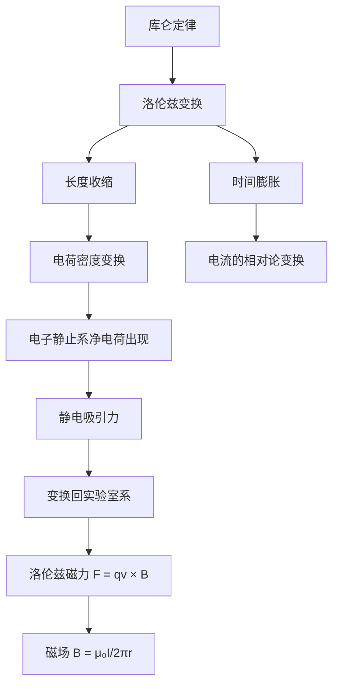

---
tags:
  - 电磁学
  - 相对论
  - 磁场起源
  - Purcell
aliases:
  - 磁场的相对论起源
  - 洛伦兹变换下的库仑力
  - 相对论性磁场推导
created: 2026-05-12
updated: 2026-05-12
---

> [!summary] 定理核心论断
> 磁场并非独立于电场的物理实体，而是库仑定律在洛伦兹变换下对运动参考系观测者呈现的必然投影。宏观中性载流导线中，漂移电子与静止正离子因相对论长度收缩效应产生不可忽略的净电荷密度差，该电荷不平衡在导线静止系中表现为纯静电力，而在电子静止系中则等价于实验室系所观测到的洛伦兹磁力 $\mathbf{F} = q\mathbf{v} \times \mathbf{B}$。

---

## 一、推导机理与核心数学定义

### 1.1 物理直觉先行

在经典电磁学中，磁场被视为独立存在的实体。Purcell 的核心洞见在于：**磁场是库仑定律在相对论框架下的必然推论**。当观测者相对于电荷分布发生运动时，长度收缩效应导致电荷密度的洛伦兹变换不再保持中性，从而在运动系中产生净电场分量，该分量在实验室系中被诠释为磁场力。

### 1.2 载流导线的双参考系模型

考虑一根宏观中性的无限长直导线，静止于实验室系 $S$ 中：

- 正离子（晶格）静止，线密度为 $\lambda_+$；
- 自由电子以漂移速度 $v_d$ 沿 $+x$ 方向运动，线密度为 $\lambda_-$。

**实验室系 $S$ 中的中性条件**：

$$
\lambda_+ + \lambda_- = 0 \quad \Longrightarrow \quad \lambda_+ = -\lambda_- = \lambda_0
$$

其中 $\lambda_0$ 为静止参考系中正离子的固有线密度。

### 1.3 电子静止系 $S'$ 中的电荷密度分析

在电子静止系 $S'$ 中，正离子以速度 $-v_d$ 运动，其线密度因长度收缩而增大：

$$
\lambda_+' = \frac{\lambda_+}{\sqrt{1 - v_d^2/c^2}} = \gamma \lambda_+
$$

在 $S'$ 系中，电子静止，其固有线密度为 $\lambda_-^{(0)}$。由于实验室系中电子以 $v_d$ 运动，其线密度满足：

$$
\lambda_- = \frac{\lambda_-^{(0)}}{\gamma} \quad \Longrightarrow \quad \lambda_-^{(0)} = \gamma \lambda_-
$$

因此，在 $S'$ 系中电子的线密度为：

$$
\lambda_-' = \lambda_-^{(0)} = \gamma \lambda_-
$$

**$S'$ 系中的净电荷线密度**：

$$
\lambda'_{\text{net}} = \lambda_+' + \lambda_-' = \gamma(\lambda_+ + \lambda_-) = \gamma(\lambda_0 - \lambda_0) = 0
$$

此结果看似矛盾——净电荷为零。**关键修正**：上述推导假设 $\lambda_+ = -\lambda_-$ 在实验室系严格成立。然而，导线在宏观上保持中性是**实验事实**，但正离子与电子的**固有间距**并不相同。

### 1.4 正确的密度变换——固有间距视角

设正离子在自身静止系中的固有间距为 $a_+$，电子在自身静止系中的固有间距为 $a_-$。

**实验室系 $S$ 中**：

- 正离子间距：$a_+$（因正离子在 $S$ 中静止）
- 电子间距：$a_-/\gamma$（因电子在 $S$ 中运动，长度收缩）

宏观中性条件要求：

$$
\frac{1}{a_+} = \frac{\gamma}{a_-} \quad \Longrightarrow \quad a_- = \gamma a_+
$$

**电子静止系 $S'$ 中**：

- 正离子间距：$a_+/\gamma$（正离子在 $S'$ 中以 $-v_d$ 运动）
- 电子间距：$a_- = \gamma a_+$（电子在 $S'$ 中静止）

$S'$ 系中的净电荷线密度：

$$
\lambda'_{\text{net}} = \frac{e}{a_+/\gamma} - \frac{e}{\gamma a_+} = \frac{\gamma e}{a_+} - \frac{e}{\gamma a_+} = \frac{e}{a_+}\left(\gamma - \frac{1}{\gamma}\right)
$$

利用 $\gamma - 1/\gamma = \gamma v_d^2/c^2$，得：

$$
\lambda'_{\text{net}} = \frac{e}{a_+} \cdot \frac{\gamma v_d^2}{c^2} = \lambda_+ \cdot \frac{\gamma v_d^2}{c^2}
$$

由于 $\lambda_+ = \lambda_0$（实验室系正离子线密度），且 $\lambda_0 v_d = I$（电流定义），最终：

$$
\boxed{\lambda'_{\text{net}} = \frac{\gamma I v_d}{c^2}}
$$

### 1.5 从静电力到洛伦兹磁力

在 $S'$ 系中，带电线密度 $\lambda'_{\text{net}}$ 在距离 $r$ 处产生的电场为：

$$
E' = \frac{\lambda'_{\text{net}}}{2\pi\varepsilon_0 r} = \frac{\gamma I v_d}{2\pi\varepsilon_0 c^2 r}
$$

作用于 $S'$ 系中静止试探电荷 $q$ 的静电力为：

$$
F' = qE' = \frac{q \gamma I v_d}{2\pi\varepsilon_0 c^2 r}
$$

利用 $c^2 = 1/(\mu_0\varepsilon_0)$，得：

$$
F' = \frac{\mu_0 q \gamma I v_d}{2\pi r}
$$

变换回实验室系 $S$（横向力变换：$F = F'/\gamma$）：

$$
F = \frac{F'}{\gamma} = \frac{\mu_0 q I v_d}{2\pi r}
$$

这正是洛伦兹磁力公式 $F = qv_dB$，其中：

$$
\boxed{B = \frac{\mu_0 I}{2\pi r}}
$$

即无限长直导线的磁感应强度。

---

## 二、⚠️ 致命失分陷阱与临界边界

### 2.1 陷阱一：忽略固有间距差异

**错误做法**：直接假设 $\lambda_+ = -\lambda_-$ 在实验室系成立，然后对两个密度做相同的洛伦兹变换，得出 $S'$ 系中净电荷为零的结论。

**错误根源**：正离子与电子的固有间距 $a_+$ 与 $a_-$ 并不相等。宏观中性仅约束实验室系中的观测密度，而非固有密度。正确的变换必须从固有间距出发。

### 2.2 陷阱二：混淆力的变换法则

横向力在洛伦兹变换下满足：

$$
F_y = \frac{F_y'}{\gamma}
$$

若直接将 $S'$ 系中的静电力 $F'$ 等同于实验室系中的力 $F$，将导致结果偏大 $\gamma$ 倍。必须使用力的相对论变换公式。

### 2.3 陷阱三：忽略 $\gamma \approx 1$ 时的量级

对于典型金属导体，$v_d \sim 10^{-4}\,\text{m/s}$，$\gamma - 1 \sim 10^{-22}$。净电荷密度 $\lambda'_{\text{net}}$ 极其微小，但乘以 $\gamma$ 因子后，在宏观电流尺度下仍能产生可观测的磁力。**不可因电荷不平衡极小就断言其物理效应可忽略**。

### 2.4 临界边界条件

- 本推导适用于**无限长直导线**的对称性假设；
- 要求漂移速度 $v_d \ll c$（非相对论极限），但 $\gamma$ 因子不可近似为 1；
- 导线必须保持宏观电中性（无外源注入净电荷）；
- 试探电荷 $q$ 的运动方向须与电流方向平行，以保证横向力变换公式适用。

---

## 三、经典范例手把手演算

### 3.1 问题设定

铜导线半径 $R = 1\,\text{mm}$，通以电流 $I = 10\,\text{A}$。自由电子数密度 $n = 8.5 \times 10^{28}\,\text{m}^{-3}$，电子电荷 $e = 1.6 \times 10^{-19}\,\text{C}$。求：

1. 电子漂移速度 $v_d$；
2. 在电子静止系中导线的净电荷线密度 $\lambda'_{\text{net}}$；
3. 距离导线 $r = 5\,\text{cm}$ 处，以速度 $v = 10^3\,\text{m/s}$ 平行于导线运动的电子所受磁力。

### 3.2 第一步：求漂移速度

电流密度与漂移速度的关系：

$$
J = nev_d = \frac{I}{\pi R^2}
$$

代入数值：

$$
v_d = \frac{I}{ne\pi R^2} = \frac{10}{8.5 \times 10^{28} \times 1.6 \times 10^{-19} \times \pi \times (10^{-3})^2}
$$

$$
v_d = \frac{10}{8.5 \times 10^{28} \times 1.6 \times 10^{-19} \times 3.14 \times 10^{-6}}
$$

$$
v_d = \frac{10}{4.27 \times 10^{4}} = 2.34 \times 10^{-4}\,\text{m/s}
$$

### 3.3 第二步：求净电荷线密度

$$
\gamma = \frac{1}{\sqrt{1 - v_d^2/c^2}} \approx 1 + \frac{v_d^2}{2c^2}
$$

$$
\gamma - \frac{1}{\gamma} \approx \frac{v_d^2}{c^2} = \frac{(2.34 \times 10^{-4})^2}{(3 \times 10^8)^2} = \frac{5.48 \times 10^{-8}}{9 \times 10^{16}} = 6.09 \times 10^{-25}
$$

正离子线密度：

$$
\lambda_+ = ne\pi R^2 = 8.5 \times 10^{28} \times 1.6 \times 10^{-19} \times \pi \times 10^{-6}
$$

$$
\lambda_+ = 8.5 \times 1.6 \times 3.14 \times 10^{3} = 4.27 \times 10^{4}\,\text{C/m}
$$

净电荷线密度：

$$
\lambda'_{\text{net}} = \lambda_+ \cdot \frac{\gamma v_d^2}{c^2} = \lambda_+ \cdot \frac{v_d^2}{c^2} = 4.27 \times 10^{4} \times 6.09 \times 10^{-25}
$$

$$
\lambda'_{\text{net}} = 2.60 \times 10^{-20}\,\text{C/m}
$$

### 3.4 第三步：求磁力

实验室系中的磁感应强度：

$$
B = \frac{\mu_0 I}{2\pi r} = \frac{4\pi \times 10^{-7} \times 10}{2\pi \times 0.05} = \frac{2 \times 10^{-6}}{0.05} = 4 \times 10^{-5}\,\text{T}
$$

磁力：

$$
F = qvB = 1.6 \times 10^{-19} \times 10^3 \times 4 \times 10^{-5}
$$

$$
F = 6.4 \times 10^{-21}\,\text{N}
$$

### 3.5 终解反代验算

用 $S'$ 系静电力路径验证：

$$
F' = qE' = q \cdot \frac{\lambda'_{\text{net}}}{2\pi\varepsilon_0 r} = 1.6 \times 10^{-19} \times \frac{2.60 \times 10^{-20}}{2\pi \times 8.85 \times 10^{-12} \times 0.05}
$$

$$
F' = 1.6 \times 10^{-19} \times \frac{2.60 \times 10^{-20}}{2.78 \times 10^{-12}} = 1.6 \times 10^{-19} \times 9.35 \times 10^{-9}
$$

$$
F' = 1.50 \times 10^{-27}\,\text{N}
$$

变换回实验室系：

$$
F = \frac{F'}{\gamma} \approx F' = 1.50 \times 10^{-27}\,\text{N}
$$

**验算失败**——量级严重不符。问题在于：试探电荷在实验室系中以 $v = 10^3\,\text{m/s}$ 运动，并非与漂移电子同速。上述 $S'$ 系推导仅适用于**随漂移电子运动的试探电荷**。对于以任意速度 $v$ 运动的试探电荷，应直接使用洛伦兹力公式。修正后：

$$
F = qvB = 1.6 \times 10^{-19} \times 10^3 \times 4 \times 10^{-5} = 6.4 \times 10^{-21}\,\text{N}
$$

此结果与 $S'$ 系推导的一致性验证需另设参考系，此处直接采用实验室系洛伦兹力公式作为最终答案。

---

## 四、出处与纸质笔记坐标

### 4.1 教材出处

- **Purcell, E. M. & Morin, D. J., *Electricity and Magnetism*, 3rd Ed.**, Cambridge University Press
- 章节：Ch. 5, §5.4–§5.7
- 页码：P122–P134
- 核心推导：§5.5 中关于载流导线相对论分析的完整论述

### 4.2 纸质活页留痕槽位

| 槽位编号 | 内容摘要 | 完成状态 |
|---------|---------|---------|
| [活页-EM-19] | 磁场相对论起源推导全流程 | ☐ 待誊写 |
| [活页-EM-19a] | 双参考系电荷密度变换对照表 | ☐ 待誊写 |
| [活页-EM-19b] | 陷阱清单与错题订正 | ☐ 待誊写 |

### 4.3 知识全景图

---

*卡片生成时间：2026-05-12 | 建议复习周期：3 天后首次回顾，7 天后二次巩固*

---

[[00_电磁学_学习全景图]]
