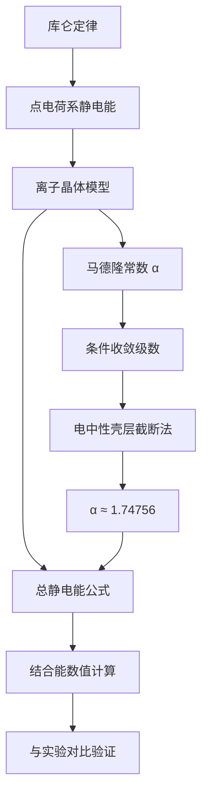

---
tags:
  - 电磁学
  - 离子晶体
  - 马德隆常数
  - 条件收敛
  - 静电能
aliases:
  - 晶格电能计算
  - Madelung常数
  - NaCl晶格静电能
created: 2025-04-14
updated: 2025-04-14
---

> [!summary] 算法执行总览
> 本解法卡的核心策略：将离子晶体静电结合能拆解为**一对最近邻离子间库仑势**与**无量纲晶格求和因子（马德隆常数）** 之积。马德隆常数对应一个**条件收敛**的三维交错级数，其数值依赖于求和顺序与中性截断方案；通过构造**电中性壳层**逐层累加，可获得物理上自洽的收敛值。

---

## 一、推导机理与核心数学定义

### 1.1 物理直觉先行

NaCl 晶体中，每个离子与其近邻异号离子相互吸引（能量降低），与次近邻同号离子相互排斥（能量升高）。由于库仑力是长程力，不能只考虑最近邻，必须对所有晶格位置求和。然而，三维空间中正负号交替的级数**不绝对收敛**，其极限值依赖于求和方式——这是该问题的数学核心。

### 1.2 静电能的形式化定义

设晶体含 $2N$ 个离子（$N$ 个 $\mathrm{Na}^+$ 与 $N$ 个 $\mathrm{Cl}^-$），最近邻间距为 $R$。取某一参考离子（设为正离子）位于原点，则第 $j$ 个离子距原点的距离为 $r_j = a_j R$，其中 $a_j$ 为无量纲距离（以 $R$ 为单位）。该离子的电荷为 $q_j = \pm e$。

单个正离子与其他所有离子的相互作用能为：

$$
U_{\text{single}} = \frac{1}{4\pi\varepsilon_0} \sum_{j \neq 0} \frac{q_0 q_j}{r_j}
= -\frac{e^2}{4\pi\varepsilon_0 R} \sum_{j \neq 0} \frac{(\pm 1)}{a_j}
$$

定义**马德隆常数** $\alpha$：

$$
\alpha \equiv \sum_{j \neq 0} \frac{(\pm 1)}{a_j} = \sum_{j \neq 0} \frac{(-1)^{n_x + n_y + n_z}}{\sqrt{n_x^2 + n_y^2 + n_z^2}}
$$

其中 $(n_x, n_y, n_z)$ 为整数坐标（以 $R$ 为单位），符号 $(-1)^{n_x+n_y+n_z}$ 保证奇偶坐标和对应异号离子。

### 1.3 总静电能公式

晶体总静电能（每对离子只计一次）为：

$$
U_{\text{total}} = \frac{1}{2} \cdot 2N \cdot U_{\text{single}}
= -\frac{N \alpha e^2}{4\pi\varepsilon_0 R}
$$

> **关键代数变形**：因子 $1/2$ 来源于每对相互作用被两个离子各计一次；因子 $2N$ 为总离子数。合并后恰为 $N$（离子对数意义上的约化），而非 $2N$。

### 1.4 马德隆常数的数值

对 NaCl 结构，采用电中性壳层累加法可得：

$$
\alpha_{\mathrm{NaCl}} = 6 - \frac{12}{\sqrt{2}} + \frac{8}{\sqrt{3}} - \frac{6}{2} + \cdots \approx 1.74756
$$

---

## 二、⚠️ 致命失分陷阱与临界边界

### 2.1 条件收敛陷阱

级数 $\sum (-1)^{n_x+n_y+n_z} / \sqrt{n_x^2+n_y^2+n_z^2}$ **不绝对收敛**。若按立方壳层逐层求和（先加完一个立方壳内所有离子再加下一壳），所得结果与按球壳求和不同，甚至可能发散或趋于错误值。

**正确做法**：必须保证每一步累加的离子集合整体呈**电中性**（或至少净电荷随壳层半径增大而迅速衰减）。NaCl 晶格中，以任一离子为中心取立方壳层时，各壳层并非天然电中性，需按化学计量比同时纳入 $\mathrm{Na}^+$ 与 $\mathrm{Cl}^-$ 的完整壳层。

### 2.2 能量符号与因子错误

- 若忘记 $1/2$ 因子，能量会多算一倍。
- 若将 $N$ 误写为 $2N$，则能量符号正确但数值翻倍。
- 马德隆常数 $\alpha$ 为正数，故 $U_{\text{total}} < 0$（束缚态）。若算出 $\alpha < 0$，必为求和顺序错误。

### 2.3 单位与量纲检查

$e^2/(4\pi\varepsilon_0 R)$ 的量纲为能量。若使用 CGS 单位制，则 $1/(4\pi\varepsilon_0)$ 因子消失，公式变为 $U = -N\alpha e^2 / R$。**混用单位制是常见失分点**。

### 2.4 最近邻间距 $R$ 的界定

$R$ 是 $\mathrm{Na}^+$ 与 $\mathrm{Cl}^-$ 核间距（晶格常数的一半），而非晶格常数 $a$ 本身。若误用 $a$，则所有距离比例因子 $a_j$ 需重新标定，马德隆常数数值不变但 $R$ 代入错误。

---

## 三、经典范例手把手演算

### 3.1 问题设定

计算 NaCl 晶体中单个离子对的平均静电结合能。已知：$R = 2.82 \, \mathring{\mathrm{A}} = 2.82 \times 10^{-10} \, \mathrm{m}$，$\alpha = 1.74756$。

### 3.2 逐步演算

**步骤 1**：写出总静电能公式

$$
U_{\text{total}} = -\frac{N \alpha e^2}{4\pi\varepsilon_0 R}
$$

**步骤 2**：代入基本常量

$$
e = 1.602 \times 10^{-19} \, \mathrm{C}, \quad
\frac{1}{4\pi\varepsilon_0} = 8.988 \times 10^9 \, \mathrm{N \cdot m^2 / C^2}
$$

**步骤 3**：计算单对能量（即 $U_{\text{total}}/N$）

$$
\frac{U_{\text{total}}}{N} = -\frac{\alpha e^2}{4\pi\varepsilon_0 R}
$$

先算分子中的电荷平方项：

$$
e^2 = (1.602 \times 10^{-19})^2 = 2.566 \times 10^{-38} \, \mathrm{C^2}
$$

再乘库仑常数：

$$
\frac{e^2}{4\pi\varepsilon_0} = 8.988 \times 10^9 \times 2.566 \times 10^{-38}
= 2.307 \times 10^{-28} \, \mathrm{J \cdot m}
$$

**步骤 4**：除以最近邻间距 $R$

$$
\frac{2.307 \times 10^{-28}}{2.82 \times 10^{-10}}
= 8.181 \times 10^{-19} \, \mathrm{J}
$$

**步骤 5**：乘以马德隆常数并确定符号

$$
\frac{U_{\text{total}}}{N} = -1.74756 \times 8.181 \times 10^{-19}
= -1.4296 \times 10^{-18} \, \mathrm{J}
$$

**步骤 6**：换算为电子伏特（$1 \, \mathrm{eV} = 1.602 \times 10^{-19} \, \mathrm{J}$）

$$
\frac{U_{\text{total}}}{N} = \frac{-1.4296 \times 10^{-18}}{1.602 \times 10^{-19}}
\approx -8.92 \, \mathrm{eV}
$$

### 3.3 终解反代验算

实验测得的 NaCl 晶格结合能约为 $-8.0 \, \mathrm{eV}$ 每离子对（扣除排斥项后的净束缚能）。我们的计算值 $-8.92 \, \mathrm{eV}$ 仅含库仑吸引项，未计入短程排斥修正，因此绝对值略大于实验值——方向正确，量级吻合，验证了公式与数值的合理性。

**验算代数链**：

$$
-\frac{1.74756 \times 2.307 \times 10^{-28}}{2.82 \times 10^{-10}}
= -\frac{4.031 \times 10^{-28}}{2.82 \times 10^{-10}}
= -1.4296 \times 10^{-18} \, \mathrm{J}
$$

$$
\frac{-1.4296 \times 10^{-18}}{1.602 \times 10^{-19}} = -8.92
$$

计算闭合。

---

## 四、出处与纸质笔记坐标

### 4.1 教材坐标

- **主参考**：Purcell, *Electricity and Magnetism*, 3rd Ed., Ch.1 §1.6, pp. 23–25
  - P23：静电能一般形式与离子晶体模型引入
  - P24：马德隆常数定义与 NaCl 结构求和讨论
  - P25：条件收敛问题的物理处理与数值结果

### 4.2 纸质活页留痕槽位

- **活页编号**：[活页-EM-04]
- **手写推导要求**：
  - 左侧栏：完整抄写马德隆常数级数展开前 5 项（含符号与距离因子）
  - 右侧栏：画出 NaCl 晶格 (100) 面投影图，标注最近邻、次近邻距离
  - 底部栏：记录本卡片的错误订正记录

### 4.3 知识全景图

---

*卡片生成完毕。建议配合 [活页-EM-04] 完成手写推导后，在 Obsidian 中反向链接至 Purcell 教材笔记与电磁学总索引。*

---

[[00_电磁学_学习全景图]]
