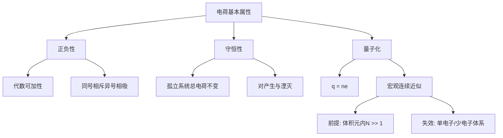

---
tags:
  - 电磁学
  - 电荷
  - 概念卡
  - Purcell
aliases:
  - 电荷守恒与量子化
  - 电荷基本属性
created: 2025-04-11
updated: 2025-04-11
---

> [!summary] 核心认知先验
> 电荷是物质的一种内禀属性，其核心特征在于**代数可加性**（正负抵消）与**绝对守恒性**（净电荷在任意物理过程中不变）。电荷的量子化（以 $e$ 为最小单位）揭示了宏观电荷连续性的统计本质，而电荷守恒在粒子对产生与湮灭过程中依然严格成立。

---

## 一、推导机理与核心数学定义

### 1.1 电荷的正负性与代数可加性

电荷分为正、负两种类型，同号相斥、异号相吸。若系统由 $N$ 个点电荷组成，第 $i$ 个电荷量为 $q_i$（可正可负），则系统的**总电荷**定义为代数求和：

$$
Q_{\text{total}} = \sum_{i=1}^{N} q_i
$$

其中 $q_i \in \mathbb{R}$，正负号代表电荷类型。这一代数可加性意味着正负电荷可以相互抵消，系统的净电荷可能为零，但此时系统中仍可能存在大量正负电荷对。

### 1.2 电荷守恒定律

**电荷守恒定律**：在一个孤立系统中，总电荷 $Q_{\text{total}}$ 不随时间改变，即：

$$
\frac{dQ_{\text{total}}}{dt} = 0
$$

这一定律的深层含义在于：电荷既不能被创造，也不能被消灭，只能从一处转移至另一处，或以正负对的形式出现或消失。

**反粒子对产生与湮灭**：在高能物理过程中，能量可以转化为粒子-反粒子对。例如，一个高能光子（$\gamma$）可以转化为一个电子（$e^-$）与一个正电子（$e^+$）：

$$
\gamma \longrightarrow e^- + e^+
$$

在此过程中，初态总电荷为 $0$（光子不带电），末态总电荷为 $(-e) + (+e) = 0$，电荷守恒严格成立。反之，电子与正电子湮灭时：

$$
e^- + e^+ \longrightarrow 2\gamma
$$

初态总电荷 $(-e) + (+e) = 0$，末态总电荷为 $0$，同样满足守恒。

### 1.3 电荷量子化

实验表明，任何孤立体系中观测到的电荷量 $q$ 都是基本电荷 $e$ 的整数倍：

$$
q = ne, \quad n \in \mathbb{Z}
$$

其中基本电荷常数为：

$$
e = 1.602176634 \times 10^{-19} \ \text{C}
$$

质子带电荷 $+e$，电子带电荷 $-e$，夸克带分数电荷（$\pm \frac{1}{3}e$ 或 $\pm \frac{2}{3}e$），但夸克因色禁闭无法以自由态存在，因此宏观可观测的自由电荷始终满足整数倍关系。

### 1.4 宏观电荷连续近似的前提

在宏观电磁学中，我们常将电荷视为连续分布的密度函数 $\rho(\mathbf{r})$，其数学定义为：

$$
\rho(\mathbf{r}) = \lim_{\Delta V \to 0} \frac{\Delta Q}{\Delta V}
$$

其中 $\Delta Q$ 为体积元 $\Delta V$ 内的总电荷。这一连续近似的**成立前提**是：

1. **特征尺度远大于微观间距**：所考察的体积元 $\Delta V$ 必须包含大量基本电荷（$N \gg 1$），使得 $\Delta Q$ 的离散涨落相对均值可忽略；
2. **量子涨落可忽略**：在经典电磁学的适用范围内，电荷的离散性（以 $e$ 为单位）不产生可观测的统计涨落效应。

当体系尺度缩小至纳米量级或电荷数极少时（如单电子器件），连续近似失效，必须回到离散电荷的量子化描述。

---

## 二、⚠️ 致命失分陷阱与临界边界

### 陷阱 1：混淆“电荷守恒”与“电荷不变”

电荷守恒指的是**孤立系统**中总电荷不变，而非单个物体上的电荷不变。电荷可以在系统内部转移（如摩擦起电），只要系统与外界无电荷交换，总电荷即守恒。失分点在于：将“某物体电荷改变”误判为“电荷不守恒”。

### 陷阱 2：忽略反粒子对产生中的初末态电荷核算

在粒子对产生或湮灭过程中，必须**逐项核算初态与末态的总电荷**。常见错误是只关注新产生的粒子而遗漏背景电荷，或忘记正反粒子电荷相反。正确做法是：

$$
Q_{\text{initial}} = \sum q_{\text{initial}}, \quad Q_{\text{final}} = \sum q_{\text{final}}, \quad Q_{\text{initial}} = Q_{\text{final}}
$$

### 陷阱 3：将宏观连续近似当作基本定律

电荷的连续分布 $\rho(\mathbf{r})$ 是**唯象近似**，不是基本事实。若题目涉及单电子或少数电荷体系（如油滴实验、单电子晶体管），仍使用连续电荷密度将导致根本性错误。临界边界在于：当体积元内电荷数 $N \lesssim 10^3$ 时，离散效应不可忽略。

### 陷阱 4：忽视电荷量子化的代数符号

电荷量子化公式 $q = ne$ 中，$n$ 为**任意整数**（含负整数与零），而非仅正整数。电子对应 $n = -1$，质子对应 $n = +1$。失分点在于：将 $n$ 误限为正整数，或忘记 $n = 0$ 对应中性粒子。

### 陷阱 5：误以为电荷量可以取任意实数

在经典电磁学的宏观尺度下，电荷量看似连续可调（如电容器充电），但微观本质仍是离散的。若题目明确考察量子化（如密立根油滴实验），则必须使用 $q = ne$ 进行分析，不能将测量值直接视为连续变量。

---

## 三、经典范例手把手演算

### 范例 1：反粒子对产生中的电荷守恒核算

**题目**：一个能量为 $E = 2.044 \ \text{MeV}$ 的光子在真空中转化为一个电子-正电子对。已知电子静质量为 $m_e = 9.109 \times 10^{-31} \ \text{kg}$，基本电荷 $e = 1.602 \times 10^{-19} \ \text{C}$。验证该过程中电荷守恒，并计算末态总电荷。

**第一步：明确初态电荷**

光子不带电，故初态总电荷为：

$$
Q_{\text{initial}} = 0
$$

**第二步：明确末态粒子及其电荷**

末态包含一个电子（电荷 $-e$）和一个正电子（电荷 $+e$）。末态总电荷为：

$$
Q_{\text{final}} = (-e) + (+e) = 0
$$

**第三步：比较初末态电荷**

$$
Q_{\text{initial}} = Q_{\text{final}} = 0
$$

电荷守恒成立。

**第四步：终解反代验算**

将 $e = 1.602 \times 10^{-19} \ \text{C}$ 代入：

$$
Q_{\text{final}} = (-1.602 \times 10^{-19}) + (+1.602 \times 10^{-19}) = 0 \ \text{C}
$$

验算通过，电荷守恒严格满足。

---

### 范例 2：宏观连续近似的适用性判断

**题目**：一个半径为 $R = 1 \ \mu\text{m}$ 的球形水滴带有净电荷 $Q = 3.2 \times 10^{-15} \ \text{C}$。判断将该电荷视为连续分布是否合理。

**第一步：计算水滴中的净电荷对应的基本电荷数**

$$
n = \frac{Q}{e} = \frac{3.2 \times 10^{-15}}{1.602 \times 10^{-19}} = 1.997 \times 10^4
$$

即净电荷对应约 $n \approx 2.0 \times 10^4$ 个基本电荷。

**第二步：估算水滴中总电荷数（含正负抵消部分）**

水滴由水分子组成，每个水分子含 10 个电子和 10 个质子。水滴体积为：

$$
V = \frac{4}{3}\pi R^3 = \frac{4}{3}\pi (10^{-6})^3 = 4.189 \times 10^{-18} \ \text{m}^3
$$

水的分子数密度约为 $3.34 \times 10^{28} \ \text{分子}/\text{m}^3$，故水滴中总分子数：

$$
N_{\text{mol}} = 3.34 \times 10^{28} \times 4.189 \times 10^{-18} = 1.40 \times 10^{11}
$$

总电荷数（正负合计）约为：

$$
N_{\text{charge}} = 10 \times N_{\text{mol}} \times 2 = 2.80 \times 10^{12}
$$

**第三步：判断连续近似的合理性**

净电荷数 $n \approx 2.0 \times 10^4$ 远小于总电荷数 $N_{\text{charge}} \approx 2.8 \times 10^{12}$，但关键在于体积元内的电荷数是否足够大。若取体积元 $\Delta V = (10\ \text{nm})^3 = 10^{-24} \ \text{m}^3$，其中包含的分子数约为：

$$
N_{\text{mol,}\Delta V} = 3.34 \times 10^{28} \times 10^{-24} = 3.34 \times 10^4
$$

对应电荷数约为 $6.68 \times 10^5$，远大于 1，离散涨落相对幅度约为 $1/\sqrt{6.68 \times 10^5} \approx 1.2 \times 10^{-3}$，可忽略。

**第四步：结论**

在该尺度下，将电荷视为连续分布是合理的，因为任意宏观体积元内包含的基本电荷数足够大，离散效应在相对误差 $10^{-3}$ 量级以下。

---

### 范例 3：电荷量子化的实验验证（密立根油滴）

**题目**：在密立根油滴实验中，测得某油滴的电荷为 $q_1 = 8.01 \times 10^{-19} \ \text{C}$，另一油滴的电荷为 $q_2 = 1.12 \times 10^{-18} \ \text{C}$。求基本电荷 $e$ 的估计值。

**第一步：假设两电荷均为基本电荷的整数倍**

$$
q_1 = n_1 e, \quad q_2 = n_2 e, \quad n_1, n_2 \in \mathbb{Z}
$$

**第二步：求两电荷之差**

$$
\Delta q = q_2 - q_1 = 1.12 \times 10^{-18} - 8.01 \times 10^{-19} = 3.19 \times 10^{-19} \ \text{C}
$$

**第三步：利用最小非零差值估计 $e$**

若 $n_2 = n_1 + 2$，则 $\Delta q = 2e$，故：

$$
e = \frac{\Delta q}{2} = \frac{3.19 \times 10^{-19}}{2} = 1.595 \times 10^{-19} \ \text{C}
$$

若 $n_2 = n_1 + 1$，则 $\Delta q = e$，但此时 $e = 3.19 \times 10^{-19} \ \text{C}$ 与已知值偏差过大，故取前者。

**第四步：终解反代验算**

以 $e = 1.595 \times 10^{-19} \ \text{C}$ 反代：

$$
n_1 = \frac{8.01 \times 10^{-19}}{1.595 \times 10^{-19}} = 5.02 \approx 5
$$

$$
n_2 = \frac{1.12 \times 10^{-18}}{1.595 \times 10^{-19}} = 7.02 \approx 7
$$

$n_1 = 5$，$n_2 = 7$ 均为整数，且 $n_2 - n_1 = 2$，与假设一致。验算通过，基本电荷估计值为：

$$
e \approx 1.595 \times 10^{-19} \ \text{C}
$$

与精确值 $1.602 \times 10^{-19} \ \text{C}$ 的相对误差约为 $0.4\%$，在实验误差范围内。

---

## 四、出处与纸质笔记坐标

### 教材出处

- **Purcell, E. M. & Morin, D. J., *Electricity and Magnetism*, 3rd Ed.**  
  - §1.1 电荷的性质：P7-P9  
  - §1.2 电荷守恒：P9-P11  
  - §1.3 电荷量子化与宏观连续近似：P11-P12

### 纸质活页留痕槽位

- **[活页-EM-01]**：本节概念卡对应笔记区，建议记录以下内容：
  - 电荷正负性实验依据（富兰克林命名法、摩擦起电序列）
  - 电荷守恒的微观机制（对产生/湮灭的费曼图示意）
  - 密立根油滴实验的数据处理表格
  - 宏观连续近似的适用边界条件自查清单

### 知识全景图

---

*本卡片依据 Purcell §1.1-1.3 编写，建议配合 [活页-EM-01] 进行手写推导与错题订正。*

---

[[00_电磁学_学习全景图]]
