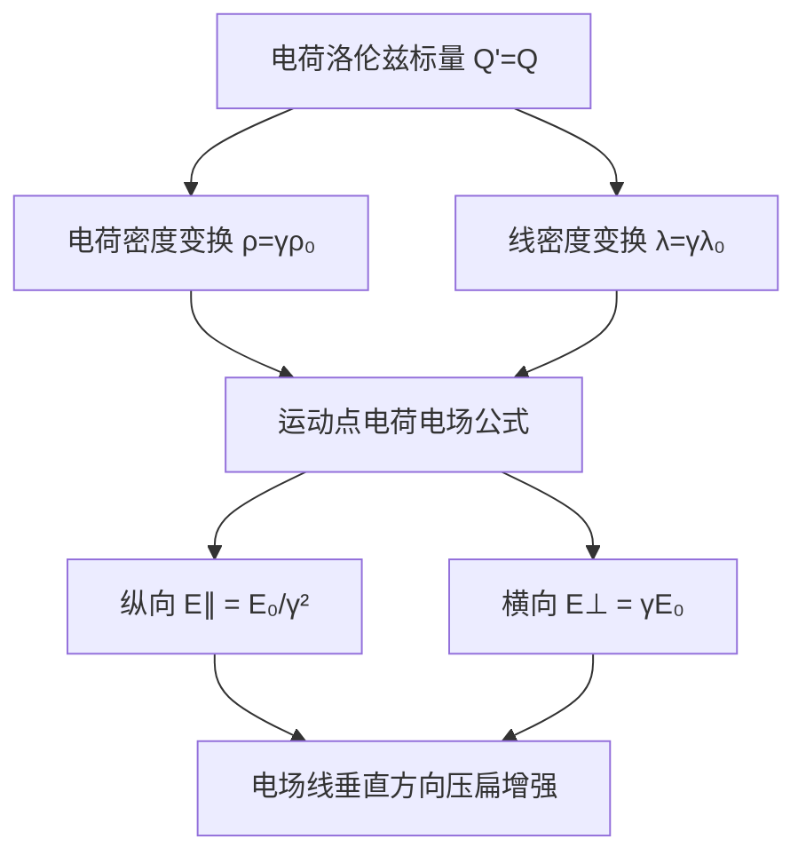

---
tags:
  - 电动力学
  - 狭义相对论
  - 电荷不变性
  - 运动电荷场
  - Purcell
aliases:
  - 电荷洛伦兹标量性
  - 运动线密度变换
  - 高速运动电荷电场
created: 2026-01-15
updated: 2026-01-15
---

> [!summary] 核心认知先验
> 电荷量 $Q$ 是洛伦兹标量，在所有惯性系中精确相等；但电荷密度 $\rho$ 与线密度 $\lambda$ 因长度收缩效应而按 $\gamma$ 因子变换。运动点电荷的电场并非球对称，而是沿运动方向被压缩、垂直方向被增强，形成“压扁”的场分布。

---

## 一、推导机理与核心数学定义

### 1.1 电荷的洛伦兹标量性

**物理直觉**：电荷是粒子内禀属性，与参考系选择无关。若电荷随速度改变，则原子整体呈电中性的事实将因热运动速度分布而被破坏，与实验观测矛盾。

**严格表述**：设粒子固有电荷为 $Q_0$，在任意惯性系 $S$ 中测得电荷为 $Q$，则

$$
Q = Q_0 \quad \text{（对所有惯性系成立）}
$$

即电荷是洛伦兹标量（Lorentz scalar），满足

$$
Q' = Q
$$

其中 $Q'$ 为另一惯性系 $S'$ 中的测量值。

### 1.2 电荷密度与线密度的变换

**关键区分**：电荷不变 ≠ 电荷密度不变。电荷密度是“单位体积内的电荷”，体积因长度收缩而改变，故密度必须变换。

**线密度变换推导**（Purcell Ch.5 §5.2）：

设静止系 $S_0$ 中，一根均匀带电细棒静止放置，固有线密度为 $\lambda_0 = \dfrac{\mathrm{d}Q}{\mathrm{d}x_0}$。

在 $S$ 系中，细棒沿 $x$ 轴以速度 $v$ 运动，长度收缩为

$$
L = \frac{L_0}{\gamma}, \quad \gamma = \frac{1}{\sqrt{1 - v^2/c^2}}
$$

因总电荷 $Q = \lambda_0 L_0 = \lambda L$ 不变，故

$$
\lambda L = \lambda_0 L_0 \implies \lambda \cdot \frac{L_0}{\gamma} = \lambda_0 L_0
$$

解得

$$
\lambda = \gamma \lambda_0
$$

**体密度变换**：同理，体积三个方向中仅运动方向收缩，故

$$
\rho = \gamma \rho_0
$$

其中 $\rho_0$ 为固有体密度（静止系中测量值）。

### 1.3 运动点电荷的电场形变

**推导思路**：利用库仑定律 + 场变换，或直接由李纳-维谢尔势导出。

设点电荷 $q$ 在 $S$ 系中以速度 $v$ 沿 $x$ 轴匀速运动。取电荷瞬时位置为原点，场点位置矢量为 $\mathbf{r}$，$\theta$ 为 $\mathbf{r}$ 与运动方向（$x$ 轴）的夹角。

**电场精确表达式**：

$$
\mathbf{E}(\mathbf{r}, t) = \frac{q}{4\pi\varepsilon_0} \cdot \frac{1 - \beta^2}{(1 - \beta^2 \sin^2\theta)^{3/2}} \cdot \frac{\hat{\mathbf{r}}}{r^2}
$$

其中 $\beta = v/c$，$\hat{\mathbf{r}}$ 为从电荷瞬时位置指向场点的单位矢量。

**关键解读**：
- 当 $\theta = 0$（沿运动方向前方/后方）：$\sin\theta = 0$，分母为 $(1)^{3/2} = 1$，场强为

$$
E_{\parallel} = \frac{q}{4\pi\varepsilon_0 r^2} (1 - \beta^2) = \frac{q}{4\pi\varepsilon_0 r^2} \cdot \frac{1}{\gamma^2}
$$

即纵向电场被削弱为静止库仑场的 $1/\gamma^2$ 倍。

- 当 $\theta = \pi/2$（垂直运动方向）：$\sin\theta = 1$，分母为 $(1 - \beta^2)^{3/2} = 1/\gamma^3$，场强为

$$
E_{\perp} = \frac{q}{4\pi\varepsilon_0 r^2} \cdot \frac{1 - \beta^2}{(1 - \beta^2)^{3/2}} = \frac{q}{4\pi\varepsilon_0 r^2} \cdot \frac{1}{\sqrt{1 - \beta^2}} = \frac{\gamma q}{4\pi\varepsilon_0 r^2}
$$

即横向电场被增强为静止库仑场的 $\gamma$ 倍。

**电场线图像**：电场线从电荷发出后，在垂直运动方向被“压扁”聚集，形成扁平盘状分布；高速极限下（$\beta \to 1$），电场几乎完全集中在垂直于运动方向的薄盘内。

---

## 二、⚠️ 致命失分陷阱与临界边界

### 陷阱 1：混淆电荷标量性与电荷密度变换

**错误表述**：“电荷是洛伦兹不变的，所以电荷密度也不变。”

**纠正**：电荷 $Q$ 是标量，但电荷密度 $\rho$ 是“电荷/体积”，体积在运动方向收缩，故 $\rho = \gamma \rho_0$。二者不可混为一谈。

**判别方法**：凡涉及“总电荷”“净电荷”用标量不变；凡涉及“单位体积/单位长度内的电荷”必须考虑长度收缩。

### 陷阱 2：运动电场公式中角度定义错误

**错误**：将 $\theta$ 定义为场点位置与运动方向的夹角，但误用 $\sin^2\theta$ 与 $\cos^2\theta$ 的互换。

**纠正**：公式中分母为 $(1 - \beta^2 \sin^2\theta)^{3/2}$，其中 $\theta$ 是 $\mathbf{r}$ 与 $\mathbf{v}$ 的夹角。当 $\theta = 0$（纵向）时因子为 $1/\gamma^2$；当 $\theta = \pi/2$（横向）时因子为 $\gamma$。若误将 $\sin^2\theta$ 写成 $\cos^2\theta$，则纵向/横向结论完全颠倒。

### 陷阱 3：忽略“瞬时位置”与“推迟位置”的区别

**错误**：用电荷的推迟位置（retarded position）代入 $r$ 计算场强。

**纠正**：上述公式中的 $r$ 是**从电荷当前瞬时位置**到场点的距离，而非推迟距离。对于匀速运动电荷，电场线始终从电荷的瞬时位置发出（场线随电荷一起运动），这一点与静态库仑场有本质区别。

### 陷阱 4：低速极限的误判

**错误**：认为 $\beta \to 0$ 时电场仍显著形变。

**纠正**：当 $v \ll c$ 时，$\gamma \approx 1$，$1 - \beta^2 \approx 1$，电场近似回到球对称库仑场。形变效应是 $\beta^2$ 阶小量，仅在高速（$\beta \gtrsim 0.5$）时才显著。

### 临界边界

- 当 $v \to c$（$\beta \to 1$，$\gamma \to \infty$）：横向电场 $E_{\perp} \to \infty$（在 $r$ 固定时），纵向电场 $E_{\parallel} \to 0$。电场完全扁平化为垂直于运动方向的 $\delta$ 函数薄盘。
- 当 $v = 0$（$\beta = 0$，$\gamma = 1$）：公式退化为库仑定律 $E = q/(4\pi\varepsilon_0 r^2)$，各向同性。

---

## 三、经典范例手把手演算

### 范例：高速电子束的线密度与电场

**题目**：在实验室系 $S$ 中，一束电子以速度 $v = 0.8c$ 沿 $x$ 轴运动。在电子静止系 $S_0$ 中测得束流线密度为 $\lambda_0 = -1.0 \times 10^{-8} \, \mathrm{C/m}$。求：
1. 实验室系中的线密度 $\lambda$；
2. 在实验室系中，距束流轴线垂直距离 $r = 2.0 \, \mathrm{cm}$ 处的电场强度大小。

**解**：

**步骤 1**：计算 $\gamma$ 因子

$$
\gamma = \frac{1}{\sqrt{1 - v^2/c^2}} = \frac{1}{\sqrt{1 - (0.8)^2}} = \frac{1}{\sqrt{1 - 0.64}} = \frac{1}{\sqrt{0.36}} = \frac{1}{0.6} = \frac{5}{3}
$$

**步骤 2**：求实验室系线密度

由 $\lambda = \gamma \lambda_0$，代入：

$$
\lambda = \frac{5}{3} \times (-1.0 \times 10^{-8} \, \mathrm{C/m}) = -1.667 \times 10^{-8} \, \mathrm{C/m}
$$

**步骤 3**：求垂直方向的电场

对于无限长均匀带电直线，垂直距离 $r$ 处的电场由高斯定理给出。在实验室系中，线电荷密度为 $\lambda$，故

$$
E_{\perp} = \frac{\lambda}{2\pi\varepsilon_0 r}
$$

代入数值：

$$
E_{\perp} = \frac{-1.667 \times 10^{-8}}{2\pi \times 8.854 \times 10^{-12} \times 0.02}
$$

先算分母：

$$
2\pi \times 8.854 \times 10^{-12} \times 0.02 = 2\pi \times 1.7708 \times 10^{-13} = 1.1127 \times 10^{-12}
$$

故

$$
E_{\perp} = \frac{-1.667 \times 10^{-8}}{1.1127 \times 10^{-12}} = -1.498 \times 10^4 \, \mathrm{V/m}
$$

**步骤 4**：终解反代验算

验证线密度变换：总电荷守恒要求 $\lambda L = \lambda_0 L_0$。在实验室系中，束流长度为 $L$，对应静止系固有长度 $L_0 = \gamma L$（因运动方向收缩）。故

$$
\lambda L = \lambda_0 L_0 = \lambda_0 \gamma L \implies \lambda = \gamma \lambda_0
$$

与步骤 2 一致。电场量纲验证：$\mathrm{V/m} = \mathrm{N/C}$，数值在 $10^4$ 量级合理（微库仑每米量级线密度在厘米距离产生此场强）。

**最终答案**：

$$
\lambda = -1.67 \times 10^{-8} \, \mathrm{C/m}, \quad E_{\perp} = 1.50 \times 10^4 \, \mathrm{V/m} \quad \text{（方向指向束流轴线）}
$$

---

## 四、出处与纸质笔记坐标

**教材出处**：Purcell, *Electricity and Magnetism*, 3rd Ed., Ch.5 §5.1–§5.3, pp.113–121。
- §5.1 (pp.113–115)：电荷的洛伦兹不变性实验论证与理论推导。
- §5.2 (pp.116–118)：电荷密度与电流密度的四维变换，$\rho = \gamma\rho_0$ 推导。
- §5.3 (pp.119–121)：运动点电荷电场公式推导与场线图示。

**纸质活页留痕槽位**：`[活页-EM-18]`

**手写推导建议**：
1. 在活页左侧重抄 §5.2 中 $\lambda = \gamma\lambda_0$ 的完整推导（含长度收缩图示）。
2. 在活页右侧画出 $\beta = 0, 0.5, 0.9$ 三种速度下的电场线分布草图，标注纵向压缩与横向增强比例。
3. 在底部留白处记录本题错因分析（如有）。

**全景图挂载**：

---

---

[[00_电磁学_学习全景图]]
