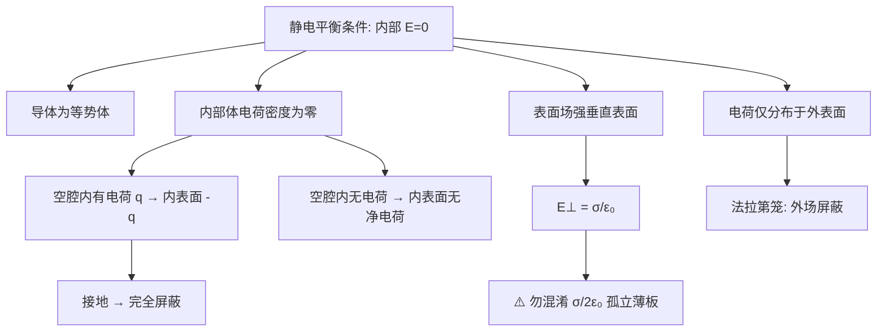

---
tags:
  - 电磁学
  - 静电平衡
  - 导体
  - 表面电荷
  - 静电屏蔽
aliases:
  - 静电平衡导体性质
  - 导体表面电荷分布
  - 法拉第笼
created: 2026-01-15
updated: 2026-01-15
---

> [!summary] 核心认知先验
> 静电平衡是导体内部自由电荷在电场驱动下完成**宏观再分布**后达到的稳态：净电流密度处处为零。该稳态的全部推论（内部场为零、等势体、电荷外表面分布、表面场强垂直且 $E_\perp = \sigma/\varepsilon_0$）均源于**导体内部可动自由电子对电场的完全屏蔽**这一微观机制。理解此卡的关键在于区分“导体表面紧邻外侧的总场”与“孤立无限大带电薄板的单侧场”，二者相差因子 $2$。

---

## 一、推导机理与核心数学定义

### 1.1 静电平衡的定义与内部场为零

设导体置于外电场 $\mathbf{E}_{\text{ext}}$ 中。导体内部存在大量自由电子（数密度约 $10^{28}\,\mathrm{m^{-3}}$），在外场驱动下瞬间（弛豫时间 $\tau \sim 10^{-14}\,\mathrm{s}$）发生定向迁移，在导体表面堆积形成**感应电荷**。感应电荷自身激发附加电场 $\mathbf{E}_{\text{ind}}$，其方向与外场相反。平衡条件为：

$$
\mathbf{E}_{\text{total}} = \mathbf{E}_{\text{ext}} + \mathbf{E}_{\text{ind}} = 0 \quad (\text{导体内部任意点})
$$

该式是静电平衡的**定义性条件**，也是后续一切结论的逻辑起点。

### 1.2 导体为等势体

由 $\mathbf{E} = -\nabla V$，若导体内部处处 $\mathbf{E} = 0$，则内部任意两点间电势差：

$$
V_A - V_B = -\int_A^B \mathbf{E} \cdot d\mathbf{l} = 0
$$

故导体内部电势处处相等。又因表面紧邻外侧的电场仅有法向分量（见 1.4），切向分量为零，故沿表面的线积分亦为零，**表面与内部电势相同**，整个导体为等势体。

### 1.3 静电荷全部分布在外表面

取导体内部任意闭合高斯面 $S$（完全位于导体材料内部），因面上每点 $\mathbf{E} = 0$，故：

$$
\oint_S \mathbf{E} \cdot d\mathbf{A} = \frac{Q_{\text{enc}}}{\varepsilon_0} = 0 \quad \Longrightarrow \quad Q_{\text{enc}} = 0
$$

即高斯面内净电荷为零。由于 $S$ 可任意收缩至任意内部点附近，故**导体内部体电荷密度处处为零** $\rho_{\text{int}} = 0$。所有净电荷只能以面密度 $\sigma$ 的形式分布于导体外表面。若导体存在空腔且腔内无电荷，同理可证空腔内表面亦无净电荷。

### 1.4 表面场强垂直于表面且 $E_\perp = \sigma/\varepsilon_0$

**垂直性论证**：若表面存在切向电场分量 $E_\parallel \neq 0$，则表面自由电子将受到切向力 $F_\parallel = -e E_\parallel$ 而继续迁移，与平衡态矛盾。故平衡时：

$$
E_\parallel = 0 \quad \Longrightarrow \quad \mathbf{E}_{\text{surface}} = E_\perp \hat{\mathbf{n}}
$$

其中 $\hat{\mathbf{n}}$ 为表面外法向单位矢量。

**场强大小推导**：取一个跨越导体表面的微小高斯“药丸盒”（pillbox），底面面积 $\Delta A$ 平行于表面，上底面位于导体外侧（场强 $E_\perp$），下底面位于导体内部（场强为零）。药丸盒高度趋于零，侧面积分贡献可忽略。由高斯定律：

$$
\oint_S \mathbf{E} \cdot d\mathbf{A} = E_\perp \Delta A = \frac{\sigma \Delta A}{\varepsilon_0}
$$

消去 $\Delta A$ 得：

$$
\boxed{E_\perp = \frac{\sigma}{\varepsilon_0}}
$$

该场强方向沿外法线（若 $\sigma > 0$）或内法线（若 $\sigma < 0$）。

### 1.5 静电屏蔽机理与法拉第笼

**屏蔽的两种情形**：

**(a) 外场屏蔽（导体壳保护内部区域）**：实心导体或闭合导体壳在达到静电平衡后，内部区域（含空腔）处处 $\mathbf{E} = 0$。外部电荷在壳外表面感应的电荷分布恰好使其在腔内产生的场与外场完全抵消。腔内观察者无法探测外部静电场的变化——**法拉第笼**即此原理。

**(b) 内场屏蔽（导体壳约束内部电荷的场）**：若空腔内有电荷 $+q$，则空腔内表面感应 $-q$，外表面感应 $+q$（由电荷守恒）。此时**外表面电荷的场在导体外部不可屏蔽**，外部观察者可探测到内部电荷的存在。若将外壳接地，则外表面电荷泄放入地，外部场消失，实现完全屏蔽。

**数学表述**：设导体壳外表面电荷为 $Q_{\text{out}}$，内表面电荷为 $Q_{\text{in}}$，腔内电荷为 $q$，则：

$$
Q_{\text{in}} = -q, \qquad Q_{\text{out}} = Q_{\text{total}} + q
$$

其中 $Q_{\text{total}}$ 为导体壳本身所带净电荷。

---

## 二、⚠️ 致命失分陷阱与临界边界

### 陷阱 1：混淆 $E = \sigma/\varepsilon_0$ 与 $E = \sigma/2\varepsilon_0$

这是本知识点最高频错误。二者适用条件截然不同：

| 物理情境 | 场强公式 | 原因 |
|---------|---------|------|
| 孤立无限大均匀带电薄板（单层电荷面密度 $\sigma$） | $E = \dfrac{\sigma}{2\varepsilon_0}$（两侧各为 $\dfrac{\sigma}{2\varepsilon_0}$，方向相反） | 高斯面仅包围 $\sigma \Delta A$ 的电荷，但**两侧均有通量**，各贡献一半 |
| 导体表面紧邻外侧 | $E_\perp = \dfrac{\sigma}{\varepsilon_0}$ | 高斯面下底面在导体内部（$E=0$），**通量仅来自外侧一面** |

**本质区别**：导体表面电荷并非孤立薄板——导体内部场为零意味着高斯面只有一侧有电通量，而孤立薄板两侧均有场。若误用 $\sigma/2\varepsilon_0$，将导致场强计算偏小一倍。

### 陷阱 2：忽略表面曲率对电荷分布的影响

表面电荷面密度 $\sigma$ 并非均匀分布，而是与表面曲率相关。孤立导体上，曲率越大（越尖锐）处 $\sigma$ 越大，场强越强。尖端放电即源于此。计算时不可默认 $\sigma$ 均匀，除非题目明确为球对称或无限大平面。

### 陷阱 3：空腔导体的内表面电荷误判

若腔内无电荷，则内表面**无净电荷**（但可能有正负交替的感应分布，净和为零）；若腔内有电荷 $q$，则内表面必有 $-q$。不可遗漏内表面感应电荷的存在。

### 陷阱 4：接地导体壳的“屏蔽”绝对化

接地导体壳可屏蔽**内部电荷对外部**的场，但**不能屏蔽外部电荷对内部**的场（外部电荷仍可在壳外表面感应电荷，但壳内区域场仍为零——实际上外部电荷的场被壳外表面感应电荷完全抵消，内部依然屏蔽）。需区分屏蔽方向。

### 陷阱 5：表面场强方向判断

$E_\perp = \sigma/\varepsilon_0$ 给出的是**大小**。方向由 $\sigma$ 符号决定：$\sigma > 0$ 时场指向外，$\sigma < 0$ 时场指向内。矢量式为：

$$
\mathbf{E}_{\text{surface}} = \frac{\sigma}{\varepsilon_0}\hat{\mathbf{n}}
$$

---

## 三、经典范例手把手演算

### 范例：金属球壳的内外表面电荷与场强分布

**题目**：一半径为 $R_1$ 的金属球壳（厚度可忽略），壳心处置一点电荷 $+q$。球壳本身不带净电荷。求：(1) 内、外表面电荷面密度；(2) 三个区域（$r < R_1$ 腔内、$R_1 < r < R_2$ 壳体内、$r > R_2$ 壳外）的电场强度。

**已知**：设球壳外半径为 $R_2$，内半径为 $R_1$。

**解**：

**步骤 1：确定内表面电荷**

取高斯面 $S_1$ 为半径 $r$（$R_1 < r < R_2$）的球面，位于导体壳材料内部。静电平衡下导体内部 $E = 0$，故：

$$
\oint_{S_1} \mathbf{E} \cdot d\mathbf{A} = 0 = \frac{q + Q_{\text{in}}}{\varepsilon_0}
$$

解得内表面总电荷：

$$
Q_{\text{in}} = -q
$$

由球对称性，内表面电荷均匀分布，面密度：

$$
\sigma_{\text{in}} = \frac{Q_{\text{in}}}{4\pi R_1^2} = -\frac{q}{4\pi R_1^2}
$$

**步骤 2：确定外表面电荷**

球壳本身净电荷为零，故：

$$
Q_{\text{in}} + Q_{\text{out}} = 0 \quad \Longrightarrow \quad Q_{\text{out}} = +q
$$

外表面面密度：

$$
\sigma_{\text{out}} = \frac{q}{4\pi R_2^2}
$$

**步骤 3：分区求场强**

**区域 I（$r < R_1$，腔内）**：取高斯面为半径 $r$ 的球面，包围电荷 $+q$：

$$
\oint \mathbf{E} \cdot d\mathbf{A} = E(r) \cdot 4\pi r^2 = \frac{q}{\varepsilon_0}
$$

$$
E_{\text{I}}(r) = \frac{q}{4\pi\varepsilon_0 r^2} \quad (\text{方向沿径向向外})
$$

**区域 II（$R_1 < r < R_2$，导体壳内部）**：静电平衡条件直接给出：

$$
E_{\text{II}}(r) = 0
$$

**区域 III（$r > R_2$，壳外）**：取高斯面半径 $r > R_2$，包围总电荷 $q + Q_{\text{in}} + Q_{\text{out}} = q - q + q = q$：

$$
E_{\text{III}}(r) = \frac{q}{4\pi\varepsilon_0 r^2} \quad (\text{方向沿径向向外})
$$

**步骤 4：验证表面场强公式**

在 $r = R_2^+$（外表面紧邻外侧）：

$$
E_{\text{III}}(R_2) = \frac{q}{4\pi\varepsilon_0 R_2^2} = \frac{\sigma_{\text{out}}}{\varepsilon_0}
$$

与 $E_\perp = \sigma/\varepsilon_0$ 一致。在 $r = R_1^-$（内表面紧邻腔内一侧）：

$$
E_{\text{I}}(R_1) = \frac{q}{4\pi\varepsilon_0 R_1^2} = \frac{|\sigma_{\text{in}}|}{\varepsilon_0}
$$

方向指向内表面（因 $\sigma_{\text{in}} < 0$），亦与公式吻合。

**步骤 5：反代验算**

验证导体表面为等势面。取无穷远处 $V(\infty) = 0$，则壳外电势：

$$
V_{\text{III}}(r) = \frac{q}{4\pi\varepsilon_0 r} \quad (r \geq R_2)
$$

壳表面电势：

$$
V(R_2) = \frac{q}{4\pi\varepsilon_0 R_2}
$$

壳体内电势恒定等于表面值（因 $E=0$）：

$$
V_{\text{II}}(r) = V(R_2) = \frac{q}{4\pi\varepsilon_0 R_2} \quad (R_1 \leq r \leq R_2)
$$

腔内电势：

$$
V_{\text{I}}(r) = V(R_2) + \int_{r}^{R_1} E_{\text{I}}(r')\,dr' = \frac{q}{4\pi\varepsilon_0 R_2} + \frac{q}{4\pi\varepsilon_0}\left(\frac{1}{r} - \frac{1}{R_1}\right)
$$

在 $r = R_1$ 处：

$$
V_{\text{I}}(R_1) = \frac{q}{4\pi\varepsilon_0 R_2} + \frac{q}{4\pi\varepsilon_0}\left(\frac{1}{R_1} - \frac{1}{R_1}\right) = \frac{q}{4\pi\varepsilon_0 R_2} = V_{\text{II}}(R_1)
$$

电势连续，验证无误。

---

## 四、出处与纸质笔记坐标

### 教材出处

- **主教材**：Purcell, *Electricity and Magnetism*, 3rd Ed., Ch. 3 §3.1–3.2, pp. 69–74
  - §3.1 (pp. 69–71)：导体与静电平衡的基本性质，内部场为零的论证
  - §3.2 (pp. 71–74)：表面电荷与表面场强关系 $E = 4\pi\sigma$（高斯单位制），对应 SI 制 $E = \sigma/\varepsilon_0$；法拉第笼与静电屏蔽
- **单位制注意**：Purcell 采用高斯单位制，公式为 $E = 4\pi\sigma$；本卡采用 SI 制 $E = \sigma/\varepsilon_0$。换算关系：$1\,\text{esu/cm}^2$ 对应 $1/(4\pi \times 10^{-5}c)$ C/m²，考试与作业以 SI 制为准。

### 纸质活页留痕槽位

- **活页编号**：[活页-EM-12]
- **手写推导建议**：
  - 左侧栏：用高斯定律完整推导 $E_\perp = \sigma/\varepsilon_0$ 的 pillbox 图示与代数步骤
  - 右侧栏：对比孤立薄板 $E = \sigma/2\varepsilon_0$ 的高斯面选取差异，画出两种高斯面
  - 底部栏：抄录 Purcell p.72 的 Fig. 3.4（导体表面电荷与场强示意图），标注 $\hat{\mathbf{n}}$ 方向
- **错题订正区**：预留半页，记录误用 $\sigma/2\varepsilon_0$ 的典型错题

### 知识全景图

---

*卡片生成时间：2026-01-15 | 对应教材版本：Purcell 3rd Ed. | 活页坐标：[活页-EM-12]*

---

[[00_电磁学_学习全景图]]
