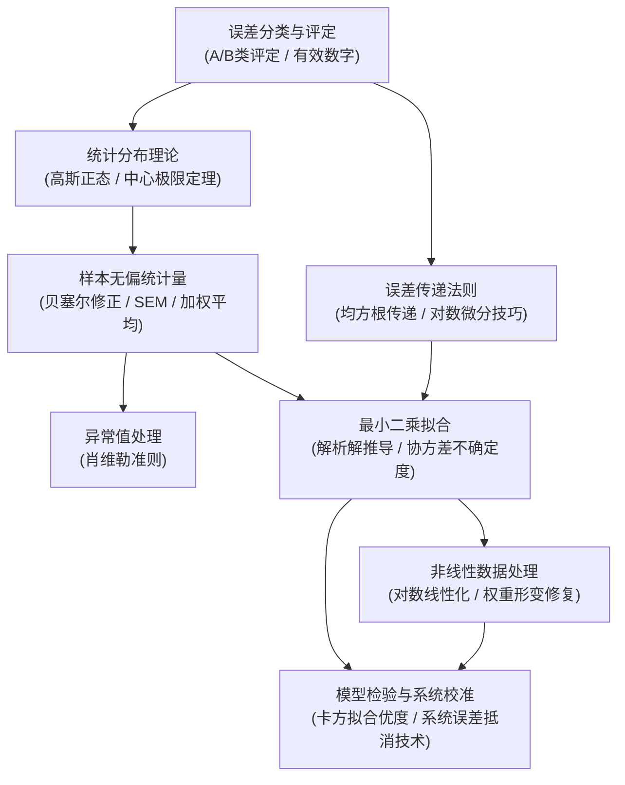

---
aliases:
  - 误差分析与数据处理全景图
  - Error Analysis and Data Reduction MOC
tags:
  - 物理/实验物理与误差分析
  - 知识全景图
---

# 误差分析与数据处理 (Error Analysis & Data Reduction) 体系全景图

> 本知识库严格遵循 **教材解构黄金标准 (v1 Standard)** 构建，解构自经典实验物理基石教材 **John R. Taylor《An Introduction to Error Analysis: The Study of Uncertainties in Physical Measurements》**。
> 全库涵盖从测量误差基本分类、通用误差传递定律、高斯正态统计与置信区间，到最小二乘拟合、参数协方差、非线性对数权重形变与卡方拟合优度检验的 14 张高阶出版级卡片，形成严密闭环的实验数据处理范式。

---

## 模块一：测量误差与不确定度传递基础

不确定度量化与间接物理量误差计算的通用代数法则。

- [[概念_测量误差分类与不确定度评定]] `[活页-ERR-01]`：系统误差与偶然随机误差、A类统计评估与B类仪器分度评估、有效数字与末位对齐修约规范。
- [[定理_独立变量误差传递通用定律]] `[活页-ERR-02]`：多元泰勒展开、独立变量均方根合成公式 $\sigma_q = \sqrt{\sum (\frac{\partial f}{\partial x_i})^2 \sigma_{x_i}^2}$ 严格推导与强相关失效边界。
- [[技术_相对误差传递与对数微分法]] `[活页-ERR-03]`：乘除幂次复合函数的对数微分化简技巧、指数权重平方放大效应与微小误差忽略判据。

---

## 模块二：统计分布与样本统计量估计

随机涨落的高斯正态建模与有限次采样的无偏估计。

- [[概念_高斯正态分布与置信区间]] `[活页-ERR-04]`：概率密度高斯曲线、拐点几何意义、三大置信区间 ($1\sigma: 68.3\%, 2\sigma: 95.5\%, 3\sigma: 99.7\%$) 与粗大误差判据。
- [[定理_中心极限定理与平均值收敛]] `[活页-ERR-05]`：任意同分布和变量的渐近正态性、方差随测量次数缩减 $\text{Var}(\bar{x}) = \sigma^2/N$、算术平均压制随机噪声的本质。
- [[技术_样本标准差与平均值标准误差计算]] `[活页-ERR-06]`：贝塞尔修正无偏方差 $s^2 = \frac{1}{N-1}\sum (x_i - \bar{x})^2$、平均值标准误差 $\sigma_{\bar{x}} = s/\sqrt{N}$ 与单次测量精度的严格区分。
- [[定理_肖维勒准则与异常数据剔除]] `[活页-ERR-07]`：可疑数据粗大误差判定概率界限 $P < \frac{1}{2N}$、重新计算均值与单次使用限制。
- [[技术_加权平均值与方差逆权重分配]] `[活页-ERR-08]`：多组异精度实验合成、极大似然最优权重 $w_i = 1/\sigma_i^2$、加权平均值及其综合不确定度公式。

---

## 模块三：最小二乘拟合与非线性加权分析

物理实验规律的参数辨识与相关性严谨评定。

- [[定理_一元线性最小二乘拟合推导]] `[活页-ERR-09]`：极大似然准则下残差卡方和 $\chi^2$ 极小化、正规方程组解析闭合解与自变量无误差假定。
- [[技术_线性拟合参数不确定度计算]] `[活页-ERR-10]`：残差自由度 $N-2$ 估计、斜率与截距的标准误差、非零协方差 $\text{cov}(A,B) = -\bar{x}\sigma_B^2$ 与误差椭圆。
- [[概念_皮尔逊线性相关系数与显著性]] `[活页-ERR-11]`：协方差归一化相关系数 $r$、柯西不等式证明界限 $-1 \le r \le 1$、学生 $t$ 检验统计量与非线性相关盲区。
- [[技术_非线性数据对数线性化与权重修正]] `[活页-ERR-12]`：幂律与指数衰减对数展开、对数微分引发的误差分布形变、加权最小二乘修正权重 $w_i = y_i^2/\sigma_y^2$。

---

## 模块四：假设检验与实验系统误差排查

实验模型拟合优良度判定与物理仪器系统偏差校准。

- [[定理_卡方检验与拟合优度判定]] `[活页-ERR-13]`：残差卡方统计量 $\chi^2$、自由度扣除 $d = N - c$、约化卡方 $\chi_{\text{red}}^2 \approx 1$ 的优良判定及过大/过小的物理病态诊断。
- [[技术_系统误差排查与仪器消除技术]] `[活页-ERR-14]`：仪器/理论/环境系统误差溯源、正反交换对称抵消法、外推零损耗法与定量误差量级闭环分析。

---

## 建议精读路线图

