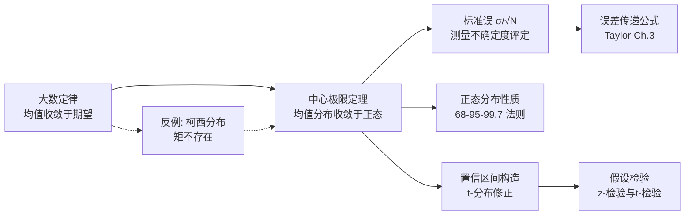

---
tags:
  - 概率论
  - 数理统计
  - 中心极限定理
  - 误差分析
  - 正态分布
aliases:
  - CLT
  - 中心极限定理
  - 平均值的正态收敛性
created: 2025-04-14
updated: 2025-04-14
---

> [!summary] 定理核心论断
> 设 $X_1, X_2, \ldots, X_N$ 为独立同分布随机变量序列，公共分布具有有限均值 $\mu$ 与有限方差 $\sigma^2$（即 $0 < \sigma^2 < \infty$）。则对样本均值 $\bar{X}_N = \frac{1}{N}\sum_{i=1}^{N}X_i$，其标准化变量依分布收敛于标准正态分布：
> $$Z_N = \frac{\bar{X}_N - \mu}{\sigma/\sqrt{N}} \xrightarrow{d} \mathcal{N}(0, 1) \quad (N \to \infty)$$
> 等价地，$\bar{X}_N$ 渐近服从 $\mathcal{N}\left(\mu, \frac{\sigma^2}{N}\right)$，方差随 $N$ 反比缩减。

---

## 一、推导机理与核心数学定义

### 1.1 定理的精确数学表述

设 $X_1, X_2, \ldots, X_N$ 为独立同分布（i.i.d.）随机变量，公共累积分布函数为 $F(x)$，满足：

$$E[X_i] = \mu < \infty, \qquad \text{Var}(X_i) = E[(X_i - \mu)^2] = \sigma^2 < \infty$$

定义样本总和 $S_N = \sum_{i=1}^{N}X_i$ 与样本均值 $\bar{X}_N = S_N / N$。

**中心极限定理（Lindeberg–Lévy形式）** 断言：对任意实数 $z$，有

$$\lim_{N \to \infty} P\left(\frac{S_N - N\mu}{\sigma\sqrt{N}} \leq z\right) = \Phi(z) = \frac{1}{\sqrt{2\pi}}\int_{-\infty}^{z} e^{-t^2/2}\,dt$$

其中 $\Phi(z)$ 为标准正态累积分布函数。

### 1.2 均值形式的等价表述

由于 $\bar{X}_N = S_N / N$，标准化后：

$$\frac{\bar{X}_N - \mu}{\sigma/\sqrt{N}} = \frac{S_N - N\mu}{\sigma\sqrt{N}}$$

因此均值 $\bar{X}_N$ 的渐近分布为：

$$\bar{X}_N \;\dot{\sim}\; \mathcal{N}\left(\mu, \frac{\sigma^2}{N}\right)$$

即均值估计量的标准差（标准误）为：

$$\sigma_{\bar{x}} = \frac{\sigma}{\sqrt{N}}$$

### 1.3 特征函数证明路径（直觉先导）

定义标准化变量 $Y_i = \dfrac{X_i - \mu}{\sigma}$，则 $E[Y_i] = 0$，$\text{Var}(Y_i) = 1$。其特征函数为：

$$\varphi_Y(t) = E[e^{itY_i}] = 1 - \frac{t^2}{2} + o(t^2) \quad (t \to 0)$$

（此处利用了 $E[Y_i]=0$ 消去一阶项，$E[Y_i^2]=1$ 给出二阶项系数。）

对 $Z_N = \dfrac{1}{\sqrt{N}}\sum_{i=1}^{N}Y_i$，利用独立性，其特征函数为：

$$\varphi_{Z_N}(t) = \left[\varphi_Y\left(\frac{t}{\sqrt{N}}\right)\right]^N = \left[1 - \frac{t^2}{2N} + o\left(\frac{t^2}{N}\right)\right]^N$$

取极限 $N \to \infty$，利用 $\lim_{N\to\infty}\left(1 + \frac{a}{N}\right)^N = e^{a}$：

$$\lim_{N \to \infty}\varphi_{Z_N}(t) = e^{-t^2/2}$$

这正是标准正态分布的特征函数。由特征函数的唯一性定理（Lévy连续性定理），$Z_N$ 依分布收敛于 $\mathcal{N}(0,1)$。

### 1.4 物理直觉：多次测量的涨落压制

单次测量的随机误差幅度由 $\sigma$ 刻画。对 $N$ 次独立重复测量取平均：

- 系统误差（恒定偏移）不受 $N$ 影响，均值无法消除；
- 随机误差（零均值涨落）在平均过程中相互部分抵消，剩余涨落的标准差按 $1/\sqrt{N}$ 衰减。

**核心物理图景**：测量精度（以标准误 $\sigma/\sqrt{N}$ 度量）随测量次数 $N$ 仅按平方根速率改善——将测量次数增至4倍，精度仅提升2倍。

---

## 二、⚠️ 致命失分陷阱与临界边界

### 2.1 柯西分布：CLT 的经典反例

柯西分布的概率密度函数为：

$$f(x) = \frac{1}{\pi}\cdot\frac{1}{1 + x^2}, \qquad x \in (-\infty, \infty)$$

**关键性质**：其一阶矩（期望）不存在，因为积分 $\int_{-\infty}^{\infty}\frac{|x|}{1+x^2}dx$ 发散；二阶矩更不存在。因此柯西分布**不满足** CLT 的有限方差前提条件。

**后果**：对柯西分布抽样取平均 $\bar{X}_N$，其分布仍为柯西分布（参数不变，仅尺度参数不变），**不收敛于正态分布**。事实上，$\bar{X}_N$ 与单次观测 $X_1$ 服从完全相同的分布——增加样本量对均值分布毫无改善。

### 2.2 无有限方差的分布族

除柯西分布外，所有尾指数 $\alpha \leq 2$ 的稳定分布（如 Lévy 分布，$\alpha = 1.5$ 的偏稳定分布）均不满足 CLT 条件。这些分布收敛于 $\alpha$-稳定分布而非正态分布。

### 2.3 系统漂移不可被平均消除

CLT 处理的是**零均值随机涨落**。若测量过程中存在随时间单调漂移的系统误差 $d(t)$（如仪器温漂、电池电压衰减），则观测模型为：

$$X_i = \mu + d(t_i) + \varepsilon_i$$

其中 $\varepsilon_i$ 为随机噪声。此时样本均值：

$$\bar{X}_N = \mu + \frac{1}{N}\sum_{i=1}^{N}d(t_i) + \frac{1}{N}\sum_{i=1}^{N}\varepsilon_i$$

第二项（漂移贡献）**不随 $N$ 趋于零**（若 $d(t)$ 不围绕零振荡），均值无法消除系统单向漂移。

### 2.4 有限 $N$ 的近似质量

CLT 是渐近定理（$N \to \infty$）。对有限 $N$，近似质量取决于母体分布与正态的偏离程度：

- 母体对称、单峰时，$N \geq 30$ 通常足够；
- 母体强偏斜或重尾时，可能需要 $N \geq 100$ 甚至更多；
- 极端情况下（如对数正态分布），有限 $N$ 下均值分布仍明显偏斜。

### 2.5 独立同分布条件的破坏

- **相关性破坏**：若 $X_i$ 之间存在正自相关，则有效样本量小于 $N$，实际标准误大于 $\sigma/\sqrt{N}$；
- **非同分布**：若各 $X_i$ 方差不同，需使用广义 CLT（Lindeberg–Feller 条件），简单形式失效。

---

## 三、经典范例手把手演算

### 3.1 范例：均匀分布母体的均值收敛

**问题**：设 $X_i \sim \text{Uniform}(0, 1)$，独立同分布。求 $N = 12$ 时 $\bar{X}_{12}$ 的近似分布，并计算 $P(\bar{X}_{12} > 0.6)$ 的近似值。

**第一步：确定母体参数**

均匀分布 $\text{Uniform}(0,1)$ 的均值与方差：

$$E[X] = \frac{0+1}{2} = \frac{1}{2}, \qquad \text{Var}(X) = \frac{(1-0)^2}{12} = \frac{1}{12}$$

**第二步：写出均值估计量的渐近分布**

由 CLT：

$$\bar{X}_{12} \;\dot{\sim}\; \mathcal{N}\left(\mu = \frac{1}{2}, \;\sigma_{\bar{x}}^2 = \frac{\sigma^2}{N} = \frac{1/12}{12} = \frac{1}{144}\right)$$

因此标准差为 $\sigma_{\bar{x}} = \sqrt{1/144} = 1/12$。

**第三步：标准化并计算概率**

$$P(\bar{X}_{12} > 0.6) = P\left(\frac{\bar{X}_{12} - 0.5}{1/12} > \frac{0.6 - 0.5}{1/12}\right) = P\left(Z > \frac{0.1}{1/12}\right) = P(Z > 1.2)$$

查标准正态分布表：

$$P(Z > 1.2) = 1 - \Phi(1.2) = 1 - 0.8849 = 0.1151$$

**第四步：精确值对照（验算）**

$N=12$ 时 $\bar{X}_{12}$ 的精确分布为 Irwin–Hall 分布（12个均匀变量均值的缩放）。精确计算 $P(\bar{X}_{12} > 0.6)$ 约为 $0.1143$。CLT 近似值 $0.1151$ 与精确值吻合良好，相对误差约 $0.7\%$。

### 3.2 范例：二项分布的正态近似

**问题**：一枚公平硬币抛掷 $N = 100$ 次，正面朝上的次数为 $S$。求 $P(40 \leq S \leq 60)$。

**第一步：识别结构**

$S = \sum_{i=1}^{100}X_i$，其中 $X_i \sim \text{Bernoulli}(p=0.5)$，独立同分布。

母体参数：$\mu = p = 0.5$，$\sigma^2 = p(1-p) = 0.25$。

**第二步：CLT 标准化**

$$Z = \frac{S - N\mu}{\sigma\sqrt{N}} = \frac{S - 100 \times 0.5}{\sqrt{0.25} \times \sqrt{100}} = \frac{S - 50}{5}$$

**第三步：连续性修正**

二项分布为离散分布，正态近似时需做连续性修正（边界各扩 $0.5$）：

$$P(40 \leq S \leq 60) \approx P(39.5 \leq S \leq 60.5)$$

标准化：

$$P\left(\frac{39.5 - 50}{5} \leq Z \leq \frac{60.5 - 50}{5}\right) = P(-2.1 \leq Z \leq 2.1)$$

**第四步：查表计算**

$$P(-2.1 \leq Z \leq 2.1) = 2\Phi(2.1) - 1 = 2 \times 0.9821 - 1 = 0.9642$$

**第五步：精确值对照**

二项分布精确计算：$P(40 \leq S \leq 60) = \sum_{k=40}^{60}\binom{100}{k}(0.5)^{100} \approx 0.9648$。近似值与精确值高度一致。

### 3.3 反代验算（通用步骤）

对任何 CLT 近似结果，验证路径为：

1. **矩条件验证**：确认 $E[X_i] = \mu$ 有限且 $\text{Var}(X_i) = \sigma^2$ 有限；
2. **标准化一致性**：验证 $E[Z_N] = 0$ 且 $\text{Var}(Z_N) = 1$（对任意有限 $N$ 精确成立）；
3. **极限核对**：当 $N \to \infty$ 时，$Z_N$ 的特征函数趋于 $e^{-t^2/2}$；
4. **数值模拟对照**：对有限 $N$，可用 Monte Carlo 模拟生成大量样本均值，绘制直方图与正态密度曲线叠加比对。

---

## 四、出处与纸质笔记坐标

### 4.1 教材出处

| 项目 | 内容 |
|------|------|
| 教材 | Taylor, J.R., *An Introduction to Error Analysis: The Study of Uncertainties in Physical Measurements*, 2nd ed. |
| 章节 | Chapter 5: The Normal Distribution |
| 页码 | P115–P121（CLT 表述、推导与物理应用） |
| 关键公式位置 | Eq. (5.10)–(5.16) 附近（均值标准误推导） |

### 4.2 纸质活页留痕槽位

> **[活页-ERR-05]**
> - 手写推导区：CLT 特征函数证明全流程
> - 错题订正区：柯西分布反例的完整积分分析
> - 自测题区：$N=4, 9, 16$ 时均匀分布均值分布的直方图对比
> - 物理实验关联：游标卡尺重复测量的不确定度评定

### 4.3 知识关联图谱

### 4.4 全景图挂载

> [!info] 知识全景图
> 本卡片关联概念簇：大数定律 → 中心极限定理 → [[概念_高斯正态分布与置信区间|正态分布]] → [[技术_样本标准差与平均值标准误差计算|标准误与置信区间]] → [[定理_独立变量误差传递通用定律|误差传递]] → [[定理_一元线性最小二乘拟合推导|最小二乘拟合]]
> 前置知识：期望与方差定义、特征函数、依分布收敛
> 后续延伸：t-分布与小样本统计、Bootstrap重采样方法、稳定分布与非高斯统计

---
**知识图谱导航**：[[00_误差分析与数据处理_学习全景图]]
