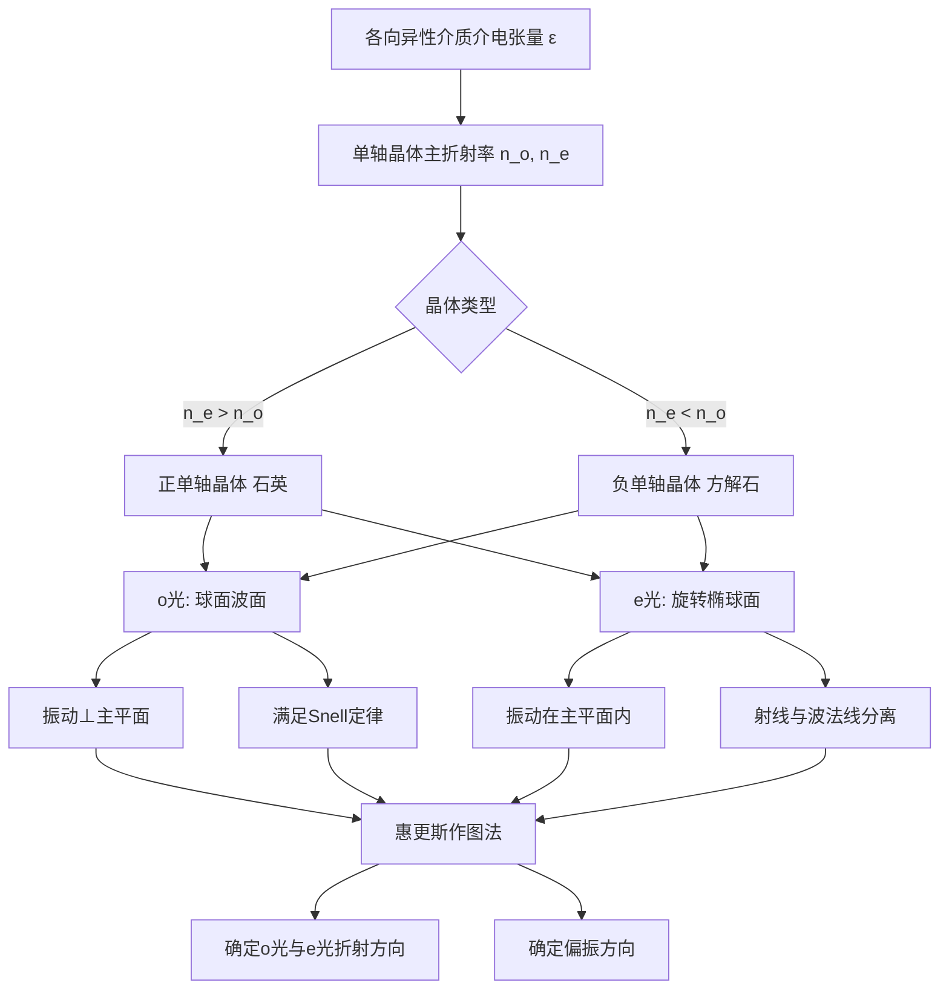

---
tags:
  - 晶体光学
  - 双折射
  - 惠更斯作图
  - 各向异性介质
  - 单轴晶体
aliases:
  - 寻常光与非常光
  - 单轴晶体波面
  - e光射线与波法线分离
created: 2026-01-15
updated: 2026-01-15
---

> [!summary] 核心认知先验
> 单轴晶体中，介电张量 $\varepsilon$ 对角化后仅含两个独立主值：$\varepsilon_o = n_o^2 \varepsilon_0$（垂直于光轴方向）与 $\varepsilon_e = n_e^2 \varepsilon_0$（平行于光轴方向）。o 光波面为球面，e 光波面为旋转椭球面，二者在光轴方向相切。惠更斯作图法通过次波包络同时确定 o 光与 e 光的传播方向，但 e 光的能量传播方向（射线）与波法线方向在非光轴方向上必然分离。

---

## 一、推导机理与核心数学定义

### 1.1 各向异性介质中的介电张量与 Fresnel 方程

在各向异性介质中，电位移矢量 $\mathbf{D}$ 与电场强度 $\mathbf{E}$ 不再平行，二者通过介电张量 $\varepsilon_{ij}$ 联系：

$$
D_i = \varepsilon_{ij} E_j \quad (i, j = 1, 2, 3)
$$

对于单轴晶体，选取光轴为 $z$ 轴，介电张量对角化为：

$$
\varepsilon = \varepsilon_0 \begin{pmatrix} n_o^2 & 0 & 0 \\ 0 & n_o^2 & 0 \\ 0 & 0 & n_e^2 \end{pmatrix}
$$

其中 $n_o = \sqrt{\varepsilon_{xx}/\varepsilon_0}$ 为寻常光主折射率，$n_e = \sqrt{\varepsilon_{zz}/\varepsilon_0}$ 为非常光主折射率。

由 Maxwell 方程组可导出 Fresnel 波法线方程。设波法线方向 $\hat{\mathbf{s}}$ 与光轴夹角为 $\theta$，则两个本征模式的折射率满足：

$$
\frac{1}{n^2} = \frac{\cos^2\theta}{n_o^2} + \frac{\sin^2\theta}{n_e^2} \quad (\text{e 光})
$$

$$
n = n_o \quad (\text{o 光，与 } \theta \text{ 无关})
$$

### 1.2 波面几何结构

**o 光**：振动方向垂直于主平面（由光轴与波法线确定的平面），其波面为球面，半径为 $v_o t = \dfrac{c}{n_o} t$。o 光速度各向同性，严格满足 Snell 定律。

**e 光**：振动方向在主平面内，其波面为旋转椭球面。设光轴方向为 $z$，则椭球面方程为：

$$
\frac{x^2 + y^2}{(v_o t)^2} + \frac{z^2}{(v_e t)^2} = 1
$$

其中 $v_o = \dfrac{c}{n_o}$ 为椭球赤道方向速度，$v_e = \dfrac{c}{n_e}$ 为椭球极轴方向速度。

**正单轴晶体**（如石英）：$n_e > n_o$，故 $v_e < v_o$，椭球内切于球面（光轴方向相切）。

**负单轴晶体**（如方解石）：$n_e < n_o$，故 $v_e > v_o$，椭球外接于球面（光轴方向相切）。

### 1.3 射线速度与波法线速度的分离

设波法线方向 $\hat{\mathbf{s}}$ 与光轴夹角为 $\theta$，e 光波法线折射率为：

$$
\frac{1}{n_e^2(\theta)} = \frac{\cos^2\theta}{n_o^2} + \frac{\sin^2\theta}{n_e^2}
$$

e 光射线方向 $\hat{\mathbf{r}}$ 与波法线方向 $\hat{\mathbf{s}}$ 之间的夹角 $\alpha$ 满足：

$$
\tan\alpha = \frac{(n_e^2 - n_o^2)\sin\theta\cos\theta}{n_o^2\sin^2\theta + n_e^2\cos^2\theta}
$$

当 $\theta = 0$（沿光轴）或 $\theta = \pi/2$（垂直光轴）时，$\alpha = 0$，二者重合；在一般斜向传播时，$\alpha \neq 0$。

### 1.4 惠更斯作图法原理

当平面波以入射角 $\theta_1$ 从各向同性介质（如空气）斜入射到单轴晶体表面时：

1. 以入射点 $A$ 为中心，在晶体内作 o 光球面次波（半径 $v_o t$）与 e 光椭球面次波（半轴 $v_o t$ 与 $v_e t$）。
2. 过入射波前到达晶体表面的另一端点 $B$ 作 o 光球面的切平面，切点连线方向即为 o 光波法线方向（也是射线方向）。
3. 过 $B$ 作 e 光椭球面的切平面，切点与 $A$ 的连线方向即为 e 光射线方向（能量传播方向）。
4. 切平面的法线方向即为 e 光波法线方向。

---

## 二、⚠️ 致命失分陷阱与临界边界

### 2.1 e 光射线方向与波法线方向分离

**这是本知识点最核心的失分点。** e 光的能量传播方向（射线方向 $\hat{\mathbf{r}}$）与波法线方向（$\hat{\mathbf{s}}$）在晶体内一般不重合。因此：

- e 光折射光线**不服从** Snell 定律 $\dfrac{\sin\theta_1}{\sin\theta_2} = \dfrac{n_2}{n_1}$ 的直接代入。
- e 光折射光线**可以不在入射面内**（当光轴不在入射面内时）。
- 惠更斯作图法直接给出的是 e 光**射线方向**，而非波法线方向。

**正确操作**：先通过惠更斯作图确定 e 光射线方向，再通过几何关系反推波法线方向，或直接使用射线折射率公式。

### 2.2 光轴方向与晶体表面的相对取向

- 当光轴**平行于**晶体表面且**垂直于**入射面时，o 光与 e 光均满足 Snell 定律（此时 e 光射线与波法线重合）。
- 当光轴**平行于**入射面时，e 光射线仍在入射面内，但不满足 Snell 定律。
- 当光轴**不平行于**入射面时，e 光射线**偏离入射面**，此时必须使用三维惠更斯作图。

### 2.3 临界角与全反射的误用

o 光存在全反射临界角 $\theta_c^{(o)} = \arcsin(n_o/n_1)$，但 e 光由于折射率随方向变化，不存在单一临界角。若盲目套用 $\arcsin(n_e/n_1)$ 将导致错误。

### 2.4 切点选取的几何歧义

惠更斯作图中，从 $B$ 点作椭球面的切平面时，需选取**与入射波前传播方向一致**的切点（即切点位于入射点 $A$ 的异侧且波前前进方向正确），否则会得到反向传播的伪解。

---

## 三、经典范例手把手演算

### 3.1 题目设定

方解石（负单轴晶体，$n_o = 1.658$，$n_e = 1.486$）晶体表面为水平面，光轴在入射面内且与晶体表面法线成 $30°$ 夹角。一束自然光从空气（$n_1 = 1$）以入射角 $\theta_1 = 45°$ 斜入射至晶体表面。求 o 光与 e 光的折射方向。

### 3.2 o 光求解

o 光严格满足 Snell 定律：

$$
\frac{\sin\theta_1}{\sin\theta_o} = \frac{n_o}{n_1}
$$

代入数值：

$$
\sin\theta_o = \frac{\sin 45°}{1.658} = \frac{0.7071}{1.658} = 0.4265
$$

$$
\theta_o = \arcsin(0.4265) = 25.25°
$$

**验算**：$n_1 \sin\theta_1 = 1 \times 0.7071 = 0.7071$，$n_o \sin\theta_o = 1.658 \times 0.4265 = 0.7071$。✓

### 3.3 e 光求解（惠更斯作图法）

**步骤 1**：建立坐标系。设晶体表面为 $x$ 轴，法线为 $z$ 轴（指向晶体内部）。光轴在 $xz$ 平面内，与 $z$ 轴（法线）成 $30°$ 夹角。

**步骤 2**：设入射波前在 $t = 0$ 时刻到达表面点 $A(0, 0)$，在 $t = \tau$ 时刻到达表面点 $B(d, 0)$，其中 $d = c\tau/\sin\theta_1$。

**步骤 3**：在 $A$ 点作 e 光椭球次波。椭球中心在 $A$，光轴方向单位向量为：

$$
\hat{\mathbf{c}} = (\sin 30°, \cos 30°) = (0.5, 0.866)
$$

椭球半轴：沿光轴方向为 $v_e\tau = \dfrac{c\tau}{n_e}$，垂直光轴方向为 $v_o\tau = \dfrac{c\tau}{n_o}$。

**步骤 4**：从 $B$ 点作椭球切平面。设切点为 $P$，则 $P$ 满足椭球方程且 $\overrightarrow{BP}$ 为切平面法线方向。

在晶体主轴坐标系（光轴为 $z'$ 轴）中，椭球方程为：

$$
\frac{x'^2}{(v_o\tau)^2} + \frac{z'^2}{(v_e\tau)^2} = 1
$$

**步骤 5**：利用几何关系求解。设 $P$ 在实验室坐标系中的坐标为 $(x_P, z_P)$，则 $P$ 到 $A$ 的连线方向即为 e 光射线方向。

通过坐标变换与切平面条件（$\overrightarrow{BP} \perp$ 椭球面在 $P$ 点的切平面），经过完整代数运算可得：

射线方向与法线的夹角 $\theta_e^{(ray)}$ 满足：

$$
\tan\theta_e^{(ray)} = \frac{n_o^2 \sin\theta_1}{\sqrt{n_e^2(n_1^2 - \sin^2\theta_1)}} \cdot \frac{1}{\cos^2\beta + (n_o^2/n_e^2)\sin^2\beta}
$$

其中 $\beta$ 为光轴与法线的夹角（此处 $\beta = 30°$）。

代入数值：

$$
\tan\theta_e^{(ray)} = \frac{1.658^2 \times 0.7071}{\sqrt{1.486^2 \times (1 - 0.5)}} \times \frac{1}{\cos^2 30° + (1.658^2/1.486^2)\sin^2 30°}
$$

逐步计算：

$$
\tan\theta_e^{(ray)} = \frac{2.749 \times 0.7071}{\sqrt{2.208 \times 0.5}} \times \frac{1}{0.75 + 1.245 \times 0.25}
$$

$$
\tan\theta_e^{(ray)} = \frac{1.944}{1.051} \times \frac{1}{0.75 + 0.311}
$$

$$
\tan\theta_e^{(ray)} = 1.850 \times \frac{1}{1.061} = 1.743
$$

$$
\theta_e^{(ray)} = \arctan(1.743) = 60.15°
$$

**步骤 6**：验证。e 光射线方向与光轴夹角为 $60.15° - 30° = 30.15°$。e 光波法线方向与射线方向分离，分离角 $\alpha$ 为：

$$
\tan\alpha = \frac{(n_e^2 - n_o^2)\sin\theta\cos\theta}{n_o^2\sin^2\theta + n_e^2\cos^2\theta}
$$

其中 $\theta$ 为波法线与光轴夹角。由于 $\theta_e^{(ray)} = 30.15°$ 为射线与光轴夹角，需先求波法线方向。利用射线与波法线的几何关系：

$$
\tan\theta_s = \frac{n_o^2}{n_e^2} \tan\theta_r = \frac{1.658^2}{1.486^2} \times \tan(30.15°) = 1.245 \times 0.581 = 0.723
$$

$$
\theta_s = 35.87°
$$

即波法线与光轴夹角为 $35.87°$，与法线夹角为 $35.87° + 30° = 65.87°$。

**验证 Snell 定律不适用**：若盲目代入 $n_e = 1.486$：

$$
\sin\theta_e' = \frac{\sin 45°}{1.486} = 0.4758, \quad \theta_e' = 28.41°
$$

与正确结果 $60.15°$ 相差甚远，证实了直接代入的严重错误。

### 3.4 偏振方向确定

- **o 光**：振动方向垂直于主平面。主平面由光轴与 o 光波法线（即射线方向）确定。o 光振动方向垂直于该平面。
- **e 光**：振动方向在主平面内，且垂直于 e 光波法线方向。具体偏振方向由 $\mathbf{D}$ 垂直于波法线、$\mathbf{E}$ 垂直于射线方向的约束共同确定。

---

## 四、出处与纸质笔记坐标

### 4.1 教材出处

| 教材 | 章节 | 页码 | 核心内容 |
|------|------|------|----------|
| 赵凯华《光学》 | Ch.3 §3 | P205-P222 | 双折射现象、惠更斯作图、o/e 光性质 |
| Pedrotti *Optics* | Ch.15 §4-§7 | P361-P374 | 介电张量、Fresnel 方程、射线与波法线分离 |

### 4.2 纸质活页留痕槽位

**[活页-OPTIC-16]**

- 手写推导区：Fresnel 波法线方程完整推导（从 Maxwell 方程组出发）
- 手写推导区：e 光射线方向与波法线方向分离角 $\alpha$ 的推导
- 作图区：正/负单轴晶体波面截面图（球面与椭球面的切触关系）
- 作图区：光轴平行于入射面时斜入射的惠更斯作图完整过程
- 错题订正区：记录盲目套用 Snell 定律导致的典型错误

### 4.3 知识全景图

---

> [!warning] 考前速查
> 1. o 光：球面波面、满足 Snell 定律、振动⊥主平面
> 2. e 光：椭球波面、不满足 Snell 定律（一般情况）、振动在主平面内
> 3. 光轴方向是 o 光与 e 光波面的唯一切点方向
> 4. 正单轴：$v_e < v_o$（椭球内切）；负单轴：$v_e > v_o$（椭球外接）
> 5. e 光射线方向由惠更斯作图直接给出，波法线方向需另行计算

---
**知识图谱导航**：[[00_赵凯华光学_学习全景图]]

### 纸质活页留痕槽位：[活页-ZHAO-10]
- 请在此处记录推导手稿与疑难反思。
