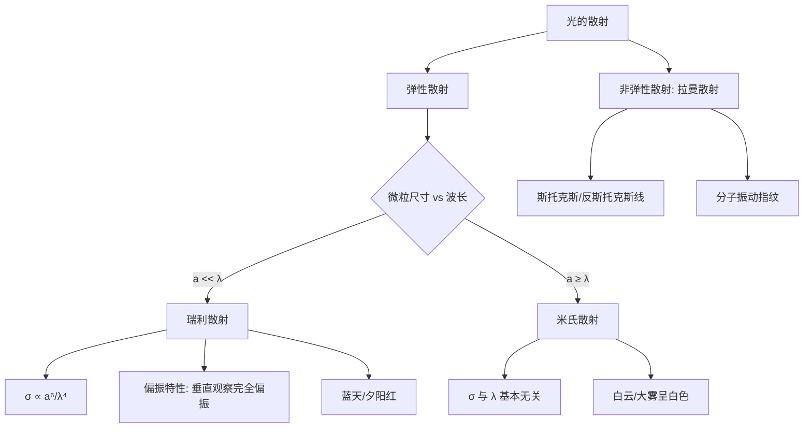

---
tags:
  - 光学/散射理论
  - 电磁波/偶极辐射
  - 大气光学
aliases:
  - 瑞利散射
  - 米氏散射
  - Rayleigh Scattering
  - Mie Scattering
created: 2025-04-14
updated: 2025-04-14
---

> [!summary] 核心认知先验
> 光的散射本质是介质中带电粒子（电子、分子偶极子）在入射电磁波驱动下做受迫振动，进而作为**二次辐射源**向四周发射子波的过程。散射截面的大小与散射体尺寸相对于入射波长的比值密切相关，这一几何尺度比值决定了应采用何种散射理论框架。

---

## 一、推导机理与核心数学定义

### 1.1 微观散射本质：偶极子受迫振动与二次辐射

入射光为平面电磁波，其电场分量 $E = E_0 e^{-i\omega t}$ 作用于介质中的微观粒子（分子、原子或微小颗粒）。若粒子尺寸远小于波长，则粒子内部感受到的电场近似均匀，粒子被极化形成**瞬时电偶极矩**：

$$
\mathbf{p}(t) = \alpha \mathbf{E}_0 e^{-i\omega t}
$$

其中 $\alpha$ 为极化率（polarizability）。根据经典电动力学，一个振荡电偶极子 $p(t) = p_0 e^{-i\omega t}$ 在远场区（$kr \gg 1$）辐射的电场为：

$$
\mathbf{E}_{\text{rad}}(\mathbf{r}, t) = \frac{k^2}{4\pi\varepsilon_0} \frac{e^{ikr}}{r} (\hat{\mathbf{r}} \times \mathbf{p}) \times \hat{\mathbf{r}}
$$

其中 $k = \omega/c = 2\pi/\lambda$ 为波数。远场辐射强度（时间平均）为：

$$
I_{\text{sca}}(\theta) = \frac{\omega^4 p_0^2 \sin^2\theta}{32\pi^2\varepsilon_0 c^3 r^2}
$$

式中 $\theta$ 为偶极矩方向与观察方向之间的夹角。**关键结论**：散射强度正比于 $\omega^4$，即正比于 $\lambda^{-4}$。

### 1.2 瑞利散射总截面推导

散射截面定义为散射功率与入射能流密度之比。对偶极辐射在球面上积分，可得单个粒子的瑞利散射总截面：

$$
\sigma_{\text{Rayleigh}} = \frac{8\pi}{3} \left(\frac{\omega^2 \alpha}{4\pi\varepsilon_0 c^2}\right)^2 = \frac{8\pi^3 \alpha^2}{3\varepsilon_0^2 \lambda^4}
$$

对于半径为 $a$ 的球形介电粒子（相对介电常数 $\varepsilon_r$，折射率 $n = \sqrt{\varepsilon_r}$），极化率为：

$$
\alpha = 4\pi\varepsilon_0 a^3 \frac{n^2 - 1}{n^2 + 2}
$$

代入得：

$$
\sigma_{\text{Rayleigh}} = \frac{128\pi^5 a^6}{3\lambda^4} \left(\frac{n^2 - 1}{n^2 + 2}\right)^2
$$

**核心结论**：$\sigma_{\text{Rayleigh}} \propto a^6/\lambda^4$，即散射截面与波长的四次方成反比。

### 1.3 瑞利散射的偏振特性

设入射光沿 $z$ 轴传播，电场沿 $x$ 轴偏振。偶极矩 $\mathbf{p}$ 沿 $x$ 方向振动。在垂直于入射方向的平面内（$xy$ 平面）观察：

- 沿 $y$ 轴方向（即垂直于入射光传播方向且垂直于偏振方向）观察时，$\sin\theta = 1$，散射光强度最大，且散射光偏振方向完全沿 $x$ 轴——**100% 完全线偏振光**。
- 沿 $x$ 轴方向（即沿偏振方向）观察时，$\sin\theta = 0$，散射强度为零。

对于自然光（非偏振光），可分解为两个正交的线偏振分量。在垂直于入射方向的任意观察方向上，散射光均为**部分偏振光**；仅在特定几何配置下（观察方向垂直于入射方向且垂直于某一偏振分量），该分量贡献为零，剩余分量完全偏振。

### 1.4 米氏散射：大颗粒情形

当微粒半径 $a$ 与波长 $\lambda$ 可比拟或更大（$a \gtrsim \lambda$）时，粒子内部电场不再均匀，需严格求解 Maxwell 方程组在球形边界条件下的解——即 **Mie 散射理论**（Gustav Mie, 1908）。其解以无穷级数形式给出散射截面：

$$
\sigma_{\text{Mie}} = \frac{2\pi}{k^2} \sum_{n=1}^{\infty} (2n+1)\left(|a_n|^2 + |b_n|^2\right)
$$

其中 $a_n$、$b_n$ 为米氏系数，是粒子尺寸参数 $x = ka = 2\pi a/\lambda$ 与相对折射率的复杂函数。**关键特征**：当 $x \gg 1$ 时，散射截面趋于几何截面 $\pi a^2$ 的 2 倍（消光 paradox），且对波长的依赖关系极弱——散射截面与波长基本解耦。

### 1.5 拉曼散射简介

拉曼散射（Raman Scattering）为非弹性散射：散射光子能量与入射光子不同，差值对应分子振动/转动能级跃迁：

$$
\hbar\omega_{\text{sca}} = \hbar\omega_{\text{inc}} \pm \hbar\Omega_{\text{vib}}
$$

其中 $\Omega_{\text{vib}}$ 为分子振动频率。斯托克斯线取负号（能量降低），反斯托克斯线取正号（能量升高）。拉曼散射截面极小（约为瑞利散射的 $10^{-6}$ 至 $10^{-8}$ 倍），但携带分子结构信息。

---

## 二、⚠️ 致命失分陷阱与临界边界

### 陷阱 1：λ⁻⁴ 定律的适用边界

**瑞利散射的 $\sigma \propto \lambda^{-4}$ 关系仅在 $a \ll \lambda$（通常要求 $a < \lambda/10$）时严格成立。** 当微粒尺寸增大至可与波长比拟时，散射截面随波长的变化趋于平缓，λ⁻⁴ 律彻底失效。此时必须转用米氏散射理论。

### 陷阱 2：云雾白色的物理解释

**不能**用瑞利散射解释云、雾呈白色。云滴典型半径 $a \sim 5\text{–}50\,\mu\text{m}$，远大于可见光波长（$0.4\text{–}0.7\,\mu\text{m}$），属于米氏散射范畴。米氏散射对可见光各波长散射截面近似相等，故各色光被同等程度散射，叠加后呈白色。

### 陷阱 3：散射截面与几何截面的混淆

瑞利散射中 $\sigma_{\text{Rayleigh}} \ll \pi a^2$（因 $a \ll \lambda$ 时 $a^6/\lambda^4$ 远小于 $a^2$），散射体远小于其几何截面所暗示的散射能力。而米氏散射中 $\sigma_{\text{Mie}} \approx 2\pi a^2$（消光 paradox），不可将两者混用。

### 陷阱 4：偏振态判断的几何条件

**只有**在入射光为完全线偏振光且观察方向垂直于入射方向（同时垂直于偏振方向）时，散射光才是 100% 完全线偏振光。若入射光为自然光，任何方向的散射光至多为部分偏振光，不存在完全偏振的散射光。

### 陷阱 5：分子散射与微粒散射的区分

大气分子（尺寸 $\sim 10^{-10}\,\text{m}$）对可见光的散射属于瑞利散射；而气溶胶颗粒（尺寸 $0.1\text{–}10\,\mu\text{m}$）需视具体尺寸与波长比值选择理论。考试中需先判断 $a/\lambda$ 量级再选用公式。

---

## 三、经典范例手把手演算

### 范例：蓝天成因的定量估算

**题目**：太阳光中蓝光波长 $\lambda_b = 450\,\text{nm}$，红光波长 $\lambda_r = 650\,\text{nm}$。设大气分子对两者的散射均处于瑞利散射区，求蓝光与红光的散射截面之比，并解释天空呈蓝色。

**解**：

**步骤 1**：确认适用条件。大气分子尺寸 $a \sim 10^{-10}\,\text{m}$，远小于 $\lambda_b$ 与 $\lambda_r$，满足 $a \ll \lambda$，适用瑞利散射公式。

**步骤 2**：写出散射截面比。由 $\sigma_{\text{Rayleigh}} \propto \lambda^{-4}$，有：

$$
\frac{\sigma_b}{\sigma_r} = \left(\frac{\lambda_r}{\lambda_b}\right)^4
$$

**步骤 3**：代入数值：

$$
\frac{\sigma_b}{\sigma_r} = \left(\frac{650}{450}\right)^4 = \left(\frac{13}{9}\right)^4
$$

**步骤 4**：计算：

$$
\left(\frac{13}{9}\right)^2 = \frac{169}{81} \approx 2.086
$$

$$
\left(\frac{13}{9}\right)^4 = \left(2.086\right)^2 \approx 4.35
$$

**步骤 5**：物理诠释。蓝光散射截面约为红光的 4.35 倍，即蓝光被大气分子散射的效率远高于红光。当太阳光穿过大气层时，蓝光被强烈散射至各个方向，使天空呈现蔚蓝色。

**步骤 6**：反代验算。设红光散射截面为 $\sigma_r$，则蓝光散射截面 $\sigma_b = 4.35\,\sigma_r$。散射光强正比于散射截面，故天空散射光中蓝光成分约为红光的 4 倍以上，人眼感知为蓝色。验算通过。

### 范例延伸：夕阳为何呈红色

**题目**：解释日出日落时太阳呈现红色的原因。

**解**：

**步骤 1**：几何条件。日出日落时，阳光以掠射角穿过大气层，有效大气路径长度约为正午时的 $1/\sin\theta_{\text{zenith}}$ 倍。当太阳高度角接近 $0°$ 时，路径长度可增大 30–40 倍。

**步骤 2**：散射损耗的指数衰减。光强大气传输满足 Beer-Lambert 定律：

$$
I(\lambda, L) = I_0(\lambda) e^{-N\sigma_{\text{Rayleigh}}(\lambda)L}
$$

其中 $N$ 为分子数密度，$L$ 为路径长度。

**步骤 3**：波长选择性衰减。由于 $\sigma_{\text{Rayleigh}} \propto \lambda^{-4}$，蓝光在长路径中被散射损耗殆尽，而红光损耗较少。透射光中红光成分相对增强，太阳呈现红色。

**步骤 4**：定量验证。设路径长度增大 30 倍，蓝光光学厚度 $\tau_b = N\sigma_b L$ 远大于红光光学厚度 $\tau_r$。透射比：

$$
\frac{I_b}{I_r} = \frac{I_{0b}}{I_{0r}} e^{-(\tau_b - \tau_r)}
$$

由于 $\tau_b - \tau_r > 0$ 且数值可观，$I_b/I_r$ 远小于 1，透射光以红光为主。验算通过。

---

## 四、出处与纸质笔记坐标

### 教材出处

| 教材 | 章节 | 页码 |
|------|------|------|
| 赵凯华《光学》 | Ch.5 §4（光的散射） | P343–P356 |
| Pedrotti *Introduction to Optics* | Ch.25 §5（Scattering） | P551–P558 |

### 纸质活页留痕槽位：[活页-ZHAO-23]：[活页-OPTIC-23]

> [!note] 活页-OPTIC-24
> - **手写推导区**：独立推导偶极辐射远场公式 → 瑞利散射截面全流程
> - **错题订正区**：记录将米氏散射误用瑞利散射的典型错误
> - **概念对比表**：瑞利散射 vs 米氏散射 vs 拉曼散射三栏对比
> - **图像粘贴区**：粘贴瑞利散射偏振空间分布示意图

### 知识全景图

---

*本卡片依据赵凯华《光学》Ch.5 §4 与 Pedrotti Ch.25 §5 编写，配套活页-OPTIC-24 使用。建议结合电磁学偶极辐射章节交叉复习。*

---
**知识图谱导航**：[[00_赵凯华光学_学习全景图]]
