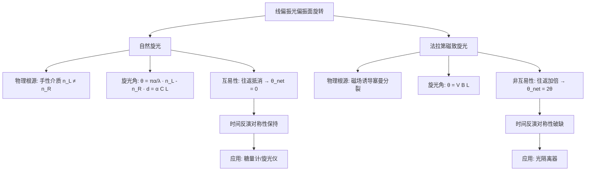

---
tags:
  - 光学/偏振
  - 旋光效应
  - 法拉第效应
  - 非互易性
  - 光隔离器
aliases:
  - 旋光效应
  - 法拉第磁致旋光
  - Faraday Effect
  - 费尔德常数
created: 2025-04-15
updated: 2025-04-15
---

> [!summary] 核心认知先验
> 旋光效应与法拉第效应均表现为**线偏振光偏振面绕传播轴旋转**，但二者物理根源截然不同：自然旋光源于介质固有的**左右旋圆偏振折射率差**（$n_L \neq n_R$），具有**互易性**；法拉第效应源于外加磁场诱导的**圆双折射**，其旋光方向由磁场方向而非光传播方向决定，具有**非互易性**。理解二者对称性差异是区分应用场景（如光隔离器）的物理关键。

---

## 一、推导机理与核心数学定义

### 1.1 自然旋光：菲涅耳圆双折射模型

**物理直觉**：线偏振光可分解为等幅的左旋圆偏振光（LCP）与右旋圆偏振光（RCP）。若介质对二者的折射率不同（$n_L \neq n_R$），则二者在介质中传播相同距离 $d$ 后积累的相位不同，合成为线偏振光时其偏振面发生旋转。

设入射光沿 $+z$ 方向传播，电场矢量沿 $x$ 轴。在 $z=0$ 处：

$$
\mathbf{E}(0,t) = E_0 \hat{x} \cos(\omega t) = \frac{E_0}{2} \left[ \hat{x} \cos(\omega t) + \hat{y} \sin(\omega t) \right] + \frac{E_0}{2} \left[ \hat{x} \cos(\omega t) - \hat{y} \sin(\omega t) \right]
$$

其中第一项为右旋圆偏振（RCP），第二项为左旋圆偏振（LCP）。传播距离 $d$ 后，RCP 与 LCP 分别获得相位延迟：

$$
\phi_R = \frac{2\pi}{\lambda} n_R d, \qquad \phi_L = \frac{2\pi}{\lambda} n_L d
$$

合成电场为：

$$
\mathbf{E}(d,t) = \frac{E_0}{2} \left[ \hat{x} \cos(\omega t - \phi_R) + \hat{y} \sin(\omega t - \phi_R) \right] + \frac{E_0}{2} \left[ \hat{x} \cos(\omega t - \phi_L) - \hat{y} \sin(\omega t - \phi_L) \right]
$$

利用三角恒等式化简，合成线偏振光的偏振方向与 $x$ 轴的夹角 $\theta$ 为：

$$
\theta = \frac{\phi_L - \phi_R}{2} = \frac{\pi}{\lambda} (n_L - n_R) d
$$

**定义**：比旋光率（旋光系数）$[\alpha]$ 定义为在特定温度与波长下，单位浓度、单位光程长度产生的旋光角：

$$
\theta = [\alpha] C L
$$

其中 $C$ 为溶液浓度（$g/cm^3$ 或 $g/mL$），$L$ 为光程长度（$dm$）。对比可得：

$$
[\alpha] = \frac{\pi}{\lambda} \cdot \frac{n_L - n_R}{C}
$$

### 1.2 法拉第磁致旋光效应

**物理直觉**：外加磁场 $B$ 沿光传播方向作用于介质时，介质中原子能级发生塞曼分裂，导致对 LCP 与 RCP 的折射率产生差异。该差异正比于磁场强度，故旋光角正比于 $B$ 与光程 $L$ 的乘积。

$$
\theta = V B L
$$

其中 $V$ 为**费尔德常数**（Verdet Constant），单位通常为 $\text{rad}/(\text{T} \cdot \text{m})$ 或 $\text{arcmin}/(\text{G} \cdot \text{cm})$。$V$ 的符号与大小取决于介质材料、波长与温度。

**微观机制**：法拉第效应的旋光方向由磁场方向唯一确定——无论光沿 $+z$ 还是 $-z$ 方向传播，只要磁场方向不变，偏振面旋转方向（相对于磁场方向）不变。

### 1.3 互易性对比的数学表述

设光沿 $+z$ 传播经过旋光介质后偏振面旋转角为 $+\theta$（从光源视角）。

**自然旋光（互易）**：光被反射镜反射后沿 $-z$ 方向再次穿过介质。由于旋光方向与传播方向无关（仅取决于介质手性），从反射镜处观察，光在回程中偏振面继续沿同一空间方向旋转 $+\theta$。但从初始光源处观察，往返总效果为：

$$
\theta_{\text{total}} = \theta_{\text{forward}} + \theta_{\text{backward}} = \theta - \theta = 0
$$

即**偏振面恢复原状**，互易性成立。

**法拉第效应（非互易）**：光沿 $+z$ 传播时偏振面旋转 $+\theta$（设磁场沿 $+z$）。反射后光沿 $-z$ 传播，但磁场仍沿 $+z$ 方向，故旋光方向（相对于磁场）不变，从光源处观察，回程偏振面继续旋转 $+\theta$：

$$
\theta_{\text{total}} = \theta_{\text{forward}} + \theta_{\text{backward}} = \theta + \theta = 2\theta
$$

即**偏振面旋转加倍**，非互易性成立。

---

## 二、⚠️ 致命失分陷阱与临界边界

### 2.1 互易性混淆（最高频失分点）

| 特征 | 自然旋光 | 法拉第效应 |
|------|----------|------------|
| 旋光方向决定因素 | 介质手性（与传播方向无关） | 磁场方向（与传播方向无关） |
| 往返一次总旋光角 | $0$（自动抵消） | $2\theta$（同向累积） |
| 时间反演对称性 | 保持（互易） | 破缺（非互易） |
| 数学判据 | $\theta(-z) = -\theta(+z)$（从固定观察者视角） | $\theta(-z) = +\theta(+z)$（从固定观察者视角） |

**典型错误**：在分析光隔离器回波抑制时，误将法拉第旋光片当作自然旋光片处理，得出回波偏振面被抵消的错误结论。

### 2.2 旋光角符号约定

- 自然旋光：右旋物质（dextrorotatory，$n_R < n_L$）使偏振面顺时针旋转（从光源看），$\theta > 0$；左旋物质反之。
- 法拉第效应：旋光方向取决于磁场方向与材料 $V$ 的符号。若光传播方向与磁场同向，$\theta = VBL$；若反向，则需重新定义坐标，但**物理上旋光方向始终相对于磁场方向定义**。

### 2.3 费尔德常数的波长依赖性

$V(\lambda)$ 通常随波长增大而减小（正常色散区），且与温度有关。在精密测量中必须注明波长与温度条件，否则数据不可比。

### 2.4 临界边界条件

- 法拉第效应要求磁场方向与光传播方向**有平行分量**；纯横向磁场不产生一阶法拉第旋光。
- 自然旋光仅存在于手性介质（如石英晶体、糖溶液）或具有螺旋结构的材料中；各向同性非手性介质无自然旋光。
- 当介质同时具有自然旋光与法拉第效应时，总旋光角为二者代数和，但互易性分析须分别处理。

---

## 三、经典范例手把手演算

### 3.1 范例一：自然旋光往返抵消验证

**题目**：一束线偏振光通过长度为 $d = 10 \text{ cm}$ 的右旋石英晶体（$[\alpha] = 21.75^\circ/(\text{dm})$），随后被平面镜反射原路返回。求往返后偏振面的净旋转角。

**解**：

**第一步**：计算单程旋光角。

$$
\theta_{\text{forward}} = [\alpha] \cdot L = 21.75^\circ/\text{dm} \times 1 \text{ dm} = 21.75^\circ
$$

**第二步**：分析回程旋光。光沿 $-z$ 传播，右旋石英的旋光方向（从光源看顺时针）不变。设从光源处观察，反射镜将偏振面旋转方向反转。回程中偏振面继续顺时针旋转 $21.75^\circ$，但从光源处看，该旋转表现为逆时针 $21.75^\circ$。

**第三步**：求净旋转角。

$$
\theta_{\text{net}} = \theta_{\text{forward}} + \theta_{\text{backward}} = 21.75^\circ + (-21.75^\circ) = 0^\circ
$$

**验算**：偏振面完全恢复初始方向，互易性成立。

### 3.2 范例二：法拉第效应往返加倍验证

**题目**：一束线偏振光通过长度为 $L = 5 \text{ cm}$ 的磁光晶体，费尔德常数 $V = 0.05 \text{ rad}/(\text{T} \cdot \text{m})$，外加磁场 $B = 0.2 \text{ T}$ 沿光传播方向。光通过后被反射镜反射原路返回（磁场方向不变）。求往返后偏振面的净旋转角。

**解**：

**第一步**：计算单程旋光角。

$$
\theta_{\text{forward}} = V B L = 0.05 \times 0.2 \times 0.05 = 5 \times 10^{-4} \text{ rad}
$$

**第二步**：分析回程旋光。光沿 $-z$ 传播，磁场仍沿 $+z$。法拉第旋光方向由磁场方向决定，故从光源处观察，回程偏振面继续顺时针旋转 $5 \times 10^{-4} \text{ rad}$。

**第三步**：求净旋转角。

$$
\theta_{\text{net}} = \theta_{\text{forward}} + \theta_{\text{backward}} = 5 \times 10^{-4} + 5 \times 10^{-4} = 1 \times 10^{-3} \text{ rad}
$$

**验算**：$2\theta = 2 \times 5 \times 10^{-4} = 1 \times 10^{-3} \text{ rad}$，非互易性成立，旋光角同向累积加倍。

### 3.3 范例三：光隔离器闭环逻辑

**题目**：设计一个法拉第光隔离器，要求正向插入损耗最小、反向隔离度最大。已知磁光晶体 $V = 0.1 \text{ rad}/(\text{T} \cdot \text{m})$，$L = 3 \text{ cm}$，求所需磁场强度。

**解**：

**第一步**：隔离器原理——正向光通过起偏器（偏振方向 $0^\circ$）→ 法拉第旋光片旋转 $45^\circ$ → 通过检偏器（偏振方向 $45^\circ$）。反向光从 $45^\circ$ 方向入射，经法拉第片再次旋转 $45^\circ$（同向累积），到达起偏器时偏振方向为 $90^\circ$，被完全阻挡。

**第二步**：计算所需磁场。

$$
\theta = V B L = 45^\circ = \frac{\pi}{4} \text{ rad}
$$

$$
B = \frac{\pi/4}{V L} = \frac{\pi/4}{0.1 \times 0.03} = \frac{0.7854}{0.003} = 261.8 \text{ T}
$$

**第三步**：验算反向隔离。反向光经法拉第片后偏振方向为 $45^\circ + 45^\circ = 90^\circ$，与起偏器透振方向 $0^\circ$ 正交，透射率为零（理想情况）。

---

## 四、出处与纸质笔记坐标

### 4.1 教材出处

| 教材 | 章节 | 页码 | 核心内容 |
|------|------|------|----------|
| 赵凯华《光学》 | Ch.3 §5 | P238-P251 | 自然旋光、菲涅耳解释、法拉第效应 |
| Pedrotti *Optics* | Ch.16 §4-§5 | P390-P398 | 旋光色散、磁致旋光、光隔离器 |

### 4.2 纸质活页留痕槽位

- **槽位编号**：`[活页-OPTIC-19]`
- **手写推导建议**：
  - 左侧页：菲涅耳圆双折射模型的完整矢量分解推导（含复数表示法）
  - 右侧页：互易性对比表格 + 光隔离器光路图
  - 底部留白：错题订正区（记录混淆互易性的典型错误）

### 4.3 知识全景图

---

*卡片生成时间：2025-04-15 | 复核状态：待纸质笔记交叉验证*

---
**知识图谱导航**：[[00_赵凯华光学_学习全景图]]

### 纸质活页留痕槽位：[活页-ZHAO-25]
- 请在此处记录推导手稿与疑难反思。
