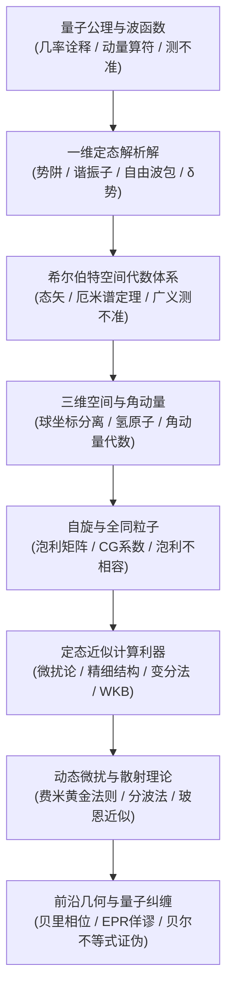

---
aliases:
  - 量子力学全景图
  - Quantum Mechanics MOC
tags:
  - 物理/量子力学
  - 知识全景图
---

# 量子力学 (Quantum Mechanics) 体系全景图

> 本知识库严格遵循 **教材解构黄金标准 (v1 Standard)** 构建，解构自当代最经典、最权威的本科至研究生过渡教材 **David J. Griffiths & Darrell F. Schroeter《Introduction to Quantum Mechanics》(3rd Edition)**。
> 全库涵盖从波动力学公理、一维定态严格解、希尔伯特空间代数表象、三维球对称势场与自旋，再递进至高阶近似方法（非简并/简并微扰、变分法、WKB、分波法、玻恩近似、费米黄金法则），直至近代量子前沿（绝热定理、贝里几何相位、EPR佯谬与贝尔不等式证伪）的 27 张高阶出版级卡片，构建严密完备的现代量子物理体系。

---

## 模块一：量子公理基础与波动力学体系

量子微观世界的统计概率解释与波函数演化基本方程。

- [[概念_波函数几率诠释与概率流密度]] `[活页-QM-01]`：玻恩概率诠释 $|\Psi|^2$、概率流密度 $\mathbf{J} = \frac{\hbar}{2mi}(\Psi^* \nabla \Psi - \Psi \nabla \Psi^*)$ 与连续性方程守恒。
- [[定理_动量算符与坐标动量测不准原理]] `[活页-QM-02]`：动量微分算符 $\hat{p} = -i\hbar\nabla$、埃伦费斯特定理极限恢复、海森堡内禀不确定性 $\Delta x \Delta p \ge \frac{\hbar}{2}$。
- [[概念_定态与薛定谔方程分离变量]] `[活页-QM-03]`：定态能量本征值方程 $\hat{H}\psi = E\psi$、时间相位因子 $e^{-iEt/\hbar}$、叠加态的量子拍频现象。

---

## 模块二：一维定态经典势场解析求解

经典一维模型中束缚态、散射态与阶梯代数的严格解构。

- [[技术_一维无限深势阱求解范式]] `[活页-QM-04]`：刚性边界条件、能级离散化 $E_n \propto n^2$、零点能本质与奇偶宇称分类。
- [[技术_一维谐振子阶梯算符代数解法]] `[活页-QM-05]`：升降算符 $\hat{a}, \hat{a}^\dagger$ 代数因式分解、粒子数本征态等距能级 $E_n = (n+\frac{1}{2})\hbar\omega$。
- [[技术_一维自由粒子波包群速与色散]] `[活页-QM-06]`：连续谱平面波傅里叶逆变换构造波包、相速与群速对立统一、高斯波包时空扩散色散。
- [[定理_一维delta势阱与势垒散射]] `[活页-QM-07]`：奇异势一阶导数跳跃边界条件、唯一单束缚态、连续散射态反射透射系数满足 $R+T=1$。

---

## 模块三：希尔伯特空间代数与测量表象理论

以狄拉克记号为核心的现代量子力学统一数学语言。

- [[概念_希尔伯特空间与狄拉克态矢]] `[活页-QM-08]`：右矢 $|\psi\rangle$ 与左矢 $\langle\psi|$、投影算符完备性 $\sum |n\rangle\langle n| = \hat{I}$、坐标与动量表象基底变换。
- [[定理_厄米算符谱定理与测量坍缩]] `[活页-QM-09]`：自伴厄米算符 $\hat{A} = \hat{A}^\dagger$、本征值实数性与本征态正交性、测量公理与波包瞬时坍缩。
- [[定理_广义测不准原理与对易式]] `[活页-QM-10]`：罗伯逊广义不确定性不等式、算符对易 $[\hat{A},\hat{B}]=0$ 与共同完备本征基、时间-能量测不准寿命诠释。

---

## 模块四：三维中心势场与角动量本征理论

三维空间旋转对称性下的中心对称体系与经典氢原子解。

- [[技术_三维中心场球坐标分离变量]] `[活页-QM-11]`：径向方程与角向算子分离、离心势垒修正、球面调和函数 $Y_l^m(\theta,\phi)$ 本征态。
- [[技术_氢原子径向薛定谔方程解析解]] `[活页-QM-12]`：库仑中心势、连带拉盖尔多项式截断导出玻尔能级 $E_n = -\frac{13.6\text{ eV}}{n^2}$、玻尔半径 $a_0$ 与主量子数能级简并。
- [[定理_轨道角动量代数与本征谱]] `[活页-QM-13]`：角动量李代数 $[L_i, L_j] = i\hbar\epsilon_{ijk}L_k$、阶梯算符 $L_\pm$ 严格推导 $L^2$ 与 $L_z$ 本征谱。

---

## 模块五：电子自旋与角动量耦合代数

微观粒子内禀自由度与多粒子体系对称性假定。

- [[概念_自旋系统与泡利自旋矩阵]] `[活页-QM-14]`：内禀自旋 $1/2$ 二维旋量、泡利自旋矩阵代数 $(\sigma_x, \sigma_y, \sigma_z)$、任意轴空间投影算符本征态。
- [[技术_角动量耦合与CG系数查表范式]] `[活页-QM-15]`：非耦合基底与耦合基底、总角动量三角不等式、克莱布什-戈登 (CG) 系数与自旋单态/三重态。
- [[定理_全同粒子交换对称性与泡利原理]] `[活页-QM-16]`：置换算符本征值 $\pm 1$、玻色子对称与费米子反对称波函数、斯莱特行列式与泡利不相容原理。

---

## 模块六：定态近似方法 (微扰论与变分法)

处理真实复杂原子与多体相互作用的核心计算利器。

- [[技术_非简并定态微扰论展开范式]] `[活页-QM-17]`：能级一阶修正期望值、波函数一阶修正、基态二阶修正负定性 $E_0^{(2)} \le 0$。
- [[技术_简并定态微扰论与久期矩阵对角化]] `[活页-QM-18]`：简并子空间久期方程 $\det(W - E^{(1)}I) = 0$ 解除能级简并、对称性算符预对角化。
- [[技术_氢原子精细结构微扰修正]] `[活页-QM-19]`：相对论动能修正、自旋-轨道耦合微扰、达尔文项与狄拉克精细能级 $E_{nj}$。
- [[技术_变分法与基态能量上限求解]] `[活页-QM-20]`：变分原理严格上限不等式 $\langle \hat{H}\rangle \ge E_0$、含参试探波函数极值化、氦原子基态电荷屏蔽优化。

---

## 模块七：半经典近似与量子散射理论

强动量大尺度过渡与非束缚散射态截面分析。

- [[技术_WKB半经典近似与势垒隧穿]] `[活页-QM-21]`：经典区域振荡与禁区衰减、转折点艾里函数连接公式、玻尔-索末菲量子化与伽莫夫势垒隧穿。
- [[技术_量子散射分波法与光学定理]] `[活页-QM-22]`：远场散射波幅 $f(\theta)$、勒让德分波展开、低能 $S$ 波相移 $\delta_l$ 与光学定理 $\sigma_{\text{tot}} = \frac{4\pi}{k}\text{Im}f(0)$。
- [[技术_第一玻恩近似与散射振幅求解]] `[活页-QM-23]`：李普曼-施温格积分方程、散射势能对动量传递矢量的傅里叶变换、汤川势散射振幅。

---

## 模块八：含时微扰、几何相位与量子前沿

体系动态演化、拓扑几何效应与量子力学本质的哲学碰撞。

- [[定理_含时微扰论与费米黄金法则]] `[活页-QM-24]`：狄拉克相互作用绘景、跃迁概率幅、简谐共振与费米黄金法则跃迁速率 $W_{i\to f}$。
- [[定理_量子绝热定理与贝里相位]] `[活页-QM-25]`：哈密顿量慢变瞬时本征态保持、动力学相位与参数空间闭回路贝里几何拓扑相位 $\gamma_n$。
- [[概念_EPR佯谬与量子纠缠]] `[活页-QM-26]`：定域实在论质疑、贝尔自旋纠缠单态、量子坍缩的非定域性与不可克隆定理。
- [[定理_贝尔不等式与隐变量理论证伪]] `[活页-QM-27]`：经典定域隐变量理论推导贝尔/CHSH不等式、量子力学超关联预言及现代实验对隐变量的彻底证伪。

---

## 建议精读路线图

