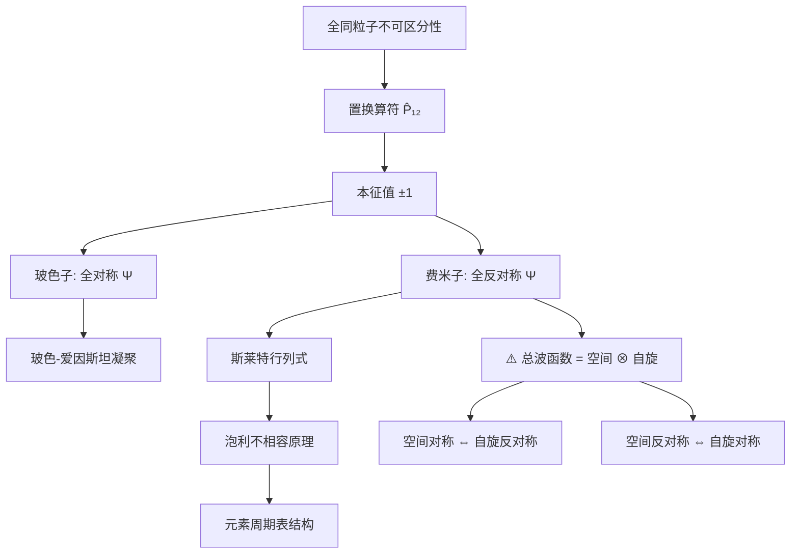

---
tags:
  - QM/全同粒子
  - QM/泡利不相容
  - QM/斯莱特行列式
  - 定理卡
aliases:
  - 全同粒子对称性假定
  - 泡利不相容原理
  - 斯莱特行列式
created: 2025-01-01
updated: 2025-01-01
---

> [!summary] 定理核心论断
> 全同粒子体系的物理态在任意两个粒子置换下仅可能获得整体相位 $\pm 1$，且该对称性由粒子自旋统计决定：整数自旋粒子（玻色子）对应全对称波函数（置换本征值 $+1$），半整数自旋粒子（费米子）对应全反对称波函数（置换本征值 $-1$）。费米子体系的反对称性直接导致泡利不相容原理：两个全同费米子不能占据相同的单粒子量子态。

---

## 一、推导机理与核心数学定义

### 1.1 全同粒子的不可区分性

全同粒子（identical particles）是指质量、电荷、自旋等内禀属性完全相同的粒子。在量子力学中，若两个全同粒子交换位置，体系的物理可观测结果必须保持不变。这意味着概率密度满足：

$$
|\Psi(\mathbf{r}_1, \mathbf{r}_2)|^2 = |\Psi(\mathbf{r}_2, \mathbf{r}_1)|^2
$$

由此可知，波函数在置换算符 $\hat{P}_{12}$ 作用下只能获得一个模长为 1 的相位因子：

$$
\hat{P}_{12} \Psi(\mathbf{r}_1, \mathbf{r}_2) = e^{i\theta} \Psi(\mathbf{r}_1, \mathbf{r}_2)
$$

### 1.2 置换算符与本征值

定义置换算符 $\hat{P}_{12}$，其作用为交换粒子 1 与粒子 2 的全部坐标（空间与自旋）：

$$
\hat{P}_{12} \Psi(\mathbf{r}_1, \mathbf{r}_2) = \Psi(\mathbf{r}_2, \mathbf{r}_1)
$$

对体系连续施加两次置换必须回到原始状态，即 $\hat{P}_{12}^2 = \hat{I}$。因此置换算符的本征值满足：

$$
\lambda^2 = 1 \quad \Longrightarrow \quad \lambda = \pm 1
$$

### 1.3 对称性假定（自旋-统计定理）

实验事实确立以下基本假定：

- **玻色子**（整数自旋 $s = 0, 1, 2, \ldots$）：波函数全对称，即

$$
\hat{P}_{12} \Psi_B = +\Psi_B
$$

- **费米子**（半整数自旋 $s = \frac{1}{2}, \frac{3}{2}, \ldots$）：波函数全反对称，即

$$
\hat{P}_{12} \Psi_F = -\Psi_F
$$

### 1.4 斯莱特行列式构造

对于 $N$ 个全同费米子，若单粒子态为 $\psi_{\alpha_i}(\mathbf{r}_i)$（其中 $\alpha_i$ 标记第 $i$ 个粒子所处的量子态），则反对称总波函数由斯莱特行列式给出：

$$
\Psi_F(\mathbf{r}_1, \ldots, \mathbf{r}_N) = \frac{1}{\sqrt{N!}}
\begin{vmatrix}
\psi_{\alpha_1}(\mathbf{r}_1) & \psi_{\alpha_1}(\mathbf{r}_2) & \cdots & \psi_{\alpha_1}(\mathbf{r}_N) \\
\psi_{\alpha_2}(\mathbf{r}_1) & \psi_{\alpha_2}(\mathbf{r}_2) & \cdots & \psi_{\alpha_2}(\mathbf{r}_N) \\
\vdots & \vdots & \ddots & \vdots \\
\psi_{\alpha_N}(\mathbf{r}_1) & \psi_{\alpha_N}(\mathbf{r}_2) & \cdots & \psi_{\alpha_N}(\mathbf{r}_N)
\end{vmatrix}
$$

行列式的性质保证了：若任意两行相同（即 $\alpha_i = \alpha_j$），则行列式为零。这正是泡利不相容原理的数学表达。

### 1.5 泡利不相容原理

由斯莱特行列式可知，若两个费米子占据相同的单粒子态（即 $\alpha_i = \alpha_j$），则行列式出现两行完全相同，其值为零。因此：

> **两个全同费米子不能处于相同的单粒子量子态。**

---

## 二、⚠️ 致命失分陷阱与临界边界

### 陷阱 1：忽略总波函数的直积结构

**这是最常失分的考点。** 全同粒子的总波函数是空间部分与自旋部分的直积：

$$
\Psi_{\text{total}} = \psi_{\text{space}}(\mathbf{r}_1, \mathbf{r}_2) \otimes \chi_{\text{spin}}(s_1, s_2)
$$

费米子要求**总波函数**反对称，而非空间部分或自旋部分单独反对称。具体而言：

- 若自旋部分为**对称**（如三重态自旋 $S = 1$），则空间部分必须**反对称**；
- 若自旋部分为**反对称**（如单重态自旋 $S = 0$），则空间部分必须**对称**。

**错误做法**：只要求空间波函数反对称而忽略自旋部分，或反之。

### 陷阱 2：混淆玻色子与费米子的对称性要求

玻色子要求总波函数全对称，费米子要求总波函数全反对称。不能将空间部分与自旋部分分开独立判断对称性后直接相加，必须考察**直积后的整体置换行为**。

### 陷阱 3：斯莱特行列式的归一化系数

斯莱特行列式前的归一化系数为 $\frac{1}{\sqrt{N!}}$，而非 $\frac{1}{N!}$。若单粒子态本身正交归一，则 $\frac{1}{\sqrt{N!}}$ 保证总波函数归一。

### 陷阱 4：置换算符作用于自旋-空间联合坐标

置换算符 $\hat{P}_{12}$ 必须同时交换粒子的空间坐标**和**自旋坐标。仅交换空间坐标或仅交换自旋坐标都是不完整的操作。

### 陷阱 5：忽略全同粒子的不可区分性对统计的影响

全同粒子体系的配分函数需除以 $N!$（吉布斯修正因子），但此修正仅对经典极限有效。在量子极限下，玻色子与费米子的统计行为截然不同（玻色-爱因斯坦凝聚 vs 费米海），不可混用。

---

## 三、经典范例手把手演算

### 范例：两电子体系的自旋-空间波函数构造

**问题**：两个全同电子（自旋 $s = \frac{1}{2}$）处于一维无限深势阱中，单粒子能级为 $E_n = \frac{n^2\pi^2\hbar^2}{2mL^2}$。若两电子处于基态与第一激发态，构造满足交换对称性要求的总波函数。

**第一步：确定单粒子空间波函数**

基态与第一激发态的空间波函数分别为：

$$
\psi_1(x) = \sqrt{\frac{2}{L}} \sin\left(\frac{\pi x}{L}\right), \quad \psi_2(x) = \sqrt{\frac{2}{L}} \sin\left(\frac{2\pi x}{L}\right)
$$

**第二步：构造空间部分的对称与反对称组合**

两粒子分别处于态 1 和态 2，空间波函数的对称与反对称组合为：

$$
\psi_S(x_1, x_2) = \frac{1}{\sqrt{2}}\left[\psi_1(x_1)\psi_2(x_2) + \psi_2(x_1)\psi_1(x_2)\right]
$$

$$
\psi_A(x_1, x_2) = \frac{1}{\sqrt{2}}\left[\psi_1(x_1)\psi_2(x_2) - \psi_2(x_1)\psi_1(x_2)\right]
$$

**第三步：构造自旋部分的对称与反对称组合**

两电子自旋 $s = \frac{1}{2}$，总自旋 $S = 0$（单重态）或 $S = 1$（三重态）。

三重态（$S = 1$，自旋对称）：

$$
\chi_{1,1} = |\uparrow\uparrow\rangle, \quad \chi_{1,0} = \frac{1}{\sqrt{2}}\left(|\uparrow\downarrow\rangle + |\downarrow\uparrow\rangle\right), \quad \chi_{1,-1} = |\downarrow\downarrow\rangle
$$

单重态（$S = 0$，自旋反对称）：

$$
\chi_{0,0} = \frac{1}{\sqrt{2}}\left(|\uparrow\downarrow\rangle - |\downarrow\uparrow\rangle\right)
$$

**第四步：总波函数的直积组合**

电子为费米子，总波函数必须反对称。因此有两种合法组合：

**组合 A**（空间反对称 × 自旋对称）：

$$
\Psi_{S=1} = \psi_A(x_1, x_2) \otimes \chi_{1,m_s} \quad (m_s = 1, 0, -1)
$$

**组合 B**（空间对称 × 自旋反对称）：

$$
\Psi_{S=0} = \psi_S(x_1, x_2) \otimes \chi_{0,0}
$$

**第五步：验证反对称性**

对组合 A 施加置换算符：

$$
\hat{P}_{12}\Psi_{S=1} = \hat{P}_{12}\left[\psi_A(x_1, x_2) \otimes \chi_{1,m_s}\right]
$$

$$
= \psi_A(x_2, x_1) \otimes \chi_{1,m_s} = \left[-\psi_A(x_1, x_2)\right] \otimes \chi_{1,m_s} = -\Psi_{S=1}
$$

其中利用了 $\psi_A$ 的反对称性（置换产生负号）和 $\chi_{1,m_s}$ 的对称性（置换不变）。总波函数反对称，满足费米子要求。组合 B 同理可验证。

**第六步：终解反代验算**

若错误地构造空间对称 × 自旋对称的组合：

$$
\Psi_{\text{wrong}} = \psi_S(x_1, x_2) \otimes \chi_{1,1}
$$

施加置换算符：

$$
\hat{P}_{12}\Psi_{\text{wrong}} = \psi_S(x_2, x_1) \otimes \chi_{1,1} = \psi_S(x_1, x_2) \otimes \chi_{1,1} = +\Psi_{\text{wrong}}
$$

总波函数为对称，违反费米子统计，该态不存在于物理世界中。此验证确认了正确组合的合法性。

---

## 四、出处与纸质笔记坐标

### 指定教材出处

- **Griffiths, Introduction to Quantum Mechanics, 3rd Edition**
  - §5.1 全同粒子 (P218-P224)
  - §5.2 交换力与周期性表 (P224-P230)

### 纸质活页留痕槽位

- **[活页-QM-16]**
  - 正面：斯莱特行列式展开推导（两粒子与三粒子情形）
  - 反面：两电子体系自旋-空间组合表 + 错题订正

### 知识全景图

---

*本卡片对应 Griffiths QM §5.1-§5.2 核心内容，建议配合纸质活页 [活页-QM-16] 进行斯莱特行列式的三粒子展开手写推导训练。*

---
**知识图谱导航**：[[00_量子力学_学习全景图]]
