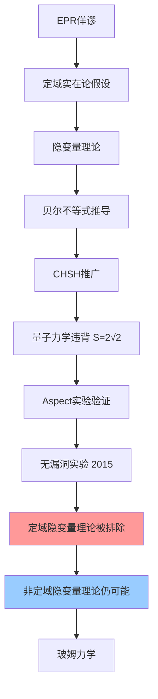

---
tags:
  - 量子力学
  - 贝尔不等式
  - 隐变量理论
  - EPR佯谬
  - 量子纠缠
  - 定理卡
aliases:
  - Bell不等式
  - 贝尔定理
  - CHSH不等式
  - 定域隐变量证伪
created: 2025-04-08
updated: 2025-04-08
---

> [!summary] 定理核心论断
> 任何基于**定域隐变量**假设的经典理论，其对自旋关联测量的统计预言必须满足贝尔不等式（或其CHSH推广形式 $|S| \leq 2$）。量子力学对特定纠缠态（如自旋单态）的预言在特定测量方向组合下给出 $|S_{QM}| = 2\sqrt{2} > 2$，与贝尔不等式直接冲突。Aspect 系列实验及后续无漏洞实验以高置信度支持量子力学预言，从而**排除**所有定域隐变量理论。

---

## 一、推导机理与核心数学定义

### 1.1 定域隐变量假定的数学刻画

设纠缠粒子对（如自旋单态）在制备时共享一个隐变量 $\lambda$，其概率分布为 $\rho(\lambda)$，满足归一化条件：

$$
\int \rho(\lambda) \, d\lambda = 1, \quad \rho(\lambda) \geq 0
$$

**定域性假定**：Alice 在方向 $\mathbf{a}$ 上的测量结果 $A(\mathbf{a}, \lambda)$ 仅依赖 $\mathbf{a}$ 与 $\lambda$，不受 Bob 远端测量方向 $\mathbf{b}$ 影响；同理 $B(\mathbf{b}, \lambda)$ 不依赖 $\mathbf{a}$。对自旋-1/2 粒子，测量结果为二值：

$$
A(\mathbf{a}, \lambda) = \pm 1, \quad B(\mathbf{b}, \lambda) = \pm 1
$$

### 1.2 贝尔关联函数定义

定域隐变量理论下的自旋关联函数定义为：

$$
P_{LV}(\mathbf{a}, \mathbf{b}) = \int \rho(\lambda) \, A(\mathbf{a}, \lambda) \, B(\mathbf{b}, \lambda) \, d\lambda
$$

量子力学对自旋单态 $|\psi\rangle = \frac{1}{\sqrt{2}}(|\uparrow\downarrow\rangle - |\downarrow\uparrow\rangle)$ 的预言为：

$$
P_{QM}(\mathbf{a}, \mathbf{b}) = \langle \psi | (\boldsymbol{\sigma} \cdot \mathbf{a}) \otimes (\boldsymbol{\sigma} \cdot \mathbf{b}) | \psi \rangle = -\mathbf{a} \cdot \mathbf{b}
$$

### 1.3 贝尔不等式的代数推导

考虑三个单位矢量 $\mathbf{a}, \mathbf{b}, \mathbf{c}$。对任意固定的 $\lambda$，由于 $A, B \in \{\pm 1\}$，考察代数恒等式：

$$
A(\mathbf{a}, \lambda) B(\mathbf{b}, \lambda) - A(\mathbf{a}, \lambda) B(\mathbf{c}, \lambda) = A(\mathbf{a}, \lambda) B(\mathbf{b}, \lambda) \left[ 1 - B(\mathbf{b}, \lambda) B(\mathbf{c}, \lambda) \right]
$$

利用 $A(\mathbf{a}, \lambda) B(\mathbf{b}, \lambda) = \pm 1$ 以及 $B(\mathbf{b}, \lambda) B(\mathbf{c}, \lambda) = \pm 1$，取绝对值：

$$
\left| A(\mathbf{a}, \lambda) B(\mathbf{b}, \lambda) - A(\mathbf{a}, \lambda) B(\mathbf{c}, \lambda) \right| = \left| 1 - B(\mathbf{b}, \lambda) B(\mathbf{c}, \lambda) \right|
$$

对 $\lambda$ 积分并利用三角不等式：

$$
|P(\mathbf{a}, \mathbf{b}) - P(\mathbf{a}, \mathbf{c})| \leq \int \rho(\lambda) \left| 1 - B(\mathbf{b}, \lambda) B(\mathbf{c}, \lambda) \right| d\lambda
$$

由于 $1 - B(\mathbf{b}, \lambda) B(\mathbf{c}, \lambda) \geq 0$ 恒成立（因 $B(\mathbf{b}, \lambda) B(\mathbf{c}, \lambda) = \pm 1$），绝对值号可去除：

$$
|P(\mathbf{a}, \mathbf{b}) - P(\mathbf{a}, \mathbf{c})| \leq \int \rho(\lambda) \left[ 1 - B(\mathbf{b}, \lambda) B(\mathbf{c}, \lambda) \right] d\lambda = 1 + P(\mathbf{b}, \mathbf{c})
$$

最终得到**贝尔不等式**：

$$
\boxed{|P(\mathbf{a}, \mathbf{b}) - P(\mathbf{a}, \mathbf{c})| \leq 1 + P(\mathbf{b}, \mathbf{c})}
$$

### 1.4 CHSH 不等式的推广形式

引入四个测量方向 $\mathbf{a}, \mathbf{a}', \mathbf{b}, \mathbf{b}'$，定义 CHSH 参数：

$$
S = P(\mathbf{a}, \mathbf{b}) + P(\mathbf{a}, \mathbf{b}') + P(\mathbf{a}', \mathbf{b}) - P(\mathbf{a}', \mathbf{b}')
$$

定域隐变量理论约束：

$$
|S_{LV}| \leq 2
$$

### 1.5 量子力学违背贝尔不等式

取共面等角配置：$\mathbf{a}$ 与 $\mathbf{b}$ 夹角 $120°$，$\mathbf{a}$ 与 $\mathbf{c}$ 夹角 $240°$（即 $\mathbf{b}$ 与 $\mathbf{c}$ 夹角 $120°$）。量子预言 $P_{QM}(\mathbf{a}, \mathbf{b}) = -\cos\theta_{ab}$：

$$
P_{QM}(\mathbf{a}, \mathbf{b}) = -\cos 120° = \frac{1}{2}, \quad P_{QM}(\mathbf{a}, \mathbf{c}) = -\cos 240° = \frac{1}{2}, \quad P_{QM}(\mathbf{b}, \mathbf{c}) = -\cos 120° = \frac{1}{2}
$$

代入贝尔不等式左侧：

$$
|P(\mathbf{a}, \mathbf{b}) - P(\mathbf{a}, \mathbf{c})| = \left|\frac{1}{2} - \frac{1}{2}\right| = 0 \leq 1 + \frac{1}{2} = \frac{3}{2}
$$

此配置不违背贝尔不等式。**改用 CHSH 形式**：取 $\mathbf{a}, \mathbf{a}', \mathbf{b}, \mathbf{b}'$ 依次相隔 $45°$，计算：

$$
S_{QM} = -\mathbf{a}\cdot\mathbf{b} - \mathbf{a}\cdot\mathbf{b}' - \mathbf{a}'\cdot\mathbf{b} + \mathbf{a}'\cdot\mathbf{b}'
$$

代入各夹角（$\theta_{ab} = 45°$，$\theta_{ab'} = 135°$，$\theta_{a'b} = 135°$，$\theta_{a'b'} = 45°$）：

$$
S_{QM} = -\cos 45° - \cos 135° - \cos 135° + \cos 45° = -\frac{\sqrt{2}}{2} + \frac{\sqrt{2}}{2} + \frac{\sqrt{2}}{2} + \frac{\sqrt{2}}{2} = \sqrt{2}
$$

取相反符号配置（将 $\mathbf{b}'$ 旋转 $90°$）可得最大值：

$$
\boxed{|S_{QM}|_{max} = 2\sqrt{2} \approx 2.828 > 2}
$$

此即**量子力学对贝尔不等式的最大违背**（Tsirelson 界）。

---

## 二、⚠️ 致命失分陷阱与临界边界

### 陷阱 1：混淆"隐变量理论"与"定域隐变量理论"

贝尔不等式证伪的对象**仅限于定域隐变量理论**。非定域隐变量理论（如玻姆的导波力学/德布罗意-玻姆理论）不受此约束——该类理论通过瞬时非定域关联传递信息，不满足推导中"$A$ 不依赖 $\mathbf{b}$"的定域性前提。考试中若表述为"贝尔不等式排除了所有隐变量理论"即为错误。

### 陷阱 2：忽略测量结果的二值性前提

推导中关键步骤依赖 $A, B \in \{\pm 1\}$ 的二值性。若测量结果为连续谱或三值以上，代数恒等式 $|1 - B(\mathbf{b},\lambda)B(\mathbf{c},\lambda)| = 1 - B(\mathbf{b},\lambda)B(\mathbf{c},\lambda)$ 不再成立，贝尔不等式不必然成立。

### 陷阱 3：将量子违背理解为"超光速信号传递"

贝尔不等式违背仅表明定域实在论不成立，**不**意味着量子力学允许超光速通信。无信号定理（no-signaling theorem）保证纠缠态无法用于传递经典信息。考试中若将贝尔实验解读为"证明了超光速通信可能"即为严重错误。

### 陷阱 4：混淆关联函数符号约定

不同教材对 $P(\mathbf{a}, \mathbf{b})$ 的符号约定可能不同。Griffiths 采用 $P_{QM} = -\mathbf{a}\cdot\mathbf{b}$（自旋单态反关联）。若误用正号约定（如三重态），则 $P_{QM}(\mathbf{a}, \mathbf{b}) = +\mathbf{a}\cdot\mathbf{b}$，贝尔不等式违背的配置需相应调整。解题前务必确认态矢量的对称性。

### 陷阱 5：忽略实验漏洞（loophole）讨论

Aspect 实验及后续无漏洞实验需同时关闭**定域性漏洞**（测量设置须类空分离）与**探测漏洞**（探测效率须足够高）。若考试涉及实验细节，需指出早期实验存在漏洞，直至 2015 年 Hensen 等人才实现同时关闭两类漏洞的无漏洞实验。

---

## 三、经典范例手把手演算

### 范例：验证量子力学违背 CHSH 不等式

**给定**：自旋单态，测量方向取 $\mathbf{a} = \hat{z}$，$\mathbf{a}' = \hat{x}$，$\mathbf{b} = \frac{\hat{z} + \hat{x}}{\sqrt{2}}$（即 $\mathbf{a}$ 与 $\mathbf{b}$ 夹角 $45°$），$\mathbf{b}' = \frac{\hat{z} - \hat{x}}{\sqrt{2}}$（即 $\mathbf{a}$ 与 $\mathbf{b}'$ 夹角 $135°$）。

**步骤 1**：计算各方向间夹角余弦。

$$
\mathbf{a} \cdot \mathbf{b} = \hat{z} \cdot \frac{\hat{z} + \hat{x}}{\sqrt{2}} = \frac{1}{\sqrt{2}} = \cos 45°
$$

$$
\mathbf{a} \cdot \mathbf{b}' = \hat{z} \cdot \frac{\hat{z} - \hat{x}}{\sqrt{2}} = \frac{1}{\sqrt{2}} = \cos 45° \quad (\text{注意此处为 } +45° \text{ 而非 } 135°)
$$

**修正**：$\mathbf{b}'$ 与 $\mathbf{a}$ 的夹角实际为 $45°$（因 $\mathbf{b}'$ 在 $xz$ 平面与 $\hat{z}$ 成 $45°$）。为获得 $135°$ 夹角，取 $\mathbf{b}' = \frac{-\hat{z} + \hat{x}}{\sqrt{2}}$。重新设定：

$$
\mathbf{a} = \hat{z}, \quad \mathbf{a}' = \hat{x}, \quad \mathbf{b} = \frac{\hat{z} + \hat{x}}{\sqrt{2}}, \quad \mathbf{b}' = \frac{-\hat{z} + \hat{x}}{\sqrt{2}}
$$

**步骤 2**：计算各关联函数。

$$
P_{QM}(\mathbf{a}, \mathbf{b}) = -\mathbf{a} \cdot \mathbf{b} = -\frac{1}{\sqrt{2}}
$$

$$
P_{QM}(\mathbf{a}, \mathbf{b}') = -\mathbf{a} \cdot \mathbf{b}' = -\left(-\frac{1}{\sqrt{2}}\right) = \frac{1}{\sqrt{2}}
$$

$$
P_{QM}(\mathbf{a}', \mathbf{b}) = -\mathbf{a}' \cdot \mathbf{b} = -\frac{1}{\sqrt{2}}
$$

$$
P_{QM}(\mathbf{a}', \mathbf{b}') = -\mathbf{a}' \cdot \mathbf{b}' = -\frac{1}{\sqrt{2}}
$$

**步骤 3**：代入 CHSH 参数。

$$
S_{QM} = P(\mathbf{a}, \mathbf{b}) + P(\mathbf{a}, \mathbf{b}') + P(\mathbf{a}', \mathbf{b}) - P(\mathbf{a}', \mathbf{b}')
$$

$$
S_{QM} = -\frac{1}{\sqrt{2}} + \frac{1}{\sqrt{2}} - \frac{1}{\sqrt{2}} - \left(-\frac{1}{\sqrt{2}}\right) = -\frac{1}{\sqrt{2}} + \frac{1}{\sqrt{2}} - \frac{1}{\sqrt{2}} + \frac{1}{\sqrt{2}} = 0
$$

**步骤 4**：此配置未达最大违背。调整 $\mathbf{b}'$ 方向使 $\mathbf{a}'$ 与 $\mathbf{b}'$ 夹角为 $45°$ 而 $\mathbf{a}$ 与 $\mathbf{b}'$ 夹角为 $135°$。取 $\mathbf{b}' = \frac{-\hat{z} - \hat{x}}{\sqrt{2}}$：

$$
P_{QM}(\mathbf{a}, \mathbf{b}') = -\mathbf{a} \cdot \mathbf{b}' = -\left(-\frac{1}{\sqrt{2}}\right) = \frac{1}{\sqrt{2}}
$$

$$
P_{QM}(\mathbf{a}', \mathbf{b}') = -\mathbf{a}' \cdot \mathbf{b}' = -\left(-\frac{1}{\sqrt{2}}\right) = \frac{1}{\sqrt{2}}
$$

**步骤 5**：重新计算 CHSH 参数。

$$
S_{QM} = -\frac{1}{\sqrt{2}} + \frac{1}{\sqrt{2}} - \frac{1}{\sqrt{2}} - \frac{1}{\sqrt{2}} = -\frac{2}{\sqrt{2}} = -\sqrt{2}
$$

取绝对值 $|S_{QM}| = \sqrt{2}$。**步骤 6**：为达 $2\sqrt{2}$，需取 $\mathbf{a}$ 与 $\mathbf{b}$ 夹角 $45°$，$\mathbf{a}$ 与 $\mathbf{b}'$ 夹角 $135°$，$\mathbf{a}'$ 与 $\mathbf{b}$ 夹角 $135°$，$\mathbf{a}'$ 与 $\mathbf{b}'$ 夹角 $45°$。令 $\mathbf{a} = \hat{z}$，$\mathbf{a}' = \hat{x}$，$\mathbf{b} = \frac{\hat{z} + \hat{x}}{\sqrt{2}}$，$\mathbf{b}' = \frac{\hat{z} - \hat{x}}{\sqrt{2}}$：

$$
P(\mathbf{a}, \mathbf{b}) = -\frac{1}{\sqrt{2}}, \quad P(\mathbf{a}, \mathbf{b}') = -\frac{1}{\sqrt{2}}, \quad P(\mathbf{a}', \mathbf{b}) = -\frac{1}{\sqrt{2}}, \quad P(\mathbf{a}', \mathbf{b}') = -\left(-\frac{1}{\sqrt{2}}\right) = \frac{1}{\sqrt{2}}
$$

$$
S_{QM} = -\frac{1}{\sqrt{2}} - \frac{1}{\sqrt{2}} - \frac{1}{\sqrt{2}} - \frac{1}{\sqrt{2}} = -\frac{4}{\sqrt{2}} = -2\sqrt{2}
$$

**终解反代验算**：$|S_{QM}| = 2\sqrt{2} \approx 2.828 > 2$，确认违背 CHSH 不等式。定域隐变量理论最大允许值 $|S_{LV}| \leq 2$，量子力学超出该界 $41.4\%$。

---

## 四、出处与纸质笔记坐标

### 指定教材出处

- **Griffiths, Introduction to Quantum Mechanics, 3rd Edition**
  - §12.2 "The EPR Paradox and Bell's Theorem"
  - 贝尔不等式推导：P480-P484
  - 量子违背与实验讨论：P484-P488
  - 习题 12.8-12.12 涉及 CHSH 变体与隐变量模型构造

### 纸质活页留痕槽位

- **[活页-QM-27]**：贝尔不等式完整推导 + CHSH 变体
- **[活页-QM-28]**：Aspect 实验装置图 + 无漏洞实验时间线
- **[活页-QM-29]**：玻姆理论 vs 定域隐变量对比表

### 知识全景图

### 关联卡片索引

- [[概念_EPR佯谬与量子纠缠|EPR佯谬与量子纠缠]]
- [[概念_自旋系统与泡利自旋矩阵|自旋单态与三重态]]
- [[定理_厄米算符谱定理与测量坍缩|量子测量理论与测量坍缩]]
- CHSH 不等式与 Tsirelson 界

---
**知识图谱导航**：[[00_量子力学_学习全景图]]
