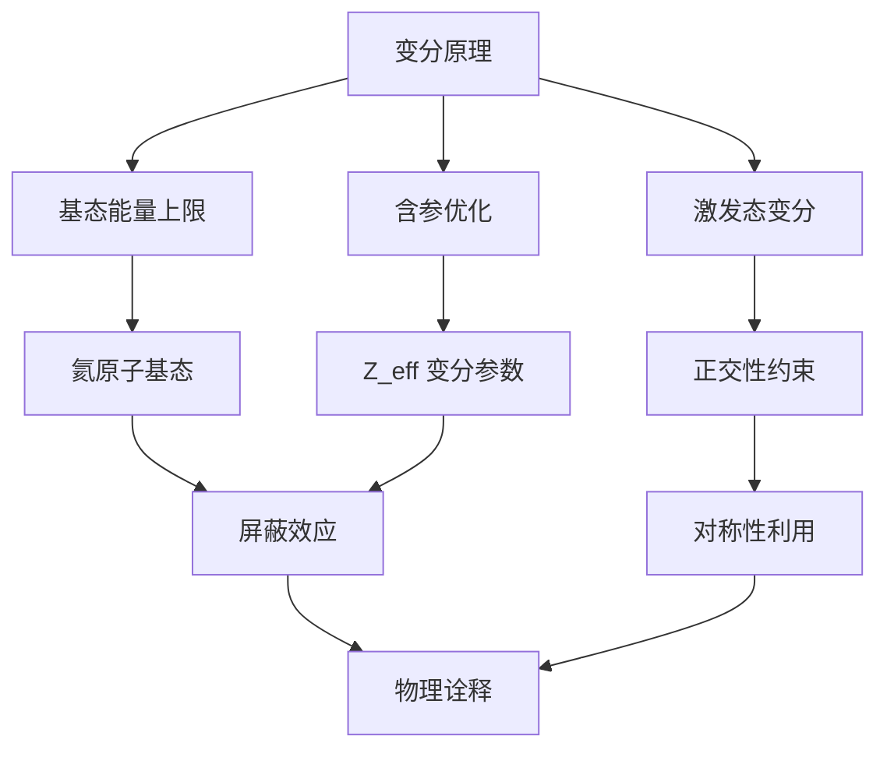

> [!summary] 算法执行总览
> 变分原理的核心操作流程：**构造试探波函数 → 计算能量期望值 → 对变分参数求极值 → 获得基态能量上限与近似波函数**。该算法将求解薛定谔方程的本征值问题转化为多元函数极值问题，其数学本质是 Rayleigh-Ritz 变分法在 Hilbert 空间中的几何投影。

---

## 一、推导机理与核心数学定义

### 1.1 变分定理的严格证明

设体系哈密顿量 $\hat{H}$ 具有离散本征谱 $\{\psi_n\}$ 与对应本征能量 $\{E_n\}$，且满足 $E_0 \le E_1 \le E_2 \le \cdots$。任意归一化试探波函数 $\psi_{\text{trial}}$ 可在完备基 $\{\psi_n\}$ 上展开：

$$
\psi_{\text{trial}} = \sum_{n=0}^{\infty} c_n \psi_n, \qquad \sum_{n=0}^{\infty} |c_n|^2 = 1
$$

能量期望值计算如下：

$$
\langle \hat{H} \rangle = \langle \psi_{\text{trial}} | \hat{H} | \psi_{\text{trial}} \rangle
= \sum_{n=0}^{\infty} |c_n|^2 E_n
$$

由于 $E_n \ge E_0$ 对所有 $n$ 成立，逐项比较可得：

$$
\langle \hat{H} \rangle = \sum_{n=0}^{\infty} |c_n|^2 E_n \ge \sum_{n=0}^{\infty} |c_n|^2 E_0 = E_0 \sum_{n=0}^{\infty} |c_n|^2 = E_0
$$

因此严格不等式成立：

$$
\boxed{\langle \hat{H} \rangle \ge E_0}
$$

**直觉诠释**：试探波函数 $\psi_{\text{trial}}$ 是 Hilbert 空间单位球面上的一个向量，能量期望值 $\langle \hat{H} \rangle$ 是该向量在哈密顿量谱分解下的加权平均。由于 $E_0$ 是谱的下确界，任何归一化向量的加权平均不可能低于谱下界。

### 1.2 含参试探函数的最优化

设试探波函数含 $k$ 个变分参数 $\{\alpha_1, \alpha_2, \ldots, \alpha_k\}$，则能量期望值为多元函数：

$$
E(\alpha_1, \alpha_2, \ldots, \alpha_k) = \frac{\langle \psi_{\text{trial}}(\alpha_1, \ldots, \alpha_k) | \hat{H} | \psi_{\text{trial}}(\alpha_1, \ldots, \alpha_k) \rangle}{\langle \psi_{\text{trial}}(\alpha_1, \ldots, \alpha_k) | \psi_{\text{trial}}(\alpha_1, \ldots, \alpha_k) \rangle}
$$

最优参数由极值条件确定：

$$
\frac{\partial E}{\partial \alpha_i} = 0, \qquad i = 1, 2, \ldots, k
$$

若试探函数未归一化，则需先计算归一化因子 $N = \langle \psi_{\text{trial}} | \psi_{\text{trial}} \rangle^{-1/2}$，再代入期望值公式。

### 1.3 第一激发态的变分条件

若目标为第一激发态能量 $E_1$ 的上限，试探波函数必须与精确基态 $\psi_0$ 正交：

$$
\langle \psi_{\text{trial}} | \psi_0 \rangle = 0
$$

在此约束下，展开系数满足 $c_0 = 0$，从而：

$$
\langle \hat{H} \rangle = \sum_{n=1}^{\infty} |c_n|^2 E_n \ge E_1 \sum_{n=1}^{\infty} |c_n|^2 = E_1
$$

**推广**：求第 $m$ 激发态时，试探函数须与最低的 $m$ 个精确本征态全部正交。

---

## 二、⚠️ 致命失分陷阱与临界边界

### 2.1 变分法仅提供上限，不提供下限

变分原理给出的是 $E_0$ 的**上限估计**，即 $\langle \hat{H} \rangle \ge E_0$。该不等式**不能**给出 $E_0$ 的下界。若两个不同试探函数给出能量 $E_a < E_b$，只能断定 $E_a$ 是更优的上限逼近，但**无法断言** $E_0$ 与 $E_a$ 的差距大小。

### 2.2 波函数精度远低于能量精度

设试探波函数与精确基态的偏差为一阶小量 $\delta$（即 $\|\psi_{\text{trial}} - \psi_0\| \sim \mathcal{O}(\delta)$），则能量误差为二阶小量：

$$
\langle \hat{H} \rangle - E_0 = \mathcal{O}(\delta^2)
$$

**推论**：能量估计的精度远高于波函数本身的精度。因此，变分法适合计算能量，但用变分波函数计算其他力学量期望值时需格外谨慎。

### 2.3 归一化条件的遗漏

若试探波函数未预先归一化，直接计算 $\langle \psi_{\text{trial}} | \hat{H} | \psi_{\text{trial}} \rangle$ 将导致量纲错误。正确公式为：

$$
\langle \hat{H} \rangle = \frac{\langle \psi_{\text{trial}} | \hat{H} | \psi_{\text{trial}} \rangle}{\langle \psi_{\text{trial}} | \psi_{\text{trial}} \rangle}
$$

### 2.4 试探函数的对称性约束

若哈密顿量具有某种对称性（如交换对称、空间反演对称），试探波函数必须满足相同的对称性约束，否则变分结果可能收敛到错误的对称性扇区。

### 2.5 第一激发态变分中基态正交的不可操作性

实际计算中精确基态 $\psi_0$ 未知，无法直接施加 $\langle \psi_{\text{trial}} | \psi_0 \rangle = 0$。实用策略是利用对称性：若基态为偶宇称，则奇宇称试探函数自动与基态正交，可直接用于估计第一激发态。

---

## 三、经典范例手把手演算：氦原子基态变分计算

### 3.1 物理模型与哈密顿量

氦原子（$Z = 2$）的哈密顿量（原子单位制 $\hbar = m_e = e = 1$）：

$$
\hat{H} = -\frac{1}{2}\nabla_1^2 - \frac{1}{2}\nabla_2^2 - \frac{2}{r_1} - \frac{2}{r_2} + \frac{1}{r_{12}}
$$

其中 $r_{12} = |\mathbf{r}_1 - \mathbf{r}_2|$ 为两电子间距。电子间排斥项 $\frac{1}{r_{12}}$ 使体系无法精确求解。

### 3.2 试探波函数构造

忽略电子排斥时，基态波函数为两个类氢 1s 轨道的乘积（$Z = 2$）。变分策略：引入**有效核电荷** $Z_{\text{eff}}$ 作为变分参数，试探波函数取为：

$$
\psi_{\text{trial}}(r_1, r_2; Z_{\text{eff}}) = \frac{Z_{\text{eff}}^3}{\pi} e^{-Z_{\text{eff}}(r_1 + r_2)}
$$

该函数已归一化，因为每个类氢 1s 轨道 $\phi_{1s}(r) = \sqrt{\frac{Z_{\text{eff}}^3}{\pi}} e^{-Z_{\text{eff}} r}$ 均满足 $\int |\phi_{1s}|^2 d^3r = 1$。

### 3.3 能量期望值分解

将哈密顿量拆分为单电子部分与相互作用部分：

$$
\hat{H} = \hat{h}_1 + \hat{h}_2 + \frac{1}{r_{12}}
$$

其中单电子哈密顿量为：

$$
\hat{h}_i = -\frac{1}{2}\nabla_i^2 - \frac{2}{r_i}, \qquad i = 1, 2
$$

**第一步：单电子动能与势能期望值**

对类氢轨道 $\phi_{1s}$（核电荷 $Z_{\text{eff}}$），动能期望值为：

$$
\langle \hat{T} \rangle = \frac{Z_{\text{eff}}^2}{2}
$$

势能期望值为（核电荷为 $Z = 2$）：

$$
\langle -\frac{2}{r} \rangle = -2 \cdot Z_{\text{eff}} = -2Z_{\text{eff}}
$$

因此单电子部分贡献为：

$$
\langle \hat{h}_1 + \hat{h}_2 \rangle = 2 \left( \frac{Z_{\text{eff}}^2}{2} - 2Z_{\text{eff}} \right) = Z_{\text{eff}}^2 - 4Z_{\text{eff}}
$$

**第二步：电子排斥能期望值**

$$
\langle \frac{1}{r_{12}} \rangle = \int \int |\psi_{\text{trial}}|^2 \frac{1}{r_{12}} d^3r_1 d^3r_2
$$

代入试探波函数：

$$
\langle \frac{1}{r_{12}} \rangle = \frac{Z_{\text{eff}}^6}{\pi^2} \int \int \frac{e^{-2Z_{\text{eff}}(r_1 + r_2)}}{|\mathbf{r}_1 - \mathbf{r}_2|} d^3r_1 d^3r_2
$$

利用经典静电学结果：对电荷密度 $\rho(r) = \frac{Z_{\text{eff}}^3}{\pi} e^{-2Z_{\text{eff}} r}$（注意归一化 $\int \rho d^3r = 1$），相互作用能为：

$$
\langle \frac{1}{r_{12}} \rangle = \frac{5}{8} Z_{\text{eff}}
$$

**第三步：总能量期望值**

$$
E(Z_{\text{eff}}) = Z_{\text{eff}}^2 - 4Z_{\text{eff}} + \frac{5}{8}Z_{\text{eff}} = Z_{\text{eff}}^2 - \frac{27}{8}Z_{\text{eff}}
$$

### 3.4 变分优化

对 $Z_{\text{eff}}$ 求导并令其为零：

$$
\frac{dE}{dZ_{\text{eff}}} = 2Z_{\text{eff}} - \frac{27}{8} = 0
$$

解得最优有效核电荷：

$$
Z_{\text{eff}}^* = \frac{27}{16} = 1.6875
$$

代入能量表达式：

$$
E_{\text{min}} = \left(\frac{27}{16}\right)^2 - \frac{27}{8} \cdot \frac{27}{16}
= \frac{729}{256} - \frac{729}{128}
= \frac{729}{256} - \frac{1458}{256}
= -\frac{729}{256}
$$

$$
E_{\text{min}} = -2.84765625 \, \text{a.u.}
$$

### 3.5 终解反代验算

实验值：$E_{\text{He}} = -2.9033 \, \text{a.u.}$

变分上限：$E_{\text{var}} = -2.8477 \, \text{a.u.}$

验证不等式：$-2.8477 > -2.9033$，即 $E_{\text{var}} \ge E_0$，符合变分定理。

**误差分析**：

$$
\frac{|E_{\text{var}} - E_0|}{|E_0|} = \frac{|-2.8477 - (-2.9033)|}{2.9033} = \frac{0.0556}{2.9033} \approx 1.92\%
$$

**物理诠释**：$Z_{\text{eff}}^* = 1.6875 < Z = 2$，表明电子间的库仑排斥部分屏蔽了核电荷，使每个电子感受到的有效核电荷降低。变分法自动捕捉了这一屏蔽效应。

---

## 四、出处与纸质笔记坐标

### 4.1 教材出处

- **主教材**：Griffiths, *Introduction to Quantum Mechanics*, 3rd Edition
  - §8.1 "Variational Principle"：P327-P332
  - §8.2 "The Ground State of Helium"：P333-P337
- **补充参考**：Sakurai & Napolitano, *Modern Quantum Mechanics*, §7.1

### 4.2 纸质活页留痕槽位

> **[活页-QM-20]**
> - 正面：变分定理证明推导 + 氦原子完整演算
> - 背面：错题订正区（记录试探函数对称性选择失误、归一化遗漏等典型错误）
> - 关联卡片：`[活页-QM-18]`（微扰论）、`[活页-QM-19]`（WKB近似）

### 4.3 知识全景图

---

*本卡片依据 Griffiths QM §8.1-§8.2 编写，配套纸质活页 [活页-QM-20] 完成手写推导后，建议对照 §8.2 末尾的习题 8.3-8.6 进行巩固训练。*

---
**知识图谱导航**：[[00_量子力学_学习全景图]]
