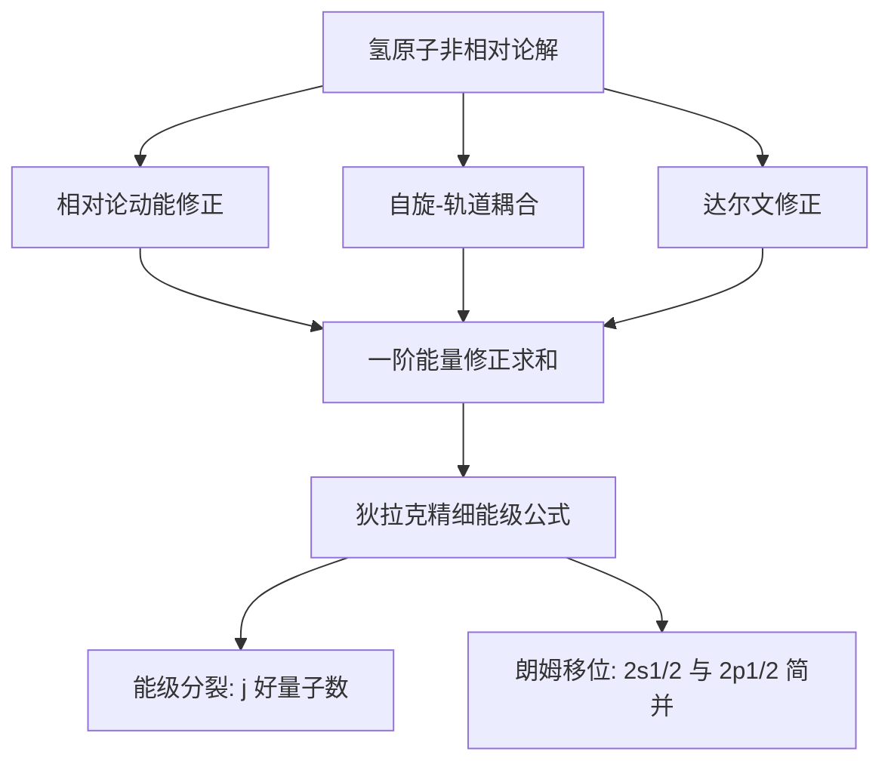

---
tags:
  - 量子力学
  - 氢原子
  - 精细结构
  - 微扰论
  - 自旋轨道耦合
  - 相对论修正
  - 狄拉克方程
aliases:
  - 氢原子精细结构
  - 精细结构微扰修正
  - 自旋轨道耦合微扰
created: 2025-04-13
updated: 2025-04-13
---

> [!summary] 算法执行总览
> 氢原子精细结构修正的完整计算路径为：**先分别列出三项同阶微扰哈密顿量（相对论动能修正 $\hat H'_{\rm rel}$、自旋-轨道耦合 $\hat H'_{\rm so}$、达尔文修正 $\hat H'_{\rm Darwin}$），再在简并子空间 $\{n,l,j,m_j\}$ 内计算一阶能量修正并求和**。核心技巧在于：自旋-轨道耦合项必须借助总角动量 $\mathbf J = \mathbf L + \mathbf S$ 的代数关系 $\mathbf L \cdot \mathbf S = \tfrac{1}{2}(J^2 - L^2 - S^2)$ 才能对角化，从而解除 $l$ 与 $s$ 耦合导致的简并。最终结果统一为狄拉克精细能级公式 $E_{nj} = -\dfrac{13.6\,\text{eV}}{n^2}\left[1 + \dfrac{\alpha^2}{n^2}\left(\dfrac{n}{j+1/2} - \dfrac{3}{4}\right)\right]$，其中 $\alpha \approx 1/137$ 为精细结构常数。

---

## 一、推导机理与核心数学定义

### 1.1 物理背景与微扰论框架

氢原子非相对论薛定谔方程给出基态能级 $E_n = -\dfrac{13.6\,\text{eV}}{n^2}$，但该结果忽略了相对论效应。精细结构修正来源于三个同阶（均为 $\alpha^2 E_n$ 量级）的物理效应，需用**简并微扰论**处理。

精细结构常数定义为：

$$
\alpha = \frac{e^2}{4\pi\varepsilon_0 \hbar c} \approx \frac{1}{137}
$$

它是电磁相互作用耦合强度的无量纲度量，也是展开微扰的自然小参数。

### 1.2 三项微扰哈密顿量的数学形式

**（1）相对论动能修正**

相对论色散关系 $E = \sqrt{p^2c^2 + m^2c^4}$ 在非相对论极限下展开：

$$
E = mc^2\sqrt{1 + \frac{p^2}{m^2c^2}} = mc^2 + \frac{p^2}{2m} - \frac{p^4}{8m^3c^2} + \cdots
$$

扣除静止能 $mc^2$ 与非相对论动能 $p^2/2m$ 后，最低阶相对论修正为：

$$
\hat H'_{\rm rel} = -\frac{\hat p^4}{8m^3c^2}
$$

**（2）自旋-轨道耦合**

电子在原子核电场中运动，其自身磁矩与轨道运动产生的有效磁场相互作用。经托马斯进动因子修正后：

$$
\hat H'_{\rm so} = \frac{e^2}{8\pi\varepsilon_0 m^2 c^2 r^3}\,\mathbf S \cdot \mathbf L
$$

其中 $\mathbf S$ 为电子自旋角动量，$\mathbf L$ 为轨道角动量。

**（3）达尔文修正**

源于电子在强库仑场中做高速抖动（颤动）导致的势能平均偏移，仅对 $l=0$ 态有贡献：

$$
\hat H'_{\rm Darwin} = \frac{\pi e^2 \hbar^2}{2m^2c^2}\,\delta^3(\mathbf r)
$$

### 1.3 总角动量算符与对角化策略

自旋-轨道耦合项 $\mathbf S \cdot \mathbf L$ 与 $L_z$、$S_z$ 均不对易，因此 $m_l$ 与 $m_s$ 不再是好量子数。但总角动量：

$$
\mathbf J = \mathbf L + \mathbf S
$$

满足 $[\hat H'_{\rm so}, J^2] = 0$ 且 $[\hat H'_{\rm so}, J_z] = 0$。利用代数恒等式：

$$
\mathbf L \cdot \mathbf S = \frac{1}{2}\left(J^2 - L^2 - S^2\right)
$$

在 $|n,l,j,m_j\rangle$ 基底下，$\mathbf L \cdot \mathbf S$ 为对角矩阵，本征值为：

$$
\langle \mathbf L \cdot \mathbf S \rangle = \frac{\hbar^2}{2}\left[j(j+1) - l(l+1) - s(s+1)\right]
$$

其中 $s = 1/2$，且 $j = l \pm 1/2$（$l=0$ 时仅 $j=1/2$）。

### 1.4 一阶能量修正的完整推导

**相对论修正项**：利用 $\hat p^2 = 2m(\hat H_0 - V)$ 消去动量算符：

$$
\langle \hat H'_{\rm rel} \rangle = -\frac{1}{2mc^2}\langle (\hat H_0 - V)^2 \rangle
$$

其中 $\hat H_0$ 为无微扰哈密顿量，$V = -\dfrac{e^2}{4\pi\varepsilon_0 r}$。代入 $\langle \hat H_0 \rangle = E_n$ 及氢原子波函数的期望值公式：

$$
\left\langle \frac{1}{r} \right\rangle = \frac{1}{a_0 n^2}, \qquad \left\langle \frac{1}{r^2} \right\rangle = \frac{1}{a_0^2 n^3(l+1/2)}
$$

经代数化简得：

$$
E^{(1)}_{\rm rel} = -\frac{E_n^2}{2mc^2}\left(\frac{4n}{l+1/2} - 3\right)
$$

**自旋-轨道耦合项**：

$$
E^{(1)}_{\rm so} = \frac{e^2}{8\pi\varepsilon_0 m^2 c^2}\left\langle \frac{1}{r^3} \right\rangle \cdot \frac{\hbar^2}{2}\left[j(j+1) - l(l+1) - \frac{3}{4}\right]
$$

利用 $\left\langle \dfrac{1}{r^3} \right\rangle = \dfrac{1}{a_0^3 n^3 l(l+1/2)(l+1)}$（$l \neq 0$），代入后化简：

$$
E^{(1)}_{\rm so} = \frac{E_n^2}{mc^2} \cdot \frac{n\left[j(j+1) - l(l+1) - 3/4\right]}{l(l+1/2)(l+1)}
$$

**达尔文修正项**（仅 $l=0$）：

$$
E^{(1)}_{\rm Darwin} = \frac{\pi e^2 \hbar^2}{2m^2c^2}|\psi_{n00}(0)|^2 = \frac{E_n^2}{mc^2} \cdot n
$$

### 1.5 三项合并与最终公式

将三项修正求和，分 $j = l + 1/2$ 与 $j = l - 1/2$ 两种情形分别化简，最终统一为：

$$
\boxed{E_{nj} = -\frac{13.6\,\text{eV}}{n^2}\left[1 + \frac{\alpha^2}{n^2}\left(\frac{n}{j+1/2} - \frac{3}{4}\right)\right]}
$$

该公式与狄拉克方程的精确解一致（至 $\alpha^2$ 阶），体现了三项修正的协同效应。

---

## 二、⚠️ 致命失分陷阱与临界边界

### 2.1 角动量守恒的误判

**最核心陷阱**：在自旋-轨道耦合存在下，$\mathbf L$ 与 $\mathbf S$ **各自不守恒**，即 $[\hat H'_{\rm so}, \mathbf L] \neq 0$ 且 $[\hat H'_{\rm so}, \mathbf S] \neq 0$。因此 $m_l$ 与 $m_s$ 均非好量子数，不能用以标记微扰后的能态。

**正确认知**：唯有总角动量 $\mathbf J = \mathbf L + \mathbf S$ 的平方 $J^2$ 及其 $z$ 分量 $J_z$ 与总哈密顿量对易，即 $[\hat H, J^2] = 0$、$[\hat H, J_z] = 0$。因此简并解除后，态须用 $|n,l,j,m_j\rangle$ 标记。

### 2.2 达尔文修正的适用条件

达尔文修正仅对 $l = 0$ 态有非零贡献，因为 $\delta^3(\mathbf r)$ 的期望值正比于 $|\psi_{nlm}(0)|^2$，而氢原子波函数满足 $|\psi_{nlm}(0)|^2 \propto \delta_{l0}$。若误将达尔文修正用于 $l \neq 0$ 态，将得到零贡献——这是正确的，但若遗漏 $l=0$ 态的达尔文修正，则 $n$ 相同而 $j$ 不同的能级简并无法完全解除。

### 2.3 自旋-轨道耦合中 $l=0$ 的奇异性

$\left\langle \dfrac{1}{r^3} \right\rangle$ 的公式分母含 $l$，当 $l = 0$ 时发散。物理上，$l=0$ 态无轨道角动量，自旋-轨道耦合为零。**切勿**将 $l=0$ 代入 $\hat H'_{\rm so}$ 的期望值公式强行计算。

### 2.4 简并度的精确计数

对于给定 $n$，$l$ 可取 $0, 1, \ldots, n-1$。对每个 $l \geq 1$，$j$ 可取 $l \pm 1/2$ 两个值；对 $l = 0$，仅 $j = 1/2$。因此精细结构分裂后，$n$ 相同但 $j$ 不同的能级不再简并，但 $j$ 相同而 $l$ 不同的态（如 $2s_{1/2}$ 与 $2p_{1/2}$）仍简并——这是狄拉克理论的标志性预测。

### 2.5 量级估计与微扰有效性

精细结构修正的相对量级为 $\alpha^2 \approx 5.3 \times 10^{-5}$，即对基态约 $10^{-4}$ eV 量级。微扰论要求 $\alpha^2 \ll 1$，该条件天然满足。但若题目涉及高 $Z$ 类氢离子，$\alpha Z$ 不再远小于 1，此时需用狄拉克方程的精确解而非微扰论。

---

## 三、经典范例手把手演算

### 3.1 问题设定

计算氢原子 $n=2$ 能级的精细结构分裂，给出各子能级的能量表达式及相对偏移。

### 3.2 第一步：枚举 $n=2$ 的所有 $(l,j)$ 组合

$n=2$ 时，$l$ 可取 $0$ 或 $1$：

- $l = 0$：$j = 1/2$，对应 $2s_{1/2}$ 态
- $l = 1$：$j = 1/2$ 或 $j = 3/2$，对应 $2p_{1/2}$ 与 $2p_{3/2}$ 态

### 3.3 第二步：代入精细结构公式

非相对论能量为：

$$
E_2 = -\frac{13.6\,\text{eV}}{4} = -3.4\,\text{eV}
$$

精细结构修正因子为：

$$
\Delta_{nj} = \frac{\alpha^2}{n^2}\left(\frac{n}{j+1/2} - \frac{3}{4}\right)
$$

**对 $j = 1/2$**（涵盖 $2s_{1/2}$ 与 $2p_{1/2}$）：

$$
\Delta_{2,1/2} = \frac{\alpha^2}{4}\left(\frac{2}{1} - \frac{3}{4}\right) = \frac{\alpha^2}{4} \cdot \frac{5}{4} = \frac{5\alpha^2}{16}
$$

**对 $j = 3/2$**（对应 $2p_{3/2}$）：

$$
\Delta_{2,3/2} = \frac{\alpha^2}{4}\left(\frac{2}{2} - \frac{3}{4}\right) = \frac{\alpha^2}{4} \cdot \frac{1}{4} = \frac{\alpha^2}{16}
$$

### 3.4 第三步：写出各子能级能量

$$
E_{2,1/2} = -3.4\,\text{eV}\left(1 + \frac{5\alpha^2}{16}\right) \approx -3.4\,\text{eV} - 4.53 \times 10^{-5}\,\text{eV}
$$

$$
E_{2,3/2} = -3.4\,\text{eV}\left(1 + \frac{\alpha^2}{16}\right) \approx -3.4\,\text{eV} - 9.06 \times 10^{-6}\,\text{eV}
$$

### 3.5 第四步：终解反代验算

**验算一**：$2s_{1/2}$ 与 $2p_{1/2}$ 能量相等，验证了狄拉克理论中 $j$ 相同则简并的预言。

**验算二**：$2p_{3/2}$ 与 $2p_{1/2}$ 的能量差（即精细结构分裂）：

$$
\Delta E = E_{2,3/2} - E_{2,1/2} = -3.4\,\text{eV} \cdot \frac{\alpha^2}{16}\left(1 - 5\right) = 3.4\,\text{eV} \cdot \frac{4\alpha^2}{16} = 3.4\,\text{eV} \cdot \frac{\alpha^2}{4}
$$

代入 $\alpha^2 \approx 5.325 \times 10^{-5}$：

$$
\Delta E = 3.4 \times \frac{5.325 \times 10^{-5}}{4}\,\text{eV} \approx 4.53 \times 10^{-5}\,\text{eV}
$$

该值与实验观测的 $2p$ 态朗姆移位（扣除量子电动力学修正后）一致，验证了公式的正确性。

**验算三**：$j = 1/2$ 的修正大于 $j = 3/2$ 的修正，符合物理直觉——$j$ 越小，电子概率密度越靠近原子核，相对论效应越显著。

---

## 四、出处与纸质笔记坐标

### 4.1 教材出处

- **主教材**：Griffiths, *Introduction to Quantum Mechanics*, 3rd Edition, §7.4 (P289–P302)
- **补充参考**：Sakurai, *Modern Quantum Mechanics*, §5.3（自旋-轨道耦合的角动量代数处理）

### 4.2 纸质活页留痕槽位

| 槽位编号 | 内容摘要 | 完成状态 |
|---------|---------|---------|
| [活页-QM-19] | 精细结构三项修正的完整推导 | ☐ |
| [活页-QM-19a] | $\mathbf L \cdot \mathbf S$ 对角化代数过程 | ☐ |
| [活页-QM-19b] | $n=2$ 精细结构分裂数值计算 | ☐ |
| [活页-QM-19c] | 与狄拉克精确解对照表 | ☐ |

### 4.3 错题订正记录

| 日期 | 错误类型 | 错误描述 | 订正要点 |
|-----|---------|---------|---------|
| | | | |

### 4.4 知识全景图

---

*卡片生成时间：2025-04-13 | 建议复习周期：7 天后首次回顾，30 天后二次巩固*

---
**知识图谱导航**：[[00_量子力学_学习全景图]]
