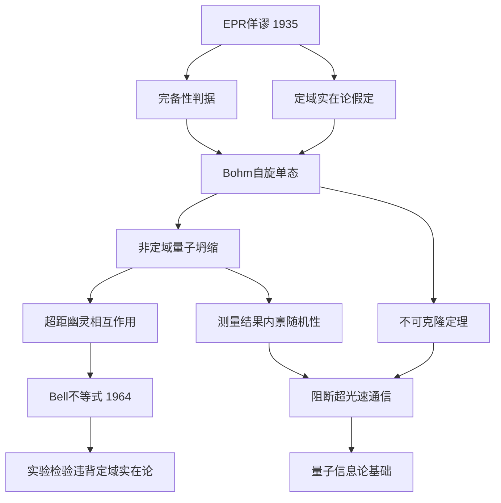

---
tags:
  - 量子力学
  - 量子纠缠
  - EPR佯谬
  - 定域实在论
  - 不可克隆定理
  - 概念卡
aliases:
  - EPR佯谬
  - 定域实在论
  - 量子纠缠与非定域性
  - 不可克隆定理
created: 2026-05-12
updated: 2026-05-12
---

> [!summary] 核心认知先验
> EPR 佯谬揭示量子力学完备性危机：若坚持**定域实在论**（物理实在独立于观测且信号传播有光速上限），则对 Bohm 自旋单态纠缠对中一个子系统的测量将迫使另一子系统瞬时获得确定态，与完备性要求冲突。量子力学的正统回应是放弃定域实在论，接受**非定域量子坍缩**；但纠缠关联的内禀随机性保证了**不可用于超光速通信**，此结论由**不可克隆定理**进一步加固。

---

## 一、推导机理与核心数学定义

### 1.1 EPR 完备性判据与定域实在论假定

爱因斯坦、波多尔多斯基与罗森于 1935 年提出完备性判据：

> 物理实在的每个要素都必须在理论中有对应物。

其充分条件为：**若在不扰动某系统的情况下能确定地预言某物理量的值，则该物理量对应一个物理实在的要素**。

定域实在论包含两条支柱：

- **实在性**：物理量在测量前即具有确定值，与观测无关。
- **定域性**：不存在超距作用；对 $A$ 处系统的测量不能瞬时影响 $B$ 处系统的物理状态。

### 1.2 Bohm 自旋单态纠缠对

Bohm 将 EPR 论证简化为自旋 1/2 粒子对。考虑总自旋为零的单态：

$$
|\psi\rangle_{AB} = \frac{1}{\sqrt{2}} \left( |\uparrow\rangle_A |\downarrow\rangle_B - |\downarrow\rangle_A |\uparrow\rangle_B \right)
$$

该态的关键性质：对 $A$ 沿任意方向 $\hat{n}$ 测量自旋，若得 $+\hbar/2$，则 $B$ 沿同方向测量必得 $-\hbar/2$，反之亦然。两测量结果**完全反关联**。

设 $\hat{n} = (\sin\theta\cos\phi,\ \sin\theta\sin\phi,\ \cos\theta)$，定义自旋投影算符：

$$
\hat{S}_n = \frac{\hbar}{2} \vec{\sigma} \cdot \hat{n} = \frac{\hbar}{2} \begin{pmatrix} \cos\theta & \sin\theta\, e^{-i\phi} \\ \sin\theta\, e^{i\phi} & -\cos\theta \end{pmatrix}
$$

单态 $|\psi\rangle_{AB}$ 满足对任意 $\hat{n}$ 的严格反关联：

$$
\hat{S}_n^{(A)} \otimes \hat{I}^{(B)} |\psi\rangle_{AB} = -\hat{I}^{(A)} \otimes \hat{S}_n^{(B)} |\psi\rangle_{AB}
$$

即 $A$ 的自旋投影与 $B$ 的自旋投影在单态上互为负值。

### 1.3 EPR 推理链

设 $A$、$B$ 空间分离。对 $A$ 测量 $\hat{S}_z^{(A)}$：

- 若结果 $+\hbar/2$，则 $B$ 的 $S_z$ 必为 $-\hbar/2$，**无需扰动 $B$** 即可确定预言其值。
- 由 EPR 实在性判据，$B$ 的 $S_z$ 是物理实在的要素。

但若改对 $A$ 测量 $\hat{S}_x^{(A)}$，同理可推出 $B$ 的 $S_x$ 也是物理实在的要素。

由于 $[\hat{S}_x, \hat{S}_z] = i\hbar \hat{S}_y \neq 0$，$S_x$ 与 $S_z$ 不可同时具有确定值。EPR 由此断言：量子力学无法同时描述 $B$ 的 $S_x$ 与 $S_z$ 这两个实在要素，故**量子力学不完备**。

### 1.4 非定域量子坍缩

正统哥本哈根诠释拒绝定域实在论。对 $A$ 的测量使整个纠缠态瞬时坍缩：

$$
|\psi\rangle_{AB} = \frac{1}{\sqrt{2}}\left(|\uparrow\rangle_A |\downarrow\rangle_B - |\downarrow\rangle_A |\uparrow\rangle_B\right) \xrightarrow{\text{测得 } A=\uparrow} |\uparrow\rangle_A |\downarrow\rangle_B
$$

$B$ 的状态从混合态（约化密度算符 $\hat{\rho}_B = \frac{1}{2}\hat{I}$）瞬时变为纯态 $|\downarrow\rangle_B$。此坍缩是**非定域的**——爱因斯坦称之为"超距幽灵相互作用"（spukhafte Fernwirkung）。

### 1.5 不可克隆定理

**定理**：不存在物理过程能对未知任意量子态 $|\psi\rangle$ 制造精确副本。

**证明**：设存在克隆算符 $\hat{U}$，满足对任意 $|\psi\rangle$ 与固定辅助态 $|s\rangle$：

$$
\hat{U} \left( |\psi\rangle \otimes |s\rangle \right) = |\psi\rangle \otimes |\psi\rangle
$$

取两个任意态 $|\psi_1\rangle$、$|\psi_2\rangle$，由上式：

$$
\hat{U} |\psi_1\rangle |s\rangle = |\psi_1\rangle |\psi_1\rangle, \qquad \hat{U} |\psi_2\rangle |s\rangle = |\psi_2\rangle |\psi_2\rangle
$$

内积两侧：

$$
\langle \psi_1 | \psi_2 \rangle = \langle \psi_1 | \psi_2 \rangle^2
$$

令 $x = \langle \psi_1 | \psi_2 \rangle$，则 $x = x^2$，即 $x(x-1)=0$，故 $x=0$ 或 $x=1$。这意味着 $|\psi_1\rangle$ 与 $|\psi_2\rangle$ 要么正交、要么相同——与"任意态"矛盾。因此精确克隆未知量子态在原理上不可能。

---

## 二、⚠️ 致命失分陷阱与临界边界

### 陷阱 1：将纠缠坍缩误认为超光速通信

**错误论断**：测量 $A$ 瞬时改变 $B$ 的状态，故可借此传递信息。

**正解**：$A$ 处测量结果 $+\hbar/2$ 或 $-\hbar/2$ 各以 $1/2$ 概率出现，完全随机。$B$ 处观测者仅凭本地测量无法区分"自己的粒子处于纠缠态中"与"处于完全混合态 $\hat{\rho}_B = \frac{1}{2}\hat{I}$"。$B$ 必须通过经典信道（速度 $\leq c$）获知 $A$ 的测量结果才能验证关联。**非定域关联 ≠ 信息传递**。

### 陷阱 2：混淆"知道 $B$ 的状态"与"影响 $B$ 的状态"

测量 $A$ 后，$A$ 处观测者**知道** $B$ 的状态，但此知识不构成对 $B$ 的物理作用。$B$ 处观测者自身的测量统计分布不因 $A$ 的测量而改变。

### 陷阱 3：忽略不可克隆定理对超光速通信的阻断

若可克隆未知量子态，则可制备大量纠缠副本，通过测量统计突破随机性限制提取信息。不可克隆定理从原理上封堵此路径。

### 陷阱 4：将 EPR 佯谬视为对量子力学的否定

EPR 论文的结论是量子力学**不完备**，而非**错误**。Bell 不等式（1964）的实验检验表明：任何定域隐变量理论都无法复现量子关联，量子力学的预言在实验上得到支持。

### 陷阱 5：单态反关联的方向依赖性

单态 $|\psi\rangle_{AB}$ 仅在**相同测量方向**上呈现完美反关联。若 $A$ 沿 $\hat{n}_1$、$B$ 沿 $\hat{n}_2$ 测量（$\hat{n}_1 \neq \hat{n}_2$），关联强度由 $\cos\theta_{12}$ 决定（$\theta_{12}$ 为两方向夹角），并非对所有方向组合都完美反关联。

---

## 三、经典范例手把手演算

### 范例：Bohm 单态沿不同方向的关联计算

**问题**：设 $A$ 沿 $\hat{z}$ 方向、$B$ 沿 $\hat{x}$ 方向测量自旋，求联合概率 $P(+\hat{z}_A,\ +\hat{x}_B)$。

**第一步**：写出单态在 $S_z$ 基下的展开：

$$
|\psi\rangle_{AB} = \frac{1}{\sqrt{2}} \left( |\uparrow_z\rangle_A |\downarrow_z\rangle_B - |\downarrow_z\rangle_A |\uparrow_z\rangle_B \right)
$$

**第二步**：将 $B$ 的 $S_z$ 本征态改写为 $S_x$ 本征态：

$$
|\uparrow_z\rangle_B = \frac{1}{\sqrt{2}} \left( |\uparrow_x\rangle_B + |\downarrow_x\rangle_B \right), \qquad |\downarrow_z\rangle_B = \frac{1}{\sqrt{2}} \left( |\uparrow_x\rangle_B - |\downarrow_x\rangle_B \right)
$$

**第三步**：代入单态：

$$
|\psi\rangle_{AB} = \frac{1}{\sqrt{2}} \left[ |\uparrow_z\rangle_A \cdot \frac{1}{\sqrt{2}}\left( |\uparrow_x\rangle_B - |\downarrow_x\rangle_B \right) - |\downarrow_z\rangle_A \cdot \frac{1}{\sqrt{2}}\left( |\uparrow_x\rangle_B + |\downarrow_x\rangle_B \right) \right]
$$

$$
= \frac{1}{2} \left[ |\uparrow_z\rangle_A |\uparrow_x\rangle_B - |\uparrow_z\rangle_A |\downarrow_x\rangle_B - |\downarrow_z\rangle_A |\uparrow_x\rangle_B - |\downarrow_z\rangle_A |\downarrow_x\rangle_B \right]
$$

**第四步**：提取目标系数。$P(+\hat{z}_A,\ +\hat{x}_B)$ 对应 $|\uparrow_z\rangle_A |\uparrow_x\rangle_B$ 项的模平方：

$$
P(+\hat{z}_A,\ +\hat{x}_B) = \left| \frac{1}{2} \right|^2 = \frac{1}{4}
$$

**第五步**：同理可得全部四种联合概率：

$$
P(+\hat{z}_A,\ -\hat{x}_B) = \frac{1}{4}, \qquad P(-\hat{z}_A,\ +\hat{x}_B) = \frac{1}{4}, \qquad P(-\hat{z}_A,\ -\hat{x}_B) = \frac{1}{4}
$$

**第六步**：验算边缘概率。对 $B$ 的 $S_x$ 求和：

$$
P(+\hat{z}_A) = P(+\hat{z}_A,\ +\hat{x}_B) + P(+\hat{z}_A,\ -\hat{x}_B) = \frac{1}{4} + \frac{1}{4} = \frac{1}{2}
$$

与单粒子测量概率一致，验证归一化正确。

**结论**：当 $A$ 测 $\hat{z}$、$B$ 测 $\hat{x}$（正交方向）时，两结果完全独立，无任何关联。关联仅在**相同测量方向**上显现。

---

## 四、出处与纸质笔记坐标

### 指定教材出处

- **Griffiths, *Introduction to Quantum Mechanics*, 3rd ed.**
  - §12.1 *The EPR Paradox*：P475–P479
  - §12.4 *Bell's Theorem*（含不可克隆定理讨论）：P493–P495

### 纸质活页留痕槽位

- **[活页-QM-26]**：EPR 佯谬推理链手写推导 + Bohm 单态展开演算 + 不可克隆定理证明步骤
- **[活页-QM-27]**：Bell 不等式推导与 CHSH 不等式（衔接本卡片的后续内容）

### 知识全景图

---

*本卡片对应 Griffiths QM 第三版 §12.1 与 §12.4，建议配合活页 QM-26 完成手写推导后，继续推进至 Bell 不等式卡片（活页 QM-27）。*

---
**知识图谱导航**：[[00_量子力学_学习全景图]]
