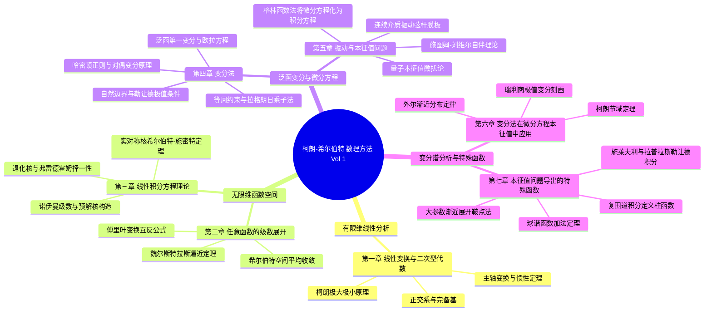

# 柯朗 & 希尔伯特《数学物理方法》（第一卷）全书学习全景图 (Master MOC)

> [!abstract] 20世纪理论物理的数学基石
> 本知识库严格对照 **R. 柯朗（Richard Courant）与 D. 希尔伯特（David Hilbert）** 经典奠基巨著《数学物理方法》（*Methods of Mathematical Physics*, Volume I）原著全书 7 章 67 节构建完成：
> - **全书规模**：共 **96 项核心知识文档**（67 篇逐节精读解构笔记 + 29 张核心概念/定理/技术沉淀卡）；
> - **思想脉络**：从有限维线性代数（主轴变换、二次型）跃迁至无限维函数空间（希尔伯特空间、积分方程、连续统振动），奠定了量子力学波动力学与现代泛函分析的核心骨架；
> - **排版规范**：全量公式严格遵循 KaTeX / Obsidian 原生学术标准，双向链接 100% 闭环。

---

## 🏛️ 全书核心知识架构拓扑

---

## 💎 29 张核心概念 / 定理 / 技术卡分类速查

| 编号 | 类型 | 核心卡片主题与双链入口 | 归属章节 | 核心学术意义 |
|---|---|---|---|---|
| card_CH1-01 | 核心概念 | [[卡片/概念_线性空间正交完备基与贝塞尔不等式|线性空间正交完备基与贝塞尔不等式]] | 第一章 | 原著精髓提炼 |
| card_CH1-02 | 核心定理 | [[卡片/定理_二次型主轴变换与惯性定理|二次型主轴变换定理与惯性定理]] | 第一章 | 原著精髓提炼 |
| card_CH1-03 | 核心定理 | [[卡片/定理_柯朗极大极小原理|矩阵本征值的柯朗极大极小原理（§1.4 本征值的极大极小性质）]] | 第一章 | 原著精髓提炼 |
| card_CH1-04 | 核心技术 | [[卡片/技术_格拉姆施密特正交化算法与内积度量|格拉姆施密特正交化算法与内积度量]] | 第一章 | 原著精髓提炼 |
| card_CH1-05 | 核心定理 | [[卡片/定理_魏尔斯特拉斯多项式逼近定理|魏尔斯特拉斯连续函数多项式逼近定理（§2.4）]] | 第二章 | 原著精髓提炼 |
| card_CH1-06 | 核心概念 | [[卡片/概念_函数空间平均收敛与希尔伯特空间完备性|函数空间平均收敛与希尔伯特空间完备性]] | 第二章 | 原著精髓提炼 |
| card_CH1-07 | 核心定理 | [[卡片/定理_帕塞瓦尔等式与正交完备性充要条件|正交化算法、贝塞尔不等式与平均逼近完备性]] | 第二章 | 原著精髓提炼 |
| card_CH1-08 | 核心定理 | [[卡片/定理_傅里叶积分定理与互反公式|傅里叶积分展开定理与互反表示公式（教材原编号：一维 (16)、(17)）]] | 第二章 | 原著精髓提炼 |
| card_CH1-09 | 核心概念 | [[卡片/概念_古典正交多项式族与母函数展开|切比雪夫、埃尔米特与拉盖尔函数正交族]] | 第二章 | 原著精髓提炼 |
| card_CH1-10 | 核心定理 | [[卡片/定理_弗雷德霍姆择一性定理|线性积分方程的弗雷德霍姆择一性定理（任意连续核，§3.3）]] | 第三章 | 原著精髓提炼 |
| card_CH1-11 | 核心定理 | [[卡片/定理_实对称核希尔伯特施密特定理|实对称核的希尔伯特-施密特谱展开定理（§3.4）]] | 第三章 | 原著精髓提炼 |
| card_CH1-12 | 核心技术 | [[卡片/技术_诺伊曼级数逐次逼近法|诺伊曼级数逐次逼近法与预解核求解]] | 第三章 | 原著精髓提炼 |
| card_CH1-13 | 核心技术 | [[卡片/技术_弗雷德霍姆行列式与预解核构造|弗雷德霍姆行列式与整函数商预解核构造]] | 第三章 | 原著精髓提炼 |
| card_CH1-14 | 核心概念 | [[卡片/概念_泛函第一变分与欧拉拉格朗日方程|泛函第一变分与欧拉-拉格朗日方程]] | 第四章 | 原著精髓提炼 |
| card_CH1-15 | 核心定理 | [[卡片/定理_二阶变分与勒让德极值必要条件|泛函二阶变分与勒让德极值必要条件（§4.5）]] | 第四章 | 原著精髓提炼 |
| card_CH1-16 | 核心技术 | [[卡片/技术_等周约束变分问题与拉格朗日乘子法|等周约束变分问题与拉格朗日乘子求解法]] | 第四章 | 原著精髓提炼 |
| card_CH1-17 | 核心技术 | [[卡片/技术_勒让德变换与正则对偶变分原理|勒让德对偶变换与哈密顿正则变分形式]] | 第四章 | 原著精髓提炼 |
| card_CH1-18 | 核心概念 | [[卡片/概念_经典连续体变分原理与数理方程导出|波动、平衡与扩散方程的变分生成]] | 第四章 | 原著精髓提炼 |
| card_CH1-19 | 核心技术 | [[卡片/技术_连续体振动分离变量法解题范式|一维连续体自由与强迫振动分离变量范式]] | 第五章 | 原著精髓提炼 |
| card_CH1-20 | 核心技术 | [[卡片/技术_矩形与圆形膜振动解法及节线分析|矩形与圆形膜振动本征解及节线分析]] | 第五章 | 原著精髓提炼 |
| card_CH1-21 | 核心定理 | [[卡片/定理_施图姆刘维尔本征值定理与自伴边界|施图姆-刘维尔微分算子自伴本征值定理]] | 第五章 | 原著精髓提炼 |
| card_CH1-22 | 核心技术 | [[卡片/技术_一维与高维微分方程格林函数积分转化|影响函数法：物理图景、跳跃条件与等价积分方程]] | 第五章 | 原著精髓提炼 |
| card_CH1-23 | 核心定理 | [[卡片/定理_本征值与本征函数微扰展开定理|线性算子本征值与本征函数微扰展开定理（§5.13）]] | 第五章 | 原著精髓提炼 |
| card_CH1-24 | 核心定理 | [[卡片/定理_瑞利商与本征值变分极值刻画|瑞利商极值原理与本征值逐级变分刻画（§6.1）]] | 第六章 | 原著精髓提炼 |
| card_CH1-25 | 核心定理 | [[卡片/定理_外尔渐近分布定律|外尔（Weyl）定律与几何体积谱渐近公式（§6.4 定理 12–19 汇编）]] | 第六章 | 原著精髓提炼 |
| card_CH1-26 | 核心定理 | [[卡片/定理_柯朗节域定理|柯朗节域定理（Courant's Nodal Domain Theorem）]] | 第六章 | 原著精髓提炼 |
| card_CH1-27 | 核心技术 | [[卡片/技术_围道积分法定义柱函数与贝塞尔性质|复平面围道积分定义柱函数与贝塞尔递推]] | 第七章 | 原著精髓提炼 |
| card_CH1-28 | 核心技术 | [[卡片/技术_施莱夫利与拉普拉斯积分表达勒让德多项式|施莱夫利与拉普拉斯积分表达勒让德函数]] | 第七章 | 原著精髓提炼 |
| card_CH1-29 | 核心技术 | [[卡片/技术_渐近展开鞍点法与达布方法|特殊函数大参数渐近展开的鞍点法与达布法]] | 第七章 | 原著精髓提炼 |

---

## 📚 全书 7 章 67 节逐节精读解构笔记树

### 第一章 线性变换与二次型代数 (Linear Transformations and Quadratic Forms)

**核心沉淀卡片**：
- [[卡片/概念_线性空间正交完备基与贝塞尔不等式|线性空间正交完备基与贝塞尔不等式]] `[card_CH1-01]`
- [[卡片/定理_二次型主轴变换与惯性定理|二次型主轴变换定理与惯性定理]] `[card_CH1-02]`
- [[卡片/定理_柯朗极大极小原理|矩阵本征值的柯朗极大极小原理（§1.4 本征值的极大极小性质）]] `[card_CH1-03]`
- [[卡片/技术_格拉姆施密特正交化算法与内积度量|格拉姆施密特正交化算法与内积度量]] `[card_CH1-04]`

**逐节精读笔记**：
- [[逐节/第一章_§1.1_线性方程与线性变换|第一章 §1.1 线性方程与线性变换（本篇单元：向量、正交系、矩阵与正交/酉变换代数）]]
- [[逐节/第一章_§1.2_带有线性参数的线性变换|§1.2 带有线性参数的线性变换（Linear Transformations with a Linear Parameter）]]
- [[逐节/第一章_§1.3_二次型与埃尔米特型的主轴变换|§1.3 二次型与埃尔米特型的主轴变换 (Transformation to Principal Axes of Quadratic and Hermitian Forms)]]
- [[逐节/第一章_§1.4_本征值的极大极小性质|§1.4 本征值的极大极小性质（单元：柯朗极大极小特征刻画与几何约束）]]
- [[逐节/第一章_§1.5_补充与习题|§1.5 补充与习题（Supplement and Problems）]]

---

### 第二章 任意函数的级数展开 (Series Expansions of Arbitrary Functions)

**核心沉淀卡片**：
- [[卡片/定理_魏尔斯特拉斯多项式逼近定理|魏尔斯特拉斯连续函数多项式逼近定理（§2.4）]] `[card_CH1-05]`
- [[卡片/概念_函数空间平均收敛与希尔伯特空间完备性|函数空间平均收敛与希尔伯特空间完备性]] `[card_CH1-06]`
- [[卡片/定理_帕塞瓦尔等式与正交完备性充要条件|正交化算法、贝塞尔不等式与平均逼近完备性]] `[card_CH1-07]`
- [[卡片/定理_傅里叶积分定理与互反公式|傅里叶积分展开定理与互反表示公式（教材原编号：一维 (16)、(17)）]] `[card_CH1-08]`
- [[卡片/概念_古典正交多项式族与母函数展开|切比雪夫、埃尔米特与拉盖尔函数正交族]] `[card_CH1-09]`

**逐节精读笔记**：
- [[逐节/第二章_§2.1_函数正交系|§2.1 函数正交系——正交化、贝塞尔不等式与平均逼近完备性]]
- [[逐节/第二章_§2.2_函数的聚点原理|§2.2 函数的聚点原理（The Accumulation Principle for Functions）：函数空间中的弱收敛与紧致性]]
- [[逐节/第二章_§2.3_独立性度量与维数|§2.3 独立性度量与维数（Measure of Independence and Dimension Number）]]
- [[逐节/第二章_§2.4_魏尔斯特拉斯逼近定理|§2.4 魏尔斯特拉斯逼近定理（Weierstrass's Approximation Theorem）精读解构笔记]]
- [[逐节/第二章_§2.5_傅里叶级数|§2.5 傅里叶级数 (Fourier Series) 精读解构笔记]]
- [[逐节/第二章_§2.6_傅里叶积分|§2.6 傅里叶积分（The Fourier Integral）——连续频谱展开与多元互反公式]]
- [[逐节/第二章_§2.7_傅里叶积分例题|§2.7 傅里叶积分例题 (Examples of Fourier Integrals)]]
- [[逐节/第二章_§2.8_勒让德多项式|§2.8 勒让德多项式 (Legendre Polynomials) 精读解构笔记]]
- [[逐节/第二章_§2.9_其他正交系的实例|§2.9 其他正交系的实例（Examples of Other Orthogonal Systems）]]
- [[逐节/第二章_§2.10_补充与习题|§2.10 补充与习题（节选）：费耶求和定理、梅林反演公式与闵茨完备性定理]]

---

### 第三章 线性积分方程理论 (Linear Integral Equations)

**核心沉淀卡片**：
- [[卡片/定理_弗雷德霍姆择一性定理|线性积分方程的弗雷德霍姆择一性定理（任意连续核，§3.3）]] `[card_CH1-10]`
- [[卡片/定理_实对称核希尔伯特施密特定理|实对称核的希尔伯特-施密特谱展开定理（§3.4）]] `[card_CH1-11]`
- [[卡片/技术_诺伊曼级数逐次逼近法|诺伊曼级数逐次逼近法与预解核求解]] `[card_CH1-12]`
- [[卡片/技术_弗雷德霍姆行列式与预解核构造|弗雷德霍姆行列式与整函数商预解核构造]] `[card_CH1-13]`

**逐节精读笔记**：
- [[逐节/第三章_§3.1_引言|§3.1 引言 (Introduction) 精读解构笔记]]
- [[逐节/第三章_§3.2_退化核的弗雷德霍姆定理|§3.2 退化核的弗雷德霍姆定理：有限秩核与线性代数方程等价性]]
- [[逐节/第三章_§3.3_任意连续核的弗雷德霍姆定理|§3.3 任意连续核的弗雷德霍姆定理 (Fredholm's Theorems for Arbitrary Kernels)]]
- [[逐节/第三章_§3.4_对称核及其本征值|§3.4 对称核及其本征值（Symmetric Kernels and Their Eigenvalues）]]
- [[逐节/第三章_§3.5_展开定理及其应用|§3.5 展开定理及其应用（单元：希尔伯特-施密特展开定理与源表达）]]
- [[逐节/第三章_§3.6_诺伊曼级数与预解核|§3.6 诺伊曼级数与预解核（Neumann’s Series and Reciprocal Kernel）]]
- [[逐节/第三章_§3.7_弗雷德霍姆公式|§3.7 弗雷德霍姆公式 (The Fredholm Formulas)]]
- [[逐节/第三章_§3.8_理论的另一种推导|§3.8 理论的另一种推导 (Another Derivation of the Theory)]]
- [[逐节/第三章_§3.9_理论的推广|§3.9 理论的推广（Extensions of the Theory）：间断核、奇异核与无界区间积分方程]]
- [[逐节/第三章_§3.10_补充与习题|§3.10 补充与习题 (Supplement and Problems)：可对称化核、哈默斯坦定理与极性核]]

---

### 第四章 变分法 (The Calculus of Variations)

**核心沉淀卡片**：
- [[卡片/概念_泛函第一变分与欧拉拉格朗日方程|泛函第一变分与欧拉-拉格朗日方程]] `[card_CH1-14]`
- [[卡片/定理_二阶变分与勒让德极值必要条件|泛函二阶变分与勒让德极值必要条件（§4.5）]] `[card_CH1-15]`
- [[卡片/技术_等周约束变分问题与拉格朗日乘子法|等周约束变分问题与拉格朗日乘子求解法]] `[card_CH1-16]`
- [[卡片/技术_勒让德变换与正则对偶变分原理|勒让德对偶变换与哈密顿正则变分形式]] `[card_CH1-17]`
- [[卡片/概念_经典连续体变分原理与数理方程导出|波动、平衡与扩散方程的变分生成]] `[card_CH1-18]`

**逐节精读笔记**：
- [[逐节/第四章_§4.1_变分法的问题|§4.1 变分法的问题：经典极值问题与泛函定义]]
- [[逐节/第四章_§4.2_直接解法|§4.2 直接解法（Direct Solutions）——里茨法、有限差分逼近与极小化序列]]
- [[逐节/第四章_§4.3_欧拉方程|§4.3 欧拉方程（The Euler Equations）精读解构笔记]]
- [[逐节/第四章_§4.4_欧拉微分方程的积分与自然边界条件|§4.4 欧拉微分方程的积分与自然边界条件（本篇：自然边界条件、自由端点与横截条件）]]
- [[逐节/第四章_§4.5_二阶变分与勒让德条件|§4.5 二阶变分与勒让德条件 (The Second Variation and Legendre Condition)]]
- [[逐节/第四章_§4.6_带有约束条件的变分问题|§4.6 带有约束条件的变分问题——微分约束与积分约束（等周问题）]]
- [[逐节/第四章_§4.7_欧拉方程的不变量性质|§4.7 欧拉方程的不变量性质 (Invariant Character of Euler Equations)]]
- [[逐节/第四章_§4.8_变分问题化为正则与对偶形式|§4.8 变分问题化为正则与对偶形式]]
- [[逐节/第四章_§4.9_变分法与数学物理微分方程|§4.9 变分法与数学物理微分方程：波动、平衡与扩散方程的变分生成（u04_09_01）]]
- [[逐节/第四章_§4.10_互易二次变分问题|§4.10 互易二次变分问题 (Reciprocal Quadratic Variational Problems) 精读解构笔记]]
- [[逐节/第四章_§4.11_变分法高级专题|§4.11 变分法高级专题（Advanced Topics in Variational Calculus）精读解构笔记]]
- [[逐节/第四章_§4.12_补充注记与习题|§4.12 补充注记与习题 (Supplementary Remarks and Exercises)]]

---

### 第五章 数学物理中的振动与本征值问题 (Vibration and Eigenvalue Problems)

**核心沉淀卡片**：
- [[卡片/技术_连续体振动分离变量法解题范式|一维连续体自由与强迫振动分离变量范式]] `[card_CH1-19]`
- [[卡片/技术_矩形与圆形膜振动解法及节线分析|矩形与圆形膜振动本征解及节线分析]] `[card_CH1-20]`
- [[卡片/定理_施图姆刘维尔本征值定理与自伴边界|施图姆-刘维尔微分算子自伴本征值定理]] `[card_CH1-21]`
- [[卡片/技术_一维与高维微分方程格林函数积分转化|影响函数法：物理图景、跳跃条件与等价积分方程]] `[card_CH1-22]`
- [[卡片/定理_本征值与本征函数微扰展开定理|线性算子本征值与本征函数微扰展开定理（§5.13）]] `[card_CH1-23]`

**逐节精读笔记**：
- [[逐节/第五章_§5.1_线性微分方程初步|§5.1 线性微分方程初步（Preliminary Remarks about Linear Differential Equations）精读解构笔记]]
- [[逐节/第五章_§5.2_有限自由度系统振动|§5.2 有限自由度系统振动（本篇：耦合振子、正则坐标与本征频率）]]
- [[逐节/第五章_§5.3_弦振动|§5.3 弦振动 (The Vibrating String)]]
- [[逐节/第五章_§5.4_杆的横向振动|§5.4 杆的横向振动 (The Vibrating Rod)]]
- [[逐节/第五章_§5.5_膜振动|§5.5 膜振动 (The Vibrating Membrane) 精读解构笔记]]
- [[逐节/第五章_§5.6_板振动|§5.6 板振动 (The Vibrating Plate) 精读解构笔记]]
- [[逐节/第五章_§5.7_本征函数方法通论|§5.7 本征函数方法通论（General Remarks on the Eigenfunction Method）]]
- [[逐节/第五章_§5.8_三维连续介质振动与分离变量|§5.8 三维连续介质振动与分离变量（Vibrations of Three-Dimensional Continua. Separation of Variables）]]
- [[逐节/第五章_§5.9_位势论边值问题与本征函数|§5.9 位势论边值问题与本征函数（Boundary Value Problem of Potential Theory）]]
- [[逐节/第五章_§5.10_施图姆-刘维尔型问题|§5.10 施图姆-刘维尔型问题（Problems of the Sturm-Liouville Type）精读解构笔记]]
- [[逐节/第五章_§5.11_解的渐近行为|§5.11 解的渐近行为 (Asymptotic Behavior of Solutions)]]
- [[逐节/第五章_§5.12_具有连续谱的本征值问题|§5.12 具有连续谱的本征值问题（Eigenvalue Problems with Continuous Spectrum）]]
- [[逐节/第五章_§5.13_微扰理论|§5.13 微扰理论 (Perturbation Theory) 精读解构笔记]]
- [[逐节/第五章_§5.14_格林函数与微分方程化为积分方程|§5.14 格林函数（影响函数）与微分方程化为积分方程——影响函数物理图景、跳跃条件与等价积分方程]]
- [[逐节/第五章_§5.15_格林函数的构造实例|§5.15 格林函数的构造实例（精读解构）]]
- [[逐节/第五章_§5.16_第五章补充|§5.16 第五章补充 (Supplement to Chapter V) 精读解构笔记]]

---

### 第六章 变分法在微分方程本征值中的应用 (Calculus of Variations in Eigenvalue Problems)

**核心沉淀卡片**：
- [[卡片/定理_瑞利商与本征值变分极值刻画|瑞利商极值原理与本征值逐级变分刻画（§6.1）]] `[card_CH1-24]`
- [[卡片/定理_外尔渐近分布定律|外尔（Weyl）定律与几何体积谱渐近公式（§6.4 定理 12–19 汇编）]] `[card_CH1-25]`
- [[卡片/定理_柯朗节域定理|柯朗节域定理（Courant's Nodal Domain Theorem）]] `[card_CH1-26]`

**逐节精读笔记**：
- [[逐节/第六章_§6.1_本征值的极值性质|§6.1 本征值的极值性质 (Extremum Properties of Eigenvalues) 精读解构笔记]]
- [[逐节/第六章_§6.2_本征值极值性质的推论|§6.2 本征值极值性质的推论（单元：柯朗极大极小原理、域单调性与边界依赖定理）]]
- [[逐节/第六章_§6.3_完备性与展开定理|§6.3 完备性与展开定理 (Completeness and Expansion Theorems)]]
- [[逐节/第六章_§6.4_本征值的渐近分布|§6.4 本征值的渐近分布：外尔定律与几何体积谱渐近公式]]
- [[逐节/第六章_§6.5_薛定谔型本征值问题|§6.5 薛定谔型本征值问题 (Eigenvalue Problems of Schrödinger Type)]]
- [[逐节/第六章_§6.6_本征函数的节|§6.6 本征函数的节（Nodes of Eigenfunctions）：柯朗节域定理]]
- [[逐节/第六章_§6.7_补充与习题|§6.7 补充与习题（Supplementary Remarks and Problems）精读解构笔记]]

---

### 第七章 本征值问题导出的特殊函数 (Special Functions Defined by Eigenvalue Problems)

**核心沉淀卡片**：
- [[卡片/技术_围道积分法定义柱函数与贝塞尔性质|复平面围道积分定义柱函数与贝塞尔递推]] `[card_CH1-27]`
- [[卡片/技术_施莱夫利与拉普拉斯积分表达勒让德多项式|施莱夫利与拉普拉斯积分表达勒让德函数]] `[card_CH1-28]`
- [[卡片/技术_渐近展开鞍点法与达布方法|特殊函数大参数渐近展开的鞍点法与达布法]] `[card_CH1-29]`

**逐节精读笔记**：
- [[逐节/第七章_§7.1_二阶线性微分方程初步|§7.1 二阶线性微分方程初步（本篇单元：常点、正则奇点与积分变换法统一解题策略）]]
- [[逐节/第七章_§7.2_贝塞尔函数|§7.2 贝塞尔函数（Bessel Functions）：汉克尔函数、第一/二类柱函数、积分表达、零点分布与递推公式]]
- [[逐节/第七章_§7.3_勒让德函数|§7.3 勒让德函数（Legendre Functions）精读解构笔记]]
- [[逐节/第七章_§7.4_积分变换法在正交多项式中的应用|§7.4 积分变换法在正交多项式中的应用（本篇：切比雪夫、埃尔米特与拉盖尔方程的统一求解）]]
- [[逐节/第七章_§7.5_拉普拉斯球谐函数|§7.5 拉普拉斯球谐函数 (Laplace Spherical Harmonics)]]
- [[逐节/第七章_§7.6_渐近展开|§7.6 渐近展开]]
- [[逐节/第七章_§7.7_附录：球谐函数的坐标变换|§7.7 附录：球谐函数的坐标变换]]

---

## 🌌 柯朗-希尔伯特数理方法之于现代物理的奠基地位

1. **波动力学的诞生之匙**：1925年海森堡建立矩阵力学后，薛定谔在1926年发表四篇奠基性论文提出波动力学方程。薛定谔本人在回忆录中明确指出，正是柯朗与希尔伯特在1924年出版的《数学物理方法》（第一卷），为他提供了完备的自伴本征值理论、球谐多项式系与微扰展开工具，使得求解氢原子能级在数日之内势如破竹。
2. **谱理论与希尔伯特空间**：本书第三章与第五章系统建立的对称核积分方程理论与施图姆-刘维尔微分算子理论，被冯·诺依曼直接吸收，升华为量子力学严格数学公理化体系中的自伴算子谱定理。
3. **现代数值分析的源头**：第六章讨论的变分直接解法（里茨法与极小化序列）及柯朗对分片多项式逼近的论述，正是二十世纪中叶计算机兴起后**有限元法 (Finite Element Method, FEM)** 的直接先驱。

