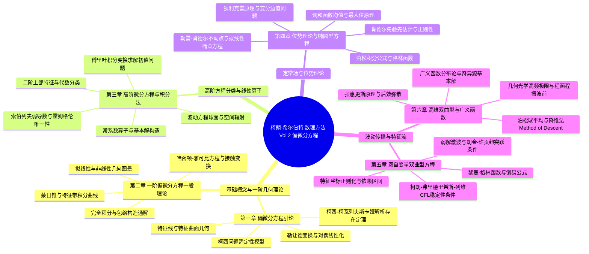
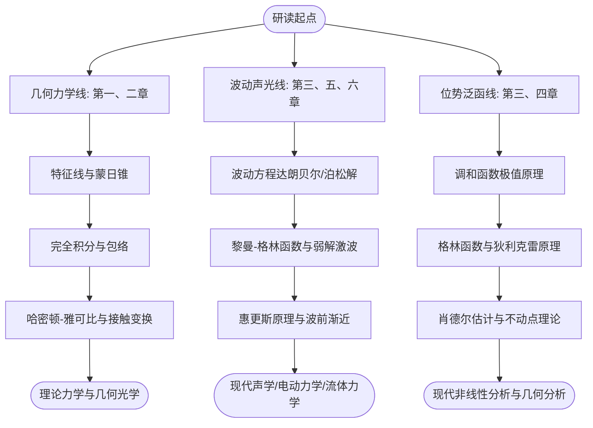

# 柯朗 & 希尔伯特《数学物理方法》（第二卷：偏微分方程）全书学习全景图 (Master MOC)

> [!abstract] 现代偏微分方程理论的最高丰碑
> 本知识库严格对照 **R. 柯朗（Richard Courant）与 D. 希尔伯特（David Hilbert）** 经典奠基巨著《数学物理方法》（*Methods of Mathematical Physics*, Volume II: Partial Differential Equations）原著全书 6 章 75 节（共 830 页）构建完成：
> - **全书规模**：共 **105 项核心知识文档**（75 篇逐节深度解构笔记 + 30 张标志性概念/定理/技术核心卡）；
> - **思想脉络**：从一阶非线性偏微分方程的特征线带几何理论，贯通至高维双曲型波动理论、几何光学渐近性、位势论与非线性椭圆边值分析，最终引入广义函数分布论（Ideal Functions / Distributions），铸就现代物理学与连续介质动力学的分析基石；
> - **排版规范**：全书公式严格遵循标准学术 LaTeX / Obsidian 原生规范，概念动机、几何图景、证明全景与失分陷阱完全闭环。

---

## 🏛️ 全书核心知识架构拓扑

---

## 🧭 全书知识卡片与章节精读全景导航

### 📂 第一章 偏微分方程引论与柯西问题提法 (Introductory Remarks)

#### 💎 核心概念与技术沉淀卡
| 卡片类型 | 核心卡片名称 | 关联章节 |
| :--- | :--- | :--- |
| 定理卡 | [[卡片/定理_柯西-柯瓦列夫斯卡娅存在性定理|§1.7 柯西-柯瓦列夫斯卡娅存在性定理（Cauchy-Kowalewsky Existence Theorem）]] | `s01_07` |
| 概念卡 | [[卡片/概念_偏微分方程特征线、特征曲面与柯西问题提法|切平面接触素、蒙日锥雏形与包络面]] | `s01_04` |
| 技术卡 | [[卡片/技术_勒让德对偶变换与偏微分方程线性化|勒让德对偶变换与切触变换线性化方法]] | `s01_06` |

#### 📖 原书章节深度解构笔记
| 节号 | 章节主题精读 | 状态 |
| :--- | :--- | :---: |
| `s01_01` | [[逐节/第一章_§1.1_解的多样性通论|§1.1 解的多样性通论（General Information about the Variety of Solutions）]] | ✅ 已解构 |
| `s01_02` | [[逐节/第一章_§1.2_微分方程组|§1.2 微分方程组 (Systems of Differential Equations) 精读解构笔记]] | ✅ 已解构 |
| `s01_03` | [[逐节/第一章_§1.3_特殊微分方程的积分法|§1.3 特殊微分方程的积分法（Integration Methods for Special Differential Equations）]] | ✅ 已解构 |
| `s01_04` | [[逐节/第一章_§1.4_一阶偏微分方程的几何解释|§1.4 一阶偏微分方程的几何解释（本单元：切平面接触素、蒙日锥雏形与包络面）]] | ✅ 已解构 |
| `s01_05` | [[逐节/第一章_§1.5_完全积分|§1.5 完全积分 (The Complete Integral) 精读解构笔记：双参数解族、包络生成奇异解与一般解]] | ✅ 已解构 |
| `s01_06` | [[逐节/第一章_§1.6_勒让德变换|§1.6 勒让德变换 (The Legendre Transformation) 精读解构笔记]] | ✅ 已解构 |
| `s01_07` | [[逐节/第一章_§1.7_柯西-柯瓦列夫斯卡娅存在性定理|§1.7 柯西-柯瓦列夫斯卡娅存在性定理（The Existence Theorem of Cauchy and Kowalewsky）精读解构笔记]] | ✅ 已解构 |
| `s01_08` | [[逐节/第一章_§1.8_附录1：极小曲面支撑函数的拉普拉斯方程|§1.8 附录1：极小曲面支撑函数的拉普拉斯方程（单元：极小曲面支撑函数所满足的二阶偏微分方程）]] | ✅ 已解构 |
| `s01_09` | [[逐节/第一章_§1.9_附录2：一阶微分方程组与高阶微分方程的等价性|§1.9 附录2：一阶微分方程组与高阶微分方程的等价性（本篇：一阶组化单高阶方程的相容性条件与退化分析）]] | ✅ 已解构 |

### 📂 第二章 一阶偏微分方程一般理论 (General Theory of Partial Differential Equations of First Order)

#### 💎 核心概念与技术沉淀卡
| 卡片类型 | 核心卡片名称 | 关联章节 |
| :--- | :--- | :--- |
| 概念卡 | [[卡片/概念_蒙日锥与一阶非线性偏微分方程特征带|特征带、蒙日锥、切触素与非线性柯西问题积分法]] | `s02_03` |
| 技术卡 | [[卡片/技术_完全积分与哈密顿-雅可比方程求解范式|完全积分与哈密顿-雅可比方程求解范式]] | `s02_08` |
| 概念卡 | [[卡片/概念_变分法极值场与光学程函方程|变分法极值场、希尔伯特不变量与光学程函方程]] | `s02_09` |

#### 📖 原书章节深度解构笔记
| 节号 | 章节主题精读 | 状态 |
| :--- | :--- | :---: |
| `s02_01` | [[逐节/第二章_§2.1_双自变量拟线性方程的几何理论|§2.1 双自变量拟线性方程的几何理论（单元：特征方向、特征线、积分曲面构造与初值问题解法）]] | ✅ 已解构 |
| `s02_02` | [[逐节/第二章_§2.2_n维自变量拟线性方程|§2.2 n维自变量拟线性方程（Quasi-Linear Differential Equations in n Variables）精读解构]] | ✅ 已解构 |
| `s02_03` | [[逐节/第二章_§2.3_双自变量一般非线性方程|§2.3 双自变量一般非线性方程（General Differential Equations in Two Independent Variables）]] | ✅ 已解构 |
| `s02_04` | [[逐节/第二章_§2.4_完全积分理论|§2.4 完全积分理论（The Complete Integral）]] | ✅ 已解构 |
| `s02_05` | [[逐节/第二章_§2.5_焦线与蒙日方程|§2.5 焦曲线与蒙日方程（Focal Curves and the Monge Equation）]] | ✅ 已解构 |
| `s02_06` | [[逐节/第二章_§2.6_经典几何与物理应用算例|§2.6 经典几何与物理应用算例 (Examples)]] | ✅ 已解构 |
| `s02_07` | [[逐节/第二章_§2.7_n维自变量一般非线性方程|§2.7 n维自变量一般非线性方程 (General Differential Equation in n Variables) 精读解构笔记]] | ✅ 已解构 |
| `s02_08` | [[逐节/第二章_§2.8_完全积分与哈密顿-雅可比理论|§2.8 完全积分与哈密顿-雅可比理论（本篇单元：特征方程正则形式、母函数与经典力学哈密顿系统）]] | ✅ 已解构 |
| `s02_09` | [[逐节/第二章_§2.9_哈密顿-雅可比理论与变分法|§2.9 哈密顿-雅可比理论与变分法 (Hamilton-Jacobi Theory and Calculus of Variations)]] | ✅ 已解构 |
| `s02_10` | [[逐节/第二章_§2.10_正则变换与应用|§2.10 正则变换与应用]] | ✅ 已解构 |

### 📂 第三章 高阶偏微分方程与波动方程傅里叶分析 (Differential Equations of Higher Order)

#### 💎 核心概念与技术沉淀卡
| 卡片类型 | 核心卡片名称 | 关联章节 |
| :--- | :--- | :--- |
| 概念卡 | [[卡片/概念_二阶偏微分方程代数分类与正则型|二阶偏微分方程代数分类与特征正则型转化]] | `s03_01` |
| 定理卡 | [[卡片/定理_霍姆格伦唯一性定理|霍姆格伦唯一性定理（附录2）]] | `s03_08` |
| 概念卡 | [[卡片/概念_索伯列夫引理与弱导数基础|索伯列夫空间连续嵌入引理与弱导数概念]] | `s03_07` |
| 技术卡 | [[卡片/技术_傅里叶积分变换求解常系数微分方程初值问题|傅里叶积分变换求解常系数双曲与波动初值问题]] | `s03_05` |

#### 📖 原书章节深度解构笔记
| 节号 | 章节主题精读 | 状态 |
| :--- | :--- | :---: |
| `s03_01` | [[逐节/第三章_§3.1_二阶双自变量算子正则型|§3.1 二阶双自变量算子正则型（Normal Forms for Second Order Operators in Two Variables）精读解构笔记]] | ✅ 已解构 |
| `s03_02` | [[逐节/第三章_§3.2_一般分类与特征曲面|第三章 高阶偏微分方程 §3.2 一般分类与特征曲面]] | ✅ 已解构 |
| `s03_03` | [[逐节/第三章_§3.3_常系数线性微分方程|§3.3 常系数线性微分方程 (Linear Differential Equations with Constant Coefficients)]] | ✅ 已解构 |
| `s03_04` | [[逐节/第三章_§3.4_波动方程初值与辐射问题|§3.4 波动方程初值与辐射问题：一维达朗贝尔解、杜阿梅尔原理与辐射奇点]] | ✅ 已解构 |
| `s03_05` | [[逐节/第三章_§3.5_傅里叶积分法求解初值问题|§3.5 傅里叶积分法求解初值问题（Solution of Initial Value Problems by Fourier Integrals）]] | ✅ 已解构 |
| `s03_06` | [[逐节/第三章_§3.6_数理方程经典问题模型通论|§3.6 数理方程经典问题模型通论 (Typical Problems in Differential Equations of Physics)]] | ✅ 已解构 |
| `s03_07` | [[逐节/第三章_§3.7_附录1：索伯列夫引理与伴随算子|§3.7 附录1：索伯列夫引理与伴随算子 (Sobolev's Lemma and Adjoint Operators)]] | ✅ 已解构 |
| `s03_08` | [[逐节/第三章_§3.8_附录2：霍姆格伦唯一性定理|§3.8 附录2：霍姆格伦唯一性定理（The Uniqueness Theorem of Holmgren）]] | ✅ 已解构 |

### 📂 第四章 位势理论与椭圆型微分方程 (Potential Theory and Elliptic Differential Equations)

#### 💎 核心概念与技术沉淀卡
| 卡片类型 | 核心卡片名称 | 关联章节 |
| :--- | :--- | :--- |
| 概念卡 | [[卡片/概念_调和函数平均值定理与极值原理|调和函数球面/体平均值定理与强极值原理]] | `s04_03` |
| 技术卡 | [[卡片/技术_泊松积分公式与狄利克雷问题求解范式|球体内与半空间泊松积分显式解、哈纳克不等式与刘维尔定理]] | `s04_02` |
| 技术卡 | [[卡片/技术_佩隆次调和函数法与边值可解性|佩隆次调和函数上包络法与狄利克雷边值可解性]] | `s04_04` |
| 定理卡 | [[卡片/定理_霍普夫强极值原理与椭圆方程解的唯一性|霍普夫强极值原理、非线性椭圆算子唯一性与雷利希单值性定理（柯朗-希尔伯特 II, §4.6）]] | `s04_06` |
| 定理卡 | [[卡片/定理_肖德尔先验内先验与边界估计|霍尔德连续性下的肖德尔先验内先验与边界估计、障碍函数与解的存在性连续性]] | `s04_07` |
| 概念卡 | [[卡片/概念_拟解析函数理论与贝尔特拉米方程|伯斯拟解析函数理论、相似原理与贝尔特拉米拟共形映射]] | `s04_12` |
| 技术卡 | [[卡片/技术_勒雷-肖德尔不动点方法在非线性椭圆方程的应用|勒雷-肖德尔不动点方法在非线性椭圆方程的应用]] | `s04_09` |

#### 📖 原书章节深度解构笔记
| 节号 | 章节主题精读 | 状态 |
| :--- | :--- | :---: |
| `s04_01` | [[逐节/第四章_§4.1_位势理论基本概念与格林公式|§4.1 位势理论基本概念与格林公式（精读解构：拉普拉斯/泊松方程、体位势、单层/双层位势跳跃关系与格林第一/第二公式）]] | ✅ 已解构 |
| `s04_02` | [[逐节/第四章_§4.2_泊松积分与格林函数|§4.2 泊松积分与格林函数（Poisson's Integral and Applications）]] | ✅ 已解构 |
| `s04_03` | [[逐节/第四章_§4.3_调和函数平均值定理|§4.3 调和函数平均值定理 (The Mean Value Theorem and Applications) 精读解构笔记]] | ✅ 已解构 |
| `s04_04` | [[逐节/第四章_§4.4_狄利克雷边值问题求解法|§4.4 狄利克雷边值问题求解法（The Boundary Value Problem）]] | ✅ 已解构 |
| `s04_05` | [[逐节/第四章_§4.5_约化波动方程与散射理论|§4.5 约化波动方程与散射理论：亥姆霍兹方程、索末菲辐射条件与无穷远能量外行波唯一性]] | ✅ 已解构 |
| `s04_06` | [[逐节/第四章_§4.6_一般二阶椭圆型方程边值问题与极值原理|§4.6 一般二阶椭圆型方程边值问题与极值原理（精读解构）]] | ✅ 已解构 |
| `s04_07` | [[逐节/第四章_§4.7_肖德尔先验估计及其应用|§4.7 肖德尔先验估计及其应用（A Priori Estimates of Schauder）精读解构笔记]] | ✅ 已解构 |
| `s04_08` | [[逐节/第四章_§4.8_贝尔特拉米方程求解|§4.8 贝尔特拉米方程求解 (Solution of the Beltrami Equations) 精读解构笔记]] | ✅ 已解构 |
| `s04_09` | [[逐节/第四章_§4.9_拟线性椭圆型方程与勒雷-肖德尔方法|§4.9 拟线性椭圆型方程与勒雷-肖德尔方法（单元：紧算子不动点延拓定理在非线性椭圆边值问题中的应用）]] | ✅ 已解构 |
| `s04_10` | [[逐节/第四章_§4.10_积分方程法与基本解拟算子构造|§4.10 积分方程法与基本解拟算子构造（Parametrix and Fundamental Solutions）精读解构笔记]] | ✅ 已解构 |
| `s04_11` | [[逐节/第四章_§4.11_附录：非线性方程微扰论|§4.11 附录：非线性方程微扰论（Appendix: Nonlinear Equations）]] | ✅ 已解构 |
| `s04_12` | [[逐节/第四章_§4.12_补充：椭圆型方程的函数论方法与拟解析函数|§4.12 补充：椭圆型方程的函数论方法与拟解析函数]] | ✅ 已解构 |

### 📂 第五章 双自变量双曲型微分方程与特征线法 (Hyperbolic Differential Equations in Two Independent Variables)

#### 💎 核心概念与技术沉淀卡
| 卡片类型 | 核心卡片名称 | 关联章节 |
| :--- | :--- | :--- |
| 技术卡 | [[卡片/技术_双曲型方程特征坐标正规化与速端图变换|特征方向线性组合正规化与速端图反演变换线性化]] | `s05_02` |
| 概念卡 | [[卡片/概念_双曲型方程依赖区间、影响区间与确定区域|确定域、影响域与二次能量积分弗里德里希斯-莱维唯一性证明]] | `s05_04` |
| 技术卡 | [[卡片/技术_黎曼函数积分法求解二维双曲型方程|伴随微分算子格林积分与黎曼函数封闭解析表达式]] | `s05_05` |
| 技术卡 | [[卡片/技术_特征网格逐次逼近迭代求解拟线性双曲组|特征线积分等价转化与皮卡逐次逼近迭代收缩收敛]] | `s05_06` |
| 概念卡 | [[卡片/概念_守恒律弱解与兰金-许戈尼奥激波条件|积分弱解定义、间断传播与兰金-许戈尼奥激波跳跃条件]] | `s05_09` |
| 技术卡 | [[卡片/技术_赫维赛德算子微积分与拉普拉斯变换偏微分求解|算子符号代数、杜阿梅尔原理与拉普拉斯变换瞬态响应严格解]] | `s05_11` |

#### 📖 原书章节深度解构笔记
| 节号 | 章节主题精读 | 状态 |
| :--- | :--- | :---: |
| `s05_01` | [[逐节/第五章_§5.1_二阶双曲型方程特征理论|§5.1 二阶双曲型方程特征理论：波前、特征线作为强/弱间断传播线与特征坐标化简]] | ✅ 已解构 |
| `s05_02` | [[逐节/第五章_§5.2_一阶双曲型方程组特征正规型|§5.2 一阶双曲型方程组特征正规型]] | ✅ 已解构 |
| `s05_03` | [[逐节/第五章_§5.3_可压缩流体动力学应用|§5.3 可压缩流体动力学应用 (Applications to Dynamics of Compressible Fluids)]] | ✅ 已解构 |
| `s05_04` | [[逐节/第五章_§5.4_唯一性与依赖区域|§5.4 唯一性与依赖区域（Uniqueness and Domain of Dependence）]] | ✅ 已解构 |
| `s05_05` | [[逐节/第五章_§5.5_黎曼函数解法|§5.5 黎曼函数解法（Riemann's Representation of Solutions）]] | ✅ 已解构 |
| `s05_06` | [[逐节/第五章_§5.6_迭代法求解拟线性双曲型初值问题|§5.6 迭代法求解拟线性双曲型初值问题 (Iterative Solution of Hyperbolic Problems)]] | ✅ 已解构 |
| `s05_07` | [[逐节/第五章_§5.7_拟线性系统柯西问题|§5.7 拟线性系统柯西问题 (Cauchy's Problem for Quasi-Linear Systems) 精读解构笔记]] | ✅ 已解构 |
| `s05_08` | [[逐节/第五章_§5.8_单个高阶双曲型方程柯西问题|第五章 双自变量双曲型偏微分方程 §5.8 单个高阶双曲型方程柯西问题]] | ✅ 已解构 |
| `s05_09` | [[逐节/第五章_§5.9_解的间断与激波理论|§5.9 解的间断与激波理论 (Discontinuities of Solutions and Shocks)：弱解、守恒律与兰金-许戈尼奥跃度条件]] | ✅ 已解构 |
| `s05_10` | [[逐节/第五章_§5.10_附录1：特征坐标应用与蒙日-安培方程|§5.10 附录1：特征坐标应用与蒙日-安培方程（精读解构）]] | ✅ 已解构 |
| `s05_11` | [[逐节/第五章_§5.11_附录2：瞬态问题与赫维赛德算子微积分|§5.11 附录2：瞬态问题与赫维赛德算子微积分]] | ✅ 已解构 |

### 📂 第六章 高维双曲型微分方程与广义函数分布论 (Hyperbolic Differential Equations with More Than Two Variables and Ideal Functions)

#### 💎 核心概念与技术沉淀卡
| 卡片类型 | 核心卡片名称 | 关联章节 |
| :--- | :--- | :--- |
| 概念卡 | [[卡片/概念_高维双曲型方程射线锥、法锥与波前几何|特征曲面、双特征线（射线）、射线锥、法锥、射线锥面与黎曼度量联系]] | `s06_01` |
| 定理卡 | [[卡片/定理_弗里德里希斯正对称双曲组能量积分与唯一性|弗里德里希斯正对称微分算子、能量积分不等式与初值唯一性定理]] | `s06_09` |
| 技术卡 | [[卡片/技术_球面平均法与达布方程求解奇数维波动方程|球面平均法与达布方程：从球对称均值到基尔霍夫–泊松波公式]] | `s06_14` |
| 技术卡 | [[卡片/技术_阿达马降维法求解偶数维波动方程|阿达马降维法（Method of Descent）与二维波动解析解]] | `s06_13` |
| 概念卡 | [[卡片/概念_强惠更斯原理与波动传播的锐度（奇偶维弥散差异）|强惠更斯原理、清晰波前传播与偶数维空间波的后效弥散性]] | `s06_21` |
| 定理卡 | [[卡片/定理_阿斯盖尔松超双曲型方程超球面平均值定理|阿斯盖尔松超双曲型偏微分方程超球面平均值定理（§6.19）]] | `s06_19` |
| 概念卡 | [[卡片/概念_广义函数分布论（狄拉克函数、弱收敛与微分卷积）|理想函数与分布：弱极限、微商算子、δ函数与积分有限部分]] | `s06_23` |

#### 📖 原书章节深度解构笔记
| 节号 | 章节主题精读 | 状态 |
| :--- | :--- | :---: |
| `s06_01` | [[逐节/第六章_§6.1_二阶方程与特征几何|§6.1 二阶方程与特征几何 (Second Order Equations and Geometry of Characteristics) 精读解构笔记]] | ✅ 已解构 |
| `s06_02` | [[逐节/第六章_§6.2_二阶方程特征作用通论|§6.2 二阶方程特征作用通论（Role of Characteristics for Second Order Equations）精读解构笔记]] | ✅ 已解构 |
| `s06_03` | [[逐节/第六章_§6.3_高阶算子特征几何|§6.3 高阶算子特征几何（本篇：特征矩阵、零向量、正规超曲面、代数双曲性与空间型超曲面条件）]] | ✅ 已解构 |
| `s06_04` | [[逐节/第六章_§6.4_物理学双曲系统实例|§6.4 物理学双曲系统实例（流体动力学、晶体光学、磁流体力学）]] | ✅ 已解构 |
| `s06_05` | [[逐节/第六章_§6.5_间断传播与柯西问题|§6.5 间断传播与柯西问题 (Propagation of Discontinuities and Cauchy Problem)]] | ✅ 已解构 |
| `s06_06` | [[逐节/第六章_§6.6_振荡初值与几何光学渐近展开|§6.6 振荡初值与几何光学渐近展开（Oscillatory Initial Values and Geometrical Optics）]] | ✅ 已解构 |
| `s06_07` | [[逐节/第六章_§6.7_唯一性定理经典范式|§6.7 唯一性定理经典范式（本篇：波动方程、达布方程、真空 Maxwell 方程组初值唯一性）]] | ✅ 已解构 |
| `s06_08` | [[逐节/第六章_§6.8_高维双曲型问题依赖域|§6.8 高维双曲型问题依赖域 (Domains of Dependence for Hyperbolic Problems)]] | ✅ 已解构 |
| `s06_09` | [[逐节/第六章_§6.9_线性正对称双曲组能量积分|§6.9 线性正对称双曲组能量积分 (Energy Integrals for Linear Symmetric Hyperbolic Systems)]] | ✅ 已解构 |
| `s06_10` | [[逐节/第六章_§6.10_高阶方程能量估计|§6.10 高阶方程能量估计（Energy Estimates for Equations of Higher Order）精读解构笔记]] | ✅ 已解构 |
| `s06_11` | [[逐节/第六章_§6.11_柯西问题存在性定理通论|§6.11 柯西问题存在性定理通论（The Existence Theorem）]] | ✅ 已解构 |
| `s06_12` | [[逐节/第六章_§6.12_解的解析表示引论与平面波分解|§6.12 解的解析表示引论与平面波分解（本篇单元范围）]] | ✅ 已解构 |
| `s06_13` | [[逐节/第六章_§6.13_常系数二阶方程解法与降维法|§6.13 常系数二阶方程解法与降维法（本篇：三维波动柯西解、降维法与惠更斯原理）]] | ✅ 已解构 |
| `s06_14` | [[逐节/第六章_§6.14_球面平均法与达布方程|§6.14 球面平均法与达布方程 (Method of Spherical Means and Darboux Equation)]] | ✅ 已解构 |
| `s06_15` | [[逐节/第六章_§6.15_弹性波初值问题|§6.15 弹性波初值问题（Initial Value Problem for Elastic Waves）]] | ✅ 已解构 |
| `s06_16` | [[逐节/第六章_§6.16_平面平均值法求解常系数双曲方程|§6.16 平面平均值法求解常系数双曲方程 (Method of Plane Mean Values)]] | ✅ 已解构 |
| `s06_17` | [[逐节/第六章_§6.17_四阶方程与晶体光学方程求解|§6.17 四阶方程与晶体光学方程求解（Crystal Optics and Fourth Order Equations）精读解构笔记]] | ✅ 已解构 |
| `s06_18` | [[逐节/第六章_§6.18_基本解与辐射函数矩阵|§6.18 基本解与辐射函数矩阵 (Fundamental Solutions and Radiation Matrix) 精读解构笔记]] | ✅ 已解构 |
| `s06_19` | [[逐节/第六章_§6.19_超双曲型方程与阿斯盖尔松平均值定理|§6.19 超双曲型方程与阿斯盖尔松平均值定理]] | ✅ 已解构 |
| `s06_20` | [[逐节/第六章_§6.20_非空间型初始流形的初值问题|§6.20 非空间型初始流形的初值问题（Initial Value Problems for Non-Space-Like Manifolds）精读解构笔记]] | ✅ 已解构 |
| `s06_21` | [[逐节/第六章_§6.21_行波、信号传输与惠更斯原理深层剖析|§6.21 行波、信号传输与惠更斯原理深层剖析 (Progressing Waves and Huygens' Principle)]] | ✅ 已解构 |
| `s06_22` | [[逐节/第六章_§6.22_附录：广义函数与分布论基础概念|§6.22 附录：广义函数与分布论基础概念（本单元：光滑测试函数空间、紧支集、双线性形式与弱拓扑收敛性）]] | ✅ 已解构 |
| `s06_23` | [[逐节/第六章_§6.23_附录：广义函数严格定义与泛函表示|§6.23 附录：广义函数严格定义与泛函表示——本篇：弱极限序列、微商算子定义、狄拉克函数与积分有限部分]] | ✅ 已解构 |
| `s06_24` | [[逐节/第六章_§6.24_附录：广义函数微积分与卷积代数|§6.24 附录：广义函数微积分与卷积代数 (Appendix: Calculus with Ideal Functions and Convolution)]] | ✅ 已解构 |
| `s06_25` | [[逐节/第六章_§6.25_附录：函数空间拓扑与希尔伯特空间嵌入|§6.25 附录：函数空间拓扑与希尔伯特空间嵌入（本篇单元：傅里叶变换、周期分布、负范数空间与索伯列夫空间现代桥梁）]] | ✅ 已解构 |

---

## ⚖️ 偏微分方程三大基本类型的物理与几何图景对比

| 方程类型 | 物理原形 | 特征曲面代数性质 | 适定定解问题 | 扰动传播速度与影响域 |
| :--- | :--- | :--- | :--- | :--- |
| **椭圆型 (Elliptic)** | 静电场、重力势、稳态温度分布 ($\Delta u = 0$) | 无实特征方向 (虚特征)，特征二次型定号 | 狄利克雷/诺伊曼边值问题 (BVP) | 传播速度无穷大，整体处处影响 (刚性连续统) |
| **双曲型 (Hyperbolic)** | 机械波、声波、电磁波波动方程 ($u_{tt} - c^2 \Delta u = 0$) | 存在充足实特征面，特征二次型不定符号 | 柯西初值问题 (IVP) | 有限速度 $c$ 传播，由特征锥划定依赖域与影响域 |
| **抛物型 (Parabolic)** | 热传导方程、扩散方程 ($u_t - a^2 \Delta u = 0$) | 简化的实特征面 ($t = \text{const}$)，具有退化退变主部 | 柯西-初边值混合问题 (IBVP) | 沿时间单向不可逆流动，扰动瞬间扩散至全空间 |

---

## 🎓 推荐研读路线与知识树穿透

> [!tip] 研习建议
> 1. **初学者**建议先读 [[第一章_§1.1_解的多样性通论|第一章 §1.1]] 与 [[概念_偏微分方程特征线、特征曲面与柯西问题提法|特征线与柯西问题]]，建立对偏微分方程定解问题本质的直观感知；
> 2. **理论物理方向**聚焦第二章的经典力学正则变换与第六章的广义函数基本解分布论；
> 3. **计算数学与应用数学方向**重点攻克第五章特征线网格差分（CFL稳定性）与第四章狄利克雷先验估计。
